# Humanoid Soccer Robot — Master System Architecture

- Status: **Definitive index.** Consolidates eight accepted ADRs and ten research baselines.
- Last updated: 2026-09-01
- Scope: RoboCup Humanoid League KidSize autonomous soccer robot, full software stack
- Authority: This document **summarises and indexes**. Where it disagrees with an ADR, the ADR governs.

---

## Table of contents

1. [Executive summary](#1-executive-summary)
2. [System context](#2-system-context)
3. [Architectural invariants](#3-architectural-invariants)
4. [Master diagrams](#4-master-diagrams)
5. [Topic-by-topic architectural summary](#5-topic-by-topic-architectural-summary)
6. [Bill of materials](#6-bill-of-materials)
7. [Qualification and release strategy](#7-qualification-and-release-strategy)
8. [What is deliberately not decided](#8-what-is-deliberately-not-decided)
9. [Document index](#9-document-index)

---

## 1. Executive summary

This is the accepted software architecture for an autonomous humanoid soccer robot competing in the
RoboCup Humanoid League KidSize division: 4 v 4 on a 9 x 6 m field, two halves of 10 minutes, all
computation edge-native, no external compute and no internet.

Eight architecture decision records fix the load-bearing structure, carrying 76 numbered decisions. Ten
research baselines carry the evidence behind them. Three domains — locomotion, estimation, and
perception — have complete research but no accepted decision, because they depend on a robot model that
does not yet exist.

### The five structural commitments

**1. A genuine 200 Hz control loop, scheduled by hardware, that cannot be contaminated.**
The 5 ms cycle performs `read -> update -> validate one tuple snapshot -> write` and nothing else. No
ROS communication, no allocation, no logging, no filesystem access, no unbounded wait. The cycle is
physically scheduled by an STM32, not by the Jetson, which is why an unqualified vendor real-time kernel
is tolerable at all.

**2. One replaceable transport seam, and everything attaches to it.**
`HumanoidActuatorSystem` is the only production `hardware_interface::SystemInterface`. Below it,
`ActuatorTransport` is a capability-based interface that knows nothing of USB, SPI, CAN, or EtherCAT.
Production hardware, the MuJoCo simulator, deterministic replay, and fault injection are all
`ActuatorTransport` implementations. Replacing the dual-STM32 topology with CAN FD or EtherCAT is a
configuration change. The published `ros2_control` simulation plugins are **prohibited** in any
environment producing release evidence, because they replace the `SystemInterface` and would delete the
safety-critical code from the tested configuration.

**3. Safety is layered, physical-first, and monotonic toward lower energy.**
Five independent authorities — whole-body controller, `SafetyKernel`, embedded safety agent, drive
protection, and a latching de-energize-to-stop power chain — where no upper layer can weaken a lower
one. The MIT command tuple is projected as **one coupled object**, because a legal stiffness and a legal
position command can jointly produce an illegal torque. No fault path returns to motion automatically.

**4. Ambiguity is a type, not an error to be resolved.**
A soccer field is symmetric and magnetometers are prohibited by rule, so the field pose posterior is
provably bimodal. The architecture publishes a **two-mode set with weights** and never collapses it,
except at exactly one point — the GameController return encoder — from which the collapsed value never
re-enters any decision. Actions whose correctness depends on knowing the field direction are gated as a
group, structurally, above a weight threshold strictly greater than 0.5.

**5. Identity is the enforcement mechanism, everywhere.**
Configuration, calibration, protocol, safety manifest, container digest, host L4T version, and TensorRT
engine digest must all match before actuator power can be armed. The same idea runs through delivery:
container images by digest, external sources by commit hash, GitHub Actions by commit SHA, build tools by
explicit version. A release is a signed manifest, and rollback moves every named identity together or not
at all.

### What the rules, not engineering, decided

Three findings from the _Laws of the Game 2025_ overrode what would otherwise have been ordinary
engineering choices:

| Rule         | Verbatim                                                                                                     | Architectural consequence                                                                                                                                      |
| ------------ | ------------------------------------------------------------------------------------------------------------ | -------------------------------------------------------------------------------------------------------------------------------------------------------------- |
| Bandwidth    | "The total bandwidth of each robot belonging to one team may not exceed 1 Mbit/s."                           | 125 kB/s total. The control log is ~170 kB/s, i.e. 1.36x the entire allowance. Streaming telemetry is prohibited, not merely costly.                           |
| Transmission | "Any kind of transmission from an external computer to the playing robots is prohibited."                    | A Zenoh session is bidirectional by construction, so the operator link is **disabled during play**. Monitoring is one-way UDP, received on a tethered station. |
| Service      | "The regular penalty time ... will be reset whenever the robot handler attempts to service the robot again." | Touching the robot restarts the penalty clock. The robot must be **diagnosable without being touched**.                                                        |

---

## 2. System context

### Physical and competition envelope

| Property            | Value                                                  | Source                |
| ------------------- | ------------------------------------------------------ | --------------------- |
| Division            | KidSize, 4 v 4                                         | Laws of the Game 2025 |
| Field               | 9 x 6 m, 1.2 m goals, FIFA size 1 ball                 | Laws of the Game 2025 |
| Maximum sight line  | 10.8 m (field diagonal)                                | Derived               |
| Match               | 2 x 10 min, half-time <= 5 min, <= 2 substitutes       | Laws of the Game 2025 |
| Per-robot bandwidth | <= 1 Mbit/s total                                      | Laws of the Game 2025 |
| Magnetometer        | Prohibited                                             | Laws of the Game 2025 |
| Compute             | NVIDIA Jetson Orin, **module not selected**            | Project               |
| Actuators           | RobStride RS00/RS02/RS03/RS05/RS06, MIT impedance mode | Project               |
| Working joint count | 14 assumed, scaling to 20+ DOF                         | Project               |
| Camera              | Stereolabs ZED, passive stereo, **model not selected** | Topic 5               |

### Current physical actuation path

```text
Jetson
  -> USB CDC, COBS framing, CRC16
  -> master STM32F446RE
  -> 200 Hz SPI with DMA
  -> slave STM32F446RE
  -> 1 Mbps classic CAN, 29-bit extended IDs
  -> RobStride drives
```

This is the production implementation of `ActuatorTransport`, **not a contract imposed on its
successor**. See [HW-13](architecture/HARDWARE_REQUIREMENTS.md) for why 20 DOF cannot run on one classic
CAN bus.

### The MIT command contract

Every controlled joint exports exactly five scalar command interfaces, owned atomically as a set:

| Interface   | Unit      | MIT meaning |
| ----------- | --------- | ----------- |
| `position`  | rad       | $q_d$       |
| `velocity`  | rad/s     | $\dot q_d$  |
| `effort`    | N·m       | $\tau_{ff}$ |
| `stiffness` | N·m/rad   | $K_p$       |
| `damping`   | N·m·s/rad | $K_d$       |

$$\tau = K_p(q_d - q) + K_d(\dot q_d - \dot q) + \tau_{ff}$$

Partial claims, mixed ownership, and partial release are rejected at
`prepare_command_mode_switch()`. One immutable all-joint snapshot crosses the hardware boundary per
cycle, so no transport can observe a partially updated tuple.

---

## 3. Architectural invariants

Thirty invariants, grouped by the concern they protect. The canonical numbered list is in
[ARCHITECTURE.md](architecture/ARCHITECTURE.md#architectural-invariants).

### Real-time and actuation (1-3, 9)

- **1.** The physical actuator path may be replaced without changing controllers, planners, or safety policy above `ActuatorTransport`.
- **2.** The production control and physical exchange rate is a **genuine** 200 Hz. A higher nominal software rate cannot substitute for fresh hardware samples.
- **3.** One controller owns all five MIT fields for every controlled joint, and one immutable all-joint snapshot crosses the hardware boundary per cycle.
- **9.** The successor physical actuator bus and topology are deliberately unspecified.

### Safety (4-6, 8)

- **4.** Physical containment begins in the host safety kernel, embedded safety agent, drive, or independent power chain **before** ROS lifecycle error handling.
- **5.** A failed joint may be isolated first, but remaining actuators continue only with an explicitly acknowledged availability mask and a prequalified degraded policy.
- **6.** Command loss causes a qualified local damping action followed by disable. Recovery never restarts motion automatically.
- **8.** Configuration, calibration, protocol, and safety identities must match before actuator power can be armed.

### Middleware and networking (7, 12, 13)

- **7.** Zenoh is the ROS 2 middleware and is excluded from the hard real-time, embedded, and emergency-stop paths.
- **12.** Team communication is an enhancement and never a dependency. Every robot plays with an empty teammate set.
- **13.** Competition network traffic is untrusted. Every reachable consequence of an injected or corrupted packet degrades toward **less** motion, never toward more actuator authority.

### Ambiguity and world model (10, 11)

- **10.** The field pose estimate is a two-mode set with weights. It is collapsed at exactly one place, the GameController return encoder, and the collapsed value never re-enters any decision.
- **11.** An action whose correctness depends on knowing the field direction cannot execute while that direction is ambiguous. This is enforced **structurally**, not per node.

### Runtime (14-16)

- **14.** All software runs in containers built on Ubuntu 24.04. No ROS installation exists on the host, because no Jazzy arm64 binaries exist for the JetPack 6 host operating system.
- **15.** Real-time privileges and limits are asserted at startup and read back. A failed assertion is a startup failure, never a silent downgrade.
- **16.** Every image and base image is referenced by digest, and the running digest participates in the startup identity interlock.

### Validation (17-19, 30)

- **17.** Simulators integrate at `ActuatorTransport` and never replace `hardware_interface::SystemInterface`. A test environment that substitutes the production system component is not evidence about the production system.
- **18.** Fault injection is a transport plugin selected by configuration. Every component above the transport boundary is digest-identical between a fault campaign and the release it qualifies.
- **19.** Software-in-the-loop establishes logical correctness only. No timing property may be claimed from it.
- **30.** No timing figure may originate in continuous integration or in simulation. Every quoted timing names the real hardware it was measured on.

### Observability and operations (20-25)

- **20.** The control loop is recorded at full rate in-cycle, independently of `rosbag2`, because the same rule that keeps the loop real-time safe keeps it off the ROS graph.
- **21.** Telemetry planes are correlated by control-cycle sequence number, **never** by timestamp. Wall-clock correlation fails silently when the system clock steps.
- **22.** Neither recorded telemetry plane touches the network. A one-way UDP health beacon is the only external channel while the robot is playing.
- **23.** The robot must be diagnosable without being touched.
- **24.** A robot that cannot record does not silently play. Log-storage writability and free space are startup interlock conditions.
- **25.** Profiling privileges are never granted to a deployed configuration.

### Delivery (26-29)

- **26.** Every external input is pinned by content identity: images by digest, sources by commit hash, actions by full-length commit SHA, build tools by explicit version.
- **27.** The protocol definition, safety manifest, and robot model are generated artifacts. CI regenerates and diffs them, so hand-edited generated output is impossible rather than discouraged.
- **28.** **A gate that cannot run is worse than no gate.** Merge gates are restricted to checks needing no hardware; hardware-in-the-loop is enforced by signed evidence naming the exact release digest.
- **29.** A release is a manifest, not an artifact. Rollback moves every named identity together or not at all.

---

## 4. Master diagrams

### 4.1 System context

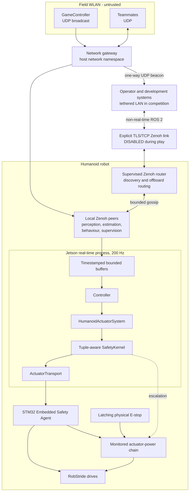

### 4.2 Real-time control boundary

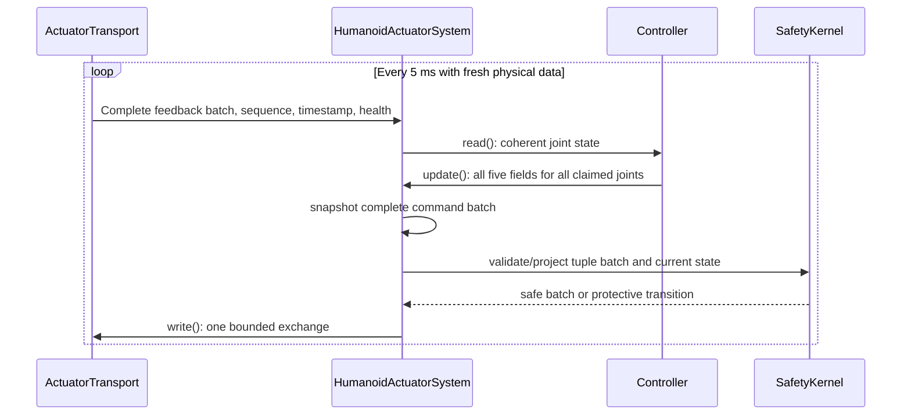

Prohibited inside this loop: ROS communication, service or action calls, logging, filesystem access,
parameter lookup, heap allocation, page faults, lock contention, and unbounded waits.

### 4.3 Safety state machine

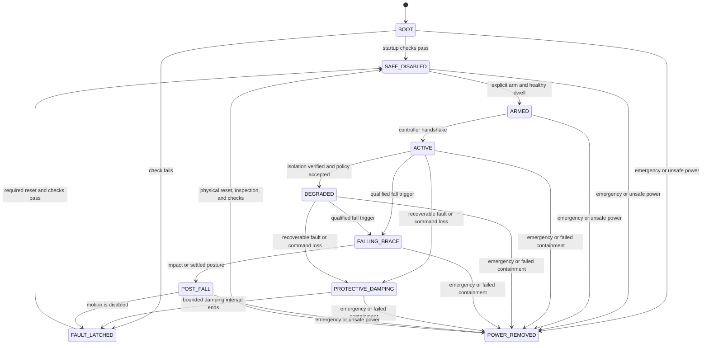

Every transition moves toward lower energy unless an explicit rearm sequence succeeds. Reconnection,
process restart, watchdog reset, fault-bit clearance, and E-stop release **cannot** return the robot to
`ARMED`, `ACTIVE`, or `DEGRADED`.

### 4.4 Safety authority stack

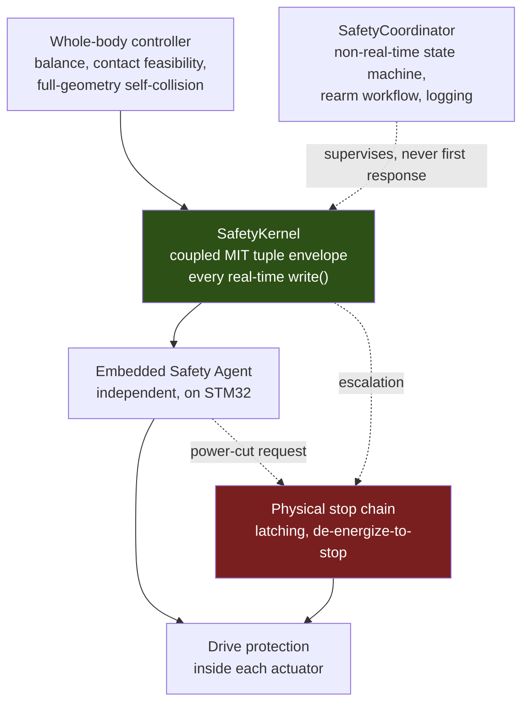

**No upper layer may weaken a lower-layer limit.** The stop chain is independent of the Jetson, ROS 2,
Zenoh, USB, and STM32 application scheduling.

### 4.5 Perception, estimation, and world model

Research complete; **no ADR accepted** because Topic 3 Model Gate 0 is open. The structure below is
constrained by ADR-001, ADR-002, and the approved Topic 6 decisions D1-D8.

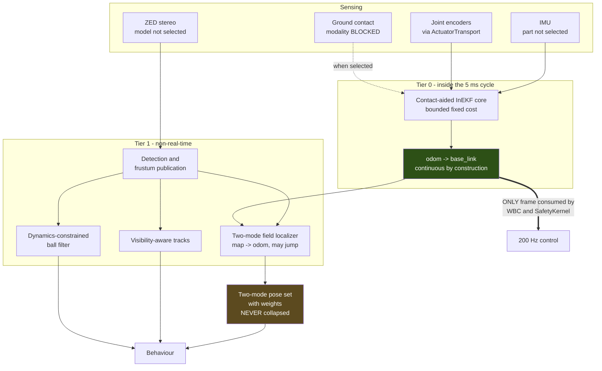

Four structural rules from Topic 6:

- **D1** — The whole-body controller and `SafetyKernel` consume **only** `odom`. A symmetry mode flip or a delayed visual correction can never inject a pose discontinuity into the 5 ms cycle.
- **D3** — The pose product is a two-mode set with weights, published permanently. The posterior is provably bimodal and the rules give no visual means to recover a wrongly collapsed heading.
- **D4** — Track confidence decays **only** when a target was inside the camera frustum and undetected. Never on elapsed time alone, because with one steerable camera "unobserved" is the normal state.
- **D5** — Ball velocity comes from a dynamics-constrained filter with a deceleration model measured on the competition surface. Finite differencing of ball position is prohibited anywhere in the stack; two-frame velocity error exceeds the signal beyond about 2 m.

### 4.6 Behaviour, game state, and the symmetry gate

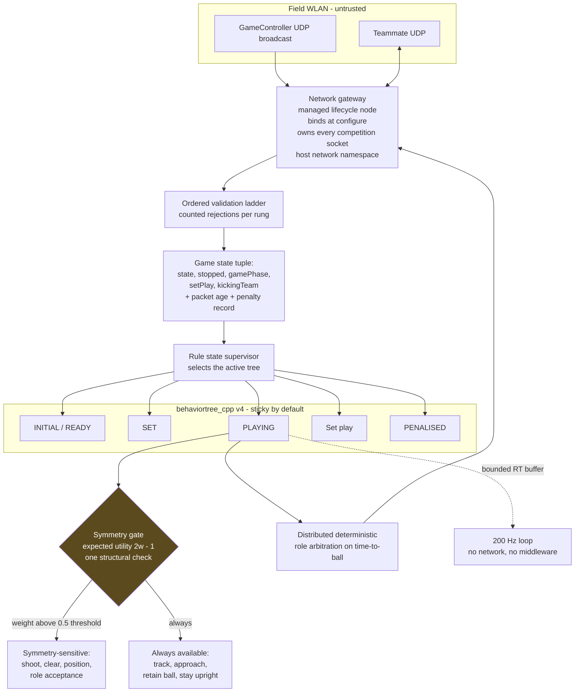

With $w$ the weight on the mode facing the opponent goal, a directional action has expected utility
$2w - 1$, which is zero at $w = 0.5$ and negative below it. Symmetry-sensitive actions are therefore
gated **as a group**, once, above a threshold strictly greater than 0.5. Every action node declares its
symmetry sensitivity; the gate is structural, not per node.

Roles are assigned by distributed deterministic arbitration ordered on time-to-ball, tie-broken by
player number, collapsing to a valid solo role when no teammate is heard. There is no central captain.

### 4.7 Deployment

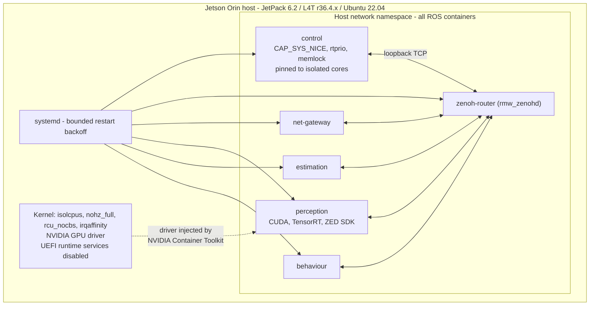

Containers are **mandatory, not convenient**: REP-2000 has a blank cell at arm64 x Ubuntu Jammy for
Jazzy, and JetPack 6 is a Jammy platform. There is no supported route to Jazzy on arm64 except a Noble
container. All ROS containers share the host network namespace, resolving the conflict between ADR-003's
loopback TCP requirement and ADR-005-12's broadcast requirement.

### 4.8 Validation environments

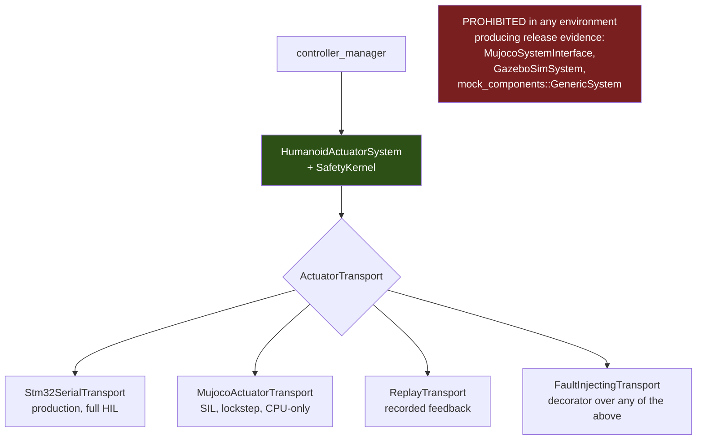

### 4.9 Telemetry planes

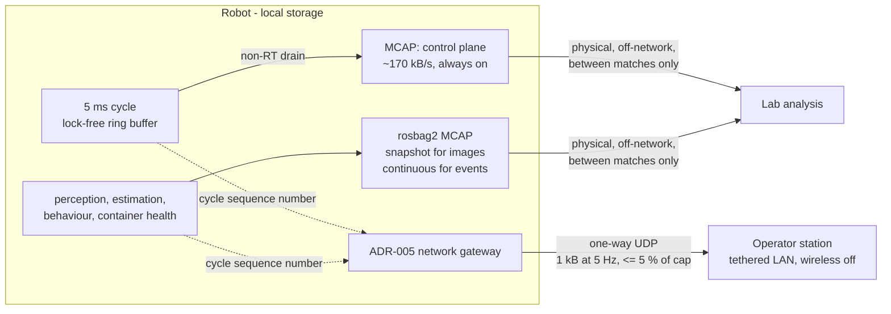

Extraction arithmetic that forced this shape:

$$
\frac{170\ \mathrm{kB/s}}{125\ \mathrm{kB/s}} \approx 1.36 \qquad
\frac{204 \times 10^{6}\ \mathrm{B} \times 8}{1 \times 10^{6}\ \mathrm{bit/s}} \approx 1632\ \mathrm{s} \approx 27\ \mathrm{min}
$$

against a half-time interval that "must not exceed 5 minutes".

### 4.10 CI/CD pipeline

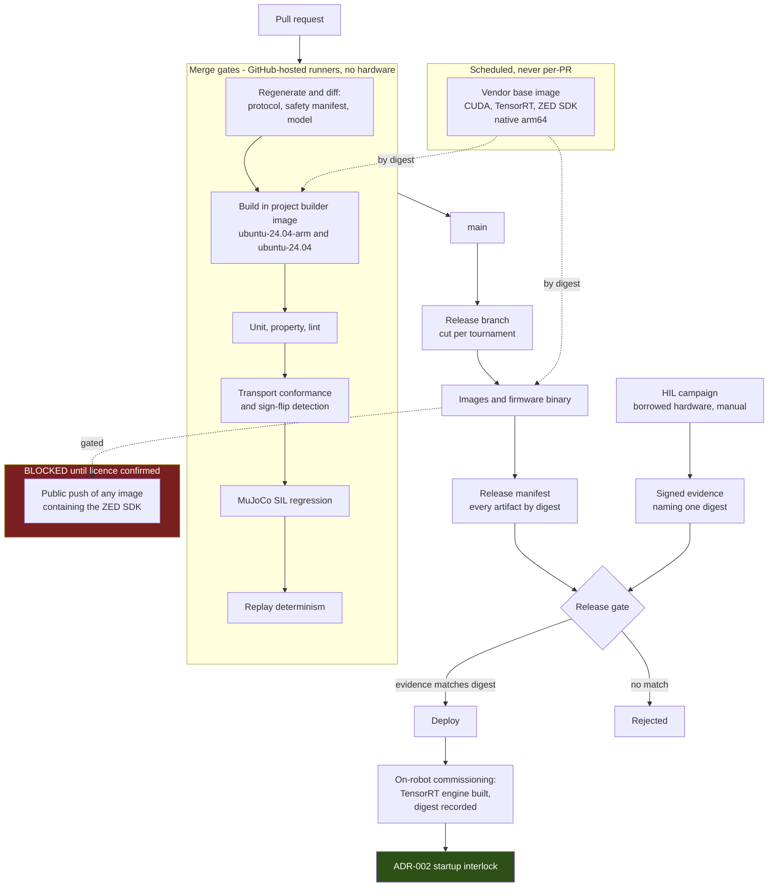

---

## 5. Topic-by-topic architectural summary

| #   | Topic                                        | Outcome                                        | ADR                                                                             | Research                                                       |
| --- | -------------------------------------------- | ---------------------------------------------- | ------------------------------------------------------------------------------- | -------------------------------------------------------------- |
| 1   | Real-time actuation and hardware abstraction | **Decided**                                    | [ADR-001](architecture/ADR-001-real-time-actuation-and-hardware-abstraction.md) | —                                                              |
| 2   | Safety and fault management                  | **Decided**                                    | [ADR-002](architecture/ADR-002-safety-and-fault-management.md)                  | —                                                              |
| 3   | Robot model, kinematics, locomotion          | **Research only.** ADR-004 reserved, unwritten | —                                                                               | [topic-3](research/topic-3-locomotion-survey.md)               |
| —   | Middleware                                   | **Decided** (cross-cutting)                    | [ADR-003](architecture/ADR-003-zenoh-middleware.md)                             | —                                                              |
| 4   | Sensors, timing, state estimation            | **Research only**                              | —                                                                               | [topic-4](research/topic-4-sensors-timing-state-estimation.md) |
| 5   | Perception pipeline                          | **Research only**                              | —                                                                               | [topic-5](research/topic-5-perception-pipeline.md)             |
| 6   | Localization, world model, gaze              | **Research + approved decisions D1-D8**        | —                                                                               | [topic-6](research/topic-6-localization-world-model.md)        |
| 7   | Behaviour and strategy                       | **Decided**                                    | [ADR-005](architecture/ADR-005-behavior-game-state-and-team-networking.md)      | [topic-7](research/topic-7-behavior-and-strategy.md)           |
| 8   | GameController and team networking           | **Decided** (jointly with 7)                   | [ADR-005](architecture/ADR-005-behavior-game-state-and-team-networking.md)      | [topic-8](research/topic-8-gamecontroller-networking.md)       |
| 9   | Runtime, containers, compute                 | **Decided**                                    | [ADR-006](architecture/ADR-006-runtime-and-containers.md)                       | [topic-9](research/topic-9-runtime-and-containers.md)          |
| 10  | Simulation, SIL, HIL, replay                 | **Decided**                                    | [ADR-007](architecture/ADR-007-simulation-sil-hil.md)                           | [topic-10](research/topic-10-simulation-sil-hil.md)            |
| 11  | Observability and competition operations     | **Decided**                                    | [ADR-008](architecture/ADR-008-observability-and-operations.md)                 | [topic-11](research/topic-11-observability-and-operations.md)  |
| 12  | Development workflow, CI/CD, release         | **Decided**                                    | [ADR-009](architecture/ADR-009-development-workflow-and-cicd.md)                | [topic-12](research/topic-12-development-workflow-and-cicd.md) |

### Topic 1 — Real-time actuation and hardware abstraction (ADR-001)

`HumanoidActuatorSystem` is the only production `SystemInterface`; it owns joint identity, state export,
command snapshots, validation, fault propagation, and transport lifecycle, and delegates physical I/O to
a capability-based `ActuatorTransport` that must not expose USB, SPI, CAN, EtherCAT, packet-layout, or
bus-topology concepts. The five-interface MIT tuple is owned atomically. The cycle is a genuine 200 Hz.
The successor bus is deliberately undecided.

### Topic 2 — Safety and fault management (ADR-002)

Five independent authorities with strictly non-weakening layering. The `SafetyKernel` projects the
complete tuple into a state-dependent feasible set enforcing a **coupled** torque and power envelope,
because independently clamping position, gain, and feed-forward does not prove the resulting torque is
safe. Joint isolation is attempted first, but unverified isolation escalates to shared actuator-power
removal — a direct consequence of the missing per-joint power switching tracked as
[HW-05](architecture/HARDWARE_REQUIREMENTS.md). Falls transition through an explicit brace state and a
post-fall disabled state; self-righting is a separate authorised action.

### Topic 3 — Robot model, kinematics, locomotion (research only)

**Model Gate 0 is open.** No kinematic tree, masses, inertias, sole geometry, or physical envelope
exists. The survey establishes that a classical model-based path (gait generator plus IK or QP whole-body
control) is the mandatory commissioning route, with closed-loop analytical or LIPM/DCM walking as the
provisional primary candidate once its model gates pass. **No ADR may be written until Gate 0 closes**,
and the register keeps ADR-004 reserved for it.

### Middleware — Zenoh (ADR-003)

`rmw_zenoh_cpp` for all ROS traffic; excluded from the real-time, embedded, and emergency-stop paths.
Explicit topology: one supervised robot-local `rmw_zenohd`, loopback TCP onboard, mutually authenticated
TLS off-host, bounded gossip, no multicast. Shared memory disabled, so loaned messages are unavailable.
`SYSTEM_DEFAULT`, `UNKNOWN`, and `BEST_AVAILABLE` QoS are prohibited. Jazzy REP-2000 does not list Zenoh,
so this is a **project-qualified baseline, not a Tier 1 claim**.

### Topic 4 — Sensors, timing, state estimation (research only)

Split estimator: a bounded fixed-cost core inside the 5 ms cycle plus a non-real-time refinement stage.
Smoothers and optimisers are inadmissible inside the cycle. **Yaw is structurally unobservable here**, so
absolute heading is delegated to Topic 6; Topic 4 delivers drift-bounded local odometry plus an explicit
validity signal. IMU part, grade, and data path remain open.

### Topic 5 — Perception pipeline (research only)

Passive stereo is decided; the camera model is not. Depth error is heteroscedastic,
$\sigma_Z = \alpha Z^2$ with $\alpha \approx 0.00257\ \mathrm{m^{-1}}$, inflated on low-texture surfaces,
with a per-pixel validity mask. **AGPL and GPL are excluded from distributed application code**, because
copyleft cannot be distributed linked against the closed-source ZED SDK — which also excludes the
Ultralytics YOLO family. Three of five delegated research subagents fabricated licence and hardware
claims during this topic; every `[Primary]` claim was subsequently re-verified against the named URL.

### Topic 6 — Localization, world model, gaze (approved decisions D1-D8)

Frame split per REP-105 with Tier 0 owning `odom -> base_link` and Tier 1 owning `map -> odom`; the
whole-body controller and `SafetyKernel` consume only `odom`. Symmetry is a first-class type: a two-mode
set with weights, never collapsed. Visibility-aware tracking decays confidence only inside the frustum.
Dynamics-constrained ball filter with a measured turf deceleration model. Custom contact-aided InEKF core
plus a custom two-mode field localizer; `nav2_amcl` rejected because it pays for general multimodality
when the multimodality is exactly two-fold and known in advance.

### Topics 7 and 8 — Behaviour, game state, team networking (ADR-005)

Rule state is a **supervisor that selects the active behaviour tree**, not guard conditions inside one,
so rule compliance lives in one inspectable component. `behaviortree_cpp` v4, sticky by default. Symmetry
sensitivity is declared per action node and gated once, structurally. Distributed deterministic role
arbitration on time-to-ball, no central captain. Three separated network planes; one gateway process owns
every competition socket, binds at `configure`, drains keeping only the last valid packet, and runs in
the host network namespace because a bridge network silently fails to receive host-subnet broadcasts.
GameController state is held and aged, with staleness acted on only above 1.5 s.

### Topic 9 — Runtime, containers, compute (ADR-006)

Containers are mandatory because REP-2000 has **no arm64 Jammy entry at any tier** for Jazzy while
JetPack 6 is a Jammy platform. Baseline JetPack 6.2 (L4T r36.4.x) with Noble containers; JetPack 7 is the
destination once every closed dependency has a named supported version. Docker with the NVIDIA container
runtime. Containers split by failure domain and privilege. systemd supervises; `ros2 launch` composes and
never supervises. CPU isolation is mandatory and independent of kernel choice; the vendor RT kernel is
Developer-Preview with no published latency data and is adopted only on measured benefit. Minimum device
privilege via udev; `--privileged` prohibited. Digest pinning end-to-end. Native arm64 builds.

### Topic 10 — Simulation, SIL, HIL, replay (ADR-007)

The seam is `ActuatorTransport`; every published Jazzy `ros2_control` simulation plugin is prohibited in
release-evidence environments because it replaces the `SystemInterface`. MuJoCo is the primary SIL
environment and regression oracle (CPU-only, states its determinism properties); Isaac Lab is
learning-only; Gazebo is not adopted. Lockstep integer substeps inside `exchange()`.
`simulation_interfaces` for scenario control only. **SIL is never timing evidence.** Three HIL
configurations, with the Jetson-side emulator required to be separate physical hardware presenting a real
USB CDC endpoint. One machine-readable protocol definition drives four consumers. Fault injection is a
transport decorator; test flags in production components are prohibited. Emergency stop is
physical-test-only. Bit-exact replay is required only within one architecture and build, because MuJoCo
guarantees reproducibility only "within a single version, on the same architecture".

### Topic 11 — Observability and competition operations (ADR-008)

Three telemetry planes; the two recorded planes never touch the network. Correlation is by control-cycle
sequence number, never timestamp, because `RCL_ROS_TIME` without an active source is the settable system
clock and a 300 ms step is 60 control cycles. Fixed-layout binary records inside MCAP with release
identity in `Metadata` and active calibration as `Attachment`. `SafetyKernel` auditability via projection
bitmask and per-joint deltas. One-way UDP health beacon from the ADR-005 gateway, bounded to 5 % of the
cap and reporting the robot's own measured transmit volume. Operator link disabled during play. Log
storage in the startup interlock. Four calibration classes with four gates; only joint zeroing is
interlocked. Profiling is a named non-default runtime configuration granting `CAP_PERFMON` without
changing the image. `EMC %` never quoted without its frequency.

### Topic 12 — Development workflow, CI/CD, release (ADR-009)

One repository, because ADR-007-07's single protocol definition has four consumers across the
host/firmware boundary and git has no atomic multi-repository commit. One pinning rule across four supply
chains. CI runs the project's own builder image. Native arm64 on free `ubuntu-24.04-arm` runners;
cross-compilation rejected because `ros-tooling/cross_compile` is archived. Vendor layers are a scheduled
base image. Merge gates are restricted to hardware-free checks. Generated artifacts verified by
regenerate-and-diff. REP-2004 quality levels declared per package. **TensorRT engines are device-local
commissioning artifacts** joined to the startup interlock. **HIL is a release gate enforced by signed
evidence naming the exact digest.** A release is a manifest. **No image containing the ZED SDK may be
published until redistribution rights are confirmed in writing.**

---

## 6. Bill of materials

### 6.1 Platform and runtime

| Item                 | Pinned value                                     | Notes                                                                                                     |
| -------------------- | ------------------------------------------------ | --------------------------------------------------------------------------------------------------------- |
| ROS 2 distribution   | **Jazzy Jalisco**                                | arm64 Tier 1 on Ubuntu Noble only; **arm64 x Jammy is blank in REP-2000**                                 |
| Container OS         | **Ubuntu 24.04 Noble**                           | Mandatory consequence of the above                                                                        |
| Host platform        | **JetPack 6.2 / L4T r36.4.x**                    | Ubuntu 22.04 host, `kernel-jammy-src`, CUDA 12.6, base image `ubuntu:22.04`                               |
| Migration target     | JetPack 7.0+ / L4T r38.1.x                       | CUDA 13.0, base `ubuntu:24.04`. Blocked: ZED SDK, TensorRT, and Orin module support on r38 are all **NR** |
| Container runtime    | **Docker + NVIDIA Container Runtime**            | Podman revisited when CDI is the documented Jetson default                                                |
| Reference base image | `dustynv/ros:jazzy-ros-base-r36.4.4-cu128-24.04` | 5.1 GB as distributed, dated 2025-03-03. Demonstrates the configuration is published and real             |
| Middleware           | **`rmw_zenoh_cpp` 0.2.10-1**                     | SHM disabled, loaned messages unavailable                                                                 |
| Supervisor           | systemd on the host                              | Bounded restart backoff; one long-running process per container                                           |

### 6.2 Pinned ROS 2 Jazzy packages

**Adopted:**

| Package                   | Jazzy release        | Role                                                                                            |
| ------------------------- | -------------------- | ----------------------------------------------------------------------------------------------- |
| `rcl`                     | 9.2.11-1             | Core client library support                                                                     |
| `rclcpp`                  | 28.1.22-1            | C++ client library                                                                              |
| `ros2_control`            | 4.47.0-1             | `SystemInterface`, `controller_manager`                                                         |
| `ros2_controllers`        | 4.42.1-1             | Controller implementations                                                                      |
| `rmw_zenoh_cpp`           | 0.2.10-1             | Middleware (ADR-003)                                                                            |
| `rosbag2`                 | 0.26.11-1            | Non-real-time telemetry plane; default storage `mcap`                                           |
| `mujoco_ros2_control`     | 0.1.1-1              | **Reference only.** Its `SystemInterface` is prohibited; MuJoCo is used via `ActuatorTransport` |
| `mujoco_vendor`           | 0.1.0-1              | MuJoCo packaging                                                                                |
| `simulation_interfaces`   | 1.5.1-1              | Scenario control only                                                                           |
| `ros2_tracing`            | 8.2.6-1              | LTTng instrumentation, compiled in by default                                                   |
| `diagnostics`             | 4.2.7-1              | Non-real-time diagnostics                                                                       |
| `geometry2`               | 0.36.22-1            | TF2                                                                                             |
| `image_pipeline`          | 5.0.13-1             | Image processing                                                                                |
| `launch` / `launch_ros`   | 3.4.11-1 / 0.26.12-1 | Composition only, never supervision                                                             |
| `pluginlib`               | 5.4.6-1              | Transport plugin loading                                                                        |
| `ros2cli`                 | 0.32.12-1            | Tooling                                                                                         |
| `ros2_socketcan`          | 1.3.0-1              | Candidate for a successor direct-CAN transport                                                  |
| `performance_test`        | 2.3.0-1              | Middleware performance measurement                                                              |
| `libstatistics_collector` | 1.7.4-1              | Status `developed`                                                                              |
| `rcpputils`               | 2.11.4-1             | Utilities                                                                                       |
| `rosidl_core`             | 0.2.1-1              | Interface generation                                                                            |
| `ros_testing`             | 0.6.1-1              | Launch testing                                                                                  |

**Build toolchain** (pinned separately in the builder image, because `colcon`, `rosdep`, and `vcstool`
are **absent from the Jazzy distribution manifest**):

| Package                       | Jazzy release                                                          |
| ----------------------------- | ---------------------------------------------------------------------- |
| `ament_cmake`                 | 2.5.6-2                                                                |
| `ament_cmake_ros`             | 0.12.1-1                                                               |
| `ament_lint`                  | 0.17.5-1                                                               |
| `ament_package`               | 0.16.5-1                                                               |
| `osrf_pycommon`               | 2.1.7-1                                                                |
| `ros_environment`             | 4.2.1-1                                                                |
| `colcon`, `rosdep`, `vcstool` | **Not distro-pinned.** Explicit versions required in the builder image |

**Rejected or excluded:**

| Package                          | Jazzy release         | Reason                                                                     |
| -------------------------------- | --------------------- | -------------------------------------------------------------------------- |
| `gz_ros2_control`                | 1.2.20-1              | Replaces `SystemInterface`; Gazebo not adopted                             |
| `ros_gz`                         | 1.0.24-1              | Gazebo not adopted                                                         |
| `webots_ros2`                    | 2025.0.0-1            | Not adopted                                                                |
| `mock_components::GenericSystem` | in 4.47.0-1           | Replaces `SystemInterface`                                                 |
| `nav2_amcl`                      | —                     | Pays for general multimodality; the multimodality here is exactly two-fold |
| `system_metrics_collector`       | **absent from Jazzy** | No Jazzy release exists                                                    |
| `jetson_stats`                   | —                     | **AGPL-3.0.** Lab-only, never distributed                                  |
| Ultralytics YOLO family          | —                     | **AGPL-3.0.** Cannot link against the closed-source ZED SDK                |

### 6.3 Simulation and validation software

| Component | Licence      | Role                                                                                      |
| --------- | ------------ | ----------------------------------------------------------------------------------------- |
| MuJoCo    | Apache-2.0   | Primary SIL environment and regression oracle. CPU-only, so it runs in CI                 |
| Isaac Sim | Apache-2.0   | Learning support                                                                          |
| Isaac Lab | BSD-3-Clause | Learning only. Requires RTX 4080 / A40 / L40S-class discrete GPU; cannot run in CI        |
| MCAP      | —            | Log container for both recorded telemetry planes                                          |
| LTTng-UST | —            | `ros2_tracing` dependency; kernel tracing needs `lttng-modules-dkms` installed separately |

### 6.4 Continuous integration platform

| Item                | Value                                                                                 |
| ------------------- | ------------------------------------------------------------------------------------- |
| Hosting             | GitHub, **public repositories**                                                       |
| arm64 runner        | `ubuntu-24.04-arm` — 4 CPU, 16 GB RAM, 14 GB SSD                                      |
| amd64 runner        | `ubuntu-24.04` — 4 CPU, 16 GB RAM, 14 GB SSD                                          |
| Cost                | "free and unlimited on public repositories"                                           |
| Job execution limit | **6 hours**, hard                                                                     |
| Workflow run limit  | 35 days                                                                               |
| GPU                 | **None on any standard hosted runner**                                                |
| Cross-compilation   | `ros-tooling/cross_compile` **archived**, last push 2022-12-14                        |
| ROS CI actions      | `action-ros-ci@v0.4`, `setup-ros@v0.7` support Jazzy; **arm64 support is NR in both** |

### 6.5 Hardware bill of materials and open selections

| Item                  | Status                                                                                       |
| --------------------- | -------------------------------------------------------------------------------------------- |
| Jetson Orin module    | **Not selected.** Blocked on Model Gate 0 physical envelope and power budget                 |
| ZED camera model      | **Not selected.** ZED 2i has a rolling shutter, which is a concern for a walking robot       |
| IMU part              | **Not selected.** Leaning industrial MEMS SPI class                                          |
| Ground contact sensor | **Blocked.** Modality undecided                                                              |
| Actuators             | RobStride RS00/RS02/RS03/RS05/RS06. Working assumption 14 joints (4x RS03, 5x RS02, 5x RS00) |
| Microcontrollers      | 2x STM32F446RE (master and slave)                                                            |
| Log storage medium    | **Blocked.** Capacity and write endurance unspecified                                        |
| Firmware toolchain    | **Not selected**                                                                             |

### 6.6 Software-driven hardware requirements

Fifty-four numbered requirements are tracked in
[HARDWARE_REQUIREMENTS.md](architecture/HARDWARE_REQUIREMENTS.md). The highest-value entries:

| ID    | Requirement                                                                                                                      | Status                                        |
| ----- | -------------------------------------------------------------------------------------------------------------------------------- | --------------------------------------------- |
| HW-01 | Latching de-energize-to-stop actuator-power chain, independent of Jetson, ROS 2, Zenoh, USB, and STM32 scheduling                | Required                                      |
| HW-05 | **Independently monitored per-joint power switching.** Its absence is why unverified isolation must remove shared actuator power | **Open — highest-value open electrical item** |
| HW-13 | **Multi-bus CAN or CAN FD.** 20 joints give 104-124 % utilisation on one 1 Mbps classic bus                                      | **Advisory, with derivation**                 |
| HW-20 | ZED 2i rolling shutter is a concern for a walking robot                                                                          | Open                                          |
| HW-23 | Ground contact sensing modality                                                                                                  | Blocked                                       |
| HW-30 | Orin module selection                                                                                                            | Blocked                                       |
| HW-31 | Log storage medium, capacity, and write endurance                                                                                | Blocked                                       |
| HW-40 | Visual status indication legible from the touchline                                                                              | **Required**                                  |
| HW-41 | Audible indication on safety transitions                                                                                         | **Required**                                  |
| HW-50 | Separate physical STM32 emulator; software loopback explicitly rejected                                                          | Required                                      |

**HW-13 derivation.** With $N$ joints, $B$ bits per frame, one command and one feedback frame per joint
per 5 ms cycle:

$$U = \frac{N \times 2 \times B \times 200}{1 \times 10^{6}}$$

| Joints | $B = 130$ bits | $B = 155$ bits |
| ------ | -------------- | -------------- |
| 12     | 62 %           | 74 %           |
| 14     | 73 %           | 87 %           |
| **20** | **104 %**      | **124 %**      |

**20 DOF cannot run on one 1 Mbps classic CAN bus.** At a 50 % utilisation target one bus carries roughly
8 joints, so 20 DOF needs at least three segments, segmented by kinematic chain to contain faults. CAN FD
removes both the bandwidth constraint and the 8-byte payload limit. The exact RobStride frame count and
payload per joint per cycle is **unconfirmed**; if a MIT command needs more than one frame, every number
doubles.

---

## 7. Qualification and release strategy

### 7.1 The evidence ladder

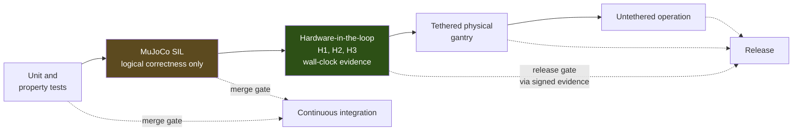

**What each environment can prove:**

| Environment                                | Proves                                                                                                                | Does **not** prove                                |
| ------------------------------------------ | --------------------------------------------------------------------------------------------------------------------- | ------------------------------------------------- |
| Unit and property tests                    | Interface ownership, tuple atomicity, envelope arithmetic                                                             | Anything about integration                        |
| MuJoCo SIL                                 | Logical correctness, sequence and freshness handling, fault-response ordering, regression against a stored trajectory | **Any timing property whatsoever**                |
| HIL H1 — Jetson vs separate STM32 emulator | Host-side timing, transport conformance, real USB CDC behaviour                                                       | Firmware internals                                |
| HIL H2 — firmware vs scripted streams      | Firmware command-loss, watchdog, and isolation behaviour                                                              | Whole-system interaction                          |
| HIL H3 — full stack on a gantry            | End-to-end wall-clock timing and fault response                                                                       | Free-standing dynamics                            |
| Physical E-stop test                       | The stop chain                                                                                                        | Nothing else — it is physical-test-only by design |

### 7.2 The startup interlock

Actuator power cannot be armed until every identity matches:

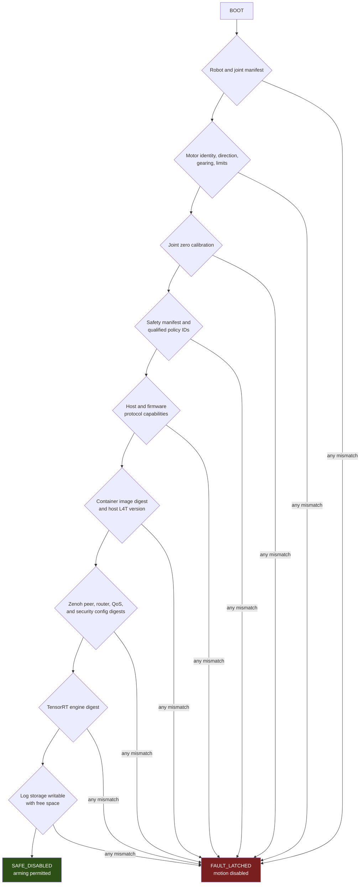

Only joint zero offsets among the four calibration classes enter this interlock, because a zero-offset
error shifts the entire `SafetyKernel` joint envelope. IMU bias, camera extrinsics, and turf friction
degrade specific estimates and are gated by their consumers instead.

### 7.3 Release process

| Stage                           | Gate                                                                                                                                                                                                 | Enforced by                        |
| ------------------------------- | ---------------------------------------------------------------------------------------------------------------------------------------------------------------------------------------------------- | ---------------------------------- |
| Pull request                    | Compile both architectures, unit and property tests, lint, generated-artifact drift, transport conformance, sign-flip detection, MuJoCo SIL regression, replay determinism, image build without push | GitHub-hosted runners, no hardware |
| Merge to `main`                 | All of the above                                                                                                                                                                                     | Branch protection                  |
| Release branch cut              | Per tournament                                                                                                                                                                                       | Manual, dated                      |
| Cherry-pick into release branch | Matching HIL evidence record                                                                                                                                                                         | Release gate                       |
| Release build                   | Vendor base image by digest, images and firmware built together                                                                                                                                      | Native arm64 runners               |
| Release manifest                | Every artifact identified by digest or exact version                                                                                                                                                 | CI, signed                         |
| Release gate                    | Signed HIL evidence exists, is complete against every ADR-002 fault class, and **names the exact release digest**                                                                                    | CI                                 |
| Publish                         | **Blocked for any image containing the ZED SDK** until redistribution rights are confirmed                                                                                                           | ADR-009 §14                        |
| Deploy                          | Both release manifests and both digest sets resident before a tournament                                                                                                                             | ADR-008 §13                        |
| Commission                      | On-robot TensorRT engine build; digest recorded and interlocked                                                                                                                                      | ADR-009 §9                         |
| Rollback                        | Image, safety manifest, calibration, configuration, and engine reverted together, then pre-match checks re-run                                                                                       | ADR-008 §13                        |

### 7.4 Evidence standards

- **Average latency alone is not acceptance evidence.** Reports preserve distributions, worst observed
  values, sample counts, hardware and software manifests, load profile, and physical trace captures.
- **No timing figure may originate in simulation or in continuous integration.** Every quoted timing
  names the real hardware it was measured on.
- **Any timing obtained under profiling is an upper bound**, because deployed configurations never hold
  `CAP_PERFMON`.
- **`EMC %` is never recorded or reported without its frequency**, and the counter semantics must be
  validated empirically against a synthetic memory load first. NVIDIA's own documentation carries
  unresolved editorial queries about whether `EMC` and `EMC_FREQ` are the same statistic.

The full qualification list is in
[ARCHITECTURE.md](architecture/ARCHITECTURE.md#qualification-path).

---

## 8. What is deliberately not decided

| Item                                                                                 | Blocked on                          | Consequence of leaving it open                                                                                                          |
| ------------------------------------------------------------------------------------ | ----------------------------------- | --------------------------------------------------------------------------------------------------------------------------------------- |
| **Robot model** — kinematic tree, masses, inertias, sole geometry, physical envelope | Mechanical design. **Model Gate 0** | No dynamic gait claim, no simulator model, no ADR-004. Blocks Jetson module selection, thermal and power budgets, and the model CI lane |
| Locomotion paradigm and whole-body optimisation stack                                | Model Gate 0                        | Research complete; the commissioning path is known                                                                                      |
| State estimation and time synchronisation                                            | IMU and contact-sensor selection    | Structure is fixed by D1-D8; the filter is not instantiated                                                                             |
| Perception pipeline topology                                                         | Camera model and compute profile    | Depth error model and licence constraints are fixed                                                                                     |
| Jetson Orin module                                                                   | Model Gate 0                        | Compute, memory, thermal, and power figures remain profile budgets                                                                      |
| Successor actuator transport                                                         | Deliberate                          | `ActuatorTransport` exists precisely so this stays open                                                                                 |
| **ZED SDK redistribution rights**                                                    | Stereolabs licence terms, **NR**    | **Blocks any public registry push of a perception image**                                                                               |
| TensorRT engine portability rules                                                    | NVIDIA documentation, **NR**        | ADR-009 §9 is deliberately conservative and does not depend on the answer                                                               |
| Firmware toolchain                                                                   | Not selected                        | Firmware CI lane specified by output, not by mechanism                                                                                  |
| HIL evidence format and signing mechanism                                            | Undefined                           | ADR-009 §10 is only as strong as the artifact it checks                                                                                 |
| Usable disk on a 14 GB runner                                                        | Unmeasured                          | The container build lane depends on it                                                                                                  |
| Unified-memory contention on Orin                                                    | Open gap from Topic 9               | Core pinning does not partition memory bandwidth or last-level cache, so perception load remains a live timing risk                     |

### Standing evidence discipline

Two rules learned the hard way during this project:

1. **`NR` never means zero.** A quantity nobody reported is a risk, not an absence. This document marks
   every such case explicitly rather than filling the gap with a plausible value.
2. **Delegated research was not reliable.** Three of five research subagents produced confident false
   statements — that Ultralytics YOLO is Apache-2.0 (it is AGPL-3.0), that the ZED 2i has a global
   shutter (it is rolling), and that the ZED Mini has no IMU (it has one). Every `[Primary]`,
   `[Upstream]`, and `[Rules]` claim in the research baselines was retrieved directly from its named
   source.

---

## 9. Document index

### Decisions

| Document                                                                        | Scope                                                                                 |
| ------------------------------------------------------------------------------- | ------------------------------------------------------------------------------------- |
| [DECISIONS.md](DECISIONS.md)                                                    | Decision register — 76 numbered decisions across eight ADRs                           |
| [ARCHITECTURE.md](architecture/ARCHITECTURE.md)                                 | Accepted system skeleton, invariants, failure boundaries, qualification path          |
| [HARDWARE_REQUIREMENTS.md](architecture/HARDWARE_REQUIREMENTS.md)               | HW-01 to HW-54 — software-driven requirements on mechanical, electrical, and firmware |
| [ADR-001](architecture/ADR-001-real-time-actuation-and-hardware-abstraction.md) | Real-time actuation and hardware abstraction                                          |
| [ADR-002](architecture/ADR-002-safety-and-fault-management.md)                  | Safety and fault management                                                           |
| [ADR-003](architecture/ADR-003-zenoh-middleware.md)                             | Zenoh middleware (cross-cutting)                                                      |
| ADR-004                                                                         | **Reserved** for Topic 3. Research complete; decision not taken                       |
| [ADR-005](architecture/ADR-005-behavior-game-state-and-team-networking.md)      | Behaviour, game state, and team networking                                            |
| [ADR-006](architecture/ADR-006-runtime-and-containers.md)                       | Runtime, container, and compute architecture                                          |
| [ADR-007](architecture/ADR-007-simulation-sil-hil.md)                           | Simulation, SIL, HIL, and deterministic replay                                        |
| [ADR-008](architecture/ADR-008-observability-and-operations.md)                 | Observability, telemetry, and competition operations                                  |
| [ADR-009](architecture/ADR-009-development-workflow-and-cicd.md)                | Development workflow, CI/CD, and release management                                   |

### Research baselines

| Document                                                                                          | Topic                               | Status                                   |
| ------------------------------------------------------------------------------------------------- | ----------------------------------- | ---------------------------------------- |
| [topic-3-locomotion-survey.md](research/topic-3-locomotion-survey.md)                             | Robot model, kinematics, locomotion | Complete. No ADR                         |
| [topic-4-sensors-timing-state-estimation.md](research/topic-4-sensors-timing-state-estimation.md) | Sensors, timing, state estimation   | Complete. No ADR                         |
| [topic-5-perception-pipeline.md](research/topic-5-perception-pipeline.md)                         | Perception pipeline                 | Complete. No ADR                         |
| [topic-6-localization-world-model.md](research/topic-6-localization-world-model.md)               | Localization, world model, gaze     | Complete. **D1-D8 approved and binding** |
| [topic-7-behavior-and-strategy.md](research/topic-7-behavior-and-strategy.md)                     | Behaviour and strategy              | Decided in ADR-005                       |
| [topic-8-gamecontroller-networking.md](research/topic-8-gamecontroller-networking.md)             | GameController and team networking  | Decided in ADR-005                       |
| [topic-9-runtime-and-containers.md](research/topic-9-runtime-and-containers.md)                   | Runtime, containers, compute        | Decided in ADR-006                       |
| [topic-10-simulation-sil-hil.md](research/topic-10-simulation-sil-hil.md)                         | Simulation, SIL, HIL                | Decided in ADR-007                       |
| [topic-11-observability-and-operations.md](research/topic-11-observability-and-operations.md)     | Observability and operations        | Decided in ADR-008                       |
| [topic-12-development-workflow-and-cicd.md](research/topic-12-development-workflow-and-cicd.md)   | Development workflow and CI/CD      | Decided in ADR-009                       |

### How to extend this architecture

1. Research first. Produce `research/topic-N-<name>.md` with tagged evidence and an explicit `NR` list.
2. Present a numbered decision proposal. Do not write the ADR before it is accepted.
3. Write `architecture/ADR-0NN-<topic>.md` using the established template: Context with named
   subsections, numbered Decision sections, Consequences split into positive and costs, a rejected
   alternatives table, verification gates, and references.
4. Update [DECISIONS.md](DECISIONS.md) — decision rows, reserved identifier, research baseline status.
5. Update [ARCHITECTURE.md](architecture/ARCHITECTURE.md) — invariants, failure boundaries,
   qualification path, open topics.
6. Update [HARDWARE_REQUIREMENTS.md](architecture/HARDWARE_REQUIREMENTS.md) if the decision places any
   requirement on another domain.
7. Update this document.
