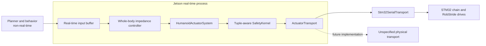

# ADR-001: Real-Time Actuation and Hardware Abstraction

- Status: Accepted
- Decision date: 2026-07-24
- Last reviewed: 2026-08-28
- Scope: Topic 1

## Context

The current robot sends actuator commands through this physical path:

```text
Jetson
  -> USB CDC, COBS framing, CRC16
  -> master STM32F446RE
  -> 200 Hz SPI DMA exchange
  -> slave STM32F446RE
  -> 1 Mbps RobStride classic CAN
  -> RobStride actuators
```

Higher-level control must survive replacement of any part of that path. The present path produces genuinely fresh command and feedback exchanges at 200 Hz; running a nominally faster controller over repeated samples would hide latency and phase lag rather than improve control.

ROS 2 Jazzy `ros2_control` supports arbitrary scalar command interfaces but does not provide an atomic structured MIT command. Atomicity therefore has to be an invariant of interface ownership and the hardware write operation.

## Decision

### Stable software boundary

`HumanoidActuatorSystem` is the only production `hardware_interface::SystemInterface` presented to controllers. It owns joint identity, state export, command snapshots, command validation, fault propagation, and transport lifecycle. It delegates physical I/O to an `ActuatorTransport` implementation.



The transport interface is capability-based. It exchanges fixed-capacity command and feedback batches and reports capabilities, timing, health, sequence, and per-joint delivery status. It must not expose USB, SPI, CAN, EtherCAT, packet-layout, or bus-topology concepts above the transport boundary.

Required transport operations are semantically equivalent to:

```cpp
configure(manifest, safety_manifest)
activate()
exchange(command_batch, feedback_batch, cycle_deadline)
request_joint_disable(joint_id)
request_all_disable()
health_snapshot()
deactivate()
```

This is a behavioral contract, not a frozen C++ signature. Implementations may use synchronous I/O, a dedicated I/O thread, DMA, or another mechanism as long as they satisfy the timing and state semantics.

`Stm32SerialTransport` is the production baseline. A simulator transport and recording/replay transport may implement the same contract. The successor physical transport is intentionally undecided.

### Joint command contract

Every controlled joint exports exactly these five scalar command interfaces:

| Interface | Unit | MIT meaning |
| --- | --- | --- |
| `position` | rad | Desired position $q_d$ |
| `velocity` | rad/s | Desired velocity $\dot q_d$ |
| `effort` | N*m | Feed-forward torque $\tau_{ff}$ |
| `stiffness` | N*m/rad | Proportional gain $K_p$ |
| `damping` | N*m*s/rad | Derivative gain $K_d$ |

The actuator law is:

$$
\tau = K_p(q_d-q) + K_d(\dot q_d-\dot q) + \tau_{ff}
$$

One controller claims all five interfaces for every joint it controls. `HumanoidActuatorSystem::prepare_command_mode_switch()` rejects partial claims, mixed ownership, and partial release. Generic position, velocity, or effort controllers cannot concurrently own a subset of the tuple.

At each `write()` call, `HumanoidActuatorSystem` copies all five values for all joints into one preallocated cycle snapshot. Validation, safety projection, protocol encoding, and transport handoff consume that immutable snapshot. No transport may observe a partially updated tuple.

At minimum, joints export measured `position`, `velocity`, and `effort` state. Temperature, voltage, drive mode, fault bits, command age, and transport counters are exported through typed status interfaces or non-real-time diagnostics without changing the command contract.

### Timing and execution

The production controller-manager rate is 200 Hz, matching the current end-to-end hardware exchange. The 5 ms cycle is:

```text
read latest complete feedback -> controller update -> validate one tuple snapshot -> write one command batch
```

The following are hard requirements for the real-time path:

- No Zenoh, ROS service, action, logging, filesystem, parameter lookup, or unbounded wait in `read()`, controller `update()`, `write()`, or `SafetyKernel`.
- Preallocate cycle data; avoid heap allocation, page faults, and lock contention after activation.
- Use monotonic timestamps and monotonically increasing cycle sequence numbers.
- Reject duplicate, out-of-order, structurally invalid, stale, or manifest-mismatched feedback.
- Bound transport work by a cycle deadline. Never wait indefinitely for physical I/O.
- Publish diagnostics from copied snapshots on a non-real-time thread.

A future rate increase is a new qualification decision. It requires fresh command and feedback samples for every required joint in every shorter cycle, measured worst-case latency and jitter within budget, and successful closed-loop hardware tests. Interpolation or repeated 200 Hz samples must not be labeled as a higher-rate hardware loop.

### Error semantics

Physical containment precedes ROS error propagation. On a critical exchange or actuator fault, the safety layers first issue the applicable local damping, joint-isolation, disable, or power-removal action defined by ADR-002. Only then does the hardware component return `ERROR` so Controller Manager can deactivate dependent controllers and coordinate lifecycle recovery.

`ros2_control` lifecycle state is therefore an orchestration signal, not the primary actuator safety mechanism.

## Protocol requirements

The production Jetson-to-STM32 protocol must be versioned and include, directly or through a startup handshake:

- Protocol version and feature bits
- Robot, actuator, calibration, and safety-manifest identities
- Command cycle sequence and freshness data
- Complete per-joint five-field tuples
- Complete per-joint feedback, drive state, and fault data
- Whole-frame integrity checking
- Explicit arm, disable, and reset epochs that cannot be replayed

Compatibility is explicit. Unsupported versions or capability sets remain disabled; they are never guessed or silently downgraded.

## Consequences

### Positive

- Controllers and safety logic remain unchanged when physical transport changes.
- Simulation and hardware use the same joint command and feedback semantics.
- The declared 200 Hz rate reflects real samples and can be tested honestly.
- Tuple ownership prevents mixed-controller impedance commands.

### Costs and constraints

- A custom controller is required to claim and update the five interfaces together.
- Each transport backend needs a conformance suite, timing qualification, and fault-injection tests.
- Standard scalar joint-limit helpers are insufficient for the coupled impedance law; ADR-002 defines tuple-aware safety validation.
- No higher layer may depend on transport-specific telemetry or addressing.

## Rejected and superseded alternatives

- A transparent STM32 bridge with all safety on the Jetson was rejected because host or link loss must be contained locally.
- A nominal 500 Hz ROS loop over 200 Hz physical samples was rejected because it creates stale-sample control cycles.
- A committed EtherCAT or multi-CAN roadmap was proposed and then explicitly withdrawn. No successor bus, topology, or migration date is part of this decision.
- Middleware in the actuator loop was rejected because ROS communication is not the deterministic field I/O contract.

## Verification gates

- Unit tests reject partial interface claims and non-finite tuple fields.
- A transport conformance suite runs unchanged against STM32, simulator, and test-double implementations.
- Hardware-in-the-loop tests inject loss, corruption, delay, duplication, reordering, STM32 reset, and drive faults.
- Timing traces demonstrate one fresh, complete command and feedback batch per 5 ms cycle at the release percentile and worst-case duration defined by the test plan.
- A backend swap compiles and passes controller tests without edits to controllers, planners, or safety policy.

## References

- [ROS 2 control: hardware components](https://control.ros.org/jazzy/doc/ros2_control/hardware_interface/doc/hardware_components_userdoc.html)
- [ROS 2 control: Controller Manager](https://control.ros.org/jazzy/doc/ros2_control/controller_manager/doc/userdoc.html)
- [ROS 2 control: hardware interface types](https://control.ros.org/jazzy/doc/ros2_control/hardware_interface/doc/hardware_interface_types_userdoc.html)
- [ROS 2 real-time programming](https://docs.ros.org/en/jazzy/Tutorials/Demos/Real-Time-Programming.html)
