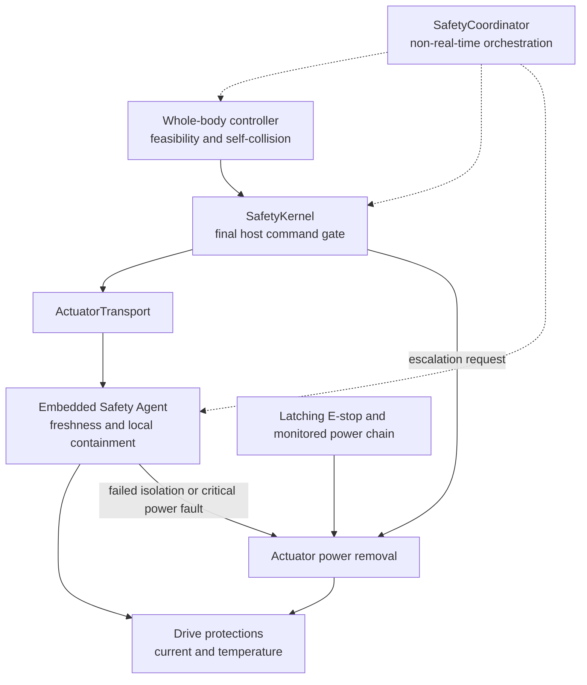
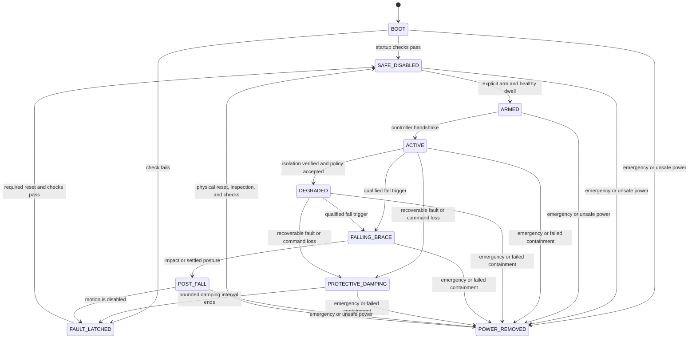

# ADR-002: Safety and Fault Management

- Status: Accepted
- Decision date: 2026-07-27
- Amendments integrated: 2026-08-28
- Scope: Topic 2
- Research baseline: [topic-2-safety-and-fault-management.md](../research/topic-2-safety-and-fault-management.md) (retroactive, assembled 2026-09-02; contains the as-built safety gap register and records evidence that challenges parts of this decision without modifying it)

## Context

A humanoid can become hazardous when a controller, Jetson, STM32, link, drive, sensor, battery, or power component fails. ROS lifecycle transitions and `ros2_control` error returns are useful for software coordination, but they depend on functioning host software and cannot be the first or only physical response.

The safety architecture must remain valid when `Stm32SerialTransport` is replaced. It must also account for a coupled impedance command: independently clamping position, gain, and feed-forward fields does not prove that the resulting torque is safe.

Per-joint containment is desirable, but continued gait control is unsafe unless the active controller explicitly supports the missing joint. The current robot also lacks independently monitored per-joint power switches, so an unverified disable must escalate to shared actuator-power removal.

This ADR defines engineering controls for the robot; it is not a claim of certification to an industrial functional-safety standard. A maintained hazard analysis and physical test evidence remain mandatory.

## Decision

### Independent authorities

Safety is implemented by independent, overlapping authorities. No upper layer may weaken a lower-layer limit.

| Authority                                  | Runs when                   | Owns                                                                                                                                                                   | Must not own                                                             |
| ------------------------------------------ | --------------------------- | ---------------------------------------------------------------------------------------------------------------------------------------------------------------------- | ------------------------------------------------------------------------ |
| Whole-body controller (WBC)                | Active host control         | Balance, contact feasibility, dynamic limits, full-geometry self-collision, approved degraded policies, brace and recovery trajectories                                | Final hard-limit enforcement or emergency power                          |
| `SafetyKernel` in `HumanoidActuatorSystem` | Every real-time `write()`   | State and command freshness, finite values, hard joint envelope, coupled MIT torque/power envelope, slew limits, availability mask, state-dependent command projection | ROS calls, allocation, full online collision geometry, transport details |
| Embedded Safety Agent                      | Independently on STM32      | Command sequence and age, packet integrity, local watchdogs, drive status, isolation attempts, safe damping, disable, power-cut request                                | Gait planning or assumptions about ROS lifecycle                         |
| `SafetyCoordinator`                        | Non-real-time host process  | System state machine, event aggregation, lifecycle transitions, operator interface, logs, rearm workflow, degraded-policy negotiation                                  | First physical response or sole watchdog                                 |
| Drive protection                           | Inside each actuator        | Hardware current, voltage, temperature, and internal fault protection                                                                                                  | Whole-robot recovery decisions                                           |
| Physical stop chain                        | Independent electrical path | Latching emergency removal of actuator energy with monitored feedback                                                                                                  | Network, Jetson, or application-software dependency                      |

The latching stop chain is de-energize-to-stop and independent of Jetson, ROS 2, Zenoh, USB, and STM32 application scheduling. Resetting the E-stop permits a later arm sequence but never starts motion. Diagnostic and embedded logic power should remain available where the electrical design permits, while actuator power is removed.

A league-allowed remote emergency control may be added only as an independent input to this chain or its safety-rated equivalent. GameController and Zenoh messages are operational stop requests, not emergency-stop channels.

### Safety state machine

State transitions are monotonic toward lower energy unless an explicit rearm sequence succeeds. Reconnection, process restart, watchdog reset, fault-bit clearance, or E-stop release cannot automatically return the robot to `ARMED`, `ACTIVE`, or `DEGRADED`.

### Command envelope

For joint $j$, the final command is a complete tuple

$$
u_j = (q_{d,j}, \dot q_{d,j}, \tau_{ff,j}, K_{p,j}, K_{d,j})
$$

with predicted torque

$$
\tau_j(u_j, x_j) = K_{p,j}(q_{d,j}-q_j) + K_{d,j}(\dot q_{d,j}-\dot q_j) + \tau_{ff,j}.
$$

The `SafetyKernel` accepts or projects the tuple as one object into a state-dependent feasible set $\mathcal U_j(x,s)$. At minimum, the set enforces:

$$
\max_{(q,\dot q)\in\mathcal X_j}
\left|\tau_j(u_j,(q,\dot q))\right|
\leq \tau_{allowed,j}(T,V,s)
$$

and

$$
|\tau_j \dot q_j| \leq P_{allowed,j}(T,V,s),
$$

as well as hard position, velocity, acceleration or command-slew, gain, thermal, voltage, and state limits. $\mathcal X_j$ includes bounded measurement uncertainty and one-cycle state evolution. Non-finite input or a tuple that cannot be projected without changing its intended safety mode causes a protective transition; it is never passed through.

Scalar field-by-field clipping is prohibited as the sole safety method. For example, a permitted $K_p$ and permitted $q_d$ can still create excessive torque when combined.

WBC owns full robot geometry, balance, contact, and self-collision constraints because those require model-wide computation. The `SafetyKernel` is the backstop: it enforces hard joint limits, conservative precomputed forbidden joint-space regions where justified, command slew, and the coupled actuator envelope. It does not claim that these local checks prove full-body collision freedom.

### Fault containment and degraded control

Fault handling is based on severity and evidence, not on the transport that reported it.

1. A faulted joint receives an immediate disable or state-appropriate containment command.
2. Isolation is verified through a drive acknowledgement plus observed state, current, or torque behavior available on the hardware.
3. The availability mask is updated with a new monotonic epoch.
4. Remaining joints enter protective damping while a controller selects a policy that was prequalified for that exact fault class and availability pattern.
5. Continued active control is allowed only after the controller acknowledges the mask epoch and the SafetyCoordinator accepts the policy ID.
6. If no qualified policy responds within its deadline, all remaining joints damp and then disable.
7. If isolation is not acknowledged or the joint still produces unsafe motion or torque, shared actuator power is removed.

An arbitrary gait cannot continue after masking a joint. Initial qualified degraded modes should be narrow, such as a stationary supported posture after a non-load-bearing arm fault. Dynamic one-leg-joint failure recovery is not assumed safe until separately demonstrated.

Returning `ERROR` from `read()` or `write()` happens after local containment has started. Controller Manager then deactivates dependent controllers; fallback activation is coordination only and must not be required to meet a physical deadline.

### Command loss

The Embedded Safety Agent independently validates packet integrity, session or arm epoch, sequence progression, and age. Three consecutive missing or invalid 5 ms command cycles assert command loss. The local response is a prequalified damping tuple, normally zero feed-forward torque, zero stiffness, zero desired velocity, and bounded damping, followed by drive disable after a posture-specific bounded interval.

Safe damping is a tested primitive, not a universal constant. If damping would worsen a detected electrical, runaway, entrapment, or impact hazard, the fault policy selects immediate disable or power removal instead. Indefinite position hold is prohibited.

### Fall, brace, and post-fall behavior

Fall handling is a first-class safety workflow. A qualified fall trigger combines independent evidence where available:

- Base tilt and angular rate outside the recoverable envelope
- Predicted capture or support failure from the state estimator
- Loss of expected foot contacts or contact inconsistency
- Free-fall or impact signatures
- Estimator invalidity while dynamic motion is active

The WBC may first attempt a prequalified balance recovery inside the recoverable envelope. Crossing the fall boundary latches `FALLING_BRACE` and cancels ordinary gait intent. The selected brace primitive prioritizes head and structure protection, avoids extending limbs into known hazards, reduces impact energy, and uses only tuple sequences qualified for the current posture and availability mask. If no matching brace is available, the fallback is protective damping followed by disable.

Impact or a settled orientation enters `POST_FALL`. Ordinary locomotion remains inhibited. The robot applies only a bounded post-impact damping or load-relief primitive, classifies posture, records the event, and disables motion. Self-righting is a separate explicit recovery action; it requires a valid model and sensors, sufficient battery and thermal margin, a clear-space authorization, an approved recovery primitive, and operator or competition-state permission. A fall never auto-restarts walking.

### Initial reaction deadlines

These are maximum release requirements at the current 200 Hz rate. Hazard analysis may tighten them. Passing an average does not satisfy a maximum.

| Event                                             |                                                                  Deadline | Start and observable end                                                           |
| ------------------------------------------------- | ------------------------------------------------------------------------: | ---------------------------------------------------------------------------------- |
| Invalid host tuple detected by `SafetyKernel`     |      Same `write()` invocation; no later than the next 5 ms transmit slot | Validation tracepoint to safe batch handoff                                        |
| Critical drive fault in a complete feedback batch |                                                                      5 ms | Feedback acceptance to isolation command on physical link                          |
| Missing or invalid host command stream            |              Assert by 15 ms; safe command by 20 ms from last valid cycle | Last accepted sequence to local safe-command transmission                          |
| Joint isolation request                           |        Verify within 15 ms; initiate power removal by 20 ms if unverified | Isolation transmission to acknowledgement and measured containment, or cut request |
| Qualified fall trigger                            |                                First brace or fallback tuple within 10 ms | Trigger latch to physical command transmission                                     |
| Impact trigger                                    |                                 Enter post-fall command mode within 10 ms | Trigger latch to physical command transmission                                     |
| Hardwired E-stop                                  | Initiate energy removal within 10 ms; monitored contact open within 30 ms | Input contact edge to coil command and auxiliary-contact feedback                  |

The time for motor current and mechanical motion to decay is a separate measured hazard quantity. It must be recorded for each actuator, load, supply voltage, and stop primitive; it is not assumed equal to contactor opening time.

Latency qualification uses physical markers: host tracepoints, STM32 GPIO transitions, a protocol or bus analyzer, drive acknowledgement, current probes, and the contactor auxiliary contact. Tests run under maximum CPU/GPU load, thermal throttling, link corruption, low battery, and repeated fault injection. Reports include sample count, percentile distribution, worst observed value, test configuration hash, and oscilloscope or logic-analyzer captures.

### Thermal and power faults

Power policy is shared by released host and embedded safety manifests, while enforcement remains independent.

- Jetson thermal warning selects a lower compute profile and sheds nonessential workloads. It must not slow the 200 Hz safety and actuation path.
- Jetson critical temperature, unrecoverable throttling, repeated real-time deadline misses, or host power loss requests or naturally triggers protective damping and disable on the STM32.
- STM32 brownout reset and independent-watchdog reset boot into drives-disabled state and require a fresh arm epoch.
- Loss of the logic rail must de-energize the actuator-power enable path by electrical design.
- Battery warning may derate allowed torque, velocity, compute profile, and optional sensors only through a qualified policy.
- Critical undervoltage, overvoltage including regenerative overvoltage, overcurrent, cell-temperature fault, BMS trip, or implausible battery telemetry causes protective stop or immediate power removal according to the electrical hazard table.
- Software cannot override BMS or drive hardware protection.

Thresholds, hysteresis, dwell times, sensor plausibility rules, and derating curves are configuration data in the safety manifest, not hard-coded policy scattered across nodes.

### Startup interlocks

Drives remain disabled until all applicable checks pass:

- E-stop chain reset, actuator-power command off, and contactor feedback plausible
- Host, STM32, transport protocol, robot model, motor table, calibration, and safety-manifest identities match
- No duplicate or missing required joint identity; physical drive identity agrees with the joint map
- Encoder zero, direction, gear ratio, and joint offset are calibrated and within versioned validity rules
- Joint states are finite, fresh, within the startup envelope, and consistent with the detected posture
- Required IMU, contact, power, and temperature inputs are present and plausible
- Every MIT tuple is initialized without a step: measured $q$ as the initial $q_d$, zero $\dot q_d$ and $\tau_{ff}$, zero $K_p$, and only the approved startup $K_d$ while drives remain disabled
- Sequence, session, and arm epochs have completed a fresh handshake; replayed commands cannot arm the robot
- The selected controller declares the same joint availability mask and approved policy set
- Real-time scheduling, memory locking, and cycle-deadline self-tests pass

Calibration validity is a hard interlock, not merely a warning. Maintenance or generated configuration files must not be hand edited. A canonical, schema-validated source generates both host and firmware artifacts and their digest.

### Rearming

All rearming requires healthy conditions for a configured dwell, stationary or otherwise approved posture, a new arm epoch, and an explicit command. Additional requirements depend on the latch source:

| Latch source                           | Additional rearm requirement                                                                             |
| -------------------------------------- | -------------------------------------------------------------------------------------------------------- |
| Brief communication loss               | Operator or supervisory acknowledgement after link and sequence tests                                    |
| Drive protective fault                 | Fault cause cleared, isolation released through maintenance policy, and drive self-test passed           |
| Fall or impact                         | Posture classified, physical inspection policy satisfied, and recovery or stand mode explicitly selected |
| Jetson or STM32 reset                  | Full startup interlocks and fresh controller handshake                                                   |
| E-stop or actuator-power removal       | Physical E-stop reset, contactor test, operator acknowledgement, then software arm                       |
| Manifest or calibration mismatch       | Correct released artifacts installed; no runtime override                                                |
| Repeated or unexplained critical fault | Maintenance lockout and fault investigation                                                              |

## Safety manifest

The safety manifest is a versioned immutable release artifact with a canonical digest. It contains units, joint identities, hard and soft limits, coupled impedance limits, safe primitives, watchdog values, thermal and electrical policies, degraded-policy IDs, sensor requirements, calibration references, and protocol capability requirements.

The Jetson and STM32 compare the same digest during startup. A mismatch keeps drives disabled. Existing motor YAML may become an input only after schema validation and unit normalization; generated firmware headers remain generated artifacts and are never hand edited.

## Consequences

### Positive

- Immediate containment does not depend on ROS, Zenoh, Linux, or a future physical bus.
- Fault isolation is available without pretending arbitrary degraded walking is safe.
- Fall and post-fall behavior are controlled states rather than incidental controller failures.
- Every critical reaction can be measured at the physical boundary.

### Costs and constraints

- The electrical design needs a monitored actuator-power interruption path.
- Safe damping, brace, degraded, and recovery primitives require posture-specific qualification.
- Configuration release and calibration become safety-controlled processes.
- A complete FMEA, hazard log, and repeated physical fault-injection campaign are release prerequisites.

## Verification gates

- Unit and property tests exercise all state transitions and tuple-envelope boundaries.
- Model-based tests prove forbidden transitions such as `FAULT_LATCHED -> ACTIVE` cannot occur directly.
- SIL and HIL inject stale, corrupt, reordered, and replayed commands; frozen firmware; reset; drive faults; false feedback; sensor loss; and power telemetry faults.
- Physical tests verify watchdog, isolation, failed-isolation escalation, E-stop, brownout, thermal, fall, brace, impact, and no-auto-restart behavior.
- Each approved degraded availability mask and every brace or recovery primitive has its own traceable qualification evidence.
- Safety test failures block release; they cannot be waived by changing a runtime parameter.

## References

- [ROS 2 control: Controller Manager error behavior](https://control.ros.org/jazzy/doc/ros2_control/controller_manager/doc/userdoc.html)
- [ROS 2 control: hardware component lifecycle](https://control.ros.org/jazzy/doc/ros2_control/hardware_interface/doc/hardware_components_userdoc.html)
- [ROS 2 managed node lifecycle](https://design.ros2.org/articles/node_lifecycle.html)
- [RoboCup Humanoid Soccer League rules](https://github.com/RoboCup-HumanoidSoccerLeague/HSL-Rules)
- [ISO 13850 emergency-stop principles](https://www.iso.org/standard/59970.html)
- [STM32F446 reference manual](https://www.st.com/resource/en/reference_manual/rm0390-stm32f446xx-advanced-armbased-32bit-mcus-stmicroelectronics.pdf)
