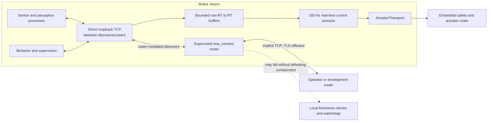

# ADR-003: Zenoh Middleware

- Status: Accepted
- Decision date: 2026-08-28
- Evidence last verified: 2026-08-28
- Scope: Cross-cutting middleware decision

## Context

The robot needs ROS 2 communication across processes, containers, the onboard computer, development workstations, simulators, and an operator station. The middleware must handle constrained and changing network paths without becoming part of the deterministic actuator or emergency-stop chain.

The project has selected `rmw_zenoh_cpp` for ROS 2 Jazzy. That selection is closed. This ADR records the conditions under which the selected middleware is production-worthy and the boundaries that prevent a middleware fault from becoming an actuator safety fault.

Support status must be stated precisely:

- `rmw_zenoh_cpp` is released for ROS 2 Jazzy; version `0.2.10` was current when this ADR was verified.
- Jazzy REP-2000 does not list Zenoh in its middleware support table. A Jazzy binary on a Tier 1 operating system is not itself a Tier 1 middleware designation.
- Kilted is the first REP-2000 distribution that lists Zenoh as Tier 1.

The Jazzy deployment is therefore a project-qualified baseline, not a claim of Jazzy Tier 1 middleware support.

## Decision

### Scope boundary

Use `rmw_zenoh_cpp` for ROS 2 topics, services, actions, parameters, lifecycle coordination, telemetry, logging, perception products, and operator communication.

Do not put Zenoh or any other ROS middleware in:

- The Controller Manager `read -> update -> write` path
- `SafetyKernel` command validation
- Jetson-to-STM32 field I/O
- Embedded command-loss handling
- Joint isolation or failed-isolation escalation
- The hardwired emergency-stop chain

The real-time process receives non-real-time inputs through bounded, timestamped real-time buffers. It remains safe when every Zenoh process and router is stopped, stalled, partitioned, restarted, or flooded.

### Production topology

The production topology uses explicit reliable stream links: loopback `tcp` for onboard peers and mutually authenticated `tls` over TCP off-host.

- Run one supervised robot-local `rmw_zenohd` router in the robot network namespace.
- Configure every onboard `rmw_zenoh_cpp` peer with an explicit TCP connection to that router.
- Retain explicitly bounded router-mediated gossip so onboard peers discover one another and establish direct loopback TCP connections. Disable multicast, multihop gossip, unintended peer targets, arbitrary auto-connect behavior, and default external listen endpoints.
- Connect an operator station or development network only through named, allowlisted TLS router links.
- Give every robot, simulator, and test environment a distinct namespace and router configuration. `ROS_DOMAIN_ID` is not treated as a security boundary.
- Do not mix UDP and TCP links in the production graph. UDP transport may be reconsidered only after its relevant upstream defects and the project network-fault suite pass.

The router is a supervised single point for new peer discovery and routed offboard communication, not necessarily the data path between already connected onboard peers and never the path for physical containment. The process supervisor applies bounded restart backoff and exposes router process state, connection state, reconnect count, and configuration identity. Router loss marks communications degraded, cancels or expires remote intent, and lets local application watchdogs choose their safe state even if established local peer links continue. It never triggers automatic motion when communication returns.

Development may use a smaller topology, but release tests and deployed images use the same version-controlled session and router configuration files as the robot.

### Version and configuration control

The release manifest pins:

- ROS 2 distribution and patch snapshot
- Exact `rmw_zenoh_cpp`, `rmw`, and Zenoh dependency versions
- Identical compatible package versions on `arm64` and `amd64`
- Router and peer configuration digests
- Security policy and certificate-generation version
- Container image digests and host kernel baseline

Every process explicitly selects `rmw_zenoh_cpp`; a mixed-RMW process set is a startup failure. Startup telemetry reports the RMW implementation identifier, package manifest, configuration digest, robot namespace, and router identity. Package upgrades are qualification events, not unattended production updates.

Do not rely on the upstream default configuration for production. All transport endpoints, discovery behavior, queues, timeouts, and security options are set in reviewed project configuration.

### QoS contract

Every publisher, subscription, service, and action declares reviewed QoS. `SYSTEM_DEFAULT`, `UNKNOWN`, and `BEST_AVAILABLE` policies are prohibited in production interfaces. The latter is especially unsuitable while upstream issue [#649](https://github.com/ros2/rmw_zenoh/issues/649) remains unresolved.

Initial interface classes are:

| Interface class | Reliability | Durability | History | Application contract |
| --- | --- | --- | --- | --- |
| High-rate replaceable sensor sample | Best effort | Volatile | Keep last 1-5 | Sequence and source timestamp; newest valid sample wins |
| High-rate control observation used outside the hard RT loop | Best effort unless loss is intolerable and measured | Volatile | Keep last 1 | Consumer enforces age and continuity bounds |
| Command or setpoint intent | Reliable | Volatile | Keep last 1 | Command epoch, sequence, issue time, expiry, source authority, and acknowledgement where required |
| Discrete safety or fault event telemetry | Reliable | Transient local | Keep last bounded event history | Monotonic event ID and latched source state; not the physical reaction channel |
| Static manifest or current operating state | Reliable | Transient local | Keep last 1 | Schema version, configuration digest, and state epoch |
| Raw camera or depth stream | Best effort | Volatile | Keep last 1 | Drop rather than build latency; source timestamp and frame ID mandatory |
| Recorder feed | Separate explicitly bounded endpoint | Volatile by default | Bounded | Must not change or backpressure the live publisher contract |

Depth values are sized from a measured consumer outage budget; they are not increased to hide slow consumers. Reliability is not synonymous with freshness. Reliable commands and observations still carry sequence numbers and expiration times, and consumers reject stale or replayed data.

The design does not depend on unsupported or incomplete RMW behavior. In particular:

- Do not depend on loaned-message APIs, content-filtered topics, or network-flow endpoint reporting while they remain in the missing-RMW work tracked by [#893](https://github.com/ros2/rmw_zenoh/issues/893).
- Enforce deadlines, lifespan, liveliness, authority, and freshness in the application whenever Jazzy Zenoh does not provide the required end-to-end guarantee.
- Test transient-local late join, publisher restart, and bounded history explicitly; do not infer semantics from a DDS implementation.
- Test mixed best-effort and reliable traffic under the exact process topology and queue configuration.

QoS compatibility is tested in CI from the interface catalog. An endpoint with an undeclared or incompatible profile fails startup or the integration test; it is not silently accepted.

### Services and actions

Services and actions are limited to supervisory operations such as lifecycle changes, configuration requests, operator commands, calibration workflows, and bounded recovery orchestration. They are forbidden for cyclic actuator commands and first-response safety actions.

Each operation has:

- A caller deadline and bounded retry policy
- An idempotency key or goal UUID
- A state or arm epoch that makes late replies harmless
- Explicit cancellation and reconciliation behavior
- A result that can be queried after reconnect when completion is not instantaneous

No operation assumes exactly-once execution. Destroying a client while a reply callback is active is avoided until the teardown behavior tracked by [#993](https://github.com/ros2/rmw_zenoh/issues/993) is fixed and qualified. Process shutdown first stops new calls, cancels or expires outstanding work, drains callbacks within a bound, and only then destroys clients.

### Images, ZED data, and shared memory

Shared-memory transport is disabled in the production baseline. Upstream issue [#978](https://github.com/ros2/rmw_zenoh/issues/978) demonstrates that an overloaded receiver can silently lose shared-memory service queries; the same failure class is unacceptable for transient-local state and supervision.

The large-data strategy is:

- Keep ZED acquisition, GPU preprocessing, and tightly coupled perception stages in one process where practical, using the camera SDK and ROS intra-process paths rather than an RMW round trip.
- Publish bounded derived products such as detections, tracks, terrain features, and localization observations for routine consumers.
- Publish raw color or depth across processes only when an identified consumer requires it, using best-effort, volatile, keep-last-1 QoS.
- Downsample, crop, or encode offboard inspection streams independently of the onboard perception stream.
- Place recording on a separate bounded path so a disk or network stall cannot create live-pipeline latency.

Because Jazzy `rmw_zenoh_cpp` does not provide a qualified loaned-message contract, all cross-process raw-image copy and memory-bandwidth costs are included in the Jetson compute budget.

Shared memory may be enabled only in a separately versioned deployment profile after all of these gates pass:

- The relevant upstream fixes are present in the pinned release.
- High-CPU, slow-subscriber, crash, restart, and memory-pressure tests show no silent topic, query, or transient-history loss.
- Raw-image throughput improves materially without violating service and control-observation latency budgets.
- Containers share the intended IPC namespace and have an explicitly sized `/dev/shm`; Docker's default allocation is not accepted implicitly.
- Segment cleanup, permissions, exhaustion behavior, and process-owner death are tested.
- The non-SHM profile remains supported as the recovery baseline.

### Security

All non-loopback Zenoh TCP links are authenticated and encrypted with mutually authenticated TLS. Router listeners bind only to required interfaces; host firewalls allowlist expected peers. Zenoh access control restricts publish, subscribe, query, and administrative key spaces by workload identity.

Private keys are not stored in source or container layers. The deployment process provisions per-robot and per-operator identities, supports revocation and rotation, and rejects expired or unexpected identities. Security configuration and certificate authority identity are release artifacts. Security-disabled development profiles cannot be promoted to a competition or field image.

Network security supplements rather than replaces command epochs, freshness, source-authority checks, safety limits, and the independent stop chain.

### Observability

Middleware health is exported without placing logging in the real-time cycle. Required metrics include:

- Router process health, identity, uptime, and restart count
- Peer connection state, reconnects, and route changes
- Per-interface publish and receive rates, age, sequence gaps, and invalid samples
- Queue depth or congestion indicators available from the implementation
- Service and action latency, timeout, retry, cancellation, and orphan-result counts
- Image frame age, drops, throughput, encoding time, CPU, GPU, and memory bandwidth
- Process CPU, resident memory, allocation growth, file descriptors, and network bytes

Critical logs include monotonic and synchronized wall-clock timestamps, robot ID, process ID, configuration digest, and event epoch. Metrics themselves are bounded and must not amplify a network overload.

## Known Jazzy risks and mitigations

| Evidence | Risk | Baseline mitigation |
| --- | --- | --- |
| Jazzy REP-2000 omits Zenoh | Lower distribution-level support assurance than a listed Tier 1 RMW | Project-owned conformance, soak, and fault qualification; pin versions |
| [#649](https://github.com/ros2/rmw_zenoh/issues/649) | Incomplete best-available QoS selection | Prohibit best-available and defaults; declare every policy |
| [#893](https://github.com/ros2/rmw_zenoh/issues/893) | Missing RMW APIs including features the project might otherwise assume | Do not depend on missing APIs; track them in the compatibility matrix |
| [#978](https://github.com/ros2/rmw_zenoh/issues/978) | Shared-memory queries can be silently dropped when a receiver stalls | Keep SHM disabled; gate it with overload and failure tests |
| [#765](https://github.com/ros2/rmw_zenoh/issues/765) | UDP multi-link token errors | Use explicit TCP-only production links |
| [#912](https://github.com/ros2/rmw_zenoh/issues/912) | Reported latency above one second in a specific deployment | Test the exact topology under saturation; enforce application expiry and queue bounds |
| [#993](https://github.com/ros2/rmw_zenoh/issues/993) | Client teardown can deadlock with an in-flight reply | Ordered bounded shutdown; no service in safety paths |

Issue closure alone does not remove a mitigation. The fix must be present in the pinned Jazzy build and pass the project regression that represents the original failure.

## Alternatives and tradeoffs

CycloneDDS has a more mature Jazzy support designation, extensive DDS operational experience, and different zero-copy and tooling options. It was not selected because the project values Zenoh's explicit routed topology and ability to span onboard, simulator, and offboard networks without DDS discovery becoming the system topology.

The cost is a larger project-owned qualification burden on Jazzy, a supervised router dependency for non-real-time communication, incomplete RMW features, and a shared-memory path that is not yet accepted. These costs are accepted.

CycloneDDS may be used as a development comparison oracle for ROS API portability and performance investigation. It is not a transparent runtime failover: RMW graphs do not automatically interoperate, and the production robot has one pinned RMW and one tested topology.

## Consequences

### Positive

- Network topology and discovery become explicit deployment artifacts.
- The same ROS-facing middleware can cover onboard, simulation, and offboard workflows.
- Middleware failure cannot directly bypass actuator containment.
- QoS, freshness, and operation semantics are reviewable per interface.

### Costs and constraints

- The team owns Jazzy-specific qualification beyond the ROS distribution support tier.
- A robot-local router and its configuration, security, supervision, and telemetry become production components.
- Raw image movement without qualified loaning or SHM consumes measurable CPU and memory bandwidth.
- Application protocols need epochs, timestamps, idempotency, and reconciliation rather than relying on delivery semantics alone.

## Production qualification gates

The deployment is not release-ready until the pinned robot image passes:

- ROS graph, topic, service, action, parameter, lifecycle, and transient-local conformance tests
- Router kill, restart, peer restart, network partition, packet loss, delay, duplication, reordering, bandwidth saturation, and reconnect tests
- Mixed `arm64` robot and `amd64` workstation compatibility tests using the exact release manifests
- Eight-hour minimum full-load soak tests and repeated cold-start campaigns with leak and descriptor-growth limits
- ZED raw and derived-stream tests under simultaneous control, logging, and offboard traffic
- Security tests for unknown peers, expired identities, unauthorized key spaces, malformed traffic, and certificate rotation
- Application freshness tests proving stale commands, observations, service replies, and action results are rejected
- Shutdown tests with in-flight services, actions, transient-local publishers, and container teardown
- Router and network overload tests proving the 200 Hz actuator cycle and all ADR-002 containment deadlines remain within their qualified bounds

Every release records end-to-end latency distributions, worst observed latency, loss, sample age, throughput, CPU, memory, and recovery time by interface class. Thresholds live in the versioned interface catalog and system test plan; a mean-only benchmark cannot pass a real-time or freshness requirement.

## References

- [`rmw_zenoh` Jazzy branch](https://github.com/ros2/rmw_zenoh/tree/jazzy)
- [`rmw_zenoh_cpp` package index](https://index.ros.org/p/rmw_zenoh_cpp/)
- [ROS 2 Jazzy: Working with Zenoh](https://docs.ros.org/en/jazzy/Installation/RMW-Implementations/Non-DDS-Implementations/Working-with-Zenoh.html)
- [REP-2000: ROS 2 target platforms](https://www.ros.org/reps/rep-2000.html)
- [`rmw_zenoh` design](https://github.com/ros2/rmw_zenoh/blob/jazzy/docs/design.md)
- [Default RMW session configuration](https://github.com/ros2/rmw_zenoh/blob/jazzy/rmw_zenoh_cpp/config/DEFAULT_RMW_ZENOH_SESSION_CONFIG.json5)
- [Default router configuration](https://github.com/ros2/rmw_zenoh/blob/jazzy/rmw_zenoh_cpp/config/DEFAULT_RMW_ZENOH_ROUTER_CONFIG.json5)
