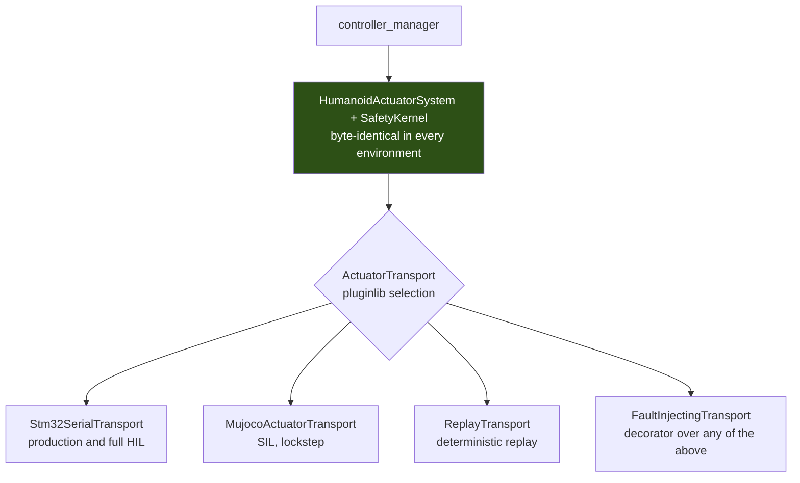
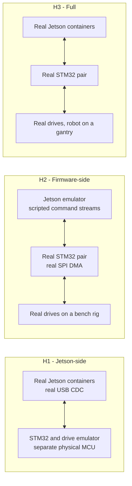

# ADR-007: Simulation, Software-in-the-Loop, Hardware-in-the-Loop, and Deterministic Replay

- Status: Accepted
- Decision date: 2026-09-01
- Evidence last verified: 2026-09-01
- Scope: Topic 10
- Depends on: [ADR-001](ADR-001-real-time-actuation-and-hardware-abstraction.md), [ADR-002](ADR-002-safety-and-fault-management.md), [ADR-003](ADR-003-zenoh-middleware.md), [ADR-005](ADR-005-behavior-game-state-and-team-networking.md), [ADR-006](ADR-006-runtime-and-containers.md)
- Research baseline: [Topic 10](../research/topic-10-simulation-sil-hil.md)

## Context

Six ADRs now end in verification gates, and nearly every gate says "measure this". Topic 10 asked
where those measurements can actually be taken, and what each environment can and cannot prove. It
returned one finding that changes the integration layer, and one that changes the telemetry design.

### The simulation plugins available for Jazzy are at the wrong layer

Every `ros2_control` simulation bridge released for Jazzy replaces the `SystemInterface`:

| Package                       | Declaration                                                                                                                                 |
| ----------------------------- | ------------------------------------------------------------------------------------------------------------------------------------------- |
| `mujoco_ros2_control` 0.1.1-1 | `class MujocoSystemInterface : public hardware_interface::SystemInterface`                                                                  |
| `gz_ros2_control` 1.2.20-1    | `GazeboSimSystemInterface`, documented in its own header as implementing "a simulated `ros2_control` `hardware_interface::SystemInterface`" |
| `mock_components` in 4.47.0-1 | `class GenericSystem : public hardware_interface::SystemInterface`                                                                          |

That is the correct general-purpose design. It is the wrong layer for this robot, because ADR-001
made `HumanoidActuatorSystem` the sole production `SystemInterface` and loaded it with the parts of
the system that most need testing: the immutable all-joint tuple snapshot, `SafetyKernel` invocation,
rejection of partial and mixed interface claims, sequence and freshness rejection, availability-mask
epoch handling, and the startup identity interlock.

**A SIL environment built on any of those plugins therefore tests a different system from the one
that is deployed.** Every ADR-001 and ADR-002 gate it appeared to satisfy would have been satisfied by
code that does not ship, and the substituted code is precisely the safety-critical code.

ADR-001 anticipated this and named the correct seam: "A simulator transport and recording/replay
transport may implement the same contract."

### The control loop cannot be recorded by rosbag2

ADR-001 forbids ROS communication, logging, filesystem access, and unbounded waits inside `read()`,
controller `update()`, `write()`, and `SafetyKernel`. The 200 Hz command and feedback tuples therefore
never reach a ROS topic at their true rate. `rosbag2` can only record what a non-real-time thread
copies out and republishes, which is by construction a decimated, re-timestamped, executor-scheduled
view.

That is a useful diagnostic record and it is not a control-loop trace. Neither post-match forensics at
cycle resolution nor deterministic replay of the control loop can be served from it.

### Determinism is bounded by the simulator vendor, not by us

MuJoCo states that its "simulation pipeline is entirely deterministic and reproducible", and in the
same section states the limit: "Exact reproducibility is only guaranteed within a **single version**,
on the **same architecture**."

The workstation is amd64 and the robot is arm64. A gate demanding bit-identical output across both
would be demanding something the vendor explicitly does not offer.

## Decision

### 1. The simulation seam is `ActuatorTransport`

Simulators integrate by implementing `ActuatorTransport`. They never implement, subclass, or replace
`hardware_interface::SystemInterface`.

`mujoco_ros2_control`'s `MujocoSystem`, `gz_ros2_control`'s `GazeboSimSystem`, and
`mock_components::GenericSystem` are **prohibited in any environment that produces release evidence**.
This is a safety and conformance invariant, not a preference: adopting them would delete
`HumanoidActuatorSystem` and `SafetyKernel` from the tested configuration.

Everything above the transport boundary is identical across production, SIL, HIL, and replay. The
environment is chosen by which plugin is loaded, which is configuration, not a build variant.

A simulator transport is not exempt from the ADR-001 conformance suite. It must present identical
units, signs, and joint ordering; monotonic cycle sequence numbers and monotonic timestamps; per-joint
delivery status and drive health; capability reporting that exercises the same identity path; and the
ability to violate all of the above on demand.

### 2. Simulator roles

| Tool          | Role                                            | Basis                                                                                                                                                   |
| ------------- | ----------------------------------------------- | ------------------------------------------------------------------------------------------------------------------------------------------------------- |
| **MuJoCo**    | Primary SIL environment and regression oracle   | Apache-2.0, CPU-only, runs on the Jetson and in GPU-less CI, and states its determinism properties.                                                     |
| **Isaac Lab** | Parallel learning and domain randomisation only | BSD-3-Clause, but requires an RTX 4080 / A40 / L40S-class discrete GPU. Its aarch64 documentation targets DGX, Jetson support is NR, determinism is NR. |
| **Gazebo**    | Not adopted                                     | Its bridge is `SystemInterface`-level, which §1 prohibits, and it adds a third physics engine without adding a capability the other two lack.           |

Licences are all permissive and compatible with the Topic 5 §4.1.1 exclusion of AGPL and GPL, so
licence does not decide this. Capability does: Isaac cannot provide on-robot SIL or GPU-less CI.

### 3. Lockstep synchronisation

`MujocoActuatorTransport::exchange()` applies the command batch, advances physics by exactly one
control period, samples the resulting state, stamps it with the next monotonic sequence number, and
returns. No wall-clock waiting occurs, so SIL runs faster or slower than real time without changing
its results.

The physics timestep must divide the control period by an integer, asserted at `configure`:

$$\Delta t_{\text{control}} = n \cdot \Delta t_{\text{physics}}, \qquad n \in \mathbb{Z}^{+}, \qquad \Delta t_{\text{physics}} = \frac{5\ \mathrm{ms}}{n}$$

A non-integer ratio produces beat-frequency aliasing between the control and physics clocks that
presents as a controller instability and is diagnosed as one.

### 4. `simulation_interfaces` is used for scenario control only

`simulation_interfaces` 1.5.1-1 is released for Jazzy and is the standard, correct mechanism for
reset, pause, world load, entity teleport, and capability discovery. `SetEntityState` in particular is
how a push or a ball reposition is injected.

`StepSimulation.srv` is rejected as the per-cycle mechanism. Its own specification states that the
service "only returns once stepping is complete, which might take considerable time". Driving a 5 ms
cycle through it means 200 service round trips per simulated second with cycle boundaries defined by
service latency rather than by physics.

### 5. SIL runs the production containers, and never produces timing evidence

The SIL stack is the ADR-006 digest-pinned images, the same `ros2 launch` composition, the same
lifecycle orchestration, and the same Zenoh configuration, with one transport plugin swapped and a
simulator container added. Workstation amd64 images are built from the same manifest as the robot
arm64 images, which is the version parity ADR-003 already requires.

| SIL can establish                                                     | SIL cannot establish                                           |
| --------------------------------------------------------------------- | -------------------------------------------------------------- |
| Logical correctness of controllers, safety projection, state machines | **Any timing property.** The loop is not at wall-clock 200 Hz. |
| Sequence, freshness, and mask-epoch handling                          | Scheduler jitter, memory-bandwidth contention, page faults     |
| Fault-response ordering and state transitions                         | Fault-response latency                                         |
| Regression detection against a stored trajectory                      | Actuator dynamics, backlash, compliance, thermal derating      |

**ADR-006 gates 4 and 5 are wall-clock gates and no SIL run can close them.** A SIL cycle-time
histogram presented as evidence for the 5 ms deadline is the wrong number, and its appearance in a
release report is a defect in the report.

### 6. Three hardware-in-the-loop configurations

| Configuration | Proves                                                                                                                    | Cannot prove                           |
| ------------- | ------------------------------------------------------------------------------------------------------------------------- | -------------------------------------- |
| **H1**        | Host timing under real USB CDC, container device passthrough, kernel scheduling, ADR-006 gates 3-5, `SafetyKernel` timing | Firmware behaviour, real drive faults  |
| **H2**        | Embedded Safety Agent watchdogs, command-loss timing, SPI DMA scheduling, drive faults, arm-epoch replay resistance       | Host-side controller behaviour         |
| **H3**        | End-to-end latency, the complete fault chain, arm and rearm workflows                                                     | Untethered dynamics, on-field recovery |

**The H1 emulator must be separate physical hardware presenting a real USB CDC endpoint.** A host-side
software loopback exercises the protocol parser and nothing else: not the USB stack, the kernel
`cdc_acm` driver, the ADR-006 §9 udev rule and container device passthrough, real serialisation
timing, or the failure modes that matter — enumeration loss, buffer stalls, device reset. The same
argument applies in reverse to the H2 Jetson emulator.

### 7. One protocol definition drives every implementation

The production transport, both HIL emulators, and the firmware tests are generated from, or
automatically checked against, a single machine-readable protocol definition carrying the ADR-001
version and feature bits. Protocol conformance vectors are shared across the transport conformance
suite, the STM32 emulator, and the firmware unit tests.

Two hand-maintained implementations of one wire format diverge, and the divergence surfaces as a field
failure rather than as a test failure.

### 8. Fault injection is plugin selection, not a build variant

`FaultInjectingTransport` implements `ActuatorTransport` as a decorator wrapping a real transport and
is selected by pluginlib configuration. Fault injection implemented as `#ifdef` branches or runtime
test flags inside `HumanoidActuatorSystem`, `SafetyKernel`, or the firmware is prohibited, because it
makes the tested binary differ from the shipped binary and contradicts the ADR-006 digest-pinned
release identity.

The campaign configuration is a versioned data artifact that can be replayed and attached to a release
report.

| ADR-002 fault                                      | Injection point                                         | Environment     |
| -------------------------------------------------- | ------------------------------------------------------- | --------------- |
| Corrupt, stale, duplicate, out-of-order feedback   | `FaultInjectingTransport`                               | SIL, H1         |
| Command loss over three consecutive cycles         | Emulator drops frames                                   | **H1, H2 only** |
| Single drive fault                                 | Transport or emulator returns a drive fault code        | SIL, H1, H2     |
| Failed joint isolation                             | Emulator acknowledges disable but reports motion        | H1, H2          |
| STM32 reset or brownout                            | Emulator resets its arm epoch mid-run                   | H1              |
| Coupled-torque envelope violation                  | Legal $K_p$ with legal $q_d$ exceeding $\tau_{allowed}$ | SIL             |
| Fall or impact                                     | `SetEntityState` or an applied external wrench          | SIL             |
| Estimator invalidity                               | Corrupt the Tier 0 validity signal                      | SIL             |
| Configuration or calibration mismatch              | Mismatched manifest or container digest                 | SIL, H1         |
| Zenoh peer, router, or partition loss              | Kill the router container; manipulate the network       | SIL, H1         |
| GameController loss, staleness, malformed, flooded | Gateway-level packet injection                          | SIL             |
| **Emergency stop**                                 | **None. Physical test only.**                           | **Physical**    |

ADR-002 requires the stop chain to be independent of Jetson, ROS 2, Zenoh, USB, and STM32 application
scheduling. Nothing that runs in software can exercise it, and no report may claim it was
software-tested.

### 9. Fault campaigns are enumerated

The ADR-002 fault set is finite: fault class × affected joint set × safety state × availability-mask
epoch. Campaigns are generated from that product with a documented reduction, so release evidence
states which combinations were executed and which were reasoned away, rather than reporting whichever
faults someone remembered to try.

### 10. Telemetry has two planes

| Plane             | Mechanism                                                                                            | Rate                       | Default       |
| ----------------- | ---------------------------------------------------------------------------------------------------- | -------------------------- | ------------- |
| **In-cycle**      | Preallocated lock-free ring buffer written inside the 5 ms cycle, drained to MCAP by a non-RT thread | Full 200 Hz, no decimation | **Always on** |
| **Non-real-time** | `rosbag2` with the Jazzy default `mcap` storage plugin                                               | Publisher rate             | On            |

The ring-buffer write is a bounded store into preallocated memory with no allocation and no syscall,
which satisfies the ADR-001 in-cycle constraint. The drain thread performs the filesystem work.

Sizing, for 20 joints at the upper end of the ADR-001 scaling envelope: 20 B command tuple + 12 B
feedback + 8 B status = 40 B per joint, so $40 \times 20 = 800$ B, plus a 48 B header carrying cycle
sequence, monotonic timestamp, safety state, mask epoch, and transport counters:

$$848\ \mathrm{B} \times 200\ \mathrm{Hz} \approx 170\ \mathrm{kB/s} \approx 611\ \mathrm{MB/h}$$

A KidSize match is two halves of 10 minutes, giving approximately 204 MB uncompressed for a full
match, and most fields change slowly between cycles. Full-rate control logging is therefore affordable
for an entire match and is **not** sampled or disabled at competition. This closes the control-loop
half of Topic 9 open gap 9.

MCAP is selected for the drained output as well as for `rosbag2` so that one toolchain reads both
planes. Its compression remains indexable, which `rosbag2`-level compression does not.

### 11. Three replay scopes with distinct guarantees

| Scope                     | Method                                                                                                            | Guarantee                                                                                                                                            |
| ------------------------- | ----------------------------------------------------------------------------------------------------------------- | ---------------------------------------------------------------------------------------------------------------------------------------------------- |
| **Control-loop replay**   | `ReplayTransport` returns the recorded feedback batch per cycle; the real system and `SafetyKernel` run unchanged | **Strong.** Bit-identical on the same build and architecture; a difference is a regression.                                                          |
| **Full-stack SIL replay** | MuJoCo from a saved state with the recorded command stream                                                        | **Strong within one simulator version and architecture**; tolerance-based across architectures.                                                      |
| **Non-real-time replay**  | `rosbag2` playback into perception, estimation, and behaviour                                                     | **Weak.** Executor callback ordering is not reproduced by replaying timestamps. Use `start_paused` and `play_next` where a test depends on ordering. |

Bit-exactness is required only within one architecture and one build. Cross-architecture comparison is
tolerance-based and reported as such.

The simulator version and the model digest are pinned in the release manifest alongside the container
digest required by ADR-006 §10, because MuJoCo guarantees reproducibility only within a single
version.

## Consequences

### Positive

- The safety-critical path is present, unmodified, in every test environment, so SIL and HIL results
  transfer to production instead of describing a substitute system.
- The transport conformance suite becomes the single artifact that makes results transferable, and it
  already exists as an ADR-001 requirement.
- Fault injection produces evidence about the shipped binary, because the shipped binary is what runs.
- The control loop is deterministically replayable **because** ADR-001 forbade ROS communication inside
  it. The rule that makes the loop real-time safe also makes it a pure function of its inputs. This
  asymmetry with the non-real-time plane is a design property, not a defect.
- Full-fidelity control telemetry for a whole match costs roughly 204 MB, so post-match forensics never
  depend on having guessed in advance which signal to record.

### Costs and constraints

- `MujocoActuatorTransport` must be written against the MuJoCo C API rather than adopting
  `mujoco_ros2_control`. That is more code. It is also less dependency risk: that package is version
  0.1.1 with status `developed`.
- MuJoCo actuator fidelity for $\tau = K_p(q_d-q) + K_d(\dot q_d-\dot q) + \tau_{ff}$ is unverified. A
  position actuator plus PID is not that law, and this must be checked before any SIL controller-tuning
  result is trusted.
- The H1 emulator is a hardware deliverable, not a software one.
- Nothing here can be exercised against the real robot model until Topic 3 Model Gate 0 closes. The
  apparatus is therefore built and conformance-tested against a synthetic manifest so that it is
  neither blocked on the model nor silently tuned to it.
- The in-cycle ring-buffer write is an in-cycle cost and must appear in the ADR-006 gate 4 budget.

## Rejected alternatives

| Alternative                                                            | Why rejected                                                                                                                                               |
| ---------------------------------------------------------------------- | ---------------------------------------------------------------------------------------------------------------------------------------------------------- |
| `mujoco_ros2_control` `MujocoSystem` as the SIL hardware component     | Replaces `HumanoidActuatorSystem`, deleting `SafetyKernel`, the tuple snapshot, identity checks, and freshness rejection from the tested configuration.    |
| `gz_ros2_control` and Gazebo                                           | Same `SystemInterface`-level substitution, plus a third physics engine for no capability the other two lack.                                               |
| `mock_components::GenericSystem` for CI                                | Same substitution. A test double belongs at `ActuatorTransport`, where the conformance suite already applies.                                              |
| Isaac Sim as the primary SIL environment                               | Requires a workstation-class discrete GPU; cannot run on the robot or in GPU-less CI; determinism NR.                                                      |
| `/clock` and `use_sim_time` as the primary synchronisation mechanism   | The RT loop does not consume ROS time, and executor arrival ordering is not reproducible.                                                                  |
| Simulator physics callback driving `controller_manager::update()`      | Requires the simulator plugin `SystemInterface`, which §1 prohibits.                                                                                       |
| `StepSimulation.srv` as the per-cycle step mechanism                   | 200 service round trips per simulated second, with cycle boundaries set by service latency. Its own specification warns it "might take considerable time". |
| Host-side software loopback as the H1 STM32 emulator                   | Tests the parser only. Leaves the USB stack, `cdc_acm`, the udev rule, device passthrough, and real timing untested.                                       |
| Compile-time or runtime fault-injection flags in production components | Breaks digest-identical release identity; the tested binary would not be the shipped binary.                                                               |
| `rosbag2` as the control-loop recorder                                 | Structurally impossible under the ADR-001 no-ROS-in-cycle rule; it can only record a decimated, re-timestamped view.                                       |
| Decimated or on-demand control logging at competition                  | 170 kB/s is affordable. Decimation trades a negligible saving for the loss of the record precisely when it is needed.                                      |
| Bit-exact cross-architecture replay as a release gate                  | MuJoCo guarantees reproducibility only "within a single version, on the same architecture". The gate would demand what the vendor does not offer.          |
| Claiming emergency-stop coverage from SIL or HIL fault injection       | ADR-002 requires the chain to be independent of every software layer. No software test can reach it.                                                       |

## Verification gates

Topic 10 §7 defines gates 1-11 in full. The binding summary:

| #   | Gate                                                                                                                                                                    |
| --- | ----------------------------------------------------------------------------------------------------------------------------------------------------------------------- |
| 1   | The ADR-001 transport conformance suite passes unchanged against `Stm32SerialTransport`, `MujocoActuatorTransport`, the STM32 emulator, and `ReplayTransport`.          |
| 2   | Joint order, sign convention, and units are driven by one generated artifact; a deliberate sign flip in the manifest, the simulator model, or the firmware is detected. |
| 3   | Integer substep ratio asserted at `configure`; simulated time advances exactly 5 ms per cycle over a long run with zero drift.                                          |
| 4   | Control-loop replay is bit-identical on the same build and architecture. Cross-architecture comparison is tolerance-based and reported separately.                      |
| 5   | No SIL-derived timing figure appears as evidence for the ADR-001 5 ms deadline or ADR-006 gates 4-5.                                                                    |
| 6   | The H1 emulator presents a real USB CDC endpoint from separate hardware, reaching the container through the ADR-006 §9 udev rule.                                       |
| 7   | Every ADR-002 fault in §8 has a campaign result or a written exclusion. Emergency stop is marked physical-only.                                                         |
| 8   | Production and fault-injection binaries have identical digests for every component above the transport boundary.                                                        |
| 9   | A legal $K_p$ with a legal $q_d$ whose product exceeds $\tau_{allowed}$ is projected or rejected as one tuple. Per-field clipping cannot pass this case.                |
| 10  | Full-rate in-cycle logging runs for a full match duration on the target medium: volume within estimate, no cycle overrun from the drain thread, endurance assessed.     |
| 11  | Simulator version and model digest are pinned in the release manifest alongside the container digest.                                                                   |

## References

- [Topic 10 research baseline](../research/topic-10-simulation-sil-hil.md) — full evidence, verbatim source quotations, and open gaps.
- `ros/rosdistro` `jazzy/distribution.yaml` — released versions and maintenance status for every package named here.
- `moveit/mujoco_ros2_control` `mujoco_system_interface.hpp`; `ros-controls/gz_ros2_control` `gz_system.hpp`; `ros-controls/ros2_control` `mock_components/generic_system.hpp` and `controller_manager/controller_manager.hpp`.
- `google-deepmind/mujoco` `LICENSE`, `doc/overview.rst`, and `doc/computation/index.rst` section _Reproducibility_.
- `isaac-sim/IsaacSim` `README.md` (licence, GPU requirements, aarch64 notes); `isaac-sim/IsaacLab` `LICENSE`.
- `ros-simulation/simulation_interfaces` `srv/StepSimulation.srv`, `msg/SimulationState.msg`, `msg/SimulatorFeatures.msg`.
- `ros2/rosbag2` `default_storage_id.cpp`, `README.md`, `rosbag2_transport/player.hpp`, `rosbag2_transport/play_options.hpp`.
