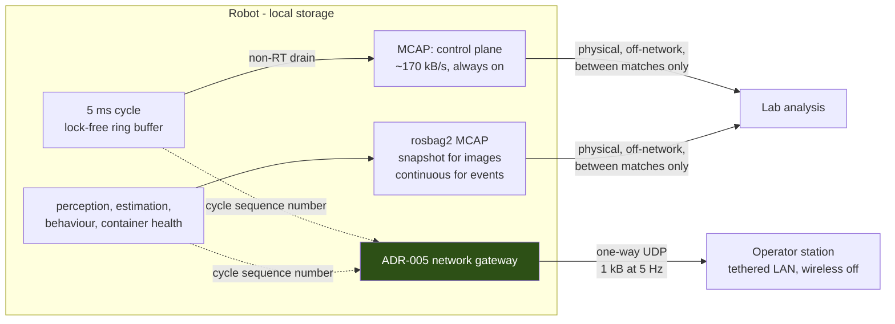

# ADR-008: Observability, Telemetry, and Competition Operations

- Status: Accepted
- Decision date: 2026-09-01
- Evidence last verified: 2026-09-01
- Scope: Topic 11
- Depends on: [ADR-001](ADR-001-real-time-actuation-and-hardware-abstraction.md), [ADR-002](ADR-002-safety-and-fault-management.md), [ADR-003](ADR-003-zenoh-middleware.md), [ADR-005](ADR-005-behavior-game-state-and-team-networking.md), [ADR-006](ADR-006-runtime-and-containers.md), [ADR-007](ADR-007-simulation-sil-hil.md)
- Research baseline: [Topic 11](../research/topic-11-observability-and-operations.md)

## Context

ADR-007 established what is recorded. Topic 11 asked what can be read, when, and by whom. It returned
three findings, and all three come from constraints the architecture had not yet been tested against.

### The rulebook forbids the standard debugging workflow

Three clauses of the _Laws of the Game 2025_ jointly eliminate live remote debugging.

> "The total bandwidth of each robot belonging to one team may not exceed 1 Mbit/s."

That is 125 kB/s, shared with GameController return traffic and the ADR-005 team plane. The ADR-007
in-cycle control log is approximately 170 kB/s, which is 1.36 times the entire per-robot allowance
before any other packet is sent. Streaming control telemetry is not merely expensive; it is
prohibited. The same arithmetic bounds extraction: one match's log at the full cap takes

$$\frac{204 \times 10^{6}\ \mathrm{B} \times 8}{1 \times 10^{6}\ \mathrm{bit/s}} \approx 1632\ \mathrm{s} \approx 27\ \mathrm{minutes}$$

against a half-time interval that "must not exceed 5 minutes".

> "Any kind of transmission from an external computer to the playing robots is prohibited... any
> monitoring is only done by receiving UDP communication from the robots using an external computer
> connected by tethered LAN to the official wireless router."

A Zenoh session is bidirectional by construction: the operator peer transmits to establish the link,
subscribe, and acknowledge. The ADR-003 operator link therefore cannot be active during play. The same
clause requires the operator station to be wired, and states that "All other wireless hardware must be
deactivated. A team may be disqualified if one of the team members violates this rule."

> "The regular penalty time will start counting only after any type of communication with the robot has
> finished and will be reset whenever the robot handler attempts to service the robot again."

Connecting a cable or pressing a button makes the robot "in service" and **restarts the penalty timer
from zero**. A three-attempt diagnostic session costs three full penalty periods of playing time. And
a robot that is misbehaving but safe cannot be retrieved at all, because pick-up is permitted "if and
only if a robot is in a dangerous situation that is likely to lead to physical injuries".

The design consequence is not a faster diagnostic cable. It is that the robot must be diagnosable
without being touched.

### Wall-clock timestamps cannot correlate the two telemetry planes

ADR-001 requires monotonic timestamps inside the cycle. ROS message header stamps are normally
`RCL_ROS_TIME`, which the `rcl` documentation defines as reporting "the latest value reported by a ROS
time source, or if a ROS time source is not active it reports the same as `RCL_SYSTEM_TIME`". The
system clock is settable and can step; the monotonic clock cannot.

The two planes therefore drift apart, and the drift is not small in the units that matter. A system
clock correction of a few hundred milliseconds — well within what NTP or a manual adjustment
produces — is 40 to 100 control cycles. Correlating the planes by timestamp would place a perception
result or a fault report in visibly the wrong part of the match, silently.

### Profiling requires privileges the runtime deliberately withholds

The Linux kernel documentation states that `perf_event_paranoid` has a "default value is 2", and that
level `>=2` will "Disallow kernel profiling by users without `CAP_PERFMON`", with level `>=1`
disallowing CPU event access on the same terms. `perf`, Nsight Systems CPU sampling, and Arm PMU
counters all fall under this.

ADR-006 §9 mandates minimum device privilege and prohibits `--privileged`. The profiling toolchain and
the runtime posture are in direct conflict, and the conflict has to be resolved explicitly rather than
by quietly granting the capability.

## Decision

### 1. Three telemetry planes

Telemetry is three planes with different owners, rates, and destinations. Nothing else leaves the robot
during play.

| Plane            | Rate     | Destination | Availability during play    |
| ---------------- | -------- | ----------- | --------------------------- |
| In-cycle control | 200 Hz   | Local MCAP  | Recorded, never transmitted |
| Non-real-time    | Variable | Local MCAP  | Recorded, never transmitted |
| Health beacon    | 5 Hz     | One-way UDP | The only external channel   |

Both recorded planes stay on the robot. Extraction is physical and off-network, and is a
between-matches action, never an in-match one.

### 2. Correlation is by control-cycle sequence number, never by timestamp

The control-cycle sequence number required by ADR-001 is the correlation key for the whole system.

- The in-cycle record's monotonic cycle time is written to the MCAP `publish_time` field, the drain
  thread's write time to `log_time`, and the cycle sequence number to `sequence`.
- **Every non-real-time producer whose output must be correlated with the control loop carries the
  cycle sequence number it was derived from**, not a timestamp. A perception result computed from a
  frame captured during cycle 41,203 is labelled 41,203.
- Where a producer genuinely has no cycle association, such as a container health report or a Zenoh
  link metric, it carries both clock readings, and the log carries periodic pairing records of
  `(monotonic, system)` samples so wall-clock artifacts can be mapped after the fact.

MCAP's `sequence` field is `uint32`. At 200 Hz it wraps after roughly $2^{32}/200 \approx 2.5 \times
10^{7}$ s, about 248 days, which is not reachable within a session.

Timestamp-based correlation between the two recorded planes is prohibited in analysis tooling, not
merely discouraged, because its failure mode is a plausible wrong answer rather than an error.

### 3. The in-cycle record is a custom binary layout inside a standard container

"MCAP or a custom binary format" is a false dichotomy. MCAP defines a container, and its `Schema`
record carries a free-form `encoding` field whose specification states that "An empty string indicates
no schema is available". A fixed-layout project record is therefore representable inside MCAP,
declared by its own schema, without pretending to be a ROS message.

The in-cycle record is:

| Group               | Fields                                                                                                                                                            | Bytes |
| ------------------- | ----------------------------------------------------------------------------------------------------------------------------------------------------------------- | ----- |
| Header              | Cycle sequence, monotonic cycle start, safety state, availability-mask epoch, availability mask, active controller ID, transport counters, deadline-overrun flags | 48    |
| Per joint, command  | $q_d$, $\dot q_d$, $\tau_{ff}$, $K_p$, $K_d$                                                                                                                      | 20    |
| Per joint, feedback | Measured $q$, $\dot q$, $\tau$                                                                                                                                    | 12    |
| Per joint, status   | Temperature, voltage, drive mode, fault bits                                                                                                                      | 8     |

The record is fixed size, with no strings and no optional fields, so that it is writable as one bounded
store. Variable-length encoding in the cycle is prohibited.

Three MCAP facilities are used deliberately:

- **`Schema`** declares the record layout and its version inside the file, so a log outlives the build
  that wrote it.
- **`Metadata`** carries the ADR-006 §10 release identity: container digest, host L4T version, safety
  manifest ID, calibration digests, protocol version, simulator version. A log can therefore never be
  analysed against the wrong build.
- **`Attachment`** carries the calibration files actually in force, which the specification explicitly
  contemplates: attachment records hold "auxiliary artifacts such as text, core dumps, calibration
  data, or other arbitrary data". Every log is self-contained.

Records are chunked, because the specification states that "Message records outside of chunks cannot be
indexed, and may not be found by readers using the index". Files roll on a bounded interval, so an
abrupt power cut costs at most one interval of index rather than the whole match.

### 4. The `SafetyKernel` must be auditable from the log

A log that records only the post-projection tuple cannot answer whether the kernel intervened, which
makes the single most safety-critical component in ADR-002 unobservable in exactly the situations that
matter.

The record therefore carries a **projection-occurred bitmask plus the per-joint delta, for projected
joints only**. Recording the full pre-projection tuple for every joint would add 20 B per joint,
400 B per cycle for 20 joints, taking the record to roughly 1248 B and 250 kB/s. The bitmask-and-delta
form is near-free in the common case where nothing is projected, and is adopted on that basis. The
full form remains the fallback if measurement shows the delta encoding costs more in-cycle time than
it saves in volume.

### 5. The health beacon is the only external channel during play

The beacon is a periodic one-way UDP datagram, budgeted at no more than 5 % of the per-robot cap. At
1 kB and 5 Hz it is 5 kB/s, or 40 kbit/s, which is 4 %.

It is **emitted by the ADR-005 network gateway**, because that process already owns every competition
socket and no other process may open one. It is sent on a **port separate from team communication**,
because the team message is consumed by robots and is bounded in content by the anti-coaching rule,
while the beacon is consumed by humans. Merging them would put debug information on the channel the
rule polices.

| Field group    | Content                                                                                          |
| -------------- | ------------------------------------------------------------------------------------------------ |
| Identity       | Release digest short form, safety manifest ID, calibration digests                               |
| Safety         | ADR-002 state, availability-mask epoch, last fault class, cycles since last fault                |
| Control        | Cycle overrun count, worst cycle duration in the last window, transport reject counters          |
| Estimation     | Odometry validity, pose mode weights, time since last accepted vision update                     |
| Behaviour      | Active tree, active role, GameController state and its age                                       |
| Platform       | Battery voltage, worst joint temperature, EMC utilisation with frequency, log storage free space |
| Communications | Teammates heard, Zenoh router state, packets rejected per validation rung                        |
| Compliance     | **This robot's own measured transmit volume**, so a bandwidth-cap violation is visible           |

### 6. Network posture during play

- The ADR-003 operator and development link is **disabled in the competition configuration**. This is
  a configuration difference from the lab posture and is part of the release identity.
- Monitoring at a physical competition is receive-only. No process may transmit toward a playing robot.
- The operator station connects by tethered LAN with its wireless hardware deactivated.
- Substitute robots on the bench are turned away from the field, as the rules require, and their
  competition transmit path is disabled while they are not in play.

### 7. The robot must be diagnosable without being touched

Because servicing resets the penalty clock and pick-up is unavailable for debugging, the in-play
diagnostic surface is the beacon plus what a human can perceive from the touchline.

**Physical status indication is therefore a requirement on the robot, not an optional feature.** A
visual indicator with distinguishable states and an audible indicator for safety transitions must
encode, at minimum: the ADR-002 safety state, the degraded-communications condition, and the ambiguous
field-direction condition from ADR-005. These are tracked as hardware requests in
[HARDWARE_REQUIREMENTS.md](HARDWARE_REQUIREMENTS.md).

### 8. Log storage is an interlocked resource

Silent non-recording — a full disk, an unmounted volume, a read-only mount, a permission error —
produces behaviour indistinguishable from a healthy system and is discovered only when the log is
needed.

Log storage writability and free space are therefore checked in the **ADR-002 startup interlock**, on
the same footing as a calibration mismatch, and free space is reported in the beacon. A robot that
cannot record does not silently play.

### 9. Calibration is four classes with four different gates

| Calibration                     | Changes when                               | Gate                                           |
| ------------------------------- | ------------------------------------------ | ---------------------------------------------- |
| **Joint zero offsets**          | Reassembly, drive replacement, hard impact | **ADR-002 startup interlock**                  |
| IMU bias                        | Every power cycle, and with temperature    | Topic 4 estimator validity signal              |
| Camera extrinsics               | Head reassembly, impact, lens disturbance  | Perception validity, with an independent check |
| Turf friction and ball dynamics | Every venue, and with surface wear         | Topic 6 D5 ball filter                         |

**Only joint zeroing enters the startup interlock.** The `SafetyKernel` joint envelope is expressed in
joint coordinates, so a zero-offset error shifts the entire envelope; that is a safety fault. The other
three degrade specific estimates and degrade gracefully. Interlocking all four would ground the robot
because a turf model is stale, which is the wrong trade.

All four are digest-identified, immutable within a release, written once rather than edited in place,
embedded in every log per §3, and reported in the beacon per §5.

### 10. Profiling is a named, non-default runtime configuration

- A single named runtime configuration grants `CAP_PERFMON` to exactly one container and relaxes the
  host `perf_event_paranoid` level. `CAP_SYS_ADMIN` is not used for this purpose; the kernel
  documentation states its use here "is discouraged".
- **The image is unchanged.** Only the runtime capability set differs, so ADR-006 §10 digest identity
  is preserved and ADR-007 §8's binary-identity principle is not violated.
- The profiling configuration is never deployed and never used at a competition.
- **Any timing number obtained under profiling is an upper bound on the observed system, not a
  measurement of the deployed one**, because the capability set and the paranoid level differ. This
  qualification is stated wherever such a number is reported.

`ros2_tracing` is treated differently and more favourably: its instrumentation is compiled in by
default and must be explicitly removed with `TRACETOOLS_DISABLED=ON`, so tracing is a runtime session
rather than a rebuild, and the shipped image already carries the tracepoints. Kernel tracing is not
included and requires `lttng-modules-dkms` separately. The tracing state is recorded in every timing
report, and the worst-case per-cycle overhead is measured on the target before tracing is enabled
during any timing-qualification run. The only published figure available, an average of 158 ns per
tracepoint, is from a third-party survey of a different system and is not accepted as evidence here.

`jetson_stats` and `jtop` are AGPL-3.0 and are lab conveniences only. They are never included in a
distributed image. Anything the architecture depends on reads `tegrastats` directly, which ships with
L4T.

### 11. In-cycle performance counters are first-class fields

Cycle duration, deadline-overrun flags, and transport counters are fields in the in-cycle record
header, not values derived later from timestamps.

The reason is operational rather than aesthetic. Every other performance instrument is unavailable at
a competition: `perf` and Nsight need privileges §10 withholds, Nsight additionally "will always be
separate" host and target on Tegra, and the LTTng kernel tracer is a lab installation. **The only
performance instrument that works on the field is the one built into the control loop.**

### 12. Memory-bandwidth counters are always recorded with their frequency

NVIDIA defines the `tegrastats` EMC field as the "Percentage of EMC memory bandwidth in use relative to
the current running frequency", alongside a separate frequency figure. DVFS changes that frequency at
runtime, so a rising percentage may mean rising traffic or falling frequency.

- `EMC %` is never recorded, reported, or budgeted without its accompanying frequency.
- Memory-bandwidth budgets are stated in absolute terms, computed from both values.
- **The counter semantics are validated empirically before use**, by running a known synthetic memory
  load and confirming the counters respond as predicted. This is required because the published
  r36.4.3 documentation still contains unresolved internal editorial queries about these exact fields,
  including "There's an `EMC_FREQ` in the examples but no `EMC`. Are they the same?" The vendor's own
  documentation does not settle what the field is called, so an unvalidated reading of it is not
  evidence.

This is the instrument that addresses the Topic 9 open gap: core pinning does not partition memory
bandwidth or last-level cache on Orin. Nsight Systems Embedded Platforms Edition, which samples "counters
from Arm PMU" so that "cache misses gets statistically correlated with function execution", is the
higher-resolution follow-up in the lab.

### 13. Rollback is a whole-release operation, prepared in advance

- **Both release digests are resident on the robot before the tournament begins.** Pulling an image at
  a venue is not possible under the §Context bandwidth arithmetic.
- **A release is the container image digest plus the safety manifest, calibration digests, and Zenoh
  configuration digests, and they are reverted together.** Reverting the image alone recreates exactly
  the identity mismatch the ADR-002 interlock exists to catch. That fails safe, but it fails.
- **Rollback is validated by the same pre-match checks**, on the clock, inside the five-minute
  half-time or the between-matches window. A rollback that cannot be validated in that window is not a
  rollback.

The pre-match checks worth automating are the ones whose failure is silent: release digest, calibration
and safety manifest identity, log storage state, GameController broadcast reception on the venue
network, teammate reception, beacon reaching the operator station, and operator-station wireless
deactivation.

## Consequences

### Positive

- The telemetry architecture is rule-compliant by construction rather than by convention. The 1 Mbit/s
  cap is not a limit the design approaches; it is a limit the design cannot reach, because the two
  large planes never touch the network.
- Correlation survives clock steps, NTP corrections, and time-source changes, because it does not use
  clocks.
- Every log is self-contained: the build that produced it, the calibration in force, and the schema
  that decodes it are all inside the file.
- The `SafetyKernel` becomes auditable after the fact, which was previously impossible.
- The profiling conflict with ADR-006 is resolved without weakening the deployed posture and without
  creating a second image.
- The instrument that matters most at a competition — in-loop cycle timing — is the one that is always
  available, and it feeds both the log and the beacon.

### Costs and constraints

- **Physical status indication is a hardware deliverable.** It requires panel area, wiring, and power
  that no one has budgeted, and the physical envelope is undesigned at Topic 3 Model Gate 0.
- The beacon adds a second competition-plane message to the gateway, which is the most safety-sensitive
  process on the competition network, and its content must be reviewed against the anti-coaching rule
  even though it is not received by robots.
- The pre-projection delta encoding adds branching to the in-cycle write path. It must be measured
  against the ADR-006 gate 4 budget before it is accepted.
- Log storage capacity, medium, and write endurance remain unselected, and the perception-plane volume
  is unbudgeted until the camera is chosen. Both are tracked as hardware requirements.
- Calibration procedures cannot be written until Model Gate 0 closes. Only the workflow, identity
  scheme, storage format, and interlock are buildable now.
- Turf-friction estimation has no released tooling and must be a project-built on-site procedure.
- The touchline-signal design is proposed from reasoning, not measurement. Its legibility under
  competition lighting and noise is untested.

## Rejected alternatives

| Alternative                                                             | Why rejected                                                                                                                                                       |
| ----------------------------------------------------------------------- | ------------------------------------------------------------------------------------------------------------------------------------------------------------------ |
| Live streaming of control telemetry to an operator station              | 170 kB/s against a 125 kB/s per-robot cap. Prohibited by rule, not merely expensive.                                                                               |
| Log extraction over the competition WLAN between halves                 | 27 minutes at the cap, against a half-time that "must not exceed 5 minutes".                                                                                       |
| Zenoh or any bidirectional session as the in-play monitoring path       | "Any kind of transmission from an external computer to the playing robots is prohibited." A session requires the operator peer to transmit.                        |
| Wireless operator station or wireless debug link at a physical event    | "All other wireless hardware must be deactivated. A team may be disqualified if one of the team members violates this rule."                                       |
| Plugging in a laptop to diagnose a robot during play                    | Connecting a cable makes the robot "in service" and resets the penalty timer to zero on every attempt.                                                             |
| Correlating the telemetry planes by wall-clock timestamp                | Header stamps are `RCL_ROS_TIME`, which without an active source is the settable system clock. A 300 ms step is 60 control cycles, and the error is silent.        |
| A bespoke non-MCAP binary log format for the control plane              | Unnecessary. MCAP's schema encoding is free-form, so the custom record already fits, and one toolchain then reads both planes with indexing and chunk compression. |
| Reusing the ADR-005 team message as the health beacon                   | The team message is consumed by robots and bounded by the anti-coaching rule. Debug content does not belong on that channel.                                       |
| Recording only the post-projection command tuple                        | Makes the `SafetyKernel` unauditable in precisely the cases that require auditing.                                                                                 |
| `rosbag2` `snapshot_mode` for the safety and behaviour event streams    | A snapshot buffer is discarded unless triggered. Low-rate events are cheap and must be recorded unconditionally; snapshot is for the high-rate image plane.        |
| Interlocking all four calibration classes at startup                    | Would ground the robot because a turf-friction model is stale. Only a joint-zero error shifts the `SafetyKernel` envelope.                                         |
| Granting `CAP_PERFMON` to the deployed configuration                    | Contradicts ADR-006 §9 minimum privilege for a capability needed only in the lab.                                                                                  |
| `CAP_SYS_ADMIN` instead of `CAP_PERFMON` for profiling                  | The kernel documentation states this usage "is discouraged" and it grants far more than profiling requires.                                                        |
| A separate build with tracing instrumentation compiled in               | Unnecessary: instrumentation is present by default. A second build would break the ADR-007 §8 tested-binary-is-shipped-binary principle.                           |
| Quoting the published 158 ns per-tracepoint average as the project cost | A third-party average from a different system. At 200 Hz the binding figure is worst case within a 5 ms budget, on Orin.                                           |
| `jetson_stats` as a runtime dependency                                  | AGPL-3.0, excluded by Topic 5 §4.1.1 for distributed code. `tegrastats` ships with L4T and answers the same question.                                              |
| Reporting `EMC %` without its frequency                                 | The percentage is normalised to the current DVFS frequency and is uninterpretable alone.                                                                           |
| Rolling back the container image alone                                  | Recreates the ADR-002 identity mismatch between image, safety manifest, and calibration.                                                                           |
| Pulling a replacement image at the venue                                | Not achievable under the bandwidth cap within any available window.                                                                                                |

## Verification gates

Topic 11 §7 defines gates 1-14 in full. The binding summary:

| #   | Gate                                                                                                                                                         |
| --- | ------------------------------------------------------------------------------------------------------------------------------------------------------------ |
| 1   | Total transmitted volume per robot over a full match, under worst-case team and beacon traffic, is below 1 Mbit/s with margin, measured at the gateway.      |
| 2   | No process transmits toward a playing robot. The ADR-003 operator link is provably disabled in the competition configuration.                                |
| 3   | Worst-case cycle duration with in-cycle logging enabled and disabled differs by less than the ADR-006 gate 4 budget.                                         |
| 4   | Stepping the system clock during a recorded run leaves control-cycle correlation unaffected.                                                                 |
| 5   | Repeated mid-match power cuts lose at most one file-roll interval; the remainder is readable and indexed.                                                    |
| 6   | Booting with a full disk, an unmounted log volume, or a read-only mount is caught by the startup interlock and reported in the beacon.                       |
| 7   | A forced `SafetyKernel` projection is recoverable from the log for the affected joints, pre- and post-projection.                                            |
| 8   | Every ADR-002 fault class is diagnosable from the beacon and touchline signals alone, or is documented as a known blind spot.                                |
| 9   | Battery change, inspection, log extraction, and pre-match checks complete inside 5 minutes, repeatedly, executed by someone who did not write the procedure. |
| 10  | A synthetic memory load produces the predicted `tegrastats` EMC response; absolute bandwidth is computed from percentage and frequency together.             |
| 11  | No deployed container holds `CAP_PERFMON` or `CAP_SYS_ADMIN`. The profiling configuration is separate, named, and non-default.                               |
| 12  | Worst-case `ros2_tracing` overhead is measured on Orin under full load, not quoted. Tracing state appears in every timing report.                            |
| 13  | Rollback to the previous release digest, including calibration and configuration, passes the pre-match checks inside the between-matches window.             |
| 14  | Topic 8 gate 3 broadcast reception is re-run and passes on the venue network, not inferred from the lab result.                                              |

## References

- [Topic 11 research baseline](../research/topic-11-observability-and-operations.md) — full evidence, verbatim source quotations, and open gaps.
- RoboCup Humanoid League, _Laws of the Game 2025_ (14 April 2025) — bandwidth cap, WLAN and tethered-LAN restrictions, in-service and penalty-clock clauses, Request for Pick-up, half-time interval, substitutions.
- `foxglove/mcap` `website/docs/spec/index.md` — record opcodes and field semantics for `Schema`, `Channel`, `Message`, `Chunk`, `Attachment`, and `Metadata`.
- `ros2/rcl` `rcl/include/rcl/time.h` — `RCL_ROS_TIME`, `RCL_SYSTEM_TIME`, and `RCL_STEADY_TIME` semantics.
- `ros2/rosbag2` `rosbag2_storage/storage_options.hpp` and `rosbag2_transport/record_options.hpp` — `snapshot_mode`, file rolling, cache bounds, compression thread priority, QoS overrides.
- `ros2/ros2_tracing` `README.md` — LTTng dependency, userspace-only default, `TRACETOOLS_DISABLED`, and the cited per-tracepoint overhead figure.
- `torvalds/linux` `Documentation/admin-guide/sysctl/kernel.rst` — `perf_event_paranoid` default and level table.
- NVIDIA _Jetson Linux Developer Guide_ r36.4.3, Tegrastats Utility — EMC field definition and the unresolved editorial queries quoted in §12.
- NVIDIA _Nsight Systems Installation Guide_ — Embedded Platforms Edition scope, Arm PMU sampling, separate-host requirement on Tegra.
- `rbonghi/jetson_stats` `LICENSE` — GNU Affero General Public License v3.
