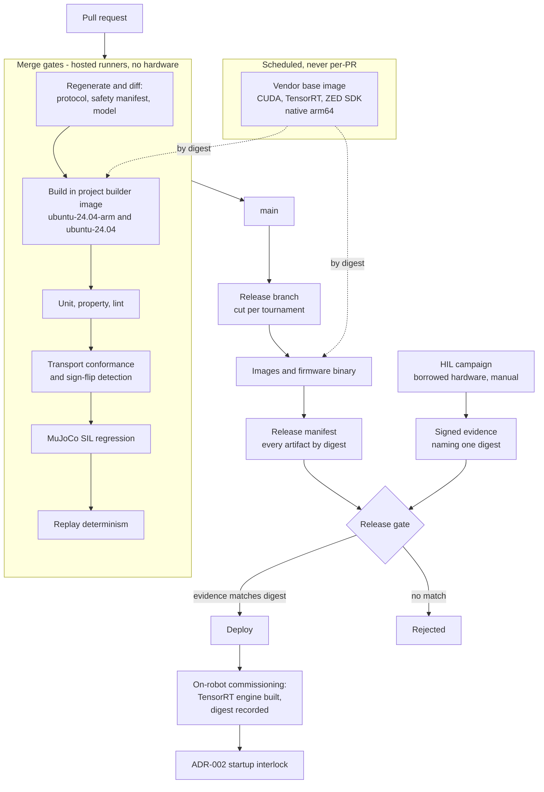

# ADR-009: Development Workflow, CI/CD, and Release Management

- Status: Accepted
- Decision date: 2026-09-01
- Evidence last verified: 2026-09-01
- Scope: Topic 12
- Depends on: [ADR-001](ADR-001-real-time-actuation-and-hardware-abstraction.md), [ADR-002](ADR-002-safety-and-fault-management.md), [ADR-003](ADR-003-zenoh-middleware.md), [ADR-005](ADR-005-behavior-game-state-and-team-networking.md), [ADR-006](ADR-006-runtime-and-containers.md), [ADR-007](ADR-007-simulation-sil-hil.md), [ADR-008](ADR-008-observability-and-operations.md)
- Research baseline: [Topic 12](../research/topic-12-development-workflow-and-cicd.md)

## Context

Eight ADRs define what must be built, how it must behave, and what evidence must exist before it ships.
Almost every one of them ends in a verification gate. This ADR defines the machinery that produces that
evidence — and, more usefully, records what the available machinery cannot produce, so that no gate is
written against a capability the project does not have.

Three project inputs were fixed before research began, because each changes the answer rather than
colouring it: the repositories are **public and hosted on GitHub**, the team is **5 to 10 developers**,
and there is **no dedicated hardware — everything is shared and borrowed**.

### The absence of dedicated hardware is less damaging than it appears

ADR-006-11 requires CUDA, TensorRT, and ZED SDK layers to be built natively on arm64, because emulating
them is prohibitively slow. With no dedicated hardware, that requirement would normally force a
self-hosted runner the project cannot supply.

GitHub's documentation resolves it, verbatim:

> "For public repositories, jobs using the workflow labels shown in the table below will run with the
> associated specifications. ... **Use of the standard GitHub-hosted runners is free and unlimited on
> public repositories.**"

The table's Linux arm64 row offers 4 CPU, 16 GB of memory, and 14 GB of storage under the label
`ubuntu-24.04-arm`. That is Ubuntu 24.04 Noble on arm64 — precisely the ADR-006 target platform, and
precisely the platform REP-2000 lists as the only arm64 Tier 1 target for Jazzy.

The corresponding negative finding is equally clean: `ros-tooling/cross_compile`, described by its own
maintainers as "A tool to build ROS and ROS2 workspaces for various targets", reports
`archived: true` with a last push of **2022-12-14**. There is no maintained ROS 2 cross-compilation
path, and there no longer needs to be one.

What the runners cost instead is **disk and wall clock**. 14 GB is shared with the runner image's own
preinstalled toolchains, against JetPack-based Jazzy images of 5.1 GB and 5.9 GB as distributed and
larger once unpacked. Job execution time is hard-capped: "Each job in a workflow can run for up to
6 hours of execution time. If a job reaches this limit, the job is terminated and fails."

### Three supply chains, and one of them had no rule

ADR-006-10 already requires every image and base image to be referenced by digest. Topic 12 found two
further external inputs that were not covered by any rule, and both fail in the same way.

`vcstool` documents its own default, verbatim:

> "If the repository is currently on the tip of a branch the branch is followed. **This implies that a
> later import might fetch a newer revision if the branch has evolved in the meantime.** ... To make
> sure to store the exact revision in the exported data use the command line argument `--exact`."

A `.repos` file whose `version` keys name branches is therefore not a pin. It is a moving reference
that silently produces a different workspace on a later build — exactly the defect ADR-006-10 exists to
prevent, one layer down.

Separately, `colcon`, `rosdep`, and `vcstool` are **absent from the Jazzy distribution manifest**. They
are distribution-independent tools delivered through PyPI and the ROS apt repository. Choosing Jazzy
pins the ROS packages and pins nothing about the tools that build them.

GitHub states the third case in the same terms:

> "**Pin actions to a full-length commit SHA.** Pinning an action to a full-length commit SHA is
> currently the only way to use an action as an immutable release."

Three supply chains, one control, previously applied to one of them.

### Two required environments cannot exist in CI, and one legal question was never asked

No standard GitHub-hosted runner has a GPU. That splits the ADR-007 verification estate cleanly:

- **MuJoCo software-in-the-loop runs in CI, free, on both architectures**, because ADR-007-02 selected
  it partly for being CPU-only. The primary regression oracle is therefore a merge gate at zero cost.
- **TensorRT engines cannot be built in CI**, because engine construction requires the target GPU. With
  no borrowed-hardware runner, there is no automated path to a built engine.
- **Isaac Lab cannot run in CI at all.**

Finally, Topic 5 established that the ZED SDK is closed-source, and excluded AGPL and GPL from
distributed application code because copyleft cannot be linked against it. **The converse was never
examined.** The repositories are public, and a pipeline that builds and pushes a perception image would
be redistributing the ZED SDK inside a publicly pullable container image. Freely downloadable is not
freely redistributable, and a public registry push is redistribution. The governing licence terms are
**NR**.

## Decision

### 1. One repository

The ROS 2 workspace, the STM32 firmware, the protocol and safety manifest definitions, the model
generation pipeline, and all configuration live in one repository.

The argument is ADR-007-07, not team size. That decision requires **one machine-readable protocol
definition to drive the production transport, the Jetson-side HIL emulator, the firmware-side emulator,
and the firmware tests**. ADR-002 requires a versioned safety manifest shared by the Jetson and the
STM32. ADR-001 requires joint identity, units, and sign conventions to come from one generated
artifact.

Each of those is a single source of truth with consumers on both sides of the host/firmware boundary.
In a polyrepo, changing the protocol is an atomic change across four repositories, and git provides no
atomic multi-repository commit. The failure mode is not inconvenience; it is a merged host-side change
whose firmware side landed separately, which is exactly the drift the ADR-002 identity interlock exists
to catch at runtime. **Catching it at runtime is a worse outcome than never creating it.**

At 5 to 10 developers there is no team boundary that repository separation would protect. The boundary
that needs protecting is the package boundary, and `CODEOWNERS` protects that inside one repository.

`vcstool` is used only for genuinely external sources that are unavailable as binary packages. It is
never the mechanism for internal structure.

### 2. One pinning rule across three supply chains

Every external input is referenced by content identity, never by a moving name.

| Supply chain          | Pinned by                                                                                  | Enforced by                                     |
| --------------------- | ------------------------------------------------------------------------------------------ | ----------------------------------------------- |
| Container images      | Digest (`@sha256:...`), including base images                                              | ADR-006-10, extended here to CI builder images  |
| External source trees | Commit hash in `.repos`, via `vcs export --exact`                                          | CI check rejecting any non-hash `version` value |
| GitHub Actions        | Full-length commit SHA                                                                     | CI check rejecting tag or branch references     |
| Build tools           | Explicit `colcon`, `rosdep`, and `vcstool` versions inside the digest-pinned builder image | Builder image manifest                          |

This is one invariant stated once, not four conventions to remember separately. A moving reference in
any of the four positions defeats the release identity that ADR-002, ADR-003, ADR-006, and ADR-008 all
depend on.

### 3. Continuous integration runs the project's own builder image

The build and test steps execute inside the project's digest-pinned builder container. No ROS-specific
GitHub Action is in the critical path. The workflow layer performs checkout, container invocation,
caching, and artifact handling only.

Two reasons, in order of weight.

First, **it makes continuous integration and local development the same environment**. ADR-007-08
requires that the tested binary is the shipped binary. A build performed in an image that is neither
the developer's nor the robot's introduces a third environment that no decision accounts for.

Second, arm64 support in the available ROS actions is **NR**. `ros-tooling/action-ros-ci@v0.4` and
`ros-tooling/setup-ros@v0.7` both document Jazzy explicitly and mention arm64 or aarch64 **zero times**;
`ros-industrial/industrial_ci` does not mention Jazzy at all. That is not a denial, and it is not
something to place under the release path.

### 4. Native arm64 builds; cross-compilation is rejected

All arm64 artifacts are built natively on `ubuntu-24.04-arm`. amd64 artifacts are built on
`ubuntu-24.04`.

Cross-compilation is rejected on evidence rather than preference: the official tool is archived and
unmaintained since 2022, and the native alternative is free. QEMU emulation remains permitted under
ADR-006-11 for cheap layers only, using `docker/setup-qemu-action`.

If GitHub's free arm64 runner terms change, this decision degrades to a borrowed or rented arm64 runner
without redesign, because nothing above the runner label depends on the provider.

### 5. Vendor layers are a separately versioned base image on a schedule

CUDA, TensorRT, and ZED SDK layers are built into a base image on a schedule and on dependency change,
never in the pull-request path. Downstream builds consume it **by digest**.

This is forced by two verified limits. A single job holding a multi-gigabyte base, its intermediate
layers, and the output simultaneously is not obviously survivable within 14 GB, and a full vendor build
on four vCPU is not obviously survivable within 6 hours. Registry-backed cache (`cache-to type=registry`)
carries the expensive layers between runs rather than rebuilding or co-resident storage.

The secondary benefit is that the vendor layer acquires its own digest and version history, which is
what ADR-006-10 wanted anyway.

### 6. Merge gates are exactly those that require no hardware

The merge gate set is: compile on both architectures, unit and property tests, lint, generated-artifact
drift, transport conformance including sign-flip detection, MuJoCo SIL regression, replay determinism,
and a container image build without push.

Everything else is deliberately not a merge gate. A gate that cannot run is worse than no gate, because
it advertises coverage that does not exist.

### 7. Generated artifacts are verified by regeneration and diff

Continuous integration regenerates the protocol definition, the safety manifest, and the robot model
from their sources and fails if the result differs from what is committed.

This costs seconds, requires no reviewer vigilance, and makes hand-editing generated output
**impossible rather than discouraged**. It is the same mechanism as a formatting check applied to a far
more dangerous class of file — one whose consumers include firmware that will act on it.

The complement is behavioural: the ADR-001 transport conformance suite runs against every transport, and
ADR-007's sign-flip gate — a deliberate joint sign inversion in the manifest, the simulator model, or
the firmware — is executed as a merge gate, because it needs no hardware.

### 8. Package quality levels are declared per package using REP-2004

Each package declares a REP-2004 quality level in its manifest.

The packages carrying safety authority — `HumanoidActuatorSystem`, the `SafetyKernel`, the
`ActuatorTransport` interface, the protocol definition, and the safety manifest schema — are held to
Level 1 requirements. REP-2004 states those verbatim as including "Must have a version policy (e.g.
`semver`)", "**Must have a strictly declared public API**", "Must have a policy for API stability",
"Must have a policy for ABI stability", "Must have system, integration, and/or unit tests which cover
all of the public API", and "_Must have code coverage tracking for the package_" together with an
enforced coverage policy for new changes.

Packages without safety authority declare a lower level and are not held to those requirements.
Applying one standard uniformly across a 5 to 10 person project would be theatre; applying an external,
ROS-native standard selectively and visibly is not. `CODEOWNERS` covers the Level 1 set.

### 9. TensorRT engines are device-local commissioning artifacts

Continuous integration pins the serialized network and the engine build recipe. It does not build the
engine.

The engine is built **on the robot, in a deliberate gated commissioning step**, and its digest joins the
release manifest and the ADR-002 startup identity interlock alongside the TensorRT version, the CUDA
version, the L4T version, and the module identity.

Building silently at first run is prohibited. That variant produces a device-local artifact that is not
in any image digest and not in any interlock, which means a robot could play with an engine nobody
recorded — a direct contradiction of ADR-006-10 and ADR-008 §3. Making the step explicit does not remove
the non-reproducibility; it makes it visible, versioned, and interlocked.

The exact rules governing engine portability across GPU architecture and TensorRT version are **NR**;
NVIDIA's hardware-compatibility documentation page was unreachable during verification. This decision is
deliberately conservative for that reason and does not depend on the answer.

### 10. Hardware-in-the-loop is a release gate enforced by evidence, not a merge gate

ADR-007 defines three HIL configurations. None can run on a hosted runner, and there is no rig to attach
to a self-hosted one. Rather than write a gate that never executes, the gate changes what it checks.

A HIL campaign produces a **signed evidence record** naming the release digest under test, the
configuration (H1, H2, or H3), the fault campaign enumerated from the ADR-002 product, the results, and
the operator. Continuous integration cannot produce that record. It can, cheaply and reliably, verify at
release time that such a record exists, is signed, is structurally complete against every ADR-002 fault
class, and **names the exact digest being released**.

Binding the evidence to the digest is what makes this rigorous rather than decorative. A rebuild
produces a new digest, so stale evidence invalidates itself without anyone having to notice. It is
impossible to ship a binary that no campaign covered, because the digest would not match — and the
digest is already the release identity under ADR-006-10.

The accepted cost is that hardware-in-the-loop becomes a deliberate, scheduled human activity. With
borrowed hardware it was always going to be.

### 11. The release is a manifest, not an artifact

A release is a single signed manifest naming, by digest or exact version:

- Every container image, including the vendor base image
- The STM32 firmware binary
- The protocol definition version
- The safety manifest and qualified policy identifiers
- The calibration set, per ADR-008 §9
- The Zenoh peer, router, QoS, and security configuration
- The robot model
- The simulator version, per ADR-007-11
- The TensorRT engine identity, per §9 above
- The competition versus laboratory network posture, per ADR-008 §6

This is not a new mechanism. It is the union of what ADR-003, ADR-006 §10, ADR-007 §11, and ADR-008 §13
each already require, collected into one artifact that continuous integration produces and attests. The
ADR-008 §13 rollback operates on this manifest, which is why both release manifests and both sets of
digests must be resident on the robot before a tournament begins.

### 12. The dual release train is coupled by protocol version

Container images and firmware binaries are versioned together. A protocol definition change forces a
coordinated release of both.

The ADR-002 identity interlock remains the runtime backstop, not the primary mechanism. An interlock
that fires regularly is a process failure being absorbed by a safety feature.

### 13. Public-repository security posture

| Control                                                                            | Rationale                                                                                                                           |
| ---------------------------------------------------------------------------------- | ----------------------------------------------------------------------------------------------------------------------------------- |
| Default `GITHUB_TOKEN` permission is read-only; elevation is per job and justified | "a compromise of a single action within a workflow ... would have access to all secrets configured in your repository"              |
| Third-party actions pinned by full-length commit SHA                               | §2. A tag "can be moved or deleted if a bad actor gains access to the repository storing the action"                                |
| Pull requests from forks receive no secrets and no registry write                  | A fork pull request able to publish an image or a release manifest would reach the ADR-002 startup interlock through the front door |
| `pull_request_target` is prohibited unless individually justified                  | It executes with the base repository's permissions against untrusted head content                                                   |
| Publishing occurs only from protected refs                                         | Release identity must not be producible from an arbitrary branch                                                                    |
| Workflow logs and artifacts are treated as public                                  | They are public                                                                                                                     |

### 14. No image containing the ZED SDK is published until redistribution rights are confirmed

**This is a blocking constraint, not an advisory note.**

Until the Stereolabs licence terms governing redistribution inside a container image are obtained in
writing and recorded in this repository, no image containing the ZED SDK may be pushed to a public
registry.

Until then, the perception image is built in continuous integration and either retained as a
non-published artifact, pushed to a private registry, or built on the robot from a recipe. The build
recipe and the SDK version remain public; the redistributed binary does not.

This is the same class of constraint as the Topic 5 §4.1.1 exclusion of AGPL and GPL, applied in the
opposite direction. Open-sourcing the project increases licence exposure rather than removing it.

### 15. No timing figure may originate in continuous integration

ADR-007-05 already prohibits quoting software-in-the-loop output as timing evidence. That prohibition
extends to the continuous integration runner itself, which is a shared virtual machine of unknown
contention.

Every timing figure in release evidence names the real hardware it was measured on. This closes the
route by which a convenient number from a green build becomes a quoted latency.

### 16. Trunk-based development with a release branch per tournament

Development is trunk-based with short-lived branches and the merge gates of §6. A release branch is cut
before each tournament.

After the cut, only cherry-picks carrying a matching HIL evidence record under §10 enter the branch.
This is the mechanism that makes §10 binding during the period when schedule pressure is highest and the
temptation to skip the campaign is greatest.

## Consequences

### Positive

- The native arm64 build requirement of ADR-006-11 is satisfied with **no dedicated hardware and no
  cost**, on the exact platform REP-2000 lists as Jazzy's only arm64 Tier 1 target.
- The ADR-007 primary regression oracle is a merge gate, because MuJoCo is CPU-only.
- Digest pinning becomes one invariant covering images, sources, actions, and build tools, rather than
  one rule and three gaps.
- Protocol drift between the host and the firmware becomes structurally impossible to merge, rather than
  detectable at runtime.
- Continuous integration and local development are byte-identical environments, which is what ADR-007-08
  actually requires.
- A legal exposure created by open-sourcing the project was identified before the first publish rather
  than after.
- Hardware-in-the-loop coverage is enforced against the release digest, so it cannot silently go stale.

### Costs and constraints

- **Hardware-in-the-loop is manual.** Regressions that only appear on real hardware are found later than
  they would be with a dedicated rig. The evidence gate bounds the damage; it does not remove it.
- **TensorRT engines are not reproducible from the repository.** The commissioning step is a
  human-in-the-loop dependency on every deployment to new hardware.
- **14 GB and 6 hours are real ceilings.** The layered base-image design exists to fit inside them and
  must be re-measured whenever a vendor dependency grows.
- **The perception image may not be publishable at all** until §14 resolves, which would make the
  project partially open-source in practice: fully open recipe, non-public binary.
- **Free arm64 runners are vendor policy, not contract.** The design must remain portable to a paid or
  borrowed runner.
- Selective REP-2004 compliance means the safety-critical packages carry real overhead — declared APIs,
  ABI policy, enforced coverage — that the rest of the codebase does not.
- Trunk-based development with a hard release-branch freeze requires discipline that a 5 to 10 person
  team must actively maintain.

## Rejected alternatives

| Alternative                                                          | Why rejected                                                                                                                      |
| -------------------------------------------------------------------- | --------------------------------------------------------------------------------------------------------------------------------- |
| Polyrepo split by domain                                             | ADR-007-07's single protocol definition has four consumers across the host/firmware boundary; git has no atomic multi-repo commit |
| Separate repository for firmware only                                | Same failure, smaller. The safety manifest and protocol are shared with the host                                                  |
| `vcstool` to compose first-party packages from separate repositories | Recreates the polyrepo problem while adding a tool whose default is to follow branches                                            |
| Branch names in `.repos` files                                       | Not a pin. vcstool documents that a later import may fetch a newer revision                                                       |
| Cross-compilation to arm64                                           | `ros-tooling/cross_compile` is archived since 2022; native arm64 runners are free                                                 |
| QEMU emulation for the full image build                              | Prohibited for CUDA, TensorRT, and ZED SDK layers by ADR-006-11; permitted only for cheap layers                                  |
| `ros-tooling/action-ros-ci` as the build mechanism                   | arm64 support is NR, and it introduces a third build environment that neither developers nor the robot use                        |
| `ros-industrial/industrial_ci`                                       | Does not mention Jazzy in its documentation; same third-environment objection                                                     |
| Self-hosted runner on a borrowed Jetson                              | "Borrowed" is not "available"; a runner that is sometimes absent produces a gate that is sometimes skipped                        |
| Building TensorRT engines in continuous integration                  | No standard hosted runner has a GPU                                                                                               |
| Building the TensorRT engine silently on first run                   | Produces an artifact outside every digest and every interlock                                                                     |
| Shipping a prebuilt engine in the container image                    | Requires a GPU builder the project does not have                                                                                  |
| HIL as a merge gate                                                  | No rig exists. A gate that cannot run advertises coverage that does not exist                                                     |
| Waiving HIL for "small" changes                                      | The digest changes, so the evidence no longer matches; size is not a property the release identity can see                        |
| Monolithic single-job image build                                    | 14 GB storage and a 6-hour job cap                                                                                                |
| Tag-pinned GitHub Actions                                            | GitHub states a full-length commit SHA is "the only way to use an action as an immutable release"                                 |
| Relying on the ROS distribution to pin `colcon` and `rosdep`         | They are absent from the distribution manifest; they are distribution-independent                                                 |
| Publishing the perception image now and resolving licensing later    | Redistribution without confirmed rights is not reversible by deleting the tag                                                     |
| Quoting continuous integration timings as performance evidence       | A shared virtual machine of unknown contention; ADR-007-05 already forbids the analogous SIL case                                 |
| Git-flow with long-lived develop and feature branches                | At 5 to 10 developers it adds merge surface without adding a control the merge gates do not already provide                       |

## Verification gates

| #   | Gate                                                           | Pass condition                                                                                                                            |
| --- | -------------------------------------------------------------- | ----------------------------------------------------------------------------------------------------------------------------------------- |
| 1   | Native arm64 workspace build on `ubuntu-24.04-arm`             | Completes within 6 hours, with measured usable disk headroom recorded                                                                     |
| 2   | Perception image build with CUDA, TensorRT, and ZED SDK layers | Completes without exhausting runner storage, using registry-backed cache                                                                  |
| 3   | Environment equivalence                                        | A CI-produced binary and a locally produced one from the same builder digest are identical, or every difference is explained and recorded |
| 4   | Generated-artifact drift                                       | A hand-edited generated file is regenerated, diffed, and rejected                                                                         |
| 5   | Sign-flip detection                                            | A deliberate joint sign inversion in the manifest, the simulator model, and the firmware is each detected in CI                           |
| 6   | SIL regression as a merge gate                                 | A behavioural regression against a stored trajectory is detected on a hosted runner, both architectures                                   |
| 7   | Replay determinism                                             | Bit-identical within one build and architecture; cross-architecture reported separately by tolerance                                      |
| 8   | Source pinning                                                 | Every release `.repos` `version` value is a commit hash. No branch names                                                                  |
| 9   | Build-tool pinning                                             | `colcon`, `rosdep`, and `vcstool` versions are explicit and the builder image is referenced by digest                                     |
| 10  | Action pinning                                                 | Every third-party action is referenced by full-length commit SHA                                                                          |
| 11  | Token privilege                                                | Default `GITHUB_TOKEN` permission is read-only; every elevation is per job and justified                                                  |
| 12  | Fork pull requests are powerless                               | A fork pull request attempting to publish obtains no secret, no registry write, and no manifest write                                     |
| 13  | HIL evidence binds to a digest                                 | A release with no campaign record, and one whose record names a different digest, are both rejected                                       |
| 14  | Release manifest completeness                                  | Every artifact class in §11 is present and identified                                                                                     |
| 15  | Rollback from the manifest alone                               | The ADR-008 §13 drill completes within the between-matches window using only the previous manifest                                        |
| 16  | Engine identity is interlocked                                 | A robot whose TensorRT engine digest does not match the release manifest fails the ADR-002 startup interlock                              |
| 17  | No CI-origin timing claim                                      | Every timing figure in release evidence names real hardware                                                                               |
| 18  | Redistribution block is effective                              | No public registry contains an image with the ZED SDK until §14 resolves                                                                  |

## References

- `github/docs` `data/reusables/actions/supported-github-runners.md` — hosted runner specifications, arm64 workflow labels, and the free-and-unlimited statement for public repositories.
- `actions/runner-images` `README.md` — available images and label stability.
- `github/docs` `content/actions/reference/limits.md` — 6-hour job execution limit and workflow run limits.
- `github/docs` `content/actions/reference/security/secure-use.md` — commit-SHA pinning, third-party action risk, and `GITHUB_TOKEN` least privilege.
- GitHub repository API for `ros-tooling/cross_compile` — `archived: true`, last push 2022-12-14.
- `dirk-thomas/vcstool` `README.rst` — branch-following import behaviour and the `--exact` export flag.
- `ros/rosdistro` `jazzy/distribution.yaml` — released toolchain versions; absence of `colcon`, `rosdep`, and `vcstool`.
- `ros-infrastructure/rep` `rep-2004.rst` — quality level definitions and Level 1 requirements.
- `docker/build-push-action` `README.md` — `platforms`, `provenance`, and registry-backed cache inputs.
- `ros-tooling/action-ros-ci`, `ros-tooling/setup-ros`, `ros-industrial/industrial_ci` — Jazzy support and the absence of any arm64 statement.
- [Topic 12 research baseline](../research/topic-12-development-workflow-and-cicd.md) — full evidence, derivations, and open gaps.
