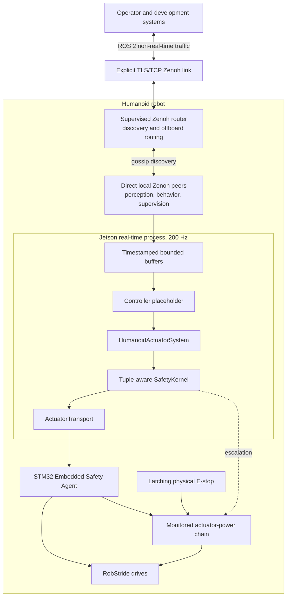
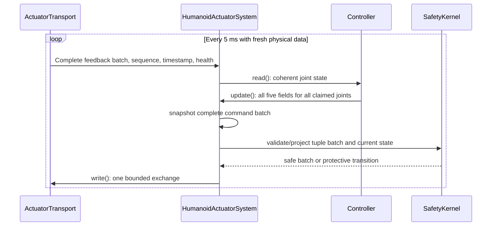
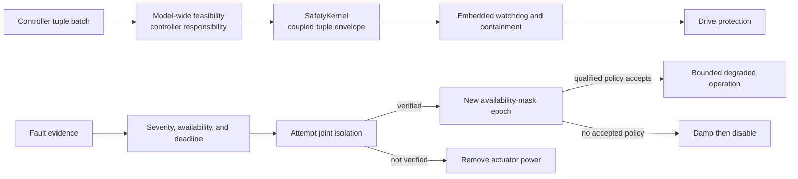
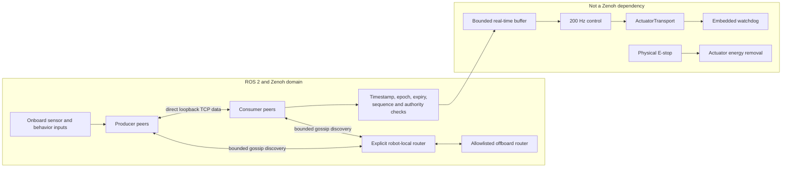
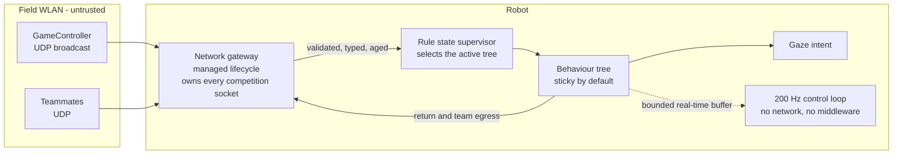

# Humanoid Soccer Robot Architecture

- Status: Living document
- Last updated: 2026-09-01
- Covered decisions: real-time actuation, hardware abstraction, safety and fault management, Zenoh middleware, and behaviour, game state, and team networking

## Scope

This document is the current accepted system skeleton. It summarizes, but does not replace, the architecture decision records:

- [ADR-001: Real-Time Actuation and Hardware Abstraction](ADR-001-real-time-actuation-and-hardware-abstraction.md)
- [ADR-002: Safety and Fault Management](ADR-002-safety-and-fault-management.md)
- [ADR-003: Zenoh Middleware](ADR-003-zenoh-middleware.md)
- [ADR-005: Behaviour, Game State, and Team Networking](ADR-005-behavior-game-state-and-team-networking.md)

Locomotion, estimation, perception, model generation, simulation, compute profiles, and team delivery workflow remain to be decided topic by topic. Diagrams show placeholders only where needed to explain an accepted boundary; placeholders are not component selections.

## Architectural invariants

1. The physical actuator path may be replaced without changing controllers, planners, or safety policy above `ActuatorTransport`.
2. The current production control and physical exchange rate is a genuine 200 Hz. A higher nominal software rate cannot substitute for fresh hardware samples.
3. One controller owns all five MIT command fields for every controlled joint, and one immutable all-joint snapshot crosses the hardware boundary per cycle.
4. Physical containment begins in the host safety kernel, embedded safety agent, drive, or independent power chain before ROS lifecycle error handling.
5. A failed joint may be isolated first, but remaining actuators continue only with an explicitly acknowledged availability mask and prequalified degraded policy.
6. Command loss causes a qualified local damping action followed by disable. Recovery never restarts motion automatically.
7. Zenoh is the ROS 2 middleware and is excluded from the hard real-time, embedded, and emergency-stop paths.
8. Configuration, calibration, protocol, and safety identities must match before actuator power can be armed.
9. The successor physical actuator bus and topology are deliberately unspecified.
10. The field pose estimate is a two-mode set with weights. It is collapsed at exactly one place, the GameController return encoder, and the collapsed value never re-enters any decision.
11. An action whose correctness depends on knowing the field direction cannot execute while that direction is ambiguous. This is enforced structurally, not per node.
12. Team communication is an enhancement and never a dependency. Every robot plays with an empty teammate set.
13. Competition network traffic is untrusted. Every reachable consequence of an injected or corrupted packet degrades toward less motion, never toward more actuator authority.

## System context

The current `Stm32SerialTransport` realizes `ActuatorTransport` as USB CDC with COBS and CRC16 to a master STM32F446RE, then a 200 Hz SPI DMA exchange to a slave STM32F446RE, then 1 Mbps classic CAN to RobStride drives. This is the production implementation, not a contract imposed on its successor.

## Real-time control boundary

For each joint, the command tuple is

$$
u = (q_d, \dot q_d, \tau_{ff}, K_p, K_d)
$$

and its intended impedance law is

$$
\tau = K_p(q_d-q) + K_d(\dot q_d-\dot q) + \tau_{ff}.
$$

`position`, `velocity`, `effort`, `stiffness`, and `damping` are scalar `ros2_control` interfaces for ecosystem compatibility, but their ownership and update semantics are atomic as a set. Partial claims and mixed controllers are invalid.

The cycle performs no ROS communication, blocking service call, unbounded wait, heap allocation, logging, filesystem access, or configuration lookup. Non-real-time threads publish copied state and diagnostics.

## Safety control

The four primary authorities are:

| Authority             | Primary role                                                                                                                       |
| --------------------- | ---------------------------------------------------------------------------------------------------------------------------------- |
| `SafetyKernel`        | Last host-side real-time gate for freshness, state-dependent joint limits, tuple torque and power envelope, slew, and availability |
| Embedded Safety Agent | Independent packet, sequence, age, watchdog, drive-health, damping, disable, and isolation handling                                |
| `SafetyCoordinator`   | Non-real-time lifecycle, event aggregation, degraded-policy negotiation, operator workflow, logging, and explicit rearming         |
| Physical stop chain   | Independent de-energize-to-stop actuator-power removal with monitored feedback                                                     |

Drive protections form another independent lower layer. Full-body balance, contact feasibility, and geometric self-collision remain controller responsibilities; the safety kernel provides conservative local backstops and does not pretend to solve full geometry online.

Falls transition through an explicit brace state and a post-fall disabled state. Self-righting is a separate authorized recovery action, never an automatic continuation of gait. Every safety transition moves toward lower energy unless a complete startup and rearm workflow succeeds.

## Middleware boundary

The Jazzy release uses pinned `rmw_zenoh_cpp` packages and version-controlled peer/router configurations. Onboard peers use router-mediated discovery and direct loopback TCP data links. All non-loopback links use mutually authenticated TLS over TCP. Every ROS endpoint declares QoS. Commands additionally carry authority, epoch, sequence, source time, and expiry because reliable delivery does not guarantee freshness.

Shared-memory Zenoh transport is disabled until its upstream fixes and project overload tests pass. Large camera pipelines prefer same-process SDK or intra-process paths and publish bounded derived products; required cross-process raw images use best-effort, volatile, keep-last-1 behavior and a measured memory budget.

Services and actions are supervisory and idempotent with bounded deadlines. They never implement cyclic actuator traffic or first-response safety behavior.

## Behaviour and competition networking

Three network planes are separated by trust and transport. Competition UDP is never carried by Zenoh, and Zenoh is never used to reach the field network.

Game state is the tuple of `state`, `stopped`, `gamePhase`, `setPlay`, and `kickingTeam`, plus packet age and this robot's penalty record. It is not a single enumeration, and it is not monotonic because the referee may undo actions. A rule state supervisor selects the active behaviour tree rather than distributing rule checks through one tree, so rule compliance is implemented in one inspectable component.

Behaviour runs on `behaviortree_cpp` v4 outside the real-time cycle, with stickiness as the default control-node semantics. Roles are assigned by distributed deterministic arbitration ordered on time-to-ball, tie-broken by player number, and collapse to a valid solo role when no teammate is heard.

Every action node declares whether its correctness depends on the field direction. With $w$ the weight on the mode facing the opponent goal, the expected utility of a directional action is $2w-1$, which is zero at $w = 0.5$ and negative below it. Symmetry-sensitive actions are therefore gated as a group above a threshold strictly greater than 0.5, while tracking, approaching, retaining the ball, and staying upright remain available at all times.

The network gateway binds its sockets at `configure`, drains each socket per wake keeping only the last valid packet, publishes state age as data, and applies an ordered validation ladder before anything downstream sees a competition byte. It runs in the host network namespace because a default bridge network does not receive host-subnet broadcasts, and that failure is silent.

## Configuration and release identity

The following artifacts are generated, immutable within a release, and identified by canonical digests:

- Robot and joint manifest
- Motor identity, direction, gearing, limits, and calibration
- Safety manifest and qualified policy IDs
- Host and firmware protocol capabilities
- Zenoh peer, router, QoS, and security configuration
- ROS, RMW, firmware, container, and dependency versions

The host, STM32, controller, and router report their relevant identities. A required mismatch keeps motion disabled. Runtime parameters may select only prequalified values and modes; they cannot weaken hard safety limits or bypass compatibility checks.

## Failure boundaries

| Failure                                               | Required containment                                                                                          |
| ----------------------------------------------------- | ------------------------------------------------------------------------------------------------------------- |
| Zenoh peer, router, or network loss                   | Remote intent expires; local control selects its defined safe behavior; embedded watchdog remains independent |
| Real-time process or Jetson loss                      | STM32 detects command loss, applies qualified damping, then disables                                          |
| Corrupt, stale, duplicate, or out-of-order field data | Reject batch and enter the fault response assigned by the safety manifest                                     |
| Single drive fault                                    | Attempt and verify isolation; require an accepted qualified availability-mask policy to continue              |
| Failed joint isolation                                | Remove shared actuator power                                                                                  |
| STM32 reset or brownout                               | Boot with drives disabled and require a fresh arm epoch                                                       |
| E-stop                                                | Independent monitored actuator-energy removal; reset does not start motion                                    |
| Fall or impact                                        | Latch brace or fallback, then post-fall disable; require explicit recovery workflow                           |
| Configuration or calibration mismatch                 | Startup interlock remains closed                                                                              |
| GameController packet loss                            | Hold and age the last state; act on staleness only above 1.5 s, then fail to the rule-safe stationary default |
| GameController never received                         | Distinct first-class condition; never defaulted to `INITIAL`                                                  |
| Team communication loss                               | Roles collapse deterministically to solo play; no role vacancy and no restart storm                           |
| Field pose ambiguous                                  | Symmetry-sensitive actions are gated off; the robot advertises low confidence and declines those roles        |
| Malformed, spoofed, or flooded competition packets    | Counted and dropped by rung; consequences bounded to less motion; flood contained by core isolation           |

## Qualification path

All accepted boundaries are tested first with unit and property tests, then SIL, HIL, tethered physical tests, and untethered operation. Release evidence includes:

- Interface ownership and immutable-snapshot tests
- Transport conformance and physical timing traces
- Tuple-envelope boundary and safety-state model tests
- Watchdog, isolation, failed-isolation, power, fall, and no-auto-restart fault injection
- Zenoh conformance, saturation, restart, partition, security, and full-load soak tests
- Cross-layer tests proving network and perception overload cannot violate the 5 ms actuator cycle or safety deadlines
- Forced-ambiguity behaviour runs demonstrating that no symmetry-sensitive action executes at a 50/50 pose belief
- A structural demonstration that the pose mode set is collapsed only at the GameController return encoder
- Fuzzing reports for both competition wire formats, with rejections counted per validation rung
- Broadcast reception verified across the deployed container network configuration, never over loopback

Average latency alone is not acceptance evidence. Reports preserve distributions, worst observed values, sample counts, hardware and software manifests, load profile, and physical trace captures.

## Open architecture topics

The following are intentionally not decided here:

- Locomotion paradigm, whole-body optimization stack, and primitive transition model
- Robot geometry, inertial, actuator, contact, and simulator model pipeline
- State estimation and time synchronization
- Perception and world modeling
- Compute capability profiles and workload isolation beyond the accepted real-time boundary
- Container topology, process supervision, kernel configuration, and GPU access
- Successor actuator transport, physical bus, and topology
- Detailed package boundaries, repositories, CI/CD, release trains, and team workflow

Each topic will update this document only after its decision is accepted.
