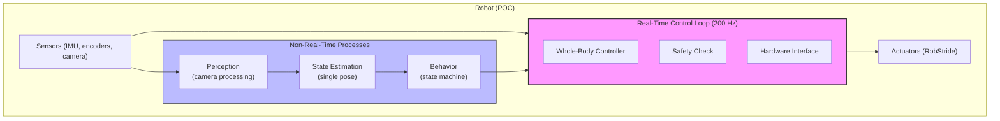
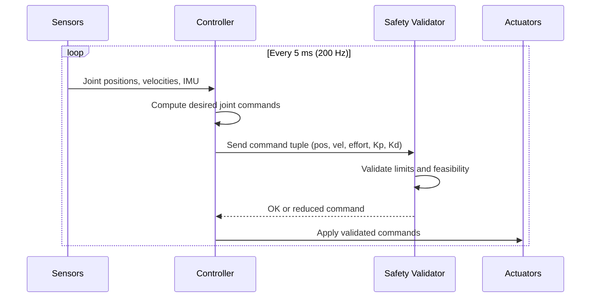
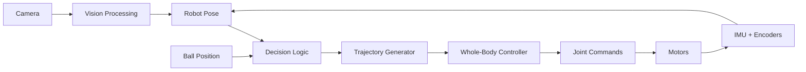
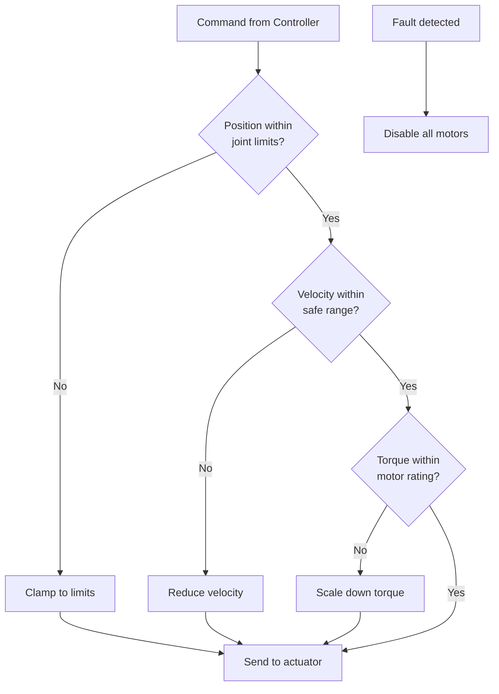

# Humanoid Soccer Robot — Simplified POC Architecture

**Status:** Proof of Concept starting point  
**Purpose:** Minimal viable architecture that can evolve into the full system  
**Last updated:** 2026-09-09

---

## Executive Summary

This is a **simplified starting point** for an autonomous humanoid soccer robot. It captures the essential structure without the full complexity, designed to be incrementally extended into the complete production system.

### Key Design Principles for the POC

1. **Start simple, stay adaptable** — Each component has clear extension points
2. **Preserve the critical boundaries** — Real-time vs non-real-time, safety layers, transport abstraction
3. **Defer complexity** — Advanced features like multi-modal pose estimation, team networking, and container orchestration can be added later
4. **Maintain evolutionary path** — Every simplification has a documented path to the full version

---

## What's Simplified (and How to Add It Back)

| Component | POC Version | Full Version (Add Later) |
|-----------|-------------|--------------------------|
| **Control Loop** | Single-threaded 200 Hz loop | Hardware-scheduled, isolated cores, SCHED_FIFO |
| **Actuator Transport** | Direct USB serial to STM32 | Pluggable transport interface (USB/CAN/EtherCAT) |
| **Safety** | Single safety layer in host code | 5-layer safety: controller → SafetyKernel → embedded agent → drive protection → physical E-stop |
| **Middleware** | Optional, local-only Zenoh | Full Zenoh router with TLS, discovery, offboard routing |
| **State Estimation** | Single pose estimate | Two-mode posterior with weights, symmetry handling |
| **Behavior** | Simple state machine | Behavior tree with rule compliance, role arbitration |
| **Networking** | None (standalone) | Three network planes: field WLAN, team UDP, operator link |
| **Deployment** | Direct process execution | Containerized runtime with systemd, identity interlock |
| **Simulation** | Manual testing only | MuJoCo SIL, HIL, fault injection, deterministic replay |
| **Observability** | Console logging + basic CSV | Dual-plane MCAP recording, one-way health beacon |

---

## System Context Diagram



**Evolution path:** Add Zenoh middleware between NonRT and RT boxes. Split Safety into multiple layers. Add network gateway for external communication.

---

## Core Architecture: Control Loop



**Key simplification:** Single validation step instead of layered safety.

**Evolution path:** Replace `V` with full safety stack:
```
Controller → SafetyKernel (tuple envelope) → Embedded Agent → Drive Protection → Physical Power Chain
```

---

## Component Interfaces (POC)

### 1. Actuator Command Interface

```cpp
// Simplified: all five fields in one struct
struct JointCommand {
    double position;      // rad
    double velocity;      // rad/s
    double effort;        // Nm (feedforward torque)
    double stiffness;     // Kp (Nm/rad)
    double damping;       // Kd (Nm/(rad/s))
    bool valid;           // command validity flag
};

// Evolution: wrap in MIT impedance law with coupled validation
// τ = Kp(q_d - q) + Kd(q̇_d - q̇) + τ_ff
```

### 2. Sensor Feedback Interface

```cpp
struct JointFeedback {
    double position;      // rad
    double velocity;      // rad/s
    double current;       // A
    int32_t sequence;     // packet counter for loss detection
    bool healthy;         // drive self-test status
};

// Evolution: add timestamp, age, authority metadata for Zenoh transport
```

### 3. Behavior Output Interface

```cpp
struct BehaviorOutput {
    // High-level intent
    enum Action { WALK, KICK, GET_UP, SEARCH, STOP };
    Action action;
    
    // Parameters for the action
    double target_x;      // m in robot frame
    double target_y;
    double target_yaw;    // rad
    
    // Evolution: add field_direction_dependency flag for symmetry gating
};
```

---

## Data Flow (Simplified)



**Evolution path:** 
- Split `Pose` into bimodal estimator with weights
- Insert Zenoh message passing between each box
- Add GameController input to `Decision`
- Add team coordination layer

---

## Directory Structure (POC)

```
src/
├── control/
│   ├── whole_body_controller.cpp    # Main control law
│   ├── safety_validator.cpp         # Simple limit checking
│   └── hardware_interface.cpp       # Direct USB/serial
├── perception/
│   ├── camera_driver.cpp            # ZED or placeholder
│   └── ball_detector.cpp            # Simple color/shape detection
├── estimation/
│   └── pose_estimator.cpp           # Single hypothesis Kalman filter
├── behavior/
│   ├── state_machine.cpp            # Simple FSM for POC
│   └── skills/
│       ├── walk.cpp
│       ├── kick.cpp
│       └── get_up.cpp
├── utils/
│   ├── logger.cpp                   # CSV/console output
│   └── config.cpp                   # Static configuration
└── main.cpp                         # Single process, all components
```

**Evolution path:** Split into separate containers/processes connected by Zenoh. Move `hardware_interface` to use `ros2_control` plugin architecture.

---

## Minimal Dependencies (POC)

| Category | POC Libraries | Notes |
|----------|---------------|-------|
| **OS** | Ubuntu 22.04 (JetPack 6 compatible) | Can upgrade to 24.04 + containers later |
| **Middleware** | None (direct function calls) | Add Zenoh + ROS 2 Jazzy when ready |
| **Control** | Eigen3 | Matrix math for WBC |
| **Perception** | OpenCV | Ball detection, camera interface |
| **Logging** | fmtlib + file I/O | Upgrade to MCAP/rosbag2 later |
| **Build** | CMake, colcon (optional) | Add containers when adding ROS |

---

## Safety Approach (POC)



**What's missing from full version:**
- No embedded safety agent (add on STM32)
- No independent watchdog timer
- No latching physical E-stop chain (add as hardware)
- No degraded operation modes (single-fault tolerance)
- No formal safety manifest

**Evolution path:** Implement each layer as a separate class/module, then move embedded agent to STM32 firmware.

---

## Testing Strategy (POC)

| Test Type | POC Approach | Full Version |
|-----------|--------------|--------------|
| **Unit tests** | GoogleTest on host PC | Same, expanded coverage |
| **Integration** | Manual robot testing | Automated HIL with STM32 emulator |
| **Simulation** | None (too complex for POC) | MuJoCo SIL with lockstep |
| **Timing validation** | Stopwatch + logs | Profiling with perf/Nsight, cycle-accurate recording |
| **Fault injection** | Manual disconnection | Automated FaultInjectingTransport decorator |
| **Regression** | Visual inspection | Deterministic replay against stored trajectories |

---

## Roadmap: POC → Full System

### Phase 1: Working POC (Current)
- [ ] Basic walking gait
- [ ] Ball detection and approach
- [ ] Simple kick motion
- [ ] Get-up behavior
- [ ] Standalone operation (no networking)

### Phase 2: Add Middleware & Safety
- [ ] Integrate Zenoh for internal messaging
- [ ] Split into separate processes
- [ ] Implement layered safety kernel
- [ ] Add embedded safety agent on STM32
- [ ] Containerize with Docker/Podman

### Phase 3: Advanced Features
- [ ] Multi-modal state estimation (symmetry handling)
- [ ] Behavior trees with rule compliance
- [ ] Game state integration (GameController)
- [ ] Team communication (role arbitration)
- [ ] Simulation pipeline (MuJoCo)

### Phase 4: Competition Ready
- [ ] Full observability (MCAP recording)
- [ ] One-way health beacon
- [ ] Identity-based release management
- [ ] HIL testing infrastructure
- [ ] Performance optimization and tuning

---

## Key Architectural Decisions (POC)

### ADR-POC-001: Single Process Architecture
**Decision:** All components run in one process for POC  
**Rationale:** Eliminates IPC complexity, easier debugging  
**Consequence:** Cannot validate real-time isolation yet  
**Evolution:** Split into containers when adding Zenoh (Phase 2)

### ADR-POC-002: Simplified Safety Model
**Decision:** Single software safety layer, no embedded agent initially  
**Rationale:** Faster iteration, can test control laws immediately  
**Consequence:** Not safe for full-power operation near humans  
**Evolution:** Add embedded agent and physical E-stop before competition

### ADR-POC-003: No Middleware Initially
**Decision:** Direct function calls between components  
**Rationale:** Reduces learning curve, fewer dependencies  
**Consequence:** Tight coupling, harder to swap components  
**Evolution:** Replace with Zenoh topics while keeping same message types

### ADR-POC-004: Single Hypothesis State Estimation
**Decision:** Standard Kalman filter with one pose estimate  
**Rationale:** Simpler to implement and debug  
**Consequence:** Will fail on symmetric field without manual intervention  
**Evolution:** Extend to two-mode Gaussian mixture model

---

## Extension Points (Where to Add Complexity)

Each component is designed with hooks for future expansion:

```cpp
// Example: Controller interface with extension points
class WholeBodyController {
public:
    // POC: direct call
    JointCommands compute(const SensorData& sensors);
    
    // Extension point 1: Accept Zenoh messages instead
    // void onSensorUpdate(ZenohMessage msg);
    
    // Extension point 2: Support degraded modes
    // JointCommands computeDegraded(const SensorData&, const AvailabilityMask&);
    
    // Extension point 3: Add simulation hook
    // virtual void setSimulationMode(bool enabled);
};
```

---

## Success Criteria for POC

The POC is successful when it can:
1. ✅ Stand up unassisted
2. ✅ Walk forward 3 meters
3. ✅ Detect and approach a ball
4. ✅ Perform a basic kick
5. ✅ Get up from a prone position
6. ✅ Log all sensor data for post-analysis

**Not required for POC:**
- ❌ Autonomous game play
- ❌ Team coordination
- ❌ Competition rule compliance
- ❌ Full safety certification
- ❌ Real-time guarantees verified

---

## Conclusion

This POC architecture provides a **minimal but extensible foundation**. Every simplification is documented with its evolution path, ensuring that work done now contributes to (rather than conflicts with) the full production system.

Start here, get something working quickly, then incrementally add the advanced features as time and resources allow. The key is maintaining the **architectural boundaries** even while simplifying the implementations within them.

---

## References

- Full Architecture: [SYSTEM_ARCHITECTURE_MASTER.md](../SYSTEM_ARCHITECTURE_MASTER.md)
- Detailed ADRs: [architecture/](./)
- RoboCup Laws of the Game: https://humanoid.robocup.org/laws-of-the-game/
