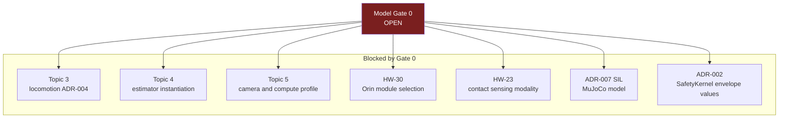
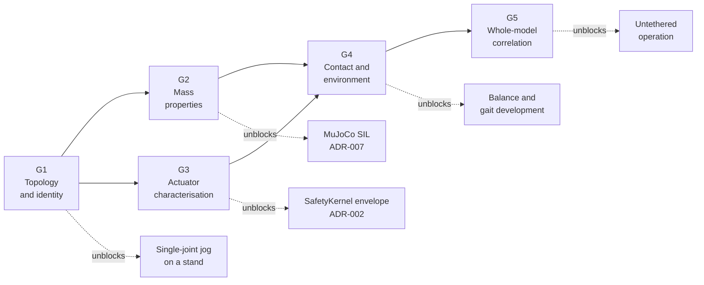
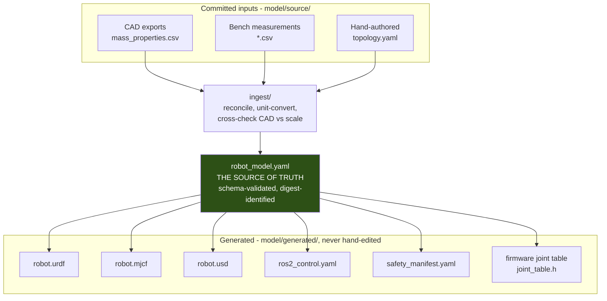
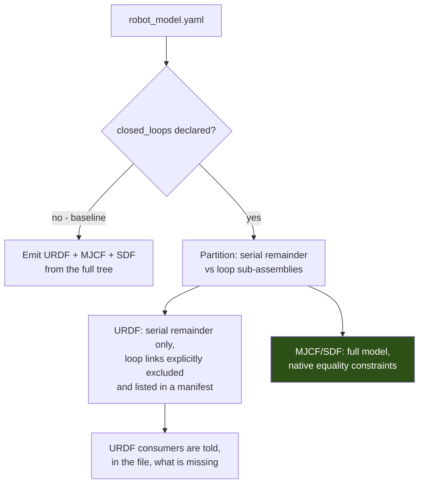
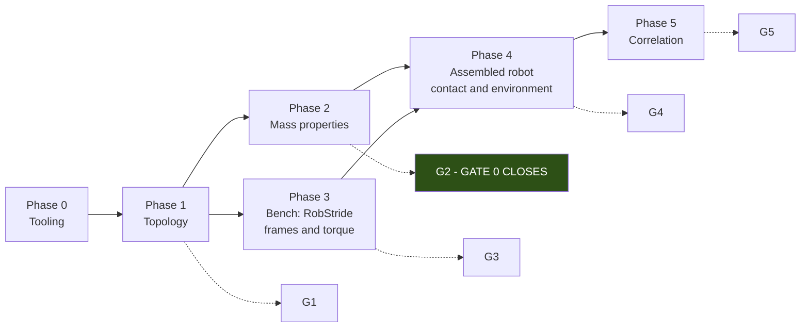

# Model Gate 0 Execution Plan

- Status: **Accepted.** The G1-G5 ladder and the relative tolerance budget are the normative model qualification path.
- Date: 2026-09-02
- Scope: Closing Topic 3 Model Gate 0 — the measurement programme, the tolerance budget, the ingestion tooling, and the RobStride bus verification bench test.
- Depends on: [ADR-001](../architecture/ADR-001-real-time-actuation-and-hardware-abstraction.md), [ADR-002](../architecture/ADR-002-safety-and-fault-management.md), [ADR-007](../architecture/ADR-007-simulation-sil-hil.md), [ADR-009](../architecture/ADR-009-development-workflow-and-cicd.md)
- Research baseline: [Topic 3](../research/topic-3-locomotion-survey.md)
- Related: [HARDWARE_REQUIREMENTS.md](../architecture/HARDWARE_REQUIREMENTS.md) HW-13, HW-20, HW-23, HW-30

---

## 0. Two things this document changes, read these first

**The gate ladder G1–G5 did not previously exist.** The Topic 3 baseline names only "Model Gate 0"
and "Model Gate 3", and never enumerates the intermediate gates. Section 2 defines G1–G5 for the
first time. That definition was **accepted on 2026-09-02** and is now the normative model
qualification path.

**Three boundary answers are recorded and binding:**

| Question                    | Answer                                                                                                                                                                                     | Where it lands                  |
| --------------------------- | ------------------------------------------------------------------------------------------------------------------------------------------------------------------------------------------ | ------------------------------- |
| Kinematic topology baseline | **Open serial chains.** If the hardware team introduces a parallel mechanism, the model compiler bypasses URDF for that sub-assembly and emits native MJCF/SDF directly                    | D-K08, section 5.5, section 5.7 |
| CAD system                  | **Onshape primary, SolidWorks fallback.** Mass properties and inertia tensors are exported through a schema-validated intermediate file, **never** trusted from a CAD-native URDF exporter | D-M01, D-M03, section 5.6       |
| Gate ladder                 | **Accepted**                                                                                                                                                                               | Section 2                       |

**Absolute tolerances cannot be stated yet, and any document that states them is fabricating.**
Almost every meaningful tolerance on this robot is a fraction of a quantity that Gate 0 itself
produces. A centre-of-mass tolerance is only meaningful against the support polygon; the support
polygon is a Gate 0 deliverable. Stating "CoM must be accurate to 5 mm" before the foot length is
known asserts a number with no derivation behind it.

This document therefore specifies **relative tolerances with their derivations**, which become
absolute numbers automatically the moment the geometry exists. Section 4 gives the arithmetic. Where
an absolute number appears, it is tagged `[Project target]` and marked as requiring confirmation
against the measured geometry.

---

## 1. What Gate 0 is, and what it unblocks

Gate 0 is open: no kinematic tree, joint distribution, masses, inertias, sole geometry, or physical
envelope exists. Nothing downstream can be instantiated.



The `SafetyKernel` dependency is the one most often overlooked. ADR-002 specifies the _form_ of the
feasible set $\mathcal U_j(x,s)$ but every number inside it — $\tau_{allowed,j}$, $P_{allowed,j}$,
the joint envelope, the slew limits — is a Gate 0 output. **The safety architecture is currently a
function with no arguments.**

### Exit criterion

Gate 0 closes when a single file, `model/source/robot_model.yaml`, exists in the repository, passes
schema validation, passes gates G1 and G2 in CI, and is signed off by the hardware lead. Nothing
else constitutes closure. A CAD model, a spreadsheet, or a verbal confirmation does not.

---

## 2. The gate ladder G1–G5

Each gate is falsifiable, is checked by a named mechanism, and blocks a named activity. A gate that
cannot be checked automatically says so and names the manual evidence instead — per ADR-009-06, a
gate that cannot run is not a gate.

| Gate   | Name                      | Question it answers                                                                                                    | Checked by                                                                         | Blocks until passed                                               |
| ------ | ------------------------- | ---------------------------------------------------------------------------------------------------------------------- | ---------------------------------------------------------------------------------- | ----------------------------------------------------------------- |
| **G1** | Topology and identity     | Is the kinematic tree well-formed, and does every joint have a verified identity, sign, direction, and zero reference? | Schema validation + generated-artifact diff in CI + physical single-joint jog test | Any multi-joint motion                                            |
| **G2** | Mass properties           | Are the masses and inertia tensors physically valid and consistent with the measured total?                            | MuJoCo compiler with corrections disabled + weighbridge reconciliation             | Any model-based dynamics claim, any SIL result                    |
| **G3** | Actuator characterisation | Do commanded MIT tuples produce the predicted torque on real hardware?                                                 | Bench dynamometer or lever-arm test per motor class                                | Any `SafetyKernel` torque envelope, any dynamic gait              |
| **G4** | Contact and environment   | Is the sole geometry correct and is turf friction measured on the competition surface?                                 | Physical sole print + friction sled + MuJoCo contact reconciliation                | Any balance or ZMP/DCM claim, the Topic 6 ball deceleration model |
| **G5** | Whole-model correlation   | Does the simulated robot match the physical robot on a preregistered trajectory set?                                   | Dual-environment replay against physical gantry logs                               | Untethered operation, any competition entry                       |

### Gate dependencies



**G1 and G2 are the Gate 0 closure set.** G3, G4, and G5 require a physically assembled robot and
are sequenced after it. Gate 0 does not wait for them.

---

## 3. Hardware team deliverables

Every deliverable has an ID, a required format, a delivery mechanism, and the gate it feeds. All
deliverables land in `model/source/` as committed files. Nothing is accepted by email, screenshot,
or spreadsheet attachment — per ADR-009-02, an input that is not in the repository by content
identity is not an input.

### 3.1 Kinematic topology and joint identity (feeds G1)

| ID    | Deliverable                                                                  | Format                                           | Notes                                                                                        |
| ----- | ---------------------------------------------------------------------------- | ------------------------------------------------ | -------------------------------------------------------------------------------------------- |
| D-K01 | Joint count and named list                                                   | YAML                                             | Final DOF count. The working assumption of 14 is not a commitment                            |
| D-K02 | Parent/child link tree                                                       | YAML                                             | Must be an acyclic tree. Closed loops must be declared explicitly, see D-K08                 |
| D-K03 | Joint origin transforms, parent link frame to joint frame                    | 4x4 homogeneous or xyz + rpy, metres and radians | Numeric, not derived from a screenshot                                                       |
| D-K04 | Joint axis unit vector in the joint frame                                    | Unit 3-vector                                    | Must normalise to 1 within $10^{-9}$                                                         |
| D-K05 | Positive-rotation direction, physically defined                              | Text + photograph                                | "Positive flexes the knee" is acceptable; "CCW" alone is not, because it is view-dependent   |
| D-K06 | Motor-to-joint assignment: joint name, motor class, CAN node ID, bus segment | YAML table                                       | Feeds the HW-13 arithmetic in section 6                                                      |
| D-K07 | Gear ratio and direction sign per joint                                      | Rational or decimal + sign                       | Sign is separate from magnitude and is verified independently in G1                          |
| D-K08 | Any parallel, coupled, or passive mechanism                                  | YAML + description                               | **Baseline is open serial chains.** Any exception is declared here and routes to section 5.7 |
| D-K09 | Zero-pose definition                                                         | Photograph + joint values                        | The pose in which all joint values read zero. Must be physically reproducible with a fixture |
| D-K10 | Joint zero offset per joint, as installed                                    | radians                                          | Interlocked under ADR-008-09. Re-measured after any disassembly                              |

### 3.2 Mass properties (feeds G2)

| ID    | Deliverable                                                      | Format                                                | Notes                                                                                    |
| ----- | ---------------------------------------------------------------- | ----------------------------------------------------- | ---------------------------------------------------------------------------------------- | --- | ----- | --------------------------------------- | ---------------- | ----------------------------------------------- |
| D-M01 | Per-link mass                                                    | kg, 4 significant figures                             | From CAD **and** from a scale. Both values delivered, see section 4.2                    |     | D-M02 | Per-link CoM position in the link frame | metres, 3-vector | Link frame must be the same frame used in D-K03 |
| D-M03 | Per-link inertia tensor, with its reference point **declared**   | kg·m², full symmetric 3x3 (`ixx iyy izz ixy ixz iyz`) | The schema requires an explicit `reference_point` of `com` or `link_origin`. Section 5.6 |
| D-M04 | Total assembled robot mass                                       | kg, measured                                          | Reconciled against $\sum$ D-M01 in G2                                                    |
| D-M05 | Whole-robot CoM in the zero pose                                 | metres, measured                                      | From a two-scale or knife-edge measurement                                               |
| D-M06 | Battery mass, CoM, and mounting frame                            | kg + metres                                           | Separated because it changes between matches                                             |
| D-M07 | Declared CAD material densities and any lumped/simplified bodies | Table                                                 | A "simplified" body with wrong density is invisible in the tensor                        |

### 3.3 Joint limits and transmission (feeds G1, G3)

| ID    | Deliverable                                        | Format                  | Notes                                                               |
| ----- | -------------------------------------------------- | ----------------------- | ------------------------------------------------------------------- |
| D-J01 | Mechanical hard-stop positions                     | radians, min and max    | The physical limit, not the intended software limit                 |
| D-J02 | Proposed software position limits                  | radians                 | Must lie strictly inside D-J01. The margin is stated in section 4.3 |
| D-J03 | Velocity limit per joint                           | rad/s                   | Mechanical or thermal, whichever binds. State which                 |
| D-J04 | Continuous and peak torque per joint at the output | N·m + duration for peak | Peak without a duration is unusable                                 |
| D-J05 | Measured backlash per joint                        | radians, at the output  | Method stated. Feeds the estimator noise model and the G5 tolerance |
| D-J06 | Transmission stiffness, if measurable              | N·m/rad                 | `NR` is an acceptable answer. It is not acceptable to omit the row  |
| D-J07 | Joint friction: Coulomb and viscous                | N·m and N·m·s/rad       | From a slow-sweep bench test                                        |

### 3.4 Contact and sole geometry (feeds G4)

| ID    | Deliverable                                           | Format                         | Notes                                                                           |
| ----- | ----------------------------------------------------- | ------------------------------ | ------------------------------------------------------------------------------- |
| D-C01 | Sole contact polygon in the foot frame                | Ordered 2D vertex list, metres | The **actual** contact patch, from an ink print under load, not the CAD outline |
| D-C02 | Sole compliance and material                          | N/m or durometer + material    | Rigid-contact assumptions must be justified, not assumed                        |
| D-C03 | Foot frame to ankle joint transform                   | xyz + rpy                      | Closes the kinematic chain to the ground                                        |
| D-C04 | Sole-to-turf friction coefficient, static and kinetic | Dimensionless                  | **On the competition surface.** Feeds G4 and the Topic 6 D5 ball model          |
| D-C05 | Turf ball deceleration measurement                    | m/s² vs initial speed          | Topic 6 D5 requires a measured model; finite differencing is prohibited         |
| D-C06 | Contact sensor mounting provision, if any             | Drawing                        | HW-23 is Blocked. This deliverable is what unblocks it                          |

### 3.5 RobStride actuator characterisation (feeds G3)

This is the deliverable set that ADR-002's torque envelope depends on, and it is currently the
weakest-evidenced area in the entire project.

| ID    | Deliverable                                                                                                 | Format                             | Notes                                                                                                |
| ----- | ----------------------------------------------------------------------------------------------------------- | ---------------------------------- | ---------------------------------------------------------------------------------------------------- |
| D-A01 | Per motor class: MIT-mode field ranges and units as actually transmitted                                    | Table per RS00/RS02/RS03/RS05/RS06 | See the warning below                                                                                |
| D-A02 | Per motor class: encoding of $q_d$, $\dot q_d$, $\tau_{ff}$, $K_p$, $K_d$ — bit width, min, max, endianness | Table                              | Determines the quantisation floor of every command the robot can express                             |
| D-A03 | Measured torque constant $K_t$ at the output                                                                | N·m/A                              | With the gearbox, not the motor datasheet value                                                      |
| D-A04 | Measured torque vs commanded MIT tuple, over a grid                                                         | CSV                                | The G3 evidence. Grid defined in section 4.5                                                         |
| D-A05 | Drive fault bit meanings                                                                                    | Table                              | ADR-002 requires the Embedded Safety Agent to interpret these                                        |
| D-A06 | Thermal derating curve                                                                                      | N·m vs winding or case temperature | $\tau_{allowed,j}(T,V,s)$ in ADR-002 is a function of $T$. Without this, that function is a constant |
| D-A07 | Behaviour on command loss, per class                                                                        | Description + measurement          | Must be verified, not assumed from documentation                                                     |
| D-A08 | CAN frame count and DLC per joint per cycle, per direction                                                  | Integer + bytes                    | **Section 6 defines the bench test that produces this.** Currently `NR`                              |

> **Warning on D-A01 and D-A02.** The RobStride MIT-mode wire format is a private protocol. No
> value for the field encodings, scaling factors, or frame count has been verified by this project
> from a primary source. Any number currently circulating in the codebase or in community
> documentation is **unverified** and must be treated as a hypothesis to be tested on the bench,
> not as a specification. Section 6 exists because of this.

### 3.6 Electrical, thermal, and envelope (feeds HW-30, G3)

| ID    | Deliverable                                              | Format                     | Notes                                  |
| ----- | -------------------------------------------------------- | -------------------------- | -------------------------------------- |
| D-E01 | Nominal, minimum, and maximum bus voltage                | V                          | $V$ in $\tau_{allowed,j}(T,V,s)$       |
| D-E02 | Battery chemistry, capacity, energy, and discharge limit | Ah, Wh, C                  |                                        |
| D-E03 | Physical envelope available for compute                  | Bounding box, mm           | Unblocks HW-30                         |
| D-E04 | Power budget available for compute                       | W, continuous              | Unblocks HW-30                         |
| D-E05 | Thermal provision for compute                            | Airflow or conduction path | HW-34                                  |
| D-E06 | Mass budget available for compute and sensing            | kg                         |                                        |
| D-E07 | Camera mounting frame and neck kinematics                | xyz + rpy + limits         | Topic 5 and Topic 6 gaze               |
| D-E08 | IMU mounting frame and rigid-body attachment             | xyz + rpy                  | Topic 4. Must be rigid to a named link |

---

## 4. Tolerance budget and its derivation

### 4.1 Why these are relative

Each tolerance below is expressed against a quantity the deliverables themselves produce. Substitute
the measured value and the tolerance becomes a number. This is deliberate: it makes the budget
auditable rather than asserted.

Notation: $m_{tot}$ total mass, $L_{foot}$ sole polygon length in the sagittal direction,
$W_{foot}$ its lateral width, $h_{CoM}$ CoM height in the zero pose, $\tau_{cont}$ continuous joint
torque.

### 4.2 Mass and inertia

| Quantity                                                          | Tolerance                                                                  | Derivation                                                                                                               |
| ----------------------------------------------------------------- | -------------------------------------------------------------------------- | ------------------------------------------------------------------------------------------------------------------------ |
| Per-link mass                                                     | $\pm 2\%$ of that link's mass, **and** $\le 0.5\%$ of $m_{tot}$            | The second term stops a large error on a heavy link hiding inside a permissive percentage                                |
| Sum of link masses vs measured $m_{tot}$                          | $\pm 1.5\%$ of $m_{tot}$                                                   | Reconciliation check. A larger gap means unmodelled mass — wiring, fasteners, adhesive — which is systematic, not random |
| Per-link CoM                                                      | $\pm 5\%$ of that link's longest dimension                                 | Scales with the link. A 5 mm error on a 300 mm thigh and on a 30 mm bracket are not comparable errors                    |
| Whole-robot CoM, computed vs measured                             | $\le 0.02 \times L_{foot}$ sagittal, $\le 0.02 \times W_{foot}$ lateral    | 2 % of the support polygon. This is the tolerance that actually matters for balance                                      |
| Inertia tensor diagonal                                           | $\pm 10\%$ per element                                                     | CAD inertia is more reliable than CAD mass when densities are right; the 10 % absorbs density error                      |
| Inertia tensor off-diagonal                                       | $\pm 20\%$ or $\pm 0.05 \times \max(\text{diagonal})$, whichever is larger | Off-diagonals are small and noisy; a pure percentage is unmeetable near zero                                             |
| Triangle inequality $I_{xx} + I_{yy} \ge I_{zz}$ and permutations | **Hard pass/fail, zero tolerance**                                         | See section 4.6                                                                                                          |

### 4.3 Kinematics

| Quantity                                                        | Tolerance                                                        | Derivation                                                                                                                                                    |
| --------------------------------------------------------------- | ---------------------------------------------------------------- | ------------------------------------------------------------------------------------------------------------------------------------------------------------- |
| Joint origin translation                                        | $\pm 0.5$ mm `[Project target]`                                  | Machining-achievable; confirm against the actual process capability                                                                                           |
| Joint origin rotation                                           | $\pm 0.2°$ `[Project target]`                                    | Accumulates over the chain; see the chain budget below                                                                                                        |
| Accumulated foot pose error, hip to sole, from tolerances alone | $\le 0.05 \times L_{foot}$                                       | This is the binding constraint. If the per-joint numbers above do not satisfy it over the real chain length, the per-joint numbers must tighten, not this one |
| Joint axis unit vector                                          | Normalises to $1 \pm 10^{-9}$                                    | Numerical, not physical                                                                                                                                       |
| Joint sign and direction                                        | **Hard pass/fail**                                               | A sign error is not a tolerance. G1 verifies each physically                                                                                                  |
| Software limit margin inside hard stop                          | $\ge 3°$ or $\ge 3\times$ measured backlash, whichever is larger | The robot must never drive into a hard stop under a `SafetyKernel`-legal command                                                                              |
| Backlash                                                        | Reported, not bounded                                            | Feeds the estimator noise model. A large value is a design finding, not a test failure                                                                        |

### 4.4 Contact and environment

| Quantity              | Tolerance                                                                                  | Derivation                                                             |
| --------------------- | ------------------------------------------------------------------------------------------ | ---------------------------------------------------------------------- |
| Sole polygon vertices | $\pm 2$ mm `[Project target]`, and the polygon must be **inscribed** in the measured print | Never optimistic. An overstated support polygon is a fall              |
| Friction coefficient  | $\pm 15\%$, measured on the competition surface                                            | Turf varies by venue; this is measurement spread, not instrument error |
| Ball deceleration     | $\pm 20\%$ over the speed range 0.5–3 m/s `[Project target]`                               | Topic 6 D5. Confirm the speed range against measured kick speeds       |

### 4.5 Actuator characterisation (G3)

The D-A04 grid, per motor class:

| Axis                       | Points                                                                   |
| -------------------------- | ------------------------------------------------------------------------ |
| $K_p$                      | 5 values spanning the intended operating range including 0               |
| $K_d$                      | 3 values including 0                                                     |
| Position error $(q_d - q)$ | 7 values spanning $\pm$ the largest error the `SafetyKernel` will permit |
| $\tau_{ff}$                | 5 values spanning $\pm \tau_{cont}$                                      |
| Temperature                | At minimum: cold start and thermally soaked                              |

| Quantity                                                                             | Tolerance                                                             | Derivation                                                                                                                             |
| ------------------------------------------------------------------------------------ | --------------------------------------------------------------------- | -------------------------------------------------------------------------------------------------------------------------------------- |
| Predicted vs measured torque, $\tau = K_p(q_d-q) + K_d(\dot q_d-\dot q) + \tau_{ff}$ | $\pm 10\%$ or $\pm 0.1$ N·m, whichever is larger, over the whole grid | The ADR-002 envelope is computed from this equation. If the equation does not predict the hardware, the envelope is not a safety bound |
| Torque at zero command                                                               | $\le 2\%$ of $\tau_{cont}$                                            | Detects an offset or sign error in the encoding                                                                                        |
| Sign of produced torque                                                              | **Hard pass/fail at every grid point**                                | A sign inversion under load is the failure mode ADR-009-06's sign-flip gate exists to catch                                            |

### 4.6 The hard pass/fail set

These are not tolerances. Any violation blocks the gate outright:

1. Kinematic tree is acyclic, or all loops are explicitly declared.
2. Every joint axis normalises to unit length.
3. Every diagonal inertia satisfies $A + B \ge C$ for all three permutations.
4. Every mass is strictly positive.
5. Every software limit lies strictly inside its hard stop.
6. Every joint's physical positive direction is confirmed by a single-joint jog test, per joint, recorded on video.
7. Sum of link masses reconciles with the weighed total inside the section 4.2 band.

**On item 3.** MuJoCo's compiler enforces this for free. Its documentation states:

> "A valid diagonal inertia matrix must satisfy A+B>=C for all permutations of the three diagonal
> elements. Some poorly designed models violate this constraint, which will normally result in a
> compile error. If this attribute is set to `true`, the compiler will silently set all three
> diagonal elements to their average value whenever the above condition is violated."

The attribute is `balanceinertia`, and its default is `false`.

> **`balanceinertia="true"` is prohibited in every generated MJCF file, and the generator must
> refuse to emit it.** Enabling it converts a hard error into a silent substitution of measured data
> with an average. Section 5.4 makes this a CI check. The same reasoning bans a nonzero
> `boundmass`, a nonzero `boundinertia`, and a positive `settotalmass` in the validation build,
> because each silently rewrites a measured quantity.

This turns the MuJoCo compiler into the G2 validator at zero cost, which is the cheapest gate in
this document.

---

## 5. Data ingestion and generation pipeline

### 5.1 The rule

**One source of truth, many generated siblings. No format is generated from another format.**



### 5.2 Why not URDF as the source of truth

URDF is the obvious candidate and it is the wrong one, for three reasons that are all
documented rather than aesthetic.

**It cannot carry what this robot needs.** ADR-001's five-field MIT tuple, per-joint `SafetyKernel`
envelopes, CAN node IDs, bus segment assignment, gear direction signs, backlash, thermal derating
curves, and calibration digests have no URDF representation. They would live in a sidecar file, and
then there are two sources of truth.

**MuJoCo import is lossy and its defaults differ.** MuJoCo's documentation states that it supports
URDF "even though it can only represent a subset of the model elements available in MuJoCo", and
that the compiler attributes `strippath`, `angle`, `fusestatic`, and `discardvisual` "have different
default values for URDF and MJCF". A URDF-to-MJCF conversion therefore silently produces a
_different model_ unless every divergent default is pinned by hand. Generating both from one source
with both sets of settings explicit removes the whole class of problem.

**It would violate ADR-009-07.** Generated artifacts are verified by regeneration and diff. If URDF
were both an input and an output, the diff has nothing to compare against.

### 5.3 Tooling layout and stack

```text
model/
├── source/                        # committed inputs, human-authored or CAD-exported
│   ├── topology.yaml
│   ├── mass_properties.csv
│   ├── joint_limits.csv
│   ├── actuator_characterisation/
│   │   ├── rs00.csv  rs02.csv  rs03.csv  rs05.csv  rs06.csv
│   ├── contact/
│   │   ├── sole_polygon.csv
│   │   └── turf_friction.csv
│   └── measurements/
│       └── weighbridge.csv
├── schema/
│   ├── robot_model.schema.json    # JSON Schema, Draft 2020-12. DELIVERED
│   └── source/*.schema.json
├── generators/                    # Python package: humanoid_model_tools
│   ├── ingest/
│   │   ├── onshape.py             # primary: mass properties via schema-validated export
│   │   ├── solidworks.py          # fallback: same intermediate format
│   │   └── parallel_axis.py       # applies the shift when reference_point == link_origin
│   ├── validate/
│   ├── emit/
│   │   ├── urdf.py  mjcf.py  usd.py  ros2_control.py
│   │   ├── safety_manifest.py
│   │   └── firmware_joint_table.py
│   └── cli.py
├── generated/                     # committed, but only ever written by the generator
│   └── .gitattributes             # linguist-generated=true
└── robot_model.yaml               # THE source of truth
```

| Concern            | Choice                                       | Reason                                                          |
| ------------------ | -------------------------------------------- | --------------------------------------------------------------- |
| Language           | Python 3.12                                  | Matches the Noble container and the Isaac Sim requirement       |
| Schema             | JSON Schema Draft 2020-12                    | Language-neutral; the C++ side can validate the same contract   |
| Data model         | `pydantic` v2                                | Validation and serialisation in one place; emits JSON Schema    |
| Units              | `pint`, with units mandatory in source files | A unit error in an inertia tensor is invisible and catastrophic |
| YAML               | `ruamel.yaml`, round-trip mode               | Deterministic key order and stable formatting                   |
| Licence constraint | No AGPL or GPL dependency                    | Topic 5 §4.1.1 — these tools ship in the release image          |

### 5.4 Determinism requirement

ADR-009-07 requires regeneration and diff. That is only meaningful if generation is bit-reproducible.
The generator must therefore:

1. Emit a fixed key order — never a hash-set iteration order.
2. Emit fixed float formatting: `repr`-round-trippable, fixed precision, no locale dependence.
3. Never embed a timestamp, hostname, username, absolute path, or version of itself in output.
4. Embed **only** the SHA-256 of `robot_model.yaml` in a header comment of every generated file.
5. Produce byte-identical output on amd64 and arm64. This is testable and is a merge gate.

```text
CI gate (merge-blocking, per ADR-009-07):
  python -m humanoid_model_tools.cli generate --out /tmp/gen
  diff -r --brief model/generated /tmp/gen   # any difference fails the build
```

### 5.5 Generator behaviour that must be explicit

| Rule                           | Behaviour                                                                                                                        |
| ------------------------------ | -------------------------------------------------------------------------------------------------------------------------------- |
| Unknown field in a source file | **Hard error.** Silently ignoring a typo'd key loses data                                                                        |
| Missing optional field         | Explicit `null` required in the source. Absence is an error                                                                      |
| `NR` value                     | Permitted, but must be spelled `NR` and the generator records which gates it blocks                                              |
| MJCF emission                  | Emits `balanceinertia="false"`, `boundmass="0"`, `boundinertia="0"`, `settotalmass="-1"` explicitly, and refuses any other value |
| MJCF emission                  | Emits `strippath`, `angle`, `fusestatic`, `discardvisual` explicitly rather than relying on defaults                             |
| Closed kinematic loops (D-K08) | Baseline is none. If declared, the loop sub-assembly is **excluded from URDF** and emitted natively in MJCF/SDF. See section 5.7 |
| USD emission                   | Isaac Lab is learning-only per ADR-007-02. USD generation is `NR` for scheduling and is **not** on the Gate 0 critical path      |
| Firmware joint table           | Emits a C header with a compile-time static assert on joint count, so a mismatch fails the firmware build rather than the robot  |

### 5.6 CAD export contract

**Onshape is the primary CAD system; SolidWorks is the fallback. Neither CAD system's native URDF
exporter is trusted, and no CAD-generated URDF enters the repository.**

The reason is narrow and specific. A CAD exporter must decide two conventions that it does not
always state: whether the inertia tensor is reported about the **centre of mass** or about the
**link origin**, and which frame it is resolved in. Those two choices differ by the parallel-axis
term $m(\lVert r \rVert^2 I_3 - r r^\top)$, which for a 300 mm link offset by 150 mm is the same
order as the tensor itself. Read the wrong one and the robot is wrong by 100 % on a quantity nobody
inspects. The error is silent, survives every downstream tool, and surfaces as "the gait is
inexplicably unstable".

The contract removes the guess:

| Rule                                                                                                                   | Enforcement                                                  |
| ---------------------------------------------------------------------------------------------------------------------- | ------------------------------------------------------------ |
| CAD exports a **schema-validated intermediate file** (`mass_properties.csv` + `provenance.yaml`), never URDF           | `model/schema/mass_properties.schema.json`                   |
| Every inertia record declares `reference_point`, one of `com` or `link_origin`                                         | Schema `required`, no default, `enum` of exactly two values  |
| Every inertia record declares `reference_frame`                                                                        | Schema `required`                                            |
| The ingest tool applies the parallel-axis shift when `reference_point == link_origin`, and records that it did         | Ingest log, embedded in the G2 report                        |
| Every record carries provenance: `cad_system`, `document_id`, `version_or_configuration`, `exported_at`, `exported_by` | Schema `required`                                            |
| A CAD-native URDF file anywhere under `model/`                                                                         | **CI failure.** `tools/verify_generated.sh` rejects the path |

Because `reference_point` has no default and only two permitted values, the exporter cannot omit
the decision and the ingester cannot assume it. That is the entire point.

### 5.7 Parallel and closed-loop mechanisms

**Baseline: open serial chains.** The generator assumes a tree and emits URDF, MJCF, and SDF from
the same source.

If the hardware team introduces a parallel mechanism — a parallel ankle being the likely case — the
policy is **not** to fail the build and **not** to approximate the loop as a serial chain. It is to
route that sub-assembly around URDF:



| Rule                                                                           | Reason                                                                                  |
| ------------------------------------------------------------------------------ | --------------------------------------------------------------------------------------- |
| A declared loop sets `emission.urdf.mode = partial_with_exclusions`            | Schema `if`/`then`. The two cannot disagree                                             |
| The URDF carries a comment block naming every excluded link and the reason     | A silently incomplete URDF is worse than a missing one                                  |
| MJCF emits the loop as a native equality constraint; SDF emits it natively     | Both formats represent loops; URDF does not                                             |
| The excluded sub-assembly may not contain a joint that `ros2_control` commands | If it does, the exclusion has broken the command path and must fail                     |
| G5 correlation is run **per sub-assembly** where loops exist                   | A loop approximated as serial passes whole-robot correlation and is still wrong locally |

The last rule is the one that matters. A parallel ankle contributes a small fraction of whole-robot
mass, so a whole-robot correlation metric will not detect that its kinematics are wrong.

### 5.8 Ingestion reconciliation

The ingest stage does the one thing a human reliably gets wrong: cross-checking two independent
measurements of the same quantity.

| Check                                | Inputs          | On failure                                                                                       |
| ------------------------------------ | --------------- | ------------------------------------------------------------------------------------------------ |
| Link mass, CAD vs scale              | D-M01 pair      | Report both, the delta, and the section 4.2 band. Block G2                                       |
| Sum of links vs weighbridge          | D-M01, D-M04    | Report the residual mass and where it is likely located                                          |
| Computed vs measured whole-robot CoM | D-M01/02, D-M05 | Block G2. This is the single most informative check in the pipeline                              |
| Inertia frame convention             | D-M03           | Verify tensors are about the CoM by recomputing the parallel-axis shift and testing plausibility |
| Joint axis vs origin consistency     | D-K03, D-K04    | Detect an axis expressed in the wrong frame                                                      |

### 5.9 What the schema cannot enforce

`model/schema/robot_model.schema.json` is delivered and behaviour-tested. It rejects the failure
modes that are expressible as structure: an omitted `reference_point`, an invented enum value, a
`principal` frame with no principal axes, a CAD export with no version, `balanceinertia="true"`, a
rescaled `settotalmass`, a declared loop with a full-tree URDF, and any unknown key.

It cannot express a relation between two values. JSON Schema has no arithmetic and no graph
traversal. The following are therefore **validator-code checks**, run in `generators/validate/`,
and they carry check IDs that the schema's `description` fields refer to:

| ID   | Check                                                                                 | Why the schema cannot do it                                                                            |
| ---- | ------------------------------------------------------------------------------------- | ------------------------------------------------------------------------------------------------------ |
| K-01 | Exactly one link has `parent_joint: null`, and the graph is a connected tree          | Graph traversal                                                                                        |
| K-02 | Every joint `axis` normalises to 1 within $10^{-9}$                                   | Arithmetic across array elements                                                                       |
| K-03 | Every `parent_link` and `child_link` names a declared link                            | Cross-document reference                                                                               |
| K-04 | No cycle exists outside a declared `closed_loops` entry                               | Graph traversal                                                                                        |
| M-01 | Inertia satisfies the triangle inequality $A+B \geq C$ for all permutations           | Arithmetic. MuJoCo also enforces this at compile time, which is why `balanceinertia` must stay `false` |
| M-02 | The tensor is positive semi-definite                                                  | Eigenvalue computation                                                                                 |
| M-03 | $\sum$ link masses reconciles with `total_mass_measured_kg`                           | Aggregation                                                                                            |
| M-04 | `principal_axes_rpy_rad` is present when `reference_frame == principal`               | Expressible, and **is** enforced by the schema; listed here for cross-reference                        |
| J-01 | `software_lower_rad` $\geq$ `hard_stop_lower_rad`, and likewise for upper             | Cross-field inequality                                                                                 |
| J-02 | `effort_continuous_nm` $\leq$ `effort_peak_nm`                                        | Cross-field inequality                                                                                 |
| A-01 | `actuator` is null if and only if the joint type is `fixed`                           | Conditional cross-field                                                                                |
| A-02 | `can_node_id` is unique within a `bus_segment`                                        | Uniqueness across an array                                                                             |
| A-03 | Per-segment bus utilisation from the section 6.2 formula is below the HW-13 threshold | Arithmetic across arrays                                                                               |
| C-01 | The sole polygon is convex and its normal points outward                              | Geometry                                                                                               |

M-01 deserves emphasis. The triangle inequality is the one free correctness check on an inertia
tensor, and MuJoCo performs it by default. Setting `balanceinertia="true"` does not make a model
pass that check; it deletes the check and replaces three measured numbers with their average. That
is why the schema pins it to `false` with `const` rather than leaving it to review.

---

## 6. RobStride CAN frame verification bench test (HW-13)

### 6.1 Why this test exists

HW-13 currently derives bus utilisation as

$$U = \frac{N \times 2 \times B \times 200}{1 \times 10^{6}}$$

giving 104–124 % at 20 joints for $B$ = 130–155 bits. The factor of 2 assumes **exactly one command
frame and one feedback frame per joint per cycle**. That assumption has never been verified. If a
MIT command requires two frames, every figure doubles and even 14 joints fails at 146–174 %.

**This single unverified integer determines whether the current bus topology can carry the robot.**
It is the highest-value measurement in this document per unit of effort.

### 6.2 Generalised model to be populated

$$U = \frac{200 \sum_{j=1}^{N} \left( F^{cmd}_j B(\text{DLC}^{cmd}_j) + F^{fb}_j B(\text{DLC}^{fb}_j) \right)}{R_{bus}}$$

with $F$ frames per joint per cycle per direction, $R_{bus}$ the bit rate, and $B(\text{DLC})$ the
on-wire frame length in bits including arbitration, control, CRC, ACK, EOF, IFS, and **worst-case
bit stuffing**. The test produces $F$ and DLC by measurement; $B(\cdot)$ is then computed, not
assumed.

### 6.3 Equipment

| Item           | Requirement                                                                      | Rationale                                                                                  |
| -------------- | -------------------------------------------------------------------------------- | ------------------------------------------------------------------------------------------ |
| CAN analyser   | Hardware-timestamped, $\le 1\ \mu s$ resolution, no frame loss at 100 % bus load | A software SocketCAN trace drops frames under load and timestamps in the wrong domain      |
| Logic analyser | $\ge 20$ MSa/s on CAN_H/CAN_L, plus a spare channel                              | Bit-level stuffing count and inter-frame spacing are not visible to a frame-level analyser |
| Trigger source | GPIO toggled by the slave STM32 at the start of each 200 Hz cycle                | Establishes the cycle boundary. Without it, "per cycle" is not measurable                  |
| Motors         | At least one of **each** class present in D-K06                                  | Frame count may differ by class. One motor does not characterise five                      |
| Load           | A lever arm or brake capable of $\tau_{cont}$                                    | Fault and derating frames may only appear under load                                       |

> The GPIO cycle-boundary trigger is the part most likely to be skipped and is the part that makes
> the result valid. Record it as HW-51 test-fixture scope.

### 6.4 Procedure

| Step | Configuration                                                      | Duration  | Measures                                                                           |
| ---- | ------------------------------------------------------------------ | --------- | ---------------------------------------------------------------------------------- |
| T1   | Bus idle, motors powered, no commands                              | 10 s      | Unsolicited or heartbeat traffic. Frequently non-zero and frequently forgotten     |
| T2   | 1 motor, MIT mode, static command, 200 Hz                          | 60 s      | $F^{cmd}$, $F^{fb}$, DLC, baseline                                                 |
| T3   | 1 motor, MIT mode, all five fields changing every cycle            | 60 s      | Whether frame count depends on payload change. Some protocols only transmit deltas |
| T4   | 1 motor, under load to $\tau_{cont}$, thermally soaked             | 300 s     | Additional status, fault, or derating frames                                       |
| T5   | 1 motor, induced fault: over-torque, over-temperature, command gap | 60 s each | Fault-frame burst size. This is what saturates a bus at the worst moment           |
| T6   | All motors on one segment per D-K06, MIT mode, 200 Hz              | 300 s     | Aggregate utilisation, arbitration latency, worst-case frame delay                 |
| T7   | T6 with one node forced into fault                                 | 60 s      | Whether one faulted drive starves the others                                       |

### 6.5 Required outputs

| Output                                         | Form       | Consumer                                   |
| ---------------------------------------------- | ---------- | ------------------------------------------ |
| $F^{cmd}_j$, $F^{fb}_j$ per motor class        | Integer    | HW-13, D-A08                               |
| DLC per frame type                             | Bytes      | HW-13                                      |
| Measured on-wire frame length, min/typ/max     | Bits       | Replaces the assumed $B$ = 130/155         |
| Observed bit-stuffing overhead                 | %          | Confirms or refutes the 155-bit worst case |
| Idle and heartbeat traffic                     | Frames/s   | Currently assumed zero                     |
| Fault burst size and duration                  | Frames, ms | New term in the model                      |
| Worst-case per-joint round-trip within a cycle | µs         | ADR-001 cycle-deadline budget              |
| Measured $U$ at the tested joint count         | %          | Validates the formula end to end           |
| Extrapolated $U$ at 12, 14, 16, 20 joints      | %          | The HW-13 decision                         |

### 6.6 Decision rule

| Measured $U$ at the target joint count | Consequence                                                                                        |
| -------------------------------------- | -------------------------------------------------------------------------------------------------- |
| $\le 50\%$                             | Single classic CAN segment is sufficient. HW-13 closes as Advisory-satisfied                       |
| $50\% < U \le 70\%$                    | Single segment is viable but has no fault-burst headroom. Segment by kinematic chain anyway        |
| $70\% < U \le 100\%$                   | **Multi-segment classic CAN or CAN FD is required.** HW-13 becomes Required                        |
| $> 100\%$                              | Current topology cannot carry the robot at 200 Hz. Escalates to ADR-001-05 successor-bus selection |

A fault burst that pushes instantaneous utilisation above 100 % for longer than one cycle
counts as exceeding 100 %, regardless of the average. Average utilisation alone is not acceptance
evidence — the same standard ADR-007 applies to latency.

### 6.7 What this test does not establish

- Whether CAN FD is available on the RobStride drives. That is a vendor question, currently `NR`.
- EtherCAT or any successor transport. ADR-001-05 leaves that open deliberately.
- Anything about the USB CDC or SPI segments of the path. Those are separate measurements.

---

## 7. Sequencing



**Phase 0 and Phase 3 do not depend on the mechanical design.** The tooling can be built now against
the schema, and the RobStride bench test needs one motor of each class on a desk. Both should start
immediately rather than waiting for the redesign, and Phase 3 in particular should start first
because its result may change the electrical architecture.

---

## 8. Open questions this document does not resolve

| Item                                           | Owner        | Consequence of leaving open                                                     |
| ---------------------------------------------- | ------------ | ------------------------------------------------------------------------------- |
| RobStride CAN FD capability                    | Vendor, `NR` | Bounds the HW-13 remedy set                                                     |
| Whether a calibration fixture for D-K09 exists | Hardware     | Without it, joint zeroing is not reproducible, and ADR-008-09 interlocks it     |
| Absolute machining tolerances (section 4.3)    | Hardware     | The `[Project target]` values must be confirmed against real process capability |
| Onshape mass-properties export mechanism       | Software     | FeatureScript, REST API, or manual export. Affects effort, not the schema       |
| Isaac Lab USD scheduling                       | Software     | Not on the Gate 0 critical path                                                 |
