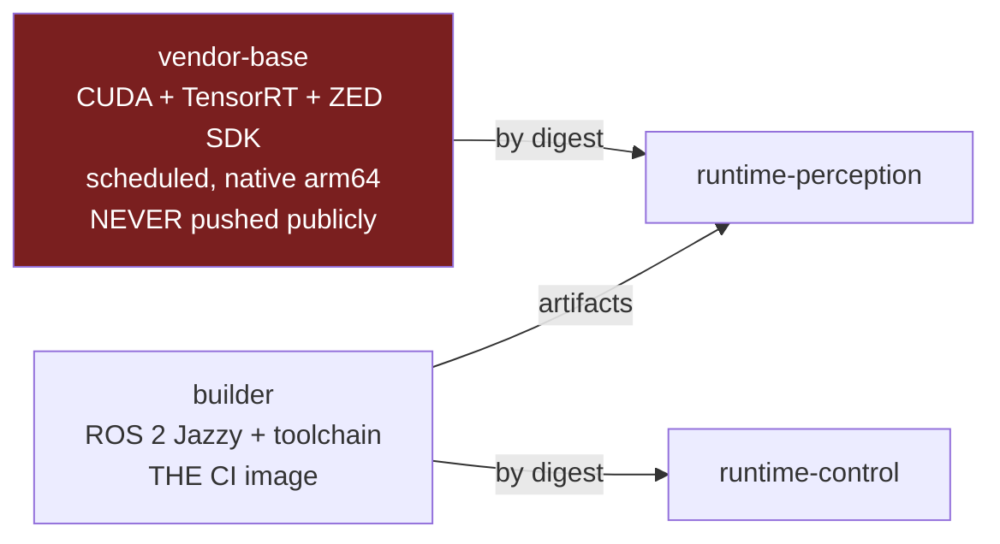

# Repository Bootstrap and Scaffolding

- Status: **Draft for acceptance.** Not yet an accepted engineering baseline.
- Date: 2026-09-02
- Scope: Monorepo layout, C++20 interface contracts, build system, container skeleton, and the initial CI workflow.
- Depends on: [ADR-001](../architecture/ADR-001-real-time-actuation-and-hardware-abstraction.md), [ADR-002](../architecture/ADR-002-safety-and-fault-management.md), [ADR-006](../architecture/ADR-006-runtime-and-containers.md), [ADR-007](../architecture/ADR-007-simulation-sil-hil.md), [ADR-009](../architecture/ADR-009-development-workflow-and-cicd.md)
- Related: [model-gate-0-execution.md](model-gate-0-execution.md)

---

## 0. A verified finding that changes ADR-001's scaffolding

ADR-001 describes `HumanoidActuatorSystem` as a `hardware_interface::SystemInterface` and sketches
its responsibilities. The **actual Jazzy API is not what a 2024-era memory of `ros2_control`
suggests**, and building against the remembered API would produce deprecation warnings at best and a
rewrite at worst.

Read directly from `ros2_control` tag `4.47.0` — the version pinned in the Jazzy distribution
manifest — `hardware_interface/system_interface.hpp` contains, in its entirety:

```cpp
class SystemInterface : public HardwareComponentInterface
{
public:
  return_type write(const rclcpp::Time & time, const rclcpp::Duration & period) override = 0;
};
```

Everything else moved to `HardwareComponentInterface`, and three of the four methods ADR-001 implies
are now deprecated:

| Method                             | Status in 4.47.0                                            | Replacement                                                                            |
| ---------------------------------- | ----------------------------------------------------------- | -------------------------------------------------------------------------------------- |
| `on_init(const HardwareInfo &)`    | `[[deprecated]]`                                            | `on_init(const HardwareComponentInterfaceParams &)`                                    |
| `export_state_interfaces()`        | `[[deprecated]]` — "Exporting is handled by the Framework." | `on_export_state_interfaces()` returning `std::vector<StateInterface::ConstSharedPtr>` |
| `export_command_interfaces()`      | `[[deprecated]]` — same note                                | `on_export_command_interfaces()` returning `std::vector<CommandInterface::SharedPtr>`  |
| `prepare_command_mode_switch(...)` | Current                                                     | Unchanged. Documented as "a **non-realtime** evaluation"                               |
| `perform_command_mode_switch(...)` | Current                                                     | Unchanged. Documented as "part of the **realtime** update loop, and should be fast"    |
| `read(...)`                        | Pure virtual on the base                                    | Unchanged                                                                              |
| `write(...)`                       | Pure virtual on `SystemInterface`                           | Unchanged                                                                              |

Two consequences for ADR-001 compliance, neither of which changes the decision:

1. **Ownership of interface memory has moved to the framework.** The new export methods return
   shared pointers to interfaces the framework creates from `InterfaceDescription`. ADR-001's
   requirement that "one immutable all-joint snapshot crosses the hardware boundary per cycle" is
   still satisfiable and is still ours to enforce — `write()` copies out of the framework-owned
   command interfaces into our preallocated snapshot. The snapshot is the boundary, not the
   interface storage.
2. **The partial-claim rejection ADR-001 places in `prepare_command_mode_switch()` is confirmed
   correct**, because upstream documents that method as explicitly non-real-time. The atomicity
   check belongs there and not in `perform_command_mode_switch()`.

No ADR amendment is required. This is an implementation-level correction and is recorded here so it
is not rediscovered during coding.

---

## 1. Monorepo layout

Honouring ADR-009-01: one repository holding the ROS 2 workspace, firmware, protocol and safety
definitions, model pipeline, and configuration. `vcstool` serves external sources only.

```text
humanoid-soccer/
├── .github/
│   ├── workflows/
│   │   ├── pr.yml                      # merge gates, ADR-009-06
│   │   ├── vendor-base-image.yml       # scheduled, ADR-009-05
│   │   ├── release.yml                 # ADR-009-11, -12
│   │   └── pin-audit.yml               # ADR-009-02 enforcement
│   ├── CODEOWNERS                      # ADR-009-08
│   └── dependabot.yml
│
├── protocol/                           # SOURCE OF TRUTH - ADR-007-07
│   ├── actuator_protocol.yaml          # one definition, four consumers
│   ├── safety_manifest.schema.json
│   └── generators/                     # emits C++, C, and Python bindings
│
├── model/                              # see model-gate-0-execution.md §5.3
│   ├── source/  schema/  generators/  generated/
│   └── robot_model.yaml
│
├── src/                                # colcon workspace
│   ├── humanoid_transport/             # QL1 - ActuatorTransport interface only
│   │   ├── include/humanoid_transport/
│   │   │   ├── actuator_transport.hpp
│   │   │   ├── batch_types.hpp
│   │   │   ├── joint_manifest.hpp
│   │   │   ├── safety_manifest.hpp
│   │   │   └── transport_capabilities.hpp
│   │   ├── test/
│   │   ├── CMakeLists.txt
│   │   └── package.xml
│   │
│   ├── humanoid_actuation/             # QL1 - HumanoidActuatorSystem
│   │   ├── include/humanoid_actuation/humanoid_actuator_system.hpp
│   │   ├── src/
│   │   ├── humanoid_actuation_plugin.xml
│   │   └── ...
│   │
│   ├── humanoid_safety/                # QL1 - SafetyKernel
│   ├── humanoid_transport_stm32/       # QL2 - Stm32SerialTransport
│   ├── humanoid_transport_mujoco/      # QL3 - MujocoActuatorTransport
│   ├── humanoid_transport_replay/      # QL3 - ReplayTransport
│   ├── humanoid_transport_fault/       # QL2 - FaultInjectingTransport decorator
│   ├── humanoid_interfaces/            # QL2 - msg/srv, partly generated
│   ├── humanoid_telemetry/             # QL2 - in-cycle ring buffer, MCAP drain
│   ├── humanoid_net_gateway/           # QL2 - ADR-005-09 single socket owner
│   ├── humanoid_estimation/            # QL3 - blocked on Gate 0
│   ├── humanoid_perception/            # QL3 - blocked on Gate 0
│   ├── humanoid_behaviour/             # QL3
│   ├── humanoid_bringup/               # QL3 - launch and params only
│   └── humanoid_description/           # QL3 - consumes model/generated/
│
├── firmware/
│   ├── master/                         # STM32F446RE, USB CDC + SPI
│   ├── slave/                          # STM32F446RE, SPI + CAN
│   ├── shared/generated/               # from protocol/ and model/
│   └── test/                           # host-run firmware unit tests
│
├── docker/
│   ├── vendor-base.Dockerfile          # CUDA + TensorRT + ZED SDK, scheduled
│   ├── builder.Dockerfile              # THE CI and dev image, ADR-009-03
│   ├── runtime-control.Dockerfile
│   ├── runtime-perception.Dockerfile
│   └── runtime-common.Dockerfile
│
├── config/
│   ├── zenoh/                          # ADR-003 router and peer configs
│   ├── controllers/
│   ├── udev/                           # ADR-006-09 stable device paths
│   ├── systemd/                        # ADR-006-05 units
│   └── kernel/                         # isolcpus, nohz_full, rcu_nocbs
│
├── evidence/
│   ├── hil/                            # ADR-009-10 signed HIL records
│   └── schema/hil_evidence.schema.json
│
├── tools/
│   ├── pin_audit.py                    # ADR-009-02
│   ├── release_manifest.py             # ADR-009-11
│   └── verify_generated.sh             # ADR-009-07
│
├── external.repos                      # vcstool, `vcs export --exact` only
├── .prettierignore
├── AGENTS.md
└── README.md
```

### Package boundary rules

| Rule                                                                                                                  | Reason                                                                                                |
| --------------------------------------------------------------------------------------------------------------------- | ----------------------------------------------------------------------------------------------------- |
| `humanoid_transport` depends on **nothing** but the C++ standard library and `humanoid_interfaces` types it needs     | ADR-001: the transport contract must not leak bus or ROS concepts. A dependency is how leakage starts |
| No transport implementation package is a build dependency of `humanoid_actuation`                                     | They are `pluginlib` plugins, loaded by configuration. A build dependency would defeat ADR-007-01     |
| `humanoid_safety` is depended on by `humanoid_actuation` only                                                         | `SafetyKernel` is invoked from one place                                                              |
| Anything under `model/generated/` and `firmware/shared/generated/` is `linguist-generated` and `CODEOWNERS`-protected | ADR-009-07                                                                                            |
| QL1 packages require `CODEOWNERS` review and carry REP-2004 Level 1 obligations                                       | ADR-009-08                                                                                            |

### Quality levels declared per package (ADR-009-08)

| Level   | Packages                                                                                                                    | Obligations                                                                                                                                                                                                                                      |
| ------- | --------------------------------------------------------------------------------------------------------------------------- | ------------------------------------------------------------------------------------------------------------------------------------------------------------------------------------------------------------------------------------------------ |
| **QL1** | `humanoid_transport`, `humanoid_actuation`, `humanoid_safety`                                                               | Version policy, stable version, strictly declared public API, API/ABI stability policy, system tests covering all documented features, tests covering all public API, code coverage tracking **and an enforced coverage policy for new changes** |
| **QL2** | `humanoid_transport_stm32`, `humanoid_transport_fault`, `humanoid_interfaces`, `humanoid_telemetry`, `humanoid_net_gateway` | Public API documented, unit + integration tests, coverage tracked                                                                                                                                                                                |
| **QL3** | Everything else                                                                                                             | Unit tests, lint                                                                                                                                                                                                                                 |

---

## 2. `ActuatorTransport` — the C++20 contract

`src/humanoid_transport/include/humanoid_transport/batch_types.hpp`:

```cpp
#pragma once

#include <array>
#include <bitset>
#include <chrono>
#include <cstdint>
#include <type_traits>

namespace humanoid::transport
{

/// Compile-time capacity. Fixed so every batch is preallocated (ADR-001).
/// Raising it is a deliberate, reviewed change; it is never sized at runtime.
inline constexpr std::size_t kMaxJoints = 32;

using JointIndex = std::uint8_t;
using CycleSequence = std::uint64_t;
using MonotonicStamp = std::chrono::steady_clock::time_point;

/// The complete MIT tuple (ADR-001). All five fields are owned as one object.
/// There is deliberately no constructor that sets a subset.
struct JointCommand
{
  double position_rad{};        ///< q_d
  double velocity_rad_s{};      ///< qdot_d
  double effort_nm{};           ///< tau_ff
  double stiffness_nm_rad{};    ///< K_p
  double damping_nm_s_rad{};    ///< K_d
};
static_assert(std::is_trivially_copyable_v<JointCommand>);

struct JointFeedback
{
  double position_rad{};
  double velocity_rad_s{};
  double effort_nm{};
  float temperature_c{};
  float bus_voltage_v{};
  std::uint16_t drive_fault_bits{};
  bool fresh{false};            ///< false means this joint produced no sample this cycle
};
static_assert(std::is_trivially_copyable_v<JointFeedback>);

/// One immutable all-joint snapshot crosses the boundary per cycle (ADR-001).
struct CommandBatch
{
  CycleSequence sequence{};
  MonotonicStamp stamp{};
  std::uint8_t joint_count{};
  std::bitset<kMaxJoints> availability_mask{};   ///< ADR-002 degraded operation
  std::uint32_t availability_epoch{};            ///< bumped on every mask change
  std::array<JointCommand, kMaxJoints> joints{};
};

struct FeedbackBatch
{
  CycleSequence sequence{};                      ///< sequence this batch answers
  MonotonicStamp stamp{};
  std::uint8_t joint_count{};
  std::array<JointFeedback, kMaxJoints> joints{};
};

enum class TransportError : std::uint8_t
{
  None = 0,
  Timeout,              ///< cycle deadline reached before a complete exchange
  Framing,              ///< COBS/CRC or equivalent integrity failure
  SequenceMismatch,     ///< duplicate, stale, or out-of-order
  ManifestMismatch,     ///< peer reports a different joint or protocol identity
  IncompleteBatch,      ///< some joints produced no sample
  NotActive,
  HardwareFault,
};

struct ExchangeResult
{
  TransportError error{TransportError::None};
  std::uint8_t joints_received{};
  std::chrono::nanoseconds elapsed{};

  [[nodiscard]] constexpr bool ok() const noexcept { return error == TransportError::None; }
};

struct HealthSnapshot
{
  CycleSequence last_completed_sequence{};
  std::uint64_t exchanges_total{};
  std::uint64_t exchanges_failed{};
  std::uint64_t deadline_misses{};
  std::uint64_t framing_errors{};
  std::uint64_t sequence_errors{};
  std::chrono::nanoseconds worst_exchange{};
  std::uint32_t peer_protocol_version{};
  bool link_up{false};
};

}  // namespace humanoid::transport
```

`src/humanoid_transport/include/humanoid_transport/actuator_transport.hpp`:

```cpp
#pragma once

#include "humanoid_transport/batch_types.hpp"
#include "humanoid_transport/joint_manifest.hpp"
#include "humanoid_transport/safety_manifest.hpp"
#include "humanoid_transport/transport_capabilities.hpp"

namespace humanoid::transport
{

/// Capability-based physical exchange contract (ADR-001).
///
/// This header must never gain a USB, SPI, CAN, EtherCAT, packet-layout, or
/// bus-topology concept. That prohibition is enforced by a CI header-content
/// check, not by review alone.
///
/// Implementations: Stm32SerialTransport (production), MujocoActuatorTransport
/// (SIL), ReplayTransport, FaultInjectingTransport (decorator).
class ActuatorTransport
{
public:
  virtual ~ActuatorTransport() = default;

  ActuatorTransport(const ActuatorTransport &) = delete;
  ActuatorTransport & operator=(const ActuatorTransport &) = delete;
  ActuatorTransport(ActuatorTransport &&) = delete;
  ActuatorTransport & operator=(ActuatorTransport &&) = delete;

  // --- Non-real-time lifecycle -------------------------------------------
  // May allocate. Called outside the control cycle.

  /// Validate identities and preallocate. Must reject a manifest whose joint
  /// count, ordering, or protocol version does not match the peer (ADR-002
  /// startup interlock).
  [[nodiscard]] virtual TransportError configure(
    const JointManifest & joints, const SafetyManifest & safety) = 0;

  [[nodiscard]] virtual TransportError activate() = 0;
  [[nodiscard]] virtual TransportError deactivate() = 0;

  [[nodiscard]] virtual TransportCapabilities capabilities() const noexcept = 0;

  // --- Real-time path ----------------------------------------------------
  // Hard requirements on every method below: no allocation, no logging, no
  // filesystem access, no ROS call, no unbounded wait, no lock that a
  // non-real-time thread can hold.

  /// One bounded command/feedback exchange. Must return at or before
  /// `deadline` whatever the physical layer is doing.
  [[nodiscard]] virtual ExchangeResult exchange(
    const CommandBatch & command,
    FeedbackBatch & feedback,
    MonotonicStamp deadline) noexcept = 0;

  /// Best-effort isolation of one joint. ADR-002 escalates when the transport
  /// cannot confirm it, which is why the return value is not advisory.
  [[nodiscard]] virtual TransportError request_joint_disable(JointIndex joint) noexcept = 0;

  [[nodiscard]] virtual TransportError request_all_disable() noexcept = 0;

  /// Must be callable from the real-time thread; returns a copied snapshot.
  [[nodiscard]] virtual HealthSnapshot health_snapshot() const noexcept = 0;

protected:
  ActuatorTransport() = default;
};

}  // namespace humanoid::transport
```

### Contract obligations not expressible in the type system

These are the conformance-suite items. ADR-009-06 makes transport conformance a merge gate, and this
is what it tests — every implementation runs the same suite.

| #   | Obligation                                                                                                                                    |
| --- | --------------------------------------------------------------------------------------------------------------------------------------------- |
| C1  | `exchange()` returns at or before `deadline`, measured, for every error path including a physically absent peer                               |
| C2  | `exchange()` performs zero allocations after `activate()`. Verified with an overridden global allocator in test                               |
| C3  | A `FeedbackBatch` with `fresh == false` for any joint sets `IncompleteBatch`; it is never silently completed with the previous cycle's values |
| C4  | Duplicate, out-of-order, or stale `sequence` yields `SequenceMismatch` and never a plausible-looking batch                                    |
| C5  | `request_all_disable()` is idempotent and callable from any state including `NotActive`                                                       |
| C6  | `health_snapshot()` is wait-free and never blocks the exchange                                                                                |
| C7  | Counters saturate rather than wrap                                                                                                            |
| C8  | A commanded positive joint direction produces a positive measured direction — the sign-flip gate                                              |

---

## 3. `HumanoidActuatorSystem` skeleton

Written against the verified 4.47.0 API. No deprecated method is overridden.

`src/humanoid_actuation/include/humanoid_actuation/humanoid_actuator_system.hpp`:

```cpp
#pragma once

#include <memory>
#include <string>
#include <vector>

#include <hardware_interface/system_interface.hpp>
#include <hardware_interface/handle.hpp>
#include <hardware_interface/types/hardware_interface_return_values.hpp>
#include <pluginlib/class_loader.hpp>
#include <rclcpp_lifecycle/state.hpp>

#include "humanoid_safety/safety_kernel.hpp"
#include "humanoid_transport/actuator_transport.hpp"

namespace humanoid::actuation
{

/// The only production hardware_interface::SystemInterface (ADR-001).
///
/// Owns joint identity, state export, the per-cycle command snapshot,
/// SafetyKernel invocation, fault propagation, and transport lifecycle.
/// Delegates all physical I/O to humanoid::transport::ActuatorTransport.
class HumanoidActuatorSystem : public hardware_interface::SystemInterface
{
public:
  // --- Initialisation (non-real-time) ------------------------------------

  hardware_interface::CallbackReturn on_init(
    const hardware_interface::HardwareComponentInterfaceParams & params) override;

  hardware_interface::CallbackReturn on_configure(
    const rclcpp_lifecycle::State & previous_state) override;

  hardware_interface::CallbackReturn on_activate(
    const rclcpp_lifecycle::State & previous_state) override;

  hardware_interface::CallbackReturn on_deactivate(
    const rclcpp_lifecycle::State & previous_state) override;

  hardware_interface::CallbackReturn on_error(
    const rclcpp_lifecycle::State & previous_state) override;

  hardware_interface::CallbackReturn on_cleanup(
    const rclcpp_lifecycle::State & previous_state) override;

  hardware_interface::CallbackReturn on_shutdown(
    const rclcpp_lifecycle::State & previous_state) override;

  // --- Interface export (current API; the deprecated pair is NOT used) ----

  std::vector<hardware_interface::StateInterface::ConstSharedPtr>
  on_export_state_interfaces() override;

  std::vector<hardware_interface::CommandInterface::SharedPtr>
  on_export_command_interfaces() override;

  // --- Command mode switching --------------------------------------------

  /// Non-real-time, per upstream documentation. Rejects partial claims,
  /// mixed ownership, and partial release of the five-field MIT tuple.
  hardware_interface::return_type prepare_command_mode_switch(
    const std::vector<std::string> & start_interfaces,
    const std::vector<std::string> & stop_interfaces) override;

  /// Real-time. Applies only what prepare_ already validated.
  hardware_interface::return_type perform_command_mode_switch(
    const std::vector<std::string> & start_interfaces,
    const std::vector<std::string> & stop_interfaces) override;

  // --- Real-time cycle ----------------------------------------------------

  hardware_interface::return_type read(
    const rclcpp::Time & time, const rclcpp::Duration & period) override;

  hardware_interface::return_type write(
    const rclcpp::Time & time, const rclcpp::Duration & period) override;

private:
  /// Copies all five fields for all claimed joints into command_snapshot_.
  /// Called once per write(), before validation. No allocation.
  void snapshot_commands() noexcept;

  /// Rejects duplicate, out-of-order, stale, or manifest-mismatched feedback.
  [[nodiscard]] bool accept_feedback(
    const humanoid::transport::FeedbackBatch & batch) noexcept;

  /// Entered when the SafetyKernel refuses the snapshot or the transport
  /// fails. Never returns the system to motion (ADR-002).
  void enter_protective_state(humanoid::safety::Trigger trigger) noexcept;

  // Transport, loaded by pluginlib from configuration (ADR-007-01).
  // Declared before transport_ so the loader outlives every instance it created.
  std::unique_ptr<pluginlib::ClassLoader<humanoid::transport::ActuatorTransport>> loader_;
  std::shared_ptr<humanoid::transport::ActuatorTransport> transport_;

  humanoid::safety::SafetyKernel safety_kernel_;

  // Preallocated at on_configure(); never resized afterwards.
  humanoid::transport::CommandBatch command_snapshot_{};
  humanoid::transport::FeedbackBatch feedback_{};
  humanoid::transport::JointManifest manifest_{};

  humanoid::transport::CycleSequence cycle_{0};
  std::uint32_t consecutive_bad_cycles_{0};
  bool mit_tuple_claimed_{false};
};

}  // namespace humanoid::actuation
```

### `write()` ordering, fixed by ADR-001 and ADR-002

```text
snapshot_commands()          // all five fields, all joints, one immutable object
  -> safety_kernel_.project(command_snapshot_, state, safety_state)
  -> transport_->exchange(command_snapshot_, feedback_, deadline)
  -> record to the in-cycle ring buffer (ADR-007-10)
```

The snapshot is taken **before** validation, and validation operates on the snapshot, never on the
live command interfaces. Any other order allows a controller write to land mid-validation.

---

## 4. Build system

### CMake baseline for a QL1 package

```cmake
cmake_minimum_required(VERSION 3.22)   # Ubuntu 24.04 Noble ships 3.28
project(humanoid_transport VERSION 0.1.0 LANGUAGES CXX)

set(CMAKE_CXX_STANDARD 20)
set(CMAKE_CXX_STANDARD_REQUIRED ON)
set(CMAKE_CXX_EXTENSIONS OFF)

if(CMAKE_CXX_COMPILER_ID MATCHES "GNU|Clang")
  add_compile_options(-Wall -Wextra -Wpedantic -Wconversion -Wshadow -Werror)
endif()

find_package(ament_cmake REQUIRED)

add_library(${PROJECT_NAME} INTERFACE)
target_include_directories(${PROJECT_NAME} INTERFACE
  $<BUILD_INTERFACE:${CMAKE_CURRENT_SOURCE_DIR}/include>
  $<INSTALL_INTERFACE:include>)
target_compile_features(${PROJECT_NAME} INTERFACE cxx_std_20)

if(BUILD_TESTING)
  find_package(ament_lint_auto REQUIRED)
  ament_lint_auto_find_test_dependencies()
  # QL1: coverage tracking is an obligation, not an option (REP-2004)
  add_compile_options(--coverage)
  add_link_options(--coverage)
endif()

install(DIRECTORY include/ DESTINATION include)
ament_export_targets(${PROJECT_NAME} HAS_LIBRARY_TARGET)
ament_package()
```

`-Werror` is deliberate on QL1 packages: the deprecated `ros2_control` methods documented in section
0 then fail the build if anyone reaches for them.

### Colcon invocation, identical in CI and locally

```bash
colcon build \
  --merge-install \
  --event-handlers console_direct+ \
  --cmake-args -DCMAKE_BUILD_TYPE=RelWithDebInfo -DBUILD_TESTING=ON
```

`--merge-install` because ADR-006 puts a single install tree in a container layer.

---

## 5. Container skeleton

Three tiers, matching ADR-009-05: vendor layers are scheduled and consumed by digest; the builder is
what CI runs in; runtime images are thin.



### `docker/builder.Dockerfile` (skeleton)

```dockerfile
# syntax=docker/dockerfile:1.7
# ADR-006-01: Ubuntu 24.04 Noble. Jazzy has no arm64 Jammy binaries at any tier.
# ADR-006-10 / ADR-009-02: base referenced by digest, never by tag.
ARG UBUNTU_DIGEST=sha256:<RESOLVE_AT_BOOTSTRAP>
FROM ubuntu@${UBUNTU_DIGEST} AS builder

ENV DEBIAN_FRONTEND=noninteractive \
    LANG=C.UTF-8

# ADR-009-02: colcon, rosdep, and vcstool are ABSENT from the Jazzy
# distribution manifest. They are distro-independent and MUST be pinned here
# explicitly, or the build has an unpinned supply chain.
ARG COLCON_VERSION=<PIN>
ARG ROSDEP_VERSION=<PIN>
ARG VCSTOOL_VERSION=<PIN>

RUN --mount=type=cache,target=/var/cache/apt,sharing=locked \
    apt-get update && apt-get install -y --no-install-recommends \
      ca-certificates curl gnupg build-essential cmake git python3-pip \
    && rm -rf /var/lib/apt/lists/*

# ROS 2 Jazzy apt source, key pinned by fingerprint
RUN <<'EOF'
set -eux
# add ros2 apt repository, verify key fingerprint, install ros-jazzy-ros-base
EOF

RUN pip3 install --no-cache-dir --break-system-packages \
      colcon-common-extensions=="${COLCON_VERSION}" \
      rosdep=="${ROSDEP_VERSION}" \
      vcstool=="${VCSTOOL_VERSION}"

# Model tooling (model-gate-0-execution.md §5.3)
COPY model/generators/requirements.lock /tmp/
RUN pip3 install --no-cache-dir --break-system-packages -r /tmp/requirements.lock

ENV RMW_IMPLEMENTATION=rmw_zenoh_cpp
WORKDIR /ws
```

### `docker/runtime-control.Dockerfile` (skeleton)

```dockerfile
# syntax=docker/dockerfile:1.7
ARG BUILDER_DIGEST=sha256:<RESOLVE_AT_BOOTSTRAP>
FROM humanoid/builder@${BUILDER_DIGEST} AS build
COPY . /ws/src
RUN . /opt/ros/jazzy/setup.sh && colcon build --merge-install \
      --packages-up-to humanoid_bringup \
      --cmake-args -DCMAKE_BUILD_TYPE=RelWithDebInfo

ARG RUNTIME_DIGEST=sha256:<RESOLVE_AT_BOOTSTRAP>
FROM humanoid/runtime-common@${RUNTIME_DIGEST}
COPY --from=build /ws/install /opt/humanoid
COPY config/zenoh /etc/humanoid/zenoh
COPY config/controllers /etc/humanoid/controllers

# ADR-006-09: no --privileged, no whole-bus passthrough. Device access is
# granted by udev rule + explicit --device at run time, not baked here.
# ADR-006-08: RT privileges are asserted at startup and read back; a failed
# assertion is a startup failure, never a silent downgrade.
ENTRYPOINT ["/opt/humanoid/bin/humanoid_control_entrypoint"]
```

### Container rules that are not optional

| Rule                                                                               | Source                                  |
| ---------------------------------------------------------------------------------- | --------------------------------------- |
| Every `FROM` uses a digest, never a tag                                            | ADR-006-10, ADR-009-02                  |
| The perception image is **never** pushed to a public registry                      | ADR-009-14, ZED SDK redistribution `NR` |
| One long-running process per container; systemd supervises, `ros2 launch` composes | ADR-006-05                              |
| All ROS containers run in the host network namespace                               | ADR-006-06                              |
| The running image digest is reported into the startup interlock                    | ADR-006-10                              |

---

## 6. Initial GitHub Actions workflow

### On action pinning — read before copying

ADR-009-02 requires every action to be pinned to a full-length commit SHA, because GitHub states
that this "is currently the only way to use an action as an immutable release".

**No SHA appears in this document.** Writing one here would mean inventing it, and an invented SHA is
either a build failure or, if it happens to resolve, an unreviewed dependency. The bootstrap
procedure is:

1. Choose the action version.
2. Resolve its full-length SHA: `gh api repos/<owner>/<repo>/commits/<tag> --jq .sha`.
3. Commit it with the version as a trailing comment.
4. `tools/pin_audit.py` fails CI on any `uses:` that is not a 40-character hex SHA.

### `.github/workflows/pr.yml` (skeleton)

```yaml
name: pr
on:
  pull_request:
  merge_group:

# ADR-009-13: read-only default, elevated per job only where required.
permissions:
  contents: read

concurrency:
  group: pr-${{ github.ref }}
  cancel-in-progress: true

jobs:
  # ADR-009-02 enforcement runs first: an unpinned supply chain invalidates
  # every result produced after it.
  pin-audit:
    runs-on: ubuntu-24.04
    steps:
      - uses: actions/checkout@<40-HEX-SHA> # v4.x - resolve at bootstrap
      - run: python3 tools/pin_audit.py

  # ADR-009-07: generated artifacts are verified by regeneration and diff.
  generated-drift:
    runs-on: ubuntu-24.04
    container:
      image: ghcr.io/${{ github.repository }}/builder@sha256:<DIGEST>
    steps:
      - uses: actions/checkout@<40-HEX-SHA>
      - run: ./tools/verify_generated.sh # protocol/, model/, firmware/shared/

  # ADR-009-04: native arm64 on free public-repo runners. No cross-compilation,
  # no QEMU: ros-tooling/cross_compile has been archived since 2022-12-14.
  build-test:
    needs: [pin-audit, generated-drift]
    strategy:
      fail-fast: false
      matrix:
        runner: [ubuntu-24.04, ubuntu-24.04-arm]
    runs-on: ${{ matrix.runner }}
    # ADR-009-03: CI runs the project's own builder image. No ROS-specific
    # action is in the critical path; action-ros-ci and setup-ros document
    # Jazzy but mention arm64 zero times.
    container:
      image: ghcr.io/${{ github.repository }}/builder@sha256:<DIGEST>
    steps:
      - uses: actions/checkout@<40-HEX-SHA>
      - name: Import external sources
        # ADR-009-02: vcstool follows a branch tip unless the file records
        # exact commits. Every release .repos is produced with `vcs export --exact`.
        run: vcs import src < external.repos
      - run: rosdep install --from-paths src --ignore-src -y
      - run: colcon build --merge-install --cmake-args -DCMAKE_BUILD_TYPE=RelWithDebInfo
      - run: colcon test --merge-install
      - run: colcon test-result --verbose

  # ADR-009-06: transport conformance including the sign-flip gate.
  conformance:
    needs: build-test
    runs-on: ubuntu-24.04-arm
    container:
      image: ghcr.io/${{ github.repository }}/builder@sha256:<DIGEST>
    steps:
      - uses: actions/checkout@<40-HEX-SHA>
      - run: ./tools/run_transport_conformance.sh

  # ADR-009-06: MuJoCo SIL is CPU-only, so it is free here.
  # ADR-009-15: this job may NEVER emit a timing figure.
  sil-regression:
    needs: build-test
    runs-on: ubuntu-24.04-arm
    container:
      image: ghcr.io/${{ github.repository }}/builder@sha256:<DIGEST>
    steps:
      - uses: actions/checkout@<40-HEX-SHA>
      - run: ./tools/run_sil_regression.sh # logical correctness only

  # ADR-009-06: image builds, but never a push from a pull request.
  image-build:
    needs: build-test
    runs-on: ubuntu-24.04-arm
    permissions:
      contents: read # deliberately NOT packages: write
    steps:
      - uses: actions/checkout@<40-HEX-SHA>
      - uses: docker/build-push-action@<40-HEX-SHA>
        with:
          file: docker/runtime-control.Dockerfile
          platforms: linux/arm64
          push: false
          provenance: true
```

### Job-to-gate mapping

| ADR-009 gate                           | Job                                            | Runner             |
| -------------------------------------- | ---------------------------------------------- | ------------------ |
| Pinning audit (§2)                     | `pin-audit`                                    | `ubuntu-24.04`     |
| Generated drift (§7)                   | `generated-drift`                              | `ubuntu-24.04`     |
| Compile both architectures (§6)        | `build-test` matrix                            | both               |
| Unit, property, lint (§6)              | `build-test`                                   | both               |
| Transport conformance + sign flip (§6) | `conformance`                                  | `ubuntu-24.04-arm` |
| MuJoCo SIL regression (§6)             | `sil-regression`                               | `ubuntu-24.04-arm` |
| Image build without push (§6)          | `image-build`                                  | `ubuntu-24.04-arm` |
| **HIL** (§10)                          | **Not here.** Release gate via signed evidence | Borrowed hardware  |
| **Timing** (§15)                       | **Not here, ever**                             | Real hardware only |

### Runner budget

Every job must fit the 6-hour hard job limit and 14 GB of runner storage. Two risks, both
`[Project target]` until measured:

| Risk                                              | Mitigation                                                                           | Measurement owed                                           |
| ------------------------------------------------- | ------------------------------------------------------------------------------------ | ---------------------------------------------------------- |
| Full workspace build on 4 arm64 cores exceeds 6 h | Builder image carries all dependencies prebuilt; only project packages compile in CI | Wall-clock of a clean `colcon build` on `ubuntu-24.04-arm` |
| Perception image exceeds 14 GB                    | Vendor layers are a separate scheduled image, pulled by digest                       | Actual usable disk after checkout and image pull           |

The reference published image `dustynv/ros:jazzy-ros-base-r36.4.4-cu128-24.04` is 5.1 GB as
distributed and `jazzy-desktop` is 5.9 GB, against 14 GB of runner storage. The headroom exists but
is not generous, and it has not been measured for this project's image.

---

## 7. Bootstrap order

| Step | Deliverable                                                                          | Depends on            |
| ---- | ------------------------------------------------------------------------------------ | --------------------- |
| B1   | Repository, branch protection, `CODEOWNERS`, read-only default token                 | —                     |
| B2   | `tools/pin_audit.py` + `pin-audit` job                                               | B1                    |
| B3   | `docker/builder.Dockerfile`, built natively on both arches, pushed to GHCR by digest | B2                    |
| B4   | `protocol/actuator_protocol.yaml` + generators + drift gate                          | B3                    |
| B5   | `humanoid_transport` headers, contract tests C1–C7 against a stub                    | B3, B4                |
| B6   | `humanoid_safety` skeleton with the envelope **as a function of Gate 0 values**      | B5                    |
| B7   | `humanoid_actuation` skeleton + `pluginlib` loading                                  | B5, B6                |
| B8   | `model/` schema + generators + drift gate                                            | B3                    |
| B9   | `humanoid_transport_mujoco` + SIL regression job                                     | B7, B8, **Gate 0 G2** |
| B10  | `humanoid_transport_stm32` + firmware skeleton                                       | B4, **G1 + G3**       |

**B1 through B8 do not depend on Model Gate 0.** They are the work that can start today. B9 and B10
are the first steps that genuinely need the robot to exist.

---

## 8. Deliberately deferred

| Item                                                   | Reason                                                                                                                       |
| ------------------------------------------------------ | ---------------------------------------------------------------------------------------------------------------------------- |
| Firmware toolchain and its CI lane                     | Not selected. The lane is specified by output — a binary, a joint-table static assert, and host-run tests — not by mechanism |
| HIL evidence schema and signing                        | ADR-009-10's gate is only as strong as this artifact, and it is currently undefined. `evidence/schema/` is a placeholder     |
| `humanoid_estimation`, `humanoid_perception` internals | Blocked on Gate 0 and on camera selection                                                                                    |
| Release and vendor-base workflows                      | Sketched in the layout; not specified here                                                                                   |
| USD generation                                         | Isaac Lab is learning-only; off the critical path                                                                            |
| Coverage threshold values for QL1                      | REP-2004 requires an enforced policy, not a specific number. The number is set once a baseline exists                        |
