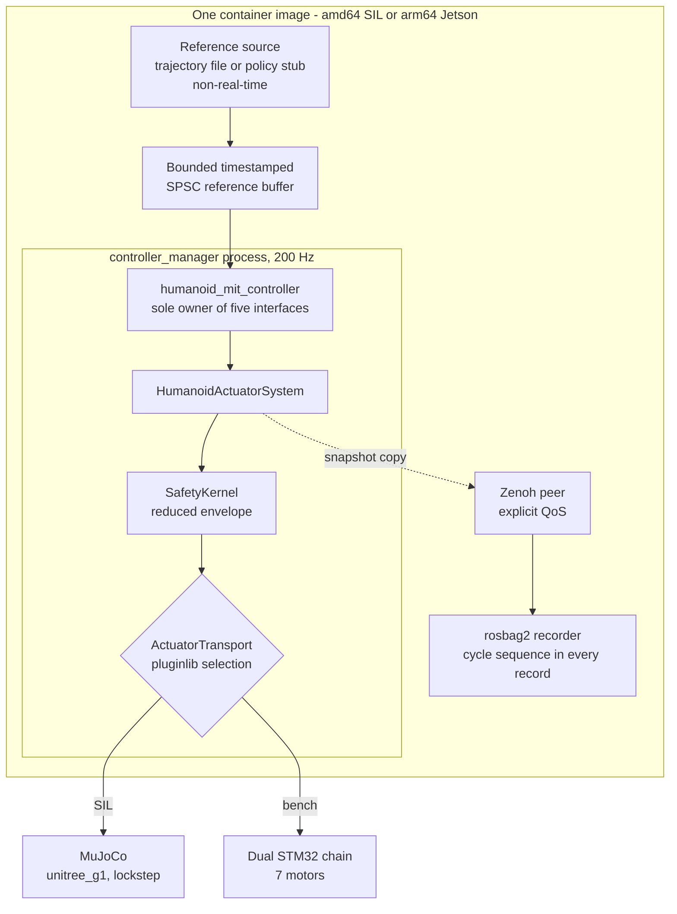
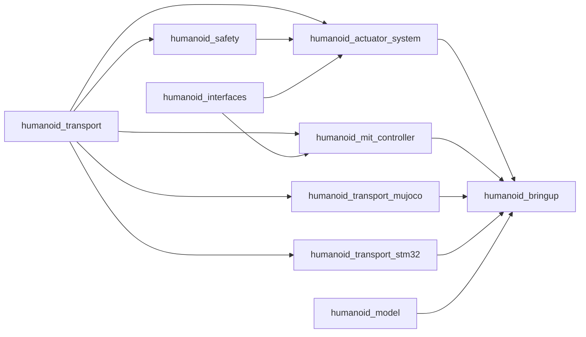
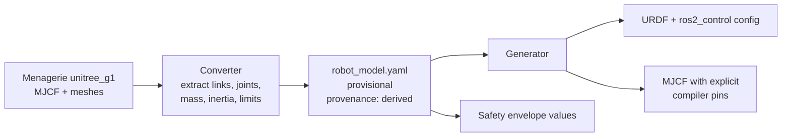
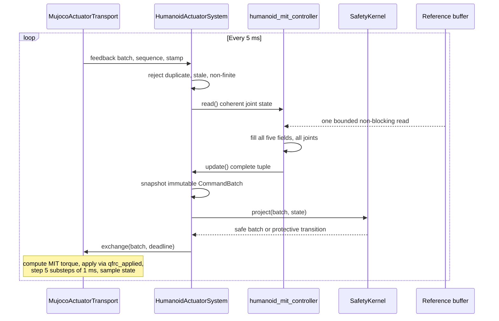
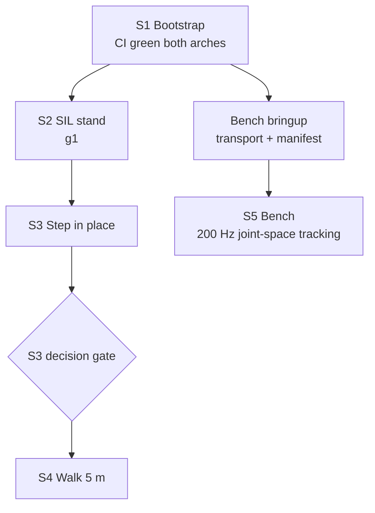

# POC Architecture: Walking Humanoid on unitree_g1

- Status: **Proposed**
- Scope: Proof-of-concept slice that grows into the full stack without rework
- Depends on: ADR-001, ADR-002, ADR-003, ADR-006, ADR-007, ADR-008, ADR-009, Topic 1-3 baselines
- Provisional model: **MuJoCo Menagerie `unitree_g1`**
- Endpoint: **a biped that stands, steps, and walks in SIL**, plus joint-space motion on the Jetson bench, with every component above the transport seam digest-identical to the future production build

## 1. Carried assumptions

| Question | Answer | Consequence |
|---|---|---|
| Q1 targets | Both amd64 SIL and arm64 Jetson, same binaries | One container image, two architectures; start with SIL |
| Q2 firmware | Host-only POC | `Stm32SerialTransport` declares reduced tuple capability |
| Q3 endpoint | Walking robot on an existing model | `unitree_g1`; joint-space only on bench |
| Q4 deferrals | Approved | Deferral table from the prior message stands |
| Model | `unitree_g1` | Menagerie MJCF wrapped in `robot_model.yaml` |
| S4 walking option | Leave to the S3 decision gate | Not decided here |

## 2. Invariants carried unchanged

These are not simplified for the POC. Cutting any of them would force a rewrite later.

| Invariant | Source | POC treatment |
|---|---|---|
| Five-field MIT tuple, all-or-none ownership | ADR-001-02 | Unchanged |
| Genuine 200 Hz | ADR-001-03 | Unchanged |
| `HumanoidActuatorSystem` is the only production `SystemInterface` | ADR-001-01 | Unchanged |
| Simulators integrate at `ActuatorTransport`, never replace `SystemInterface` | ADR-007-01 | Unchanged |
| Lockstep, integer substeps asserted at `configure` | ADR-007-03 | $\Delta t_{physics} = 1$ ms, $n = 5$ |
| Correlation by cycle sequence number, never timestamp | ADR-008-02 | Sequence in every batch and every log record |
| `SafetyKernel` projects the tuple as one coupled object | ADR-002 | Same structure, reduced envelope content |
| Containers on Jetson; digest-pinned images | ADR-006-01/10 | One control container, both arches |
| No `SYSTEM_DEFAULT` / `BEST_AVAILABLE` QoS | ADR-003 | Every endpoint declares explicit QoS |
| No timing figure may originate in SIL or CI | ADR-007-05, ADR-009-15 | Unchanged |

## 3. Scope

### In scope

- Working `HumanoidActuatorSystem` (current scaffold becomes real)
- Working `SafetyKernel` with reduced envelope: finiteness, position, velocity, slew, fixed torque bound
- `MujocoActuatorTransport`, lockstep, passing the conformance suite
- `Stm32SerialTransport` declared `kPositionVelocityOnly`
- One custom controller owning all five MIT interfaces per joint
- Provisional `unitree_g1` model wrapped in schema-valid `robot_model.yaml`
- Bounded non-RT reference buffer feeding the 200 Hz loop
- One container image, one Zenoh peer config, `rosbag2` telemetry with cycle sequence numbers

### Out of scope, with owners

| Item | Returns under |
|---|---|
| Six-container failure-domain split | ADR-006-04 |
| Supervised Zenoh router, TLS, QoS catalogue | ADR-003 |
| In-cycle ring buffer to MCAP | ADR-007-10, ADR-008-03 |
| `FaultInjectingTransport` | ADR-007-08 |
| Fall, brace, post-fall states | ADR-002 (needs estimator and real robot) |
| E-stop and power chain | ADR-002, HW-01 |
| Firmware full-tuple upgrade | Separate firmware work item |
| Perception, behaviour, GameController | ADR-005, Topics 5-8 |
| Real robot model | Topic 3, Gates G0-G5 |

## 4. System context



The same image runs SIL and bench. Only the transport plugin name in the hardware YAML changes. This is the ADR-007 seam working as designed: everything above `AT` is byte-identical in both environments.

## 5. Package layout

Existing scaffolds are marked. New packages fill the gaps.

```text
src/
├── humanoid_transport/            EXISTS - interface only; add TupleCompleteness
├── humanoid_safety/               EXISTS - implement reduced envelope
├── humanoid_actuator_system/      EXISTS - implement
├── humanoid_transport_mujoco/     NEW - MujocoActuatorTransport
├── humanoid_transport_stm32/      NEW - Stm32SerialTransport, reduced capability
├── humanoid_mit_controller/       NEW - tuple owner, reference buffer consumer
├── humanoid_interfaces/           NEW - minimal msg for telemetry/reference
├── humanoid_bringup/              NEW - launch, hardware YAML, Zenoh config
└── humanoid_model/                NEW - robot_model.yaml + generated siblings
```



Dependency rule from repository-bootstrap: no transport implementation is a build dependency of `humanoid_actuator_system`. All four are `pluginlib` plugins selected by configuration.

## 6. Robot model: unitree_g1 pipeline

One source of truth, many generated siblings. No format is generated from another format.



| Rule | POC treatment |
|---|---|
| Source of truth | `model/source/robot_model.yaml`, generated from the Menagerie MJCF by the converter; committed; schema-validated |
| Provenance | Every mass/inertia record: `cad_system: derived`, version = MJCF file digest |
| Unknowns | RobStride-specific fields (`bus_segment`, `can_node_id`, MIT wire encoding) are `NR` or sim-valued. Schema permits `NR`; the generator must emit the key |
| Inertia reference point | Declared explicitly per record (`com` or `link_origin`); converter applies the parallel-axis shift when needed |
| MJCF emission | Emits `balanceinertia="false"`, `boundmass="0"`, `boundinertia="0"`, `settotalmass="-1"` explicitly; refuses any other value |
| Actuators in sim | Menagerie's default actuators are disabled. The transport applies joint torques via `qfrc_applied`, so the executed law is exactly $\tau = K_p(q_d-q) + K_d(\dot q_d-\dot q) + \tau_{ff}$ |
| Actuated subset | Declared in the joint manifest. Initially legs + torso + arms; hands excluded. Unactuated DoF held at low stiffness |
| Schema drift | If the draft schema rejects a required provisional field, the fix is a schema amendment PR, never a bypass |
| Regenerate-and-diff | CI regenerates all siblings and fails on any difference (ADR-009-07) |

## 7. The 5 ms cycle



Prohibited inside this loop, per ADR-001: ROS communication, allocation, logging, filesystem access, unbounded wait.

## 8. SafetyKernel POC envelope

Same structure as ADR-002, reduced content. The kernel still accepts or projects the tuple as one object; scalar field-by-field clipping remains prohibited.

| Check | POC | Full system |
|---|---|---|
| All five fields finite, one sequence | Yes | Yes |
| Position and velocity bounds | Yes | Yes |
| Command slew limits | Yes | Yes |
| Torque bound | Fixed per-joint constant | Coupled $\tau_{allowed}(T,V,s)$ with overload curves |
| Power bound | Absent | $|\tau \dot q| \le P_{allowed}$ |
| Thermal derating | Absent | From G3 actuator characterisation |
| Availability-mask epoch | Yes | Yes |
| Protective damping on command loss | Yes | Yes, with qualified profile |

## 9. Reduced-capability transport

New field in `transport_capabilities.hpp`:

```cpp
enum class TupleCompleteness : std::uint8_t
{
  kFull = 0,               // all five fields delivered to the actuator
  kPositionVelocityOnly    // stiffness, damping, tau_ff not delivered
};

// added to TransportCapabilities
TupleCompleteness tuple_completeness{TupleCompleteness::kFull};
```

Rules:

- `MujocoActuatorTransport` reports `kFull`
- `Stm32SerialTransport` reports `kPositionVelocityOnly`, matching the as-built firmware: `SpiMitCmd` carries position and velocity only, $\tau_{ff}$ is hard-coded to `0.0f`, gains come from static config
- At `configure`, if the controller claims all five interfaces and the transport is `kPositionVelocityOnly`:
  - if the hardware YAML declares `accepted_degradation: position_velocity_only`, `HumanoidActuatorSystem` maps the tuple down at the transport boundary and records the degradation in every log record
  - otherwise `activate()` fails. Fail closed
- The controller still owns all five fields in both cases. Ownership is not split; delivery is declared

This closes Topic 1 finding 14: without the field, a reduced transport passes capability checks as complete.

**Bench precondition.** The as-built firmware torque trip is `max_tau: 0.8` N·m, which fires at about 3 degrees of tracking error with `default_kp: 15`. Either raise it in a bench firmware configuration or run with gains low enough to stay under it. Flagged, not resolved, in the POC.

## 10. Walking phases



| Stage | Capability | Reference source | Exit gate |
|---|---|---|---|
| S1 | Bootstrap: CI green on both arches, packages build, conformance stub passes | — | Merge gates pass |
| S2 | Stand: rise from a slumped pose, reject a scripted push | Keyframe trajectory file | Upright within 2 s of perturbation, zero envelope violations |
| S3 | Step in place under the same controller | Same, extended | 10 consecutive steps, no fall |
| S4 | Walk forward over flat ground | Per S3 gate decision | 5 m without fall, one replayable log |
| S5 | Bench: sine tracking on the 7-motor rig | Same controller, degraded tuple | Sustained 200 Hz, measured on hardware |

S4 decision gate, resolved during S3:

- **Option A:** pretrained RL walking policy exported to ONNX behind the reference buffer, keyframe fallback mandatory
- **Option B:** minimal LIPM/DCM gait plus IK, per the Topic 3 commissioning path

Both consume the identical reference interface, so the choice does not change this architecture.

## 11. Stubbed versus real

| Layer | POC | Full system | ADR owner |
|---|---|---|---|
| SystemInterface | Real, implemented | Unchanged | ADR-001 |
| Tuple ownership | Real | Unchanged | ADR-001 |
| SafetyKernel | Real, reduced envelope | Coupled torque/power/thermal envelope | ADR-002 |
| Protective damping | Real | Real plus qualified profile | ADR-002 |
| Fall/brace states | Stub: protective damping only | Full state machine | ADR-002 |
| MuJoCo transport | Real | Unchanged | ADR-007 |
| STM32 transport | Real, reduced capability | Full tuple after firmware upgrade | ADR-001 |
| Fault injection | Absent | Decorator transport | ADR-007-08 |
| Telemetry | rosbag2, sequence in every record | In-cycle MCAP ring buffer | ADR-007-10 |
| Containers | One control container | Six failure-domain containers | ADR-006 |
| Zenoh | One peer, loopback, no TLS | Router, TLS, QoS catalogue | ADR-003 |
| Model | Provisional Menagerie-derived | Measured robot model | Topic 3 |
| Perception, behaviour, GC | Absent | Full stack | ADR-005 |

## 12. Upgrade path

| Deferred item | Retrofit cost | Mitigation built into POC |
|---|---|---|
| Cycle sequence correlation | High if missed | Sequence already in every batch type and every logged record |
| In-cycle ring buffer | Moderate | Telemetry drain is a separate class; swap implementation later |
| Six-container split | Low | Processes already separated by concern inside one image |
| Zenoh router/TLS | Low | Config files exist from day one, peer-only content |
| Fault injection | Low | Decorator pattern; conformance suite already runs against MuJoCo |
| Full envelope | Low | Envelope data comes from `robot_model.yaml`, not code |
| Full tuple firmware | Medium | Capability field makes the gap explicit and machine-checked |
| Real model | Low | Converter and drift gate already in CI |

## 13. Qualification gates

1. Transport conformance obligations C1-C8 pass unchanged against `MujocoActuatorTransport`, including the sign-flip test
2. Partial five-interface claim is rejected by unit test
3. Integer substep ratio asserted at `configure`; simulated time advances exactly 5 ms per cycle over a long run with zero drift
4. SIL replay is bit-identical within one build and architecture; cross-architecture comparison reported separately
5. S2-S4 stage gates pass, with replayable logs carrying cycle sequence numbers
6. Bench: 200 Hz joint-space tracking sustained 10 minutes, timing measured on hardware
7. Command loss: 3 bad cycles triggers protective damping in SIL; bench behaviour documented
8. No timing figure in any POC report originates from SIL or CI
9. Digest equality between SIL and bench for every component above the transport boundary
10. A `tuple_completeness` mismatch without `accepted_degradation` fails `activate()`

## 14. Open items

| Item | Owner | Blocks |
|---|---|---|
| Final actuated joint subset for g1 | During S2 | S2 |
| Menagerie-to-`robot_model` converter (B8) | Software | S2 |
| Bench firmware `max_tau` handling | Hardware/firmware | S5 |
| USB CDC latency measurement on target | Software | S5 evidence |
| S4 Option A vs B | S3 gate | S4 only |
| Real robot model | Mechanical design, Model Gate 0 | Post-POC |