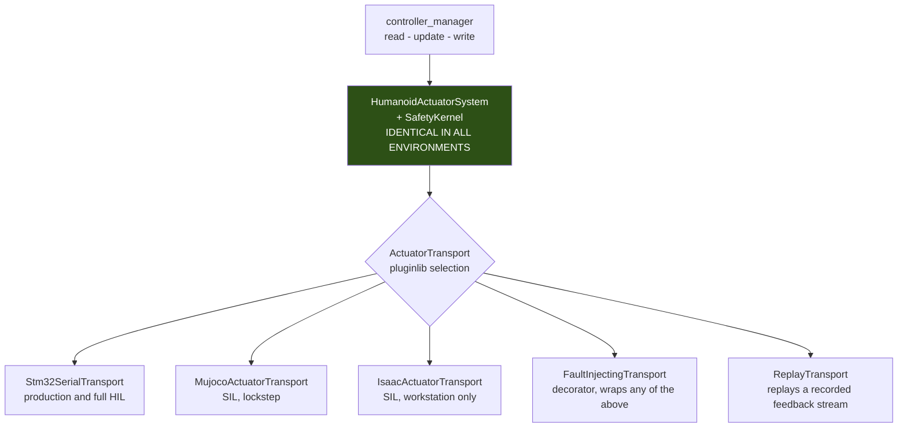
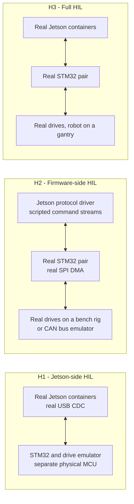

# Topic 10 Research: Simulation, SIL, HIL, Fault Injection, and Replay

- Status: Complete research baseline; update before any Topic 10 architecture revision
- Evidence last verified: 2026-09-01
- Scope: Research input for Topic 10; architecture proposal presented separately
- Canonical decisions: [ADR-001](../architecture/ADR-001-real-time-actuation-and-hardware-abstraction.md), [ADR-002](../architecture/ADR-002-safety-and-fault-management.md), [ADR-003](../architecture/ADR-003-zenoh-middleware.md), [ADR-005](../architecture/ADR-005-behavior-game-state-and-team-networking.md), [ADR-006](../architecture/ADR-006-runtime-and-containers.md)
- Related research: [Topic 3](topic-3-locomotion-survey.md), [Topic 4](topic-4-sensors-timing-state-estimation.md), [Topic 9](topic-9-runtime-and-containers.md)

## Purpose and evidence policy

Every ADR so far ends in verification gates, and almost every gate says "measure this". This topic
establishes where those measurements can actually be taken, and what each environment is and is not
capable of proving.

Evidence tags follow the Topic 4-9 convention:

| Tag            | Meaning                                                                                            |
| -------------- | -------------------------------------------------------------------------------------------------- |
| **[Primary]**  | Read directly from a source file, header, licence, service definition, or manifest at a named URL. |
| **[Upstream]** | Stated by the maintainer or vendor in their own documentation.                                     |
| **[Derived]**  | Computed or concluded here from tagged inputs. Reasoning shown.                                    |
| **[Project]**  | A target or constraint set by this project.                                                        |
| **NR**         | **Not reported.** Never means zero.                                                                |

## Confirmed project inputs

| Input              | Value                                                                                                                              | Source         |
| ------------------ | ---------------------------------------------------------------------------------------------------------------------------------- | -------------- |
| Transport seam     | `ActuatorTransport`; ADR-001 already states "A simulator transport and recording/replay transport may implement the same contract" | ADR-001        |
| System boundary    | `HumanoidActuatorSystem` is **the only** production `SystemInterface`                                                              | ADR-001        |
| Control cycle      | 200 Hz, 5 ms; **no ROS communication, logging, or filesystem access inside it**                                                    | ADR-001        |
| Safety authorities | `SafetyKernel` (host RT), Embedded Safety Agent (STM32), `SafetyCoordinator` (non-RT), physical stop chain                         | ADR-002        |
| Command loss       | Three consecutive missing or invalid 5 ms cycles                                                                                   | ADR-002        |
| Runtime            | Containers on Ubuntu 24.04; one process per container; digest-pinned images                                                        | ADR-006        |
| Robot model        | **Not designed.** Topic 3 Model Gate 0 is open: no kinematic tree, masses, inertias, or sole geometry exist.                       | Topic 3        |
| Licensing          | AGPL and GPL excluded for distributed application code                                                                             | Topic 5 §4.1.1 |

**Scope note.** Because Model Gate 0 is open, this topic cannot validate any model. It defines the
apparatus that will validate the model once it exists, and the apparatus is deliberately designed so
that its correctness does not depend on the model's content.

---

## 1. The integration seam, and why the existing simulator plugins are at the wrong layer

This is the finding that determines the rest of the topic.

### 1.1 What the available `ros2_control` simulation plugins actually are

| Package                                        | Jazzy release                 | Licence    | Class declaration                                                                    |
| ---------------------------------------------- | ----------------------------- | ---------- | ------------------------------------------------------------------------------------ |
| `mujoco_ros2_control`                          | 0.1.1-1, status `developed`   | MIT        | `class MujocoSystemInterface : public hardware_interface::SystemInterface` [Primary] |
| `gz_ros2_control`                              | 1.2.20-1, status `maintained` | Apache-2.0 | `class GazeboSimSystem : public GazeboSimSystemInterface` [Primary]                  |
| `mock_components` (in `ros2_control` 4.47.0-1) | 4.47.0-1                      | Apache-2.0 | `class GenericSystem : public hardware_interface::SystemInterface` [Primary]         |

The `gz_ros2_control` header states the relationship verbatim in a comment:

> "These class must inherit `gz_ros2_control::GazeboSimSystemInterface` which implements a simulated
> `ros2_control` `hardware_interface::SystemInterface`." [Primary]

**All three replace the `SystemInterface`.** That is the standard and correct design for a general-purpose
robot. It is the wrong layer for this one.

### 1.2 What that would bypass

ADR-001 assigned `HumanoidActuatorSystem` a specific and non-trivial set of responsibilities. Replacing
it with a simulator plugin removes all of them from the test:

| Responsibility                                                                         | Owner                                 | Present in a simulator `SystemInterface`? |
| -------------------------------------------------------------------------------------- | ------------------------------------- | ----------------------------------------- |
| Rejection of partial or mixed five-interface claims in `prepare_command_mode_switch()` | `HumanoidActuatorSystem`              | No                                        |
| The single immutable all-joint cycle snapshot                                          | `HumanoidActuatorSystem::write()`     | No                                        |
| `SafetyKernel` coupled-torque envelope projection                                      | `SafetyKernel`                        | No                                        |
| Manifest, calibration, protocol, and safety identity checks                            | `HumanoidActuatorSystem::configure()` | No                                        |
| Sequence, freshness, duplicate, and reorder rejection                                  | `HumanoidActuatorSystem::read()`      | No                                        |
| Availability-mask epoch handling                                                       | `HumanoidActuatorSystem`              | No                                        |
| Transport lifecycle and deadline bounding                                              | `HumanoidActuatorSystem`              | No                                        |

**Derived conclusion.** A SIL environment built on `MujocoSystem`, `GazeboSimSystem`, or
`mock_components::GenericSystem` tests a _different system_ from the one that is deployed. Every
ADR-001 and ADR-002 gate it appears to satisfy would be satisfied by code that does not ship. This is
not a marginal concern: the safety-critical logic is precisely the part that gets replaced.

### 1.3 The seam ADR-001 already specified

ADR-001 anticipated this. The transport contract is behavioural, not a frozen signature, and the ADR
states plainly that a simulator transport and a recording/replay transport may implement it.

Everything above the transport boundary is byte-identical across production, SIL, HIL, and replay. The
environment is selected by which plugin is loaded, which is a configuration choice, not a build
choice.

### 1.4 What the simulator transports must still satisfy

A simulator transport is not exempt from the ADR-001 conformance suite. It must supply:

- Identical units, signs, and joint ordering to the production manifest
- Monotonic cycle sequence numbers and monotonic timestamps
- Per-joint delivery status and drive-health fields
- Capability reporting, so that identity checks exercise the same path
- The ability to violate all of the above **on demand**, for fault injection

The transport conformance suite required by ADR-001 — "runs unchanged against STM32, simulator, and
test-double implementations" — is therefore the single most valuable artifact in this topic. It is
what makes SIL results transferable to hardware.

---

## 2. Simulator candidates

### 2.1 Availability, licence, and where each can run

|                             | MuJoCo                                                            | Isaac Sim / Isaac Lab                                                                           | Gazebo (`gz_ros2_control`)                                |
| --------------------------- | ----------------------------------------------------------------- | ----------------------------------------------------------------------------------------------- | --------------------------------------------------------- |
| Licence                     | **Apache-2.0** [Primary]                                          | Isaac Sim **Apache-2.0**; Isaac Lab **BSD-3-Clause** [Primary]                                  | Apache-2.0                                                |
| Jazzy `ros2_control` bridge | `mujoco_ros2_control` 0.1.1-1, status `developed` [Primary]       | None released for Jazzy; ROS bridge is topic-level                                              | `gz_ros2_control` 1.2.20-1, status `maintained` [Primary] |
| Model ingest                | MJCF native; **"URDF model files can also be loaded"** [Upstream] | "supports importing robotic systems from common formats such as URDF, MJCF, and CAD" [Upstream] | SDF native, URDF via conversion                           |
| GPU requirement             | None                                                              | **RTX 4080 / 5080 / A40 / L40S / RTX PRO class discrete GPU** [Upstream, requirements table]    | None for headless physics                                 |
| Runs on the Jetson?         | Yes, CPU-only                                                     | **NR, and unlikely.** The aarch64 build instructions reference DGX Spark, not Jetson. [Primary] | Yes                                                       |
| Runs in CI without a GPU?   | Yes                                                               | No                                                                                              | Yes                                                       |

All three are licence-compatible with the Topic 5 §4.1.1 policy. That removes the licence question
entirely and lets the decision rest on capability.

**The decisive practical difference is where each can execute.** Isaac requires a workstation-class
discrete GPU. It cannot provide on-robot SIL, cannot run in a GPU-less CI job, and its Jetson support
is unreported. MuJoCo has neither constraint.

### 2.2 Determinism

MuJoCo states its reproducibility properties explicitly [Upstream, `doc/computation/index.rst`,
section *Reproducibility*]:

> "MuJoCo's simulation pipeline is entirely deterministic and reproducible"

and, in the same section, the limit:

> "Exact reproducibility is only guaranteed within a **single version**, on the **same architecture**."

MuJoCo also documents a "compact, well-defined internal state which, together with the deterministic
pipeline" enables state save and restore.

**Two consequences follow, and both are architectural.**

1. **Determinism is version- and architecture-pinned by the vendor's own statement.** This is not a
   caveat to work around; it is the same constraint ADR-006 already imposes through image digest
   pinning. The simulator version belongs in the release manifest alongside the container digest.
2. **Bit-exact replay across amd64 and arm64 is not achievable and must not become a gate.** The
   workstation and the robot are different architectures. A replay gate demanding bit-identical output
   across both would be demanding something the simulator explicitly does not offer. Cross-architecture
   comparison must be tolerance-based; bit-exactness is only meaningful within one architecture.

Isaac Sim determinism guarantees are **NR**. GPU-parallel physics with non-associative floating-point
reduction is a structurally harder determinism problem than a single-threaded CPU pipeline, and no
equivalent vendor statement was found.

### 2.3 Role assignment

Topic 3 already proposed the split, and the evidence above supports it without modification: **MuJoCo
as the lightweight, deterministic, CPU-only controller-SIL and regression oracle; Isaac Lab as the
parallel-learning and domain-randomisation environment.** These are different jobs, not competing
options, and the deciding evidence is licence-independent.

### 2.4 The model gate

Every simulator above ingests URDF or MJCF. None of them can be used until Topic 3 Model Gate 0
produces a kinematic tree, masses, inertias, and sole geometry. The apparatus in this document is
therefore built and conformance-tested against a **synthetic manifest** — an arbitrary joint set with
declared units and limits — so that the transport, fault-injection, and replay infrastructure is
validated before the robot model exists. That is deliberate: it keeps the test apparatus from being
blocked on, or silently tuned to, an unfinished model.

---

## 3. Software-in-the-loop and the stepping problem

### 3.1 Three candidate synchronisation architectures

| Architecture                                 | Mechanism                                                                                                                     | Determinism                                                                                                          | Verdict                           |
| -------------------------------------------- | ----------------------------------------------------------------------------------------------------------------------------- | -------------------------------------------------------------------------------------------------------------------- | --------------------------------- |
| **A. Loose, `/clock`-driven**                | Simulator publishes `/clock`; nodes run with `use_sim_time`; the control loop free-runs                                       | Poor. Message arrival order across an executor is not reproducible, and the RT loop does not consume ROS time anyway | Rejected as the primary mechanism |
| **B. Simulator drives `controller_manager`** | The physics callback calls `controller_manager::update()` directly, as `gz_ros2_control` does                                 | Good, but requires the simulator plugin `SystemInterface` — the §1.2 problem                                         | Rejected                          |
| **C. Lockstep transport**                    | `MujocoActuatorTransport::exchange()` advances physics by exactly one control period and returns the resulting feedback batch | Good, and preserves the entire production stack above the transport                                                  | **Recommended**                   |

`controller_manager` exposes `read(time, period)`, `update(time, period)`, and `write(time, period)` as
public methods [Primary], so an external stepper can drive the exact production loop when required.
Architecture C does not even need that: the blocking happens inside `exchange()`, and the controller
manager runs its normal loop.

### 3.2 Why the standard stepping service is not the answer at 200 Hz

`simulation_interfaces` 1.5.1-1 is released for Jazzy and defines `StepSimulation.srv`,
`SetSimulationState.srv`, `GetSimulationState.srv`, `ResetSimulation.srv`, `SetEntityState.srv`, and a
`GetSimulatorFeatures` capability-discovery service [Primary]. `StepSimulation.srv` reads:

> "Assuming the simulation is paused, simulate a finite number of steps and return to paused state.
> The service only returns once stepping is complete, which might take considerable time." [Primary]

**[Derived]** This is a ROS service round trip per step group. Driving a 5 ms cycle through it means
200 service round trips per simulated second, each carrying request/response serialisation and
executor scheduling. That is a correctness hazard as well as a throughput one: the standard explicitly
warns that the call "might take considerable time", so cycle boundaries would be defined by service
latency rather than by physics.

`simulation_interfaces` is nonetheless valuable, just at a different granularity: **scenario control**
— reset, pause, world load, entity teleport, and capability discovery — where a service round trip per
operation is entirely appropriate. `SetEntityState` in particular is the clean, standard way to inject
a push or reposition the ball. Using it there and the lockstep transport for the cycle is the right
division.

### 3.3 The lockstep contract

The physics timestep must divide the control period exactly. With a 5 ms control period and MuJoCo's
`mjModel.opt.timestep`, an integer $n$ substeps per cycle gives

$$\Delta t_{\text{control}} = n \cdot \Delta t_{\text{physics}}, \qquad n \in \mathbb{Z}^{+}$$

so that $\Delta t_{\text{physics}} = 5\ \mathrm{ms}/n$. A non-integer ratio produces beat-frequency
aliasing between the control and physics clocks that is easily mistaken for a controller instability.

`exchange()` then: applies the command batch to the actuator inputs, advances physics $n$ substeps,
samples the resulting state, stamps it with the next monotonic sequence number, and returns. No
wall-clock waiting occurs, which is what makes SIL run faster or slower than real time without
affecting its results.

### 3.4 What SIL structurally cannot test

This is the most important limitation in the topic and it must be stated before any SIL result is
quoted as evidence.

| SIL can establish                                                         | SIL cannot establish                                                   |
| ------------------------------------------------------------------------- | ---------------------------------------------------------------------- |
| Logical correctness of controllers, safety projection, and state machines | **Any timing property.** The loop is not running at wall-clock 200 Hz. |
| Sequence, freshness, and epoch handling                                   | Scheduler jitter, cache and memory-bandwidth contention, page faults   |
| Fault-response _ordering_ and state transitions                           | Fault-response _latency_                                               |
| Regression detection against a stored trajectory                          | Physical actuator dynamics, backlash, compliance, thermal derating     |
| Behaviour under injected sensor and estimator faults                      | Anything about the physical stop chain                                 |

ADR-006 gates 4 and 5 are wall-clock timing gates. **No SIL run can close them.** They belong to HIL
and physical testing, and any report that presents a SIL cycle-time histogram as evidence for the 5 ms
deadline is reporting the wrong number.

### 3.5 SIL runs the production containers

ADR-006 pays off here. The SIL stack is the same digest-pinned containers, the same `ros2 launch`
composition, the same lifecycle orchestration, and the same Zenoh router configuration — with one
transport plugin swapped and the simulator container added. The workstation runs amd64 images built
from the same manifest as the arm64 robot images, which is exactly the version parity ADR-003 already
requires.

The architecture difference is real and is handled by §2.2: comparisons across architectures are
tolerance-based, never bit-exact.

---

## 4. Hardware-in-the-loop

ADR-001's transport boundary partitions HIL cleanly into three configurations, each testing a
different thing.

| Configuration        | Proves                                                                                                                         | Cannot prove                                    |
| -------------------- | ------------------------------------------------------------------------------------------------------------------------------ | ----------------------------------------------- |
| **H1** Jetson-side   | Host timing under real USB CDC, container device passthrough, real kernel scheduling, ADR-006 gates 3-5, `SafetyKernel` timing | Firmware behaviour, real drive faults           |
| **H2** Firmware-side | Embedded Safety Agent watchdogs, command-loss timing, SPI DMA scheduling, drive fault handling, arm-epoch replay resistance    | Host-side controller behaviour                  |
| **H3** Full          | End-to-end latency, the complete fault chain, arm and rearm workflows                                                          | Untethered dynamics, fall recovery on the field |

### 4.1 The emulator must be a separate physical device

**[Derived]** For H1, emulating the STM32 in a host-side software loopback tests the protocol parser
and nothing else. It does not exercise the USB CDC stack, the kernel `cdc_acm` driver, the udev rule
and container device passthrough required by ADR-006 §9, the real serialisation timing, or the
failure modes that matter — enumeration loss, buffer stalls, device reset. The emulator must present a
real USB CDC endpoint from separate hardware, or H1 proves substantially less than it appears to.

The same argument applies in reverse to H2: a Jetson emulator that sends commands over a socket rather
than over USB does not test what the firmware will actually receive.

### 4.2 The emulators share the protocol definition

Both emulators and the production transport must be generated from, or checked against, **one machine-
readable protocol definition** — versioned, with feature bits, per ADR-001's protocol requirements. Two
hand-maintained implementations of the same wire format will diverge, and the divergence will surface
as a field failure rather than a test failure. The protocol conformance vectors are shared across the
transport conformance suite, the STM32 emulator, and the firmware unit tests.

---

## 5. Fault injection

### 5.1 Injection is a plugin selection, not a compile flag

**This is the central discipline of the lane.** Fault injection implemented as `#ifdef` branches or
runtime test flags inside `HumanoidActuatorSystem`, `SafetyKernel`, or the firmware means the tested
binary is not the shipped binary, which directly contradicts ADR-006's digest-pinned release identity.

Instead, `FaultInjectingTransport` is a **decorator** implementing `ActuatorTransport` and wrapping a
real one. It is selected by pluginlib configuration. The production code path is byte-identical in
both cases, and the fault campaign configuration is a data artifact that can be versioned, replayed,
and attached to a release report.

### 5.2 Where each ADR-002 fault is injected

| ADR-002 fault                                      | Injection point                                                                                       | Environment       | What is being verified                                                                                                                                       |
| -------------------------------------------------- | ----------------------------------------------------------------------------------------------------- | ----------------- | ------------------------------------------------------------------------------------------------------------------------------------------------------------ |
| Corrupt, stale, duplicate, out-of-order feedback   | `FaultInjectingTransport`                                                                             | SIL, H1           | `HumanoidActuatorSystem::read()` rejection and the manifest-assigned fault response                                                                          |
| Command loss (3 consecutive cycles)                | Emulator drops frames                                                                                 | **H1, H2 only**   | Embedded Safety Agent damping-then-disable; latency is meaningless in SIL                                                                                    |
| Single drive fault                                 | Transport or emulator returns a drive fault code                                                      | SIL, H1, H2       | Isolation attempt, verification, availability-mask epoch                                                                                                     |
| Failed joint isolation                             | Emulator acknowledges disable but keeps reporting motion                                              | H1, H2            | Escalation to shared actuator-power removal                                                                                                                  |
| STM32 reset or brownout                            | Emulator resets its arm epoch mid-run                                                                 | H1                | Boot with drives disabled; fresh arm epoch required; replay resistance                                                                                       |
| Coupled-torque envelope violation                  | Scripted controller commanding a legal $K_p$ with a legal $q_d$ that together exceed $\tau_{allowed}$ | SIL               | `SafetyKernel` projects the tuple as one object; proves scalar clipping is not what is happening                                                             |
| Fall or impact                                     | Simulator: `SetEntityState`, or a direct external wrench                                              | SIL               | Brace trigger, post-fall disable, no automatic gait continuation                                                                                             |
| Estimator invalidity                               | Estimator-level injection: corrupt the Tier 0 validity signal                                         | SIL               | ADR-002 estimator-invalidity response; scoped to Tier 0 per Topic 6 D2                                                                                       |
| Configuration or calibration mismatch              | Mismatched manifest or container digest                                                               | SIL, H1           | Startup interlock stays closed                                                                                                                               |
| Zenoh peer, router, or partition loss              | Container network manipulation; kill the router container                                             | SIL, H1           | Remote intent expiry, degraded marking, no automatic motion on recovery                                                                                      |
| GameController loss, staleness, malformed, flooded | Gateway-level packet injection                                                                        | SIL               | Topic 8 gates 1-9; the validation ladder                                                                                                                     |
| **E-stop**                                         | **None**                                                                                              | **Physical only** | ADR-002 requires the stop chain to be independent of Jetson, ROS 2, Zenoh, USB, and STM32 application scheduling. Nothing that runs in software can test it. |

### 5.3 Fault campaigns must be enumerated, not sampled ad hoc

The ADR-002 fault set is finite and enumerable: fault class × affected joint set × safety state ×
availability mask epoch. The campaign should be generated from that product with a documented
reduction, so that release evidence states which combinations were executed and which were reasoned
away, rather than presenting whichever faults someone remembered to try.

---

## 6. Deterministic replay and telemetry

### 6.1 What rosbag2 provides in Jazzy

`rosbag2` 0.26.11-1. The default storage plugin is **`mcap`**, verified from
`default_storage_id.cpp`, which returns the literal string `"mcap"`, and from the README: "The default
is `mcap`" [Primary].

The player exposes the mechanisms needed for stepped replay [Primary, `player.hpp` and
`play_options.hpp`]: `play_next`, `burst`, `pause`, `toggle_paused`, `seek`, `set_rate`, plus
`start_paused`, `clock_publish_frequency`, `clock_publish_on_topic_publish`, and `clock_trigger_topics`.

The README also records a property that matters for a size-constrained robot:

> "the MCAP file format offered by the `rosbag2_storage_mcap` storage plugin supports compression in a
> way that produces files that are still indexable (whereas using the Rosbag2 compression will not)"
> [Primary]

### 6.2 What rosbag2 structurally cannot record

**[Derived, and this is the significant finding of the lane.]** ADR-001 states as a hard requirement:
"No Zenoh, ROS service, action, logging, filesystem, parameter lookup, or unbounded wait in `read()`,
controller `update()`, `write()`, or `SafetyKernel`."

Therefore **the 200 Hz command and feedback tuples never appear on a ROS topic at their true rate.**
`rosbag2` can only record what a non-real-time thread copies out and publishes, which is by
construction a decimated, re-timestamped, executor-scheduled view. It is a good diagnostic record and
it is not a control-loop trace.

A post-match analysis that says "the actuator command at cycle 41,203 was X" cannot be answered from a
bag. Neither can a deterministic replay of the control loop, because replay requires exactly the
inputs the loop actually saw, cycle by cycle.

### 6.3 The in-cycle binary log

The control loop therefore needs its own record: a preallocated lock-free ring buffer written inside
the cycle, drained to disk by a non-real-time thread. Writing into a preallocated ring is a bounded
store with no allocation and no syscall, which satisfies the ADR-001 constraint; the drain thread does
the filesystem work.

**[Derived] Size estimate.** Assume 20 joints, the upper end of the ADR-001 scaling envelope.

| Field group                                        | Per joint |
| -------------------------------------------------- | --------- |
| Command tuple, 5 × `float32`                       | 20 B      |
| Feedback position, velocity, effort, 3 × `float32` | 12 B      |
| Temperature, voltage, drive mode, fault bits       | 8 B       |
| **Per-joint total**                                | **40 B**  |

Per cycle: $40 \times 20 = 800$ B of joint data, plus a header carrying cycle sequence, monotonic
timestamp, safety state, availability-mask epoch, and transport counters, taken as 48 B. Total
$\approx 848$ B per cycle.

$$848\ \mathrm{B} \times 200\ \mathrm{Hz} \approx 170\ \mathrm{kB/s} \approx 611\ \mathrm{MB/h}$$

A KidSize match is two halves of 10 minutes, so a full match of continuous logging is
$\approx 204$ MB uncompressed. Most fields change slowly between cycles, so this compresses well.

**This is not a constraint.** The relevant conclusion is that full-rate, full-fidelity control logging
is affordable for an entire match and should be **on by default**, not sampled or disabled at
competition. Topic 9 gap 9 listed logging volume as unscoped; this closes the control-loop half of it.

### 6.4 What deterministic replay actually means here

Three replay scopes, with genuinely different guarantees:

| Scope                         | Method                                                                                                                                                 | Guarantee                                                                                                                                                                                          |
| ----------------------------- | ------------------------------------------------------------------------------------------------------------------------------------------------------ | -------------------------------------------------------------------------------------------------------------------------------------------------------------------------------------------------- |
| **Control-loop replay**       | `ReplayTransport` returns the recorded feedback batch for each cycle; the real `HumanoidActuatorSystem`, controllers, and `SafetyKernel` run unchanged | **Strong.** The loop is a pure function of its inputs by ADR-001 construction. Same architecture and build gives bit-identical output; a difference is a regression.                               |
| **Full-stack SIL replay**     | MuJoCo from a saved state with the recorded command stream                                                                                             | **Strong within one version and architecture**, by MuJoCo's own statement; tolerance-based across architectures.                                                                                   |
| **Non-real-time node replay** | `rosbag2` playback into perception, estimation, and behaviour                                                                                          | **Weak.** Callback execution order across an executor is not reproduced by replaying message timestamps. Use `start_paused` plus `play_next` to make ordering explicit where a test depends on it. |

**[Derived]** The asymmetry is not an accident and should be stated as a design property rather than a
defect: the control loop is deterministically replayable _because_ ADR-001 forbade ROS communication
inside it. The same rule that makes the loop real-time safe makes it replayable. The non-real-time
plane bought flexibility and paid for it in reproducibility, which is the correct trade in both
directions.

---

## 7. Falsifiable gates

| #   | Gate                                                                                                                                                                                | Pass condition                                                                                                                                                     |
| --- | ----------------------------------------------------------------------------------------------------------------------------------------------------------------------------------- | ------------------------------------------------------------------------------------------------------------------------------------------------------------------ |
| 1   | **Transport conformance parity.** Run the ADR-001 conformance suite unchanged against `Stm32SerialTransport`, `MujocoActuatorTransport`, the STM32 emulator, and `ReplayTransport`. | Identical pass results. Any transport-specific exemption is a documented defect, not a configuration.                                                              |
| 2   | **Units, signs, and ordering.** Cross-check joint order, sign convention, and units between the manifest, the simulator model, and the firmware protocol.                           | A single generated artifact drives all three; a deliberate sign flip in any one of them is detected by an automated test.                                          |
| 3   | **Lockstep integrity.** Verify the physics timestep divides the control period exactly and that `exchange()` advances physics by exactly one control period.                        | Integer substep ratio asserted at configure time; simulated time advances exactly 5 ms per cycle over a long run with zero drift.                                  |
| 4   | **Control-loop replay determinism.** Replay a recorded cycle stream through `ReplayTransport` on the same build and architecture.                                                   | Bit-identical command output. Cross-architecture comparison is tolerance-based and reported separately.                                                            |
| 5   | **SIL cannot be quoted for timing.** Audit release reports.                                                                                                                         | No SIL-derived timing figure appears as evidence for the ADR-001 5 ms deadline or ADR-006 gates 4-5.                                                               |
| 6   | **H1 realism.** Verify the STM32 emulator presents a real USB CDC endpoint from separate hardware and that the container receives it through the ADR-006 §9 udev rule.              | No host-side software loopback in the H1 path.                                                                                                                     |
| 7   | **Fault campaign completeness.** Execute the enumerated fault class × joint set × safety state × mask epoch product with a documented reduction.                                    | Every ADR-002 fault row in §5.2 has a result or a written justification for exclusion. E-stop is explicitly marked physical-only.                                  |
| 8   | **Injection purity.** Diff the production and fault-injection binaries.                                                                                                             | Identical digests for every component above the transport boundary. Injection is plugin configuration only.                                                        |
| 9   | **Coupled-envelope proof.** Command a legal $K_p$ and a legal $q_d$ whose product exceeds $\tau_{allowed}$.                                                                         | `SafetyKernel` projects or rejects the tuple as one object. Passing this with per-field clipping is impossible by construction of the test case.                   |
| 10  | **Log volume and endurance.** Run full-rate in-cycle logging for a full match duration on the target storage medium.                                                                | Measured volume within the §6.3 estimate; no cycle overrun attributable to the drain thread; storage endurance assessed.                                           |
| 11  | **Simulator version in the release manifest.**                                                                                                                                      | Simulator version and model digest pinned alongside the container digest, per ADR-006 §10, because MuJoCo guarantees reproducibility only within a single version. |

---

## 8. Open gaps

1. **Model Gate 0 is still open.** No simulator model exists, so no dynamic result in this apparatus
   can be validated. The apparatus is built against a synthetic manifest specifically so it is not
   blocked on this.
2. **`mujoco_ros2_control` is version 0.1.1 with status `developed`.** Even though the recommended
   architecture does not use its `SystemInterface`, its maturity is relevant if any part of it is
   reused. Its actuator-model fidelity against the MIT impedance law is **NR** and must be checked
   independently.
3. **MuJoCo actuator fidelity for the MIT law is unverified.** The RobStride drives close FOC and the
   impedance law internally. Whether a MuJoCo actuator reproduces that faithfully enough for controller
   development is unmeasured, and a naive `position` actuator plus PID is not the same law.
4. **Isaac Sim determinism is NR**, and Jetson support is NR with aarch64 documentation pointing at
   DGX rather than Jetson.
5. **Real-time safety of the in-cycle ring-buffer write is asserted, not measured.** A lock-free
   bounded store should be safe; it is still an in-cycle cost that must appear in the gate 4 budget.
6. **Storage medium and endurance are undecided**, inherited from Topic 9 gap 9. 204 MB per match is
   affordable; write endurance over a season of testing is not yet assessed.
7. **Sensor simulation fidelity is out of scope here and unresolved.** Stereo depth error is
   heteroscedastic and surface-dependent (Topic 5 §3.4); no simulator reproduces that without a
   deliberately built noise model. SIL perception results are therefore not evidence for perception
   accuracy, only for pipeline plumbing.
8. **Ball dynamics on 30 mm turf are unmeasured** (Topic 6). A simulator ball model is a guess until
   the rolling-resistance and restitution measurements exist, so SIL cannot validate the Topic 6 D5
   dynamics-constrained ball filter.
9. **No gantry, tether, or bench rig exists.** H2 and H3 require physical test fixtures that are not
   designed, and their design depends on the still-unknown physical envelope.

---

## References

- **[S-1]** `ros/rosdistro` `jazzy/distribution.yaml` — release versions and maintenance status for `mujoco_ros2_control` 0.1.1-1, `mujoco_vendor` 0.1.0-1, `gz_ros2_control` 1.2.20-1, `ros_gz` 1.0.24-1, `rosbag2` 0.26.11-1, `ros2_control` 4.47.0-1, `simulation_interfaces` 1.5.1-1, `webots_ros2` 2025.0.0-1.
- **[S-2]** `moveit/mujoco_ros2_control` — `mujoco_system_interface.hpp` (`class MujocoSystemInterface : public hardware_interface::SystemInterface`), `package.xml` (MIT), `README.md`.
- **[S-3]** `ros-controls/gz_ros2_control` `jazzy` — `gz_system.hpp`, including the verbatim comment that `GazeboSimSystemInterface` "implements a simulated `ros2_control` `hardware_interface::SystemInterface`".
- **[S-4]** `ros-controls/ros2_control` `jazzy` — `mock_components/generic_system.hpp` and `controller_manager/controller_manager.hpp` public `read`, `update`, and `write`.
- **[S-5]** `google-deepmind/mujoco` — `LICENSE` (Apache-2.0), `doc/overview.rst` (URDF ingest), `doc/computation/index.rst` section _Reproducibility_.
- **[S-6]** `isaac-sim/IsaacSim` `README.md` — Apache-2.0 badge, GPU requirements table, aarch64 build notes. `isaac-sim/IsaacLab` `LICENSE` — BSD-3-Clause.
- **[S-7]** `ros-simulation/simulation_interfaces` — `srv/StepSimulation.srv`, `msg/SimulationState.msg`, `msg/SimulatorFeatures.msg`, and the full service and message listings.
- **[S-8]** `ros2/rosbag2` `jazzy` — `default_storage_id.cpp` (returns `"mcap"`), `README.md`, `rosbag2_transport/player.hpp`, `rosbag2_transport/play_options.hpp`.
- **[D-1]** [ADR-001](../architecture/ADR-001-real-time-actuation-and-hardware-abstraction.md) — the transport contract, the no-ROS-in-cycle rule, and the conformance-suite requirement.
- **[D-2]** [ADR-002](../architecture/ADR-002-safety-and-fault-management.md) — the fault set enumerated in §5.2.
- **[D-3]** [ADR-006](../architecture/ADR-006-runtime-and-containers.md) — container identity, device passthrough, and the wall-clock timing gates SIL cannot close.
