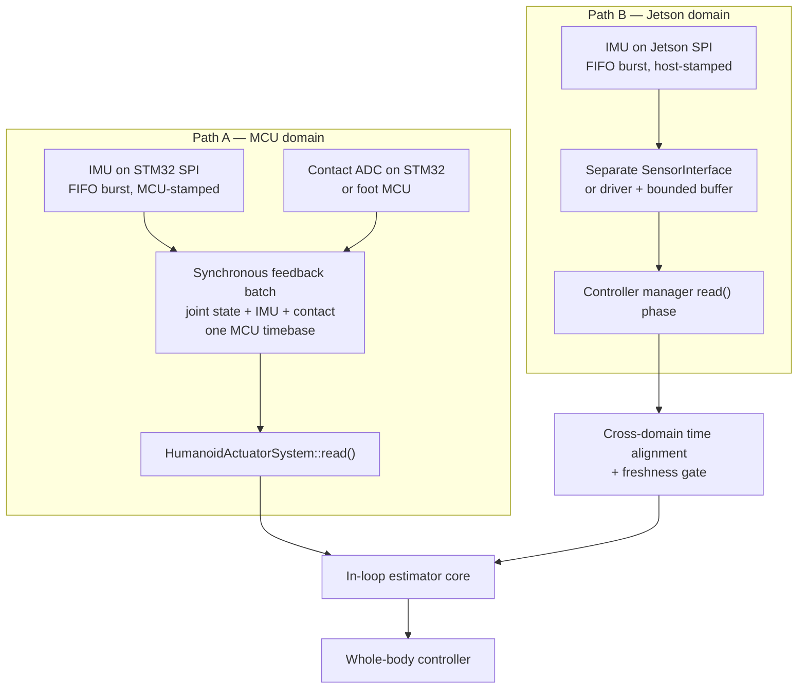
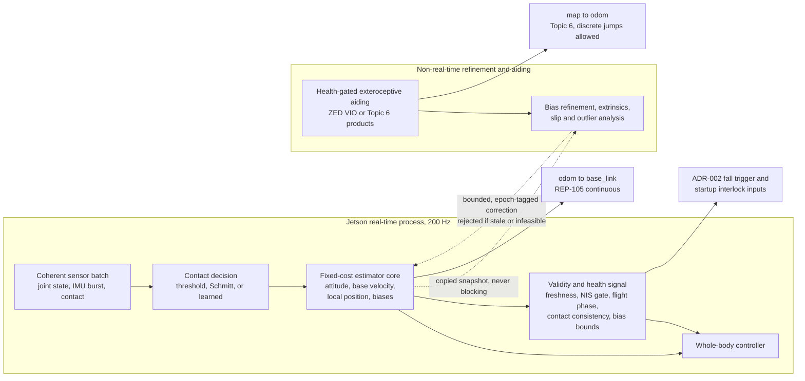

# Topic 4 Research: Sensors, Timing, and State Estimation

- Status: Complete research baseline; update before any Topic 4 architecture revision
- Evidence last verified: 2026-09-01
- Scope: Research input for Topic 4; not an accepted architecture decision
- Canonical decisions: [ADR-001](../architecture/ADR-001-real-time-actuation-and-hardware-abstraction.md), [ADR-002](../architecture/ADR-002-safety-and-fault-management.md), [ADR-003](../architecture/ADR-003-zenoh-middleware.md)
- Related research: [Topic 3 locomotion survey](topic-3-locomotion-survey.md)

## Purpose and evidence policy

This survey establishes what can be sensed, when it can be timestamped, and what can be estimated, without reopening the accepted 200 Hz actuator boundary, the safety authority stack, or the middleware selection. Evidence tags follow the Topic 3 convention:

- **Peer reviewed**: a paper reports the method and experiment.
- **League reported**: a team paper, TDP, rulebook, or released team code reports competition practice.
- **Upstream documented**: a project, vendor, or standards body documents the behaviour.
- **Community**: vendor forum, reverse-engineered SDK, or unreviewed repository.
- **Derived**: arithmetic performed in this document from a cited input. Labelled inline.
- **Project target**: a proposed budget or gate that still requires measurement.

`NR` means the inspected source did not report a value. It never means zero. A datasheet noise density is not a bias-stability figure, a nominal update rate is not a worst-case bound, and a desktop timing result does not qualify a Jetson.

## Confirmed project inputs

| Input                                           | Confirmed state                                                                                                                                                                       | Architectural consequence                                                                                                                                 |
| ----------------------------------------------- | ------------------------------------------------------------------------------------------------------------------------------------------------------------------------------------- | --------------------------------------------------------------------------------------------------------------------------------------------------------- |
| Estimator execution placement                   | **Fixed**: bounded fixed-cost core inside the 5 ms cycle, plus a non-real-time refinement/aiding stage.                                                                               | The in-loop core must be a filter with deterministic cost. Smoothers and optimisers are inadmissible inside the cycle.                                    |
| Estimator class                                 | **Open, evidence-driven**: ESKF versus Invariant EKF.                                                                                                                                 | Section 4.3 resolves this from evidence.                                                                                                                  |
| Absolute heading ownership                      | **Fixed**: Topic 6 vision localization owns heading. Topic 4 delivers drift-bounded local odometry plus an explicit validity signal. ZED VIO admissible only as a health-gated input. | Yaw is structurally unobservable in Topic 4 (Section 4.1). This is not a deficiency to be engineered away here.                                           |
| Exteroceptive aiding cadence                    | **Deferred to Topic 6.** The Topic 4 baseline assumes a variable, health-gated 30-60 Hz stream that may drop, stall, arrive late, or be rejected by an outlier gate.                  | The in-loop filter must tolerate asynchronous, delayed and missing updates without destabilising the 200 Hz propagation. Section 4.6 states the contract. |
| IMU part and grade                              | **Open**, leaning industrial MEMS SPI class.                                                                                                                                          | Section 1.1. Selection cannot be closed from datasheets alone.                                                                                            |
| Proprioceptive sensor data path                 | **Open**, leaning STM32 synchronous batch. Both paths must be carried.                                                                                                                | Section 2.                                                                                                                                                |
| Time synchronisation infrastructure             | **Open**; USB CDC is the presumed near-term reality, additional wiring is possible at a later board revision.                                                                         | Section 3.                                                                                                                                                |
| Ground contact sensing                          | **Open by direction.** Physical sensing and dynamic/kinematic inference remain active candidates; neither is selected. Resolve when the physical envelope and compute budget are set. | Sections 1.3 and 1.3.4. Both must be carried through Topic 5 and Topic 6 without either being assumed.                                                    |
| Joint position evidence                         | **Open**, to be established from RobStride documentation.                                                                                                                             | Section 1.2.                                                                                                                                              |
| Kinematic tree, masses, inertias, sole geometry | **Not designed** (Topic 3 Model Gate 0).                                                                                                                                              | No estimator covariance, leg-odometry chain, or dynamics-based method can be tuned or validated. All numbers in this document are structural, not tuned.  |

## Binding external constraints

The RoboCup Humanoid League 2025 Laws of the Game impose hard constraints on this topic. No 2026 rulebook is published as of 2026-09-01; `RC-HL-2026-Rules.pdf` returns 404 and the rules index lists 2025 as current [R1, R2]. All clauses below are from Law 4, _The Players_, and were quoted verbatim during verification [League reported, R1].

| Clause (Law 4)            | Text as verified                                                                                                                                                                                                                                                   | Consequence for Topic 4                                                                                                                                                                                                                                                                                                                                                                                       |
| ------------------------- | ------------------------------------------------------------------------------------------------------------------------------------------------------------------------------------------------------------------------------------------------------------------ | ------------------------------------------------------------------------------------------------------------------------------------------------------------------------------------------------------------------------------------------------------------------------------------------------------------------------------------------------------------------------------------------------------------- |
| Sensors                   | "Measurements from earth magnetic field sensors **may not be used in the software** and — in case of doubt — the code must be made available to members of the Technical Committee for inspection."                                                                | **Magnetometer-aided yaw is prohibited, not merely inadvisable.** The heading-ownership decision is forced by rule, not preference. Any IMU with a magnetometer (ZED 2i, BMI323-class 9-axis parts) must have that channel disabled and provably unused.                                                                                                                                                      |
| Sensors                   | "Sensors inside the robot may measure all quantities representing the local state of the system... They can be at any position inside the robot."                                                                                                                  | IMU, FSR, load-cell, encoder and temperature sensing are unrestricted in placement.                                                                                                                                                                                                                                                                                                                           |
| Sensors                   | "Touch sensors, force sensors, and temperature sensors may be placed at any position on the robot."                                                                                                                                                                | Sole-mounted contact sensing is explicitly legal, including on the outer sole.                                                                                                                                                                                                                                                                                                                                |
| Sensors                   | "External sensors, such as cameras and up to two microphones, may not be placed in the legs or arms or the torso of the robots. **They must be placed in the robot's head and above any neck joint.**"                                                             | **The ZED camera, and therefore its built-in IMU, is rigidly attached to the head above the neck joint — not to the base.** Any ZED IMU sample is separated from the base by the neck kinematic chain and its encoder error, backlash and compliance. This materially degrades the ZED IMU as an estimator input and is an argument for a dedicated base-mounted IMU independent of any timing consideration. |
| Sensors                   | "Any other **active sensor** (emitting light, sound, or electromagnetic waves into the environment in order to measure reflections) is not allowed."                                                                                                               | Capacitive **proximity** sole sensing is a rules risk and needs a Technical Committee ruling. Capacitive **compression** inside a sealed sole, and barometric-in-elastomer, are arguably passive. Do not design around an unruled interpretation.                                                                                                                                                             |
| Size Restrictions         | "Each foot must fit into a rectangle of area $\tfrac{1}{32}(2.2 \cdot H_{COM})^2$. A foot is defined as the minimum encapsulating rectangle covering all mechanical parts below the ankle joint." Aspect ratio between 1.2 and 3.5.                                | Every piece of added sole hardware counts toward the foot rectangle. This bounds the four-corner sensor spacing and therefore the lever arm of any centre-of-pressure estimate.                                                                                                                                                                                                                               |
| Communication and Control | "Robots... must act autonomously... No external power supply, teleoperation, remote control, or **remote brain** of any kind is allowed." Team bandwidth limit 1 Mbit/s; "Any kind of transmission from an external computer to the playing robots is prohibited." | Confirms the edge-native constraint. No offboard estimation, no offboard time server during play. Reinforces that the robot has **no external time reference** while playing (Section 3.1).                                                                                                                                                                                                                   |

## 1. Sensor hardware candidates

### 1.1 Inertial measurement unit

#### 1.1.1 Datasheet comparison

Values are transcribed from the cited source. Nothing is interpolated.

| Parameter                     | BMI088 [H1]                  | BMI270 [H2]            | ICM-42688-P [H3]         | ICM-45686 [H4]          | ADIS16505-1 [H5]                                      |
| ----------------------------- | ---------------------------- | ---------------------- | ------------------------ | ----------------------- | ----------------------------------------------------- |
| Source quality                | Full datasheet               | Full datasheet         | Full datasheet           | **Product page only**   | **Product page only**                                 |
| Gyro range (dps)              | ±125 to ±2000                | ±125 to ±2000          | ±15.625 to ±2000         | up to ±4000             | ±125 / ±500 / ±2000 by variant                        |
| Gyro noise density (mdps/√Hz) | **14**                       | 7 (perf) / 10 (normal) | **2.8** @ 10 Hz          | **3.8**                 | NR                                                    |
| Gyro in-run bias instability  | NR                           | NR                     | NR                       | NR                      | **2.3 °/h**                                           |
| Gyro ARW (stated)             | NR                           | NR                     | NR                       | NR                      | **0.13 °/√h**                                         |
| Gyro zero-rate offset         | ±1 °/s                       | ±0.5 °/s               | ±0.5 °/s                 | NR                      | NR (factory calibrated)                               |
| Gyro offset tempco            | ±0.015 °/s/K                 | ±0.015 °/s/K           | ±0.005 °/s/°C            | ±0.005 °/s/°C           | NR                                                    |
| Accel noise density (µg/√Hz)  | 160 XY / 190 Z               | 160                    | **65 XY / 70 Z**         | **70**                  | NR                                                    |
| Accel zero-g offset           | ±20 mg                       | ±20 mg                 | ±20 mg                   | NR                      | NR (factory calibrated)                               |
| Accel in-run bias instability | NR                           | NR                     | NR                       | NR                      | **26.5 µm/s²**                                        |
| Max ODR                       | gyro 2000 Hz / accel 1600 Hz | gyro 6400 Hz           | 32 kHz both              | NR                      | NR                                                    |
| Interface                     | SPI ≤10 MHz                  | SPI 10 MHz             | SPI 24 MHz               | SPI / I²C / I3C         | SPI (max NR)                                          |
| Factory calibration           | TCO/TCS compensated          | CRT sensitivity retrim | Sensitivity scale factor | NR                      | **Sensitivity, bias, axial alignment, −40 to +85 °C** |
| Axis misalignment             | 0.5°                         | 0.5°                   | ±1 % cross-axis          | NR                      | **±0.25°**                                            |
| g-sensitivity (VRE)           | **0.1 °/s/g max**            | NR                     | NR                       | qualitative claim only  | NR                                                    |
| Shock survivability           | 10 000 g                     | NR                     | NR                       | 20 000 g                | 14 700 m/s²                                           |
| Operating temperature         | −40 to +85 °C                | NR                     | −40 to +85 °C            | NR                      | **−40 to +105 °C**                                    |
| Package                       | LGA 3.0 × 4.5 × 0.95 mm      | NR                     | LGA 2.5 × 3.0 × 0.91 mm  | LGA 2.5 × 3.0 × 0.81 mm | NR                                                    |

All tagged [Upstream documented] at the source-quality level stated in row 1. ADIS16505 and ICM-45686 full datasheets were not retrievable — Analog Devices' media CDN and TDK's gated download both refused automated retrieval. BMI323 was not verified at all; Bosch exposes no static datasheet link.

#### 1.1.2 The finding that governs selection

**Only the ADIS16505 publishes in-run bias instability and angular random walk.** These are the two parameters that determine floating-base estimator drift between contact and vision updates. Every consumer and industrial MEMS candidate publishes noise density and nothing else. Selection therefore **cannot be closed from datasheets**; it requires Allan-variance characterisation of candidate parts on the actual robot chassis under actuator vibration.

Converting the published noise densities to angle random walk, using $\mathrm{ARW}\,[°/\sqrt{\mathrm h}] = N\,[°/\mathrm{s}/\sqrt{\mathrm{Hz}}] \times 60$:

| Part        | $N$ (°/s/√Hz) | ARW (°/√h) **[Derived]** | Yaw error from ARW over 10 s **[Derived]** |
| ----------- | ------------: | -----------------------: | -----------------------------------------: |
| BMI088      |         0.014 |                     0.84 |                                     0.044° |
| ICM-45686   |        0.0038 |                    0.228 |                                     0.012° |
| ICM-42688-P |        0.0028 |                    0.168 |                                     0.009° |
| ADIS16505-1 |             — |            0.13 (stated) |                                     0.007° |

Random-walk yaw error is negligible for all candidates at RoboCup timescales. The dominant term is the **uncompensated residual gyro bias** $b_{\omega z}$, which produces $\psi_{err} \approx b_{\omega z} t$:

$$
\psi_{err}(t) \approx b_{\omega z}\,t + \sigma_{ARW}\sqrt{t}, \qquad b_{\omega z}\,t \gg \sigma_{ARW}\sqrt{t} \ \text{for}\ t \gtrsim 1\ \mathrm{s}.
$$

| Tolerated yaw error | Free-running interval | Required residual yaw bias **[Derived]** |
| ------------------: | --------------------: | ---------------------------------------: |
|                  5° |                  10 s |                       0.5 °/s = 1800 °/h |
|                  5° |                  60 s |                      0.083 °/s = 300 °/h |
|                  5° |      600 s (one half) |                      0.0083 °/s = 30 °/h |
|                  1° |                 600 s |                       0.0017 °/s = 6 °/h |

A 10 s free-running interval is comfortably met by any candidate. **A full 10-minute half is not**, even by the ADIS16505 at its stated 2.3 °/h bias instability, once temperature drift and vibration rectification are included. This is quantitative confirmation that Topic 6 vision aiding is structurally required and that the aiding cadence, not the IMU grade, is the binding parameter. It also means the IMU-grade decision should be deferred until the required free-running interval is set by Topic 6.

#### 1.1.3 Attitude and velocity error from accelerometer bias

Tilt error from an uncompensated accelerometer bias $a_b$ is $\theta \approx a_b/g$. A ±20 mg zero-g offset (all three MEMS candidates) gives $\theta \approx 0.02\ \mathrm{rad} = 1.15°$ **[Derived]**. Conversely, a 1° attitude or IMU-mounting error leaks gravity into the horizontal channel:

$$
a_{leak} = g\sin(1°) = 0.171\ \mathrm{m/s^2} \quad\Rightarrow\quad 0.171\ \mathrm{m/s\ per\ second\ of\ velocity\ ramp.}
$$

**[Derived]** This is why IMU-to-base extrinsics must be estimated, never taken from CAD, and why accelerometer bias must be a filter state rather than a calibration constant (Section 5).

#### 1.1.4 Sampling pattern: FIFO burst, not single-sample read

At a 200 Hz cycle with a 1 kHz IMU there are five IMU samples per control cycle. Reading only the newest sample decimates the IMU to 200 Hz and discards the integration benefit of the higher rate. The correct pattern is a **FIFO burst read per cycle**, propagating all buffered samples in order.

- BMI088 provides FIFO and reconfigurable interrupt pins that can serve as external-sync inputs [Upstream documented, H1].
- ICM-42688-P provides a FIFO with an embedded 16-bit timestamp field and a `CLKIN` external clock input that scales the ODR [Upstream documented, H3]. The `CLKIN` input is a concrete mechanism to lock the IMU sample clock to the MCU timebase.
- ADIS16505 provides direct, scaled and output external-sync modes plus a data-ready output [Upstream documented, H5].

External-clock or external-sync capability is a genuine discriminator and should be a selection criterion, not an afterthought.

#### 1.1.5 ZED built-in IMU

| Question                       | Finding                                                                                                                           | Tag                       |
| ------------------------------ | --------------------------------------------------------------------------------------------------------------------------------- | ------------------------- |
| Which models have an IMU       | ZED X / X Mini / X Nano / X One, ZED 2 / 2i, ZED Mini. Original ZED has none. ZED 2i additionally has magnetometer and barometer. | [Upstream documented, H6] |
| IMU part number                | Not disclosed for any model.                                                                                                      | [NR]                      |
| Output rate                    | 400 Hz (stated for ZED 2).                                                                                                        | [Upstream documented, H6] |
| Timestamp domain               | Host clock, UNIX epoch, nanoseconds. "Incoming packets are timestamped **upon reception by the host machine**."                   | [Upstream documented, H7] |
| Runtime noise characterisation | `SensorParameters` exposes per-sensor `noise_density` and `random_walk` at runtime.                                               | [Upstream documented, H6] |

Three independent reasons disqualify the ZED IMU as the primary propagation source: it is **host-timestamped on arrival**, not hardware-timestamped; its magnetometer channel (ZED 2i) is **rule-prohibited** in software; and it is **mechanically located in the head above the neck joint** by rule, so every sample must be transformed through the neck chain. It remains useful as an independent attitude cross-check and health monitor, and its runtime noise parameters are worth querying.

### 1.2 Joint position evidence

RobStride publishes no static public documentation. The `robstride.com` site is a JavaScript SPA returning identical HTML for every path. The authoritative reachable source is the vendor GitHub organisation's own SDK, whose `protocol.py` states that its constants come from the RobStride user manual; the manual itself is not public. Everything in this subsection is tagged [Community] one confidence step below a vendor PDF, and **must be bench-verified before any estimator depends on it** [H8].

Feedback frame (communication type 2), one 8-byte extended-ID CAN frame carrying four 16-bit channels:

```text
position_u16, velocity_u16, torque_i16, temperature_u16 = unpack(">HHHH", data)
position    = (position_u16 / 0x7FFF - 1) * POSITION_RANGE[model]
velocity    = (velocity_u16 / 0x7FFF - 1) * VELOCITY_RANGE[model]
torque      = (torque_i16   / 0x7FFF - 1) * TORQUE_RANGE[model]
temperature = temperature_u16 * 0.1     # degrees C
```

| Property                                      | Finding                                                                                                                                                                                                                           | Tag             |
| --------------------------------------------- | --------------------------------------------------------------------------------------------------------------------------------------------------------------------------------------------------------------------------------- | --------------- |
| Position range                                | ±4π rad for every model RS00–RS06                                                                                                                                                                                                 | [Community, H8] |
| Position resolution                           | $8\pi/65535 = 3.84\times10^{-4}$ rad = 0.0220°                                                                                                                                                                                    | **[Derived]**   |
| Velocity resolution                           | 1.0–1.5 ×10⁻³ rad/s depending on model range                                                                                                                                                                                      | **[Derived]**   |
| Torque resolution                             | 5.2×10⁻⁴ N·m (17 N·m models), 1.8×10⁻³ N·m (60 N·m models)                                                                                                                                                                        | **[Derived]**   |
| Temperature                                   | Reported, 0.1 °C/LSB                                                                                                                                                                                                              | [Community, H8] |
| Encoder technology                            | **Magnetic.** Status bitfield includes `status_magnetic_encoder_fault`; fault frame bit 7 is "encoder uncalibrated".                                                                                                              | [Community, H8] |
| Encoder placement (rotor vs output side)      | **Not stated in any reachable source.**                                                                                                                                                                                           | [NR]            |
| Absolute at power-on / multi-turn persistence | **Not documented.** `SET_ZERO_POSITION`, `MECHANICAL_OFFSET`, `ZERO_STATE` and a commented-out multi-turn `rot_cnt` register exist; the SDK applies direction and homing offset in software and warns when calibration is absent. | [NR]            |
| Higher-resolution feedback                    | float32 via READ_PARAMETER: `0x3016 mechPos`, `0x3017 mechVel`, `0x302C torque_fdb`, at one request/response round trip per channel                                                                                               | [Community, H8] |
| Gear ratio, backlash, positional accuracy     | **Not stated anywhere.**                                                                                                                                                                                                          | [NR]            |

**Assessment.** 0.022° quantisation is not the limiting error. At a 0.3 m lever arm it contributes roughly 0.12 mm of foot-position error **[Derived]** — an order below what unmodelled gearbox backlash and link compliance will contribute on a 3D-printed or light-alloy leg. Camurri explicitly attributes a degraded lateral estimate on HyQ to leg flexibility [Peer reviewed, E9]. The open questions that actually matter are **encoder placement** and **absolute-at-power-on behaviour**, and neither is answerable from public sources.

Output-side absolute encoders, if the placement question resolves badly:

| Part              | Resolution                                | Type                                  | Interface                   | Form                                           | Tag                        |
| ----------------- | ----------------------------------------- | ------------------------------------- | --------------------------- | ---------------------------------------------- | -------------------------- |
| AS5047P           | 14-bit; ABI to 1000 PPR                   | Absolute single-turn on-axis magnetic | SPI + ABI/UVW/PWM           | TSSOP-14, 4.4 mm                               | [Upstream documented, H9]  |
| AS5048A / AS5048B | 14-bit                                    | Absolute single-turn on-axis magnetic | SPI / I²C + PWM             | TSSOP-14, 5 × 6.4 mm                           | [Upstream documented, H10] |
| RLS Orbis BRD01   | 14-bit, **±0.25° after self-calibration** | True absolute axial-read ring         | BiSS-C, SSI, SPI, UART, ABZ | Through-hole ring, ID 12–30 mm, −40 to +120 °C | [Upstream documented, H11] |

14-bit over a single output-side turn is $2.2\times10^{-2}$ °/LSB **[Derived]** — approximately the same as the RobStride CAN resolution. An output-side encoder therefore buys **absolute truth downstream of the gearbox**, not extra resolution. That is the correct reason to add one, and the only reason.

### 1.3 Ground contact sensing

#### 1.3.1 Option comparison

| Option                                                                        | Measured quantity                                            | Key metrology                                                                                                                                                                                    | Rate                                                         | Mass/size                               | Durability                                                          | Dominant failure mode                                                                                                                        |
| ----------------------------------------------------------------------------- | ------------------------------------------------------------ | ------------------------------------------------------------------------------------------------------------------------------------------------------------------------------------------------ | ------------------------------------------------------------ | --------------------------------------- | ------------------------------------------------------------------- | -------------------------------------------------------------------------------------------------------------------------------------------- |
| **FSR array** (Interlink FSR 402/406; NAO 4/sole)                             | Shunt resistance vs normal force; **not a calibrated force** | Datasheet states **no accuracy or linearity figure at all**; ±2 % single part, **±6 % part-to-part**, **+10 % hysteresis**, <5 % drift per decade of time, **+30 % after 240 h at 85 °C/95 %RH** | Device rise time <3 µs; rate set by your ADC                 | 0.46 mm thick; FSR 402 Ø14.68 mm        | 10 M actuations at 1 kg ≈ **1850 h of walking at 1.5 Hz [Derived]** | Saturation — NAO's range is 0–25 N per cell, under half a 5 kg robot's static weight; humidity shift; tail/solder fatigue                    |
| **Load cell / strain beam** (Bit-Bots BitFoot, 4 × TAL230A; Rhoban ForceFoot) | Uniaxial force per corner, calibrated                        | TAL230A figures NR; HyQ foot load cells ±25 N                                                                                                                                                    | **697 Hz measured** on BitFoot; readable >1 kHz from the bus | One structural beam per corner; mass NR | NR; beam yields permanently on overload                             | Beam yield on hard landings; bridge zero drift needs a calibration routine; ankle cable fatigue                                              |
| **6-axis ankle F/T** (ATI Mini45, Bota Rokubi)                                | Full contact wrench                                          | ATI accuracy **behind sales contact** (NR publicly); Bota claims "negligible drift" with no number                                                                                               | NR for Mini45                                                | **Rokubi 120 g**; ATI Mini45 mass NR    | Mini45 tolerates 5.7–25.3× overload                                 | Distal mass at the ankle; Hwangbo et al. state force sensors are "often too heavy and can be easily damaged during impacts with the terrain" |
| **Binary microswitch** (Omron D2F)                                            | Boolean plunger travel                                       | Operating force 0.74–1.47 N                                                                                                                                                                      | **Rated 3.3 ops/s mechanically**; contact transition ≤1 ms   | ≈0.5 g                                  | 1 M mechanical ops ≈ **185 h of walking [Derived]**; IP40           | Turf debris ingress; contact bounce; **cannot express "contact inconsistency" at all**                                                       |
| **Capacitive / barometric-in-elastomer**                                      | Pad compression                                              | **No primary source verified**                                                                                                                                                                   | NR                                                           | NR                                      | NR                                                                  | Elastomer creep; barometer offset drift; **capacitive proximity is a rules risk** (Law 4, active external sensors)                           |
| **Torque/current inference, no added sensor**                                 | $\hat f = J^{-\top}(\tau - M\ddot q - h)$                    | Camurri: classifier choice moved leg-odometry drift from **1.79 to 0.43 cm/m** on trot                                                                                                           | Bounded by the control loop                                  | Zero                                    | N/A                                                                 | Model error, backlash, compliance; **no independent failure channel — weak as the sole evidence for a safety-rated fall trigger**            |

All metrology rows [Upstream documented] from the cited datasheets; Camurri figures [Peer reviewed, E9]; Hwangbo quotation [Peer reviewed, E10]. Cost classes were not sourced and are omitted rather than guessed.

#### 1.3.2 League practice

| Team / platform                          | Contact sensing                                                                                                                                                                                                                                                                                                  | Tag                       |
| ---------------------------------------- | ---------------------------------------------------------------------------------------------------------------------------------------------------------------------------------------------------------------------------------------------------------------------------------------------------------------- | ------------------------- |
| **Hamburg Bit-Bots** (Wolfgang-OP)       | **BitFoot**: 4 load cells per sole (TAL230A), ADS126X delta-sigma ADC, ESP32, read over the Dynamixel bus. **697 Hz measured**, board readable faster than 1 kHz. Explicitly derived from Rhoban ForceFoot with higher rate and resolution. ROS message `FootPressure`; RL policies consume it binary or scaled. | [League reported, L1]     |
| **Rhoban** (Sigmaban)                    | **ForceFoot**: strain gauges in the foot, values over the Dynamixel bus. Used in competition since RoboCup 2016.                                                                                                                                                                                                 | [League reported, L2]     |
| **NimbRo / igus Humanoid Open Platform** | **No foot force or pressure sensor in the published platform sensor list.** State estimation from the 9-axis IMU; gait uses IMU-driven feedback.                                                                                                                                                                 | [Peer reviewed, L3]       |
| **B-Human / NAO**                        | 8 FSRs, 4 per sole, 0–25 N each. `GroundContactDetector` gives a boolean with asymmetric hysteresis. `FootSupportProvider` computes a signed support ratio in $[-1,+1]$ with distinct outer/inner weights, flags `trustedSupport` only when calibrated, and extrapolates `predictedSwitched`.                    | [League reported, L4]     |
| **Any HL team with ankle 6-axis F/T**    | **None found.** Negative result from a bounded search.                                                                                                                                                                                                                                                           | NR                        |
| **ANYmal**                               | No foot force sensor; probabilistic inference from dynamics and kinematics.                                                                                                                                                                                                                                      | [Peer reviewed, E10]      |
| **Unitree**                              | `unitree_go/msg/LowState.msg` contains `int16[4] foot_force` and `foot_force_est`. The humanoid `unitree_hg/msg/LowState.msg` (G1/H1) contains **no foot-force field at all**.                                                                                                                                   | [Upstream documented, L5] |

Dedicated sole force sensing in the Humanoid League is a **load-cell tradition** (Rhoban to Bit-Bots), not an F/T tradition. FSR is the NAO/SPL tradition. Nobody found puts a 6-axis F/T at a KidSize ankle.

#### 1.3.3 Probabilistic contact estimation

| Work                                      | Sensors required                                                                          | Output                                                                                        | Reported result                                                                                                                                                                    | Validated on                               |
| ----------------------------------------- | ----------------------------------------------------------------------------------------- | --------------------------------------------------------------------------------------------- | ---------------------------------------------------------------------------------------------------------------------------------------------------------------------------------- | ------------------------------------------ |
| Camurri et al., RA-L 2017 [E9]            | Encoders, joint torque, IMU. Load cells used as **ground truth only**                     | Per-foot contact probability, adaptive measurement covariance, impact detection               | Drift per distance, trot, x-axis: fixed threshold 1.79, Schmitt trigger 0.75, **logistic regression 0.43 cm/m**. Crawl: 1.34 cm/m for all three — no benefit when impacts are rare | HyQ, 85 kg quadruped                       |
| Hwangbo et al., IROS 2016 [E10]           | Full dynamics plus differential/forward kinematics, **no force sensor**                   | Probabilistic contact                                                                         | "much more accurate than the state-of-the-art strategy"; no numeric figure in the abstract                                                                                         | Quadruped (unit not named in the abstract) |
| Bledt et al., ICRA 2018 [E11]             | NR — full text not verified                                                               | NR                                                                                            | NR                                                                                                                                                                                 | MIT Cheetah 3 per venue context            |
| Lin, Zhang, Yu, Ghaffari, CoRL 2021 [E12] | **Proprioception only**; explicitly motivated by robots without dedicated contact sensors | Learned contact events feeding a contact-aided InEKF                                          | Reduced position drift versus threshold-based contact on soft/slippery ground; no numeric figure in the abstract                                                                   | Not named in the abstract                  |
| Rotella, Schaal, Righetti, 2017 [E13]     | **Six-axis contact wrench sensors** plus IMUs                                             | **Per-DoF contact probability in all six end-effector DoF** via unsupervised fuzzy clustering | NR                                                                                                                                                                                 | **Simulation only**                        |

The only method that yields six-dimensional contact probability — that is, that can detect foot _rotation_ and _slip_, the true "contact inconsistency" signal named in ADR-002 — requires a six-axis wrench sensor and was validated in simulation only. Every hardware-validated method outputs a scalar per-foot probability from either force thresholding or proprioceptive inference.

#### 1.3.4 Physical sensing versus inference: budget and risk comparison

Both remain active candidates. This table exists so the trade-off can be resolved against measured numbers later rather than re-argued from scratch.

| Axis                                          | Physical sensing (FSR, load cell, barometric pad)                                                                                                                                             | Dynamic/kinematic inference (momentum observer, disturbance observer, thresholding, learned classifier)                                                                                                                                                                                  |
| --------------------------------------------- | --------------------------------------------------------------------------------------------------------------------------------------------------------------------------------------------- | ---------------------------------------------------------------------------------------------------------------------------------------------------------------------------------------------------------------------------------------------------------------------------------------- |
| **Dependence on Topic 3 Model Gate 0**        | **None.** A load cell reads force whether or not the URDF exists. Commissioning can start immediately.                                                                                        | **Total for the dynamics-based variants.** $\hat f = J^{-\top}(\tau - M(q)\ddot q - h(q,\dot q))$ needs identified masses, inertias and a friction model. Kinematic-only thresholding on measured joint torque is weaker but survives without the model.                                 |
| **Added distal mass**                         | Non-zero and at the worst possible place — distal mass on a swing leg costs energy every step and raises leg inertia. Load-cell beams are structural; FSR film is ~0.46 mm and near-massless. | **Zero.**                                                                                                                                                                                                                                                                                |
| **Added failure surface**                     | Foot-to-body harness across the most-flexed joints in the machine, plus connectors in the wettest, dirtiest location. Cable fatigue is the realistic dominant failure, not sensor failure.    | **Zero new hardware.** Inherits every existing actuator-feedback failure mode.                                                                                                                                                                                                           |
| **In-loop compute**                           | Decode only. ADC conversion is off-CPU. Fixed, trivially bounded.                                                                                                                             | Momentum observer is a small filter per joint. A learned classifier adds inference cost that must either fit the 5 ms budget or run one cycle stale with an explicit age.                                                                                                                |
| **Sensor/wiring budget**                      | Needs an ADC path (STM32 SPI/foot MCU) or a bus drop per foot, plus the Section 2 data-path decision. Counts against the Law 4 foot rectangle.                                                | None.                                                                                                                                                                                                                                                                                    |
| **Calibration burden**                        | Bridge zero drift and gain need a routine; FSR needs part-to-part characterisation and re-characterisation after humidity/temperature exposure (+30 % after 240 h at 85 °C/95 %RH).           | Needs the identified model, joint-friction and backlash characterisation, and a classifier training set with labels — which in practice come from a physical sensor.                                                                                                                     |
| **Independence for the ADR-002 fall trigger** | **Independent channel.** Contact evidence does not share a failure mode with the actuator feedback path.                                                                                      | **Not independent.** A stalled or corrupted actuator feedback batch corrupts both the state estimate and the contact estimate simultaneously. This is the decisive safety asymmetry.                                                                                                     |
| **Slip and partial-contact discrimination**   | Multi-corner arrays give a centre-of-pressure and therefore partial-contact and roll-over evidence. Binary switches give none.                                                                | Camurri's classifier gives per-foot probability, not CoP. Six-DoF contact state needs a wrench sensor [E13].                                                                                                                                                                             |
| **Best available evidence**                   | League tradition: Rhoban ForceFoot → Bit-Bots BitFoot (load cells, 697 Hz measured). B-Human/NAO uses FSRs with hysteresis and a signed support ratio.                                        | Camurri: logistic-regression contact moved trot drift **1.79 → 0.43 cm/m** using load cells as ground truth only [E9]. Hwangbo: probabilistic contact with **no force sensor** [E10]. Lin: learned contact events feeding an InEKF, explicitly for robots without contact sensors [E12]. |
| **Bootstrapping problem**                     | None.                                                                                                                                                                                         | **Every published inference method used a physical force sensor to generate ground truth.** Choosing inference does not remove the need for the sensor during development; it removes it from the competition robot.                                                                     |

**The two axes that will actually decide this** are Model Gate 0 dependence and safety-channel independence, not mass or cost. A defensible compromise exists and should be evaluated explicitly: **instrument the development robot physically, train and validate inference against it, then decide whether the sensor stays on the competition machine.** That is exactly the path Camurri, Hwangbo and Lin took, and it is the only sequence in which the inference option can be qualified at all.

### 1.4 Other sensing already required by accepted decisions

ADR-002 startup interlocks already require plausible **temperature**, **voltage/current** and **power-chain contactor feedback**, and its thermal and electrical fault tables require battery telemetry with plausibility checking. RobStride reports per-motor temperature in the standard feedback frame at 0.1 °C/LSB [Community, H8], which satisfies the actuator-thermal input without additional hardware. Battery, bus-current and contactor-feedback sensing are electrical-design items owned by ADR-002 and are not re-specified here.

## 2. Sensor data path

Both candidate paths must be carried until the hardware team commits.



| Criterion                          | Path A — IMU and contact in the STM32 synchronous batch                                                                                               | Path B — IMU and contact direct to Jetson                                                                             |
| ---------------------------------- | ----------------------------------------------------------------------------------------------------------------------------------------------------- | --------------------------------------------------------------------------------------------------------------------- |
| Time alignment to joint state      | **Zero cross-domain error by construction.** One MCU counter stamps joint, IMU and contact samples. Only intra-MCU sampling phase remains.            | Two clock domains. Requires the Section 3 disciplining machinery and a residual uncertainty that is currently **NR**. |
| Coherence with ADR-001 invariant 3 | Natural. One immutable all-sensor snapshot per cycle.                                                                                                 | Requires an explicit alignment and freshness step before the snapshot is formed.                                      |
| Achievable IMU rate                | Bounded by MCU SPI bandwidth and the existing 200 Hz SPI DMA slot; a 1 kHz FIFO burst of 5 samples per cycle costs additional payload in every batch. | Bounded only by Jetson SPI. Higher raw rates are easier.                                                              |
| Staleness detection                | Implicit — a missing batch is already a detected ADR-002 command-loss condition.                                                                      | **Silent.** Section 5.2 shows `ros2_control` provides no staleness signal anywhere in the stack. Must be built.       |
| Effect on the 5 ms budget          | Adds decode cost only; no additional bus transaction.                                                                                                 | Adds a second bus transaction inside `read()`, with its own latency tail.                                             |
| Failure isolation                  | An MCU fault takes out joint state and IMU together — which is arguably correct, since neither is usable without the other.                           | An IMU fault is independent of the actuator path. Enables an estimator-only degraded mode.                            |
| Mechanical placement freedom       | Constrained to where the MCU can be cabled.                                                                                                           | Constrained to where the Jetson can be cabled. Neither dominates.                                                     |
| Wiring and board revision cost     | IMU must be on or near an STM32; contact ADC needs a foot-to-MCU harness.                                                                             | IMU needs a Jetson SPI header; contact needs an ADC path to the Jetson.                                               |
| Vibration environment              | MCU boards are typically closer to the actuators. Mounting stiffness and isolation must be designed either way.                                       | Same.                                                                                                                 |

**Assessment.** Path A is materially stronger on the criteria that ADR-001 and ADR-002 already make binding: temporal coherence, snapshot atomicity, and non-silent staleness. Path B's only structural advantage is IMU rate headroom, which Section 1.1.2 shows is not the binding parameter — residual gyro bias is, and that is unaffected by sample rate. The one Path B advantage worth preserving is **independent failure isolation**; that can be recovered in Path A by making IMU health a separately reported field in the batch rather than an implicit consequence of batch validity.

A third arrangement is worth explicit evaluation and was not initially on the table: **IMU on the STM32 for the estimator, plus the ZED IMU on the Jetson as an independent attitude cross-check.** This gives Path A's coherence and a genuinely independent second attitude source for the ADR-002 "estimator invalid" trigger, at zero additional hardware cost, subject to the neck-chain transformation cost noted in Section 1.1.5.

## 3. Timing and synchronisation

### 3.1 Clock semantics

| Clock                 | Steps?           | NTP-slewed? | Notes                                              |
| --------------------- | ---------------- | ----------- | -------------------------------------------------- |
| `CLOCK_REALTIME`      | **Yes**          | Yes         | The only clock meaningful outside the machine      |
| `CLOCK_MONOTONIC`     | No               | **Yes**     | Frequency-adjusted by `adjtimex`; excludes suspend |
| `CLOCK_MONOTONIC_RAW` | No               | No          | Raw hardware rate                                  |
| `CLOCK_TAI`           | Follows realtime | Yes         | Leap-second free                                   |

[Upstream documented, T1]

Verified in Jazzy source [Upstream documented, T2, T3]:

- `RCL_SYSTEM_TIME` resolves to **`clock_gettime(CLOCK_REALTIME)`**.
- `RCL_STEADY_TIME` resolves to **`clock_gettime(CLOCK_MONOTONIC)`** on Linux.
- `rcutils_raw_steady_time_now()` (`CLOCK_MONOTONIC_RAW`) exists but **no `rcl_clock_type_t` maps to it** — it is unreachable through `rclcpp::Clock`.
- `RCL_ROS_TIME` returns system time unless `use_sim_time` is set and `/clock` is published.

`builtin_interfaces/Time` is `int32 sec` plus `uint32 nanosec` and nothing else: **no clock-domain field, no source identifier, no uncertainty**. The ROS 2 design article states the assumption directly: "we require that nodes running in the ROS network have a synchronized system clock such that they can accurately report timestamps for events" [Upstream documented, T4].

**Two consequences.** First, **ROS 2 provides no time-synchronisation mechanism between nodes or hosts**; `/clock` distributes simulated time, not a disciplined real clock, and the design article defers to NTP at the OS level [Upstream documented, T4]. `rmw_zenoh_cpp` changes none of this. Second, Law 4 prohibits any transmission from an external computer during play, so **the robot has no external time reference while playing**. `CLOCK_REALTIME` is seeded from the RTC and will **step** the moment chrony or systemd-timesyncd gets a fix — typically when the field laptop is plugged in. A header stamp is therefore not a stable quantity across that event, and code that subtracts two such stamps can produce a negative duration.

`message_filters` `ApproximateTime` is documented for association, not synchronisation: it matches on header stamps and assumes they are already in one domain, has **no documented latency bound** because it buffers until it can prove a set optimal, and is callback-driven, allocating and `shared_ptr`-based [Upstream documented, T5]. It is inadmissible inside the 5 ms cycle under ADR-001 and is appropriate only in the non-real-time perception graph.

### 3.2 Host-to-MCU disciplining over USB CDC

USB CDC-ACM data moves on **bulk endpoints**, scheduled opportunistically in leftover bandwidth with no reserved service interval, quantised to 1 ms full-speed frames or 125 µs high-speed microframes [Upstream documented, T6].

A widely repeated mitigation does not apply here: **`ASYNC_LOW_LATENCY` / `setserial low_latency` has no effect on CDC-ACM.** The flag is honoured only by `ftdi_sio`, where it sets the FTDI latency timer to 1 ms; `drivers/usb/class/cdc-acm.c` contains no `low_latency` handling at all [Upstream documented, T7, T8]. The FTDI distinction matters in the opposite direction: an FTDI bridge defaults to a 16 ms latency timer, a classic silent jitter source that native CDC-ACM avoids without gaining the `low_latency` benefit.

The standard four-timestamp offset and delay estimator, with $t_0$ host send, $t_1$ MCU receive, $t_2$ MCU send, $t_3$ host receive:

$$
\theta = \frac{(t_1-t_0)+(t_2-t_3)}{2}, \qquad \delta = (t_3-t_0)-(t_2-t_1)
$$

[Upstream documented, T9]. Retain only minimum-$\delta$ samples; asymmetric delay $\Delta$ biases $\theta$ by $\Delta/2$ and is **not observable**. Cristian's bound is $|\varepsilon| \le \mathrm{RTT}/2 - t_{\min}$ [Peer reviewed, T10] — uncertainty is set by RTT _spread_, not RTT. Skew by regression over minimum-$\delta$ samples:

$$
t_{host} = (1+\rho)\,t_{mcu} + b
$$

Convex-hull or linear-programming skew estimators are preferred over least squares, which is biased by the one-sided delay distribution [Peer reviewed, T11].

**No published measurement of clock-offset uncertainty for a Linux host to STM32 CDC-ACM link was found** [NR]. The closest analogue is micro-ROS: `rmw_uros_sync_session` computes exactly the NTP offset, sign-inverted, with **no minimum-delay filtering, no skew estimation, no outlier rejection, single-shot**; micro.ros.org states no accuracy figure and the only numeric assertion in the codebase is a unit test requiring agreement within **5 seconds** [Upstream documented, T12, T13]. Treat micro-ROS-style sync as coarse epoch alignment, never as a 200 Hz time base.

Crystal drift, $\Delta t = \rho T$ over a 600 s half **[Derived]**:

| Oscillator  |           $\rho$ | Drift over 600 s | Drift over one 5 ms cycle |
| ----------- | ---------------: | ---------------: | ------------------------: |
| HSE ±10 ppm |        $10^{-5}$ |             6 ms |                     50 ns |
| HSE ±20 ppm | $2\times10^{-5}$ |            12 ms |                    100 ns |
| HSE ±50 ppm | $5\times10^{-5}$ |            30 ms |                    250 ns |
| HSI RC ±1 % |        $10^{-2}$ |              6 s |                     50 µs |

Per-cycle drift is irrelevant. Accumulated drift is 12–30 ms, larger than two control periods, so **boot-time-only synchronisation is unacceptable**. Resynchronising at 1 Hz caps accumulated error at $\rho \cdot 1\ \mathrm{s} = 20\ \mu\mathrm{s}$ for a ±20 ppm part **[Derived]** — two orders below the 5 ms cycle — without any skew estimation at all. Skew estimation is worth doing only to avoid step corrections and to widen the resync interval. The actual crystal specification is **NR** and must be read from the BOM.

### 3.3 Hardware synchronisation options

| Option                                               | Mechanism                                                                                                                                                                                                                                                                                                                                                                                                        | Hardware needed                                                                                                                                                                                                                 | Uncertainty                                                                                           | Tag                                                       |
| ---------------------------------------------------- | ---------------------------------------------------------------------------------------------------------------------------------------------------------------------------------------------------------------------------------------------------------------------------------------------------------------------------------------------------------------------------------------------------------------- | ------------------------------------------------------------------------------------------------------------------------------------------------------------------------------------------------------------------------------- | ----------------------------------------------------------------------------------------------------- | --------------------------------------------------------- |
| **GPIO event marker with Hardware Timestamp Engine** | Jetson Orin's HTE timestamps AON-domain GPIO edges from the **TSC at 31.25 MHz**, i.e. **32 ns resolution**. Userspace ABI exists via `gpio-cdev` v2 with `GPIO_V2_LINE_FLAG_EVENT_CLOCK_HTE`. NVIDIA uses exactly this in its own BMI088 Jetson driver, whose documentation states data-ready interrupts "must be connected to the Jetson's Always On (AON) GPIOs, which are capable of hardware timestamping". | **One wire, an AON-capable pin, a device-tree overlay.** Not currently present.                                                                                                                                                 | **32 ns** on the Jetson side; total bounded by MCU-side capture jitter                                | [Upstream documented, T14, T15, T16, T17]                 |
| **PPS input / `nvpps`**                              | `nvpps` exposes `/dev/nvpps0` with `NVPPS_GETEVENT` returning "correlated timestamps of different time-domains (TSC, PTP etc.)". PTP-TSC sync aligns TSC to a MAC PPS with a configurable lock threshold: reset 0x1F ≈ **1 µs**, default 0x26c ≈ **20 µs**.                                                                                                                                                      | One wire, plus `nvpps` availability. **`nvpps` is documented in the NVIDIA DRIVE OS guide, not the Jetson Linux Developer Guide — a site search of r36.4.4 for "nvpps" returns 0 matches.** Presence on Orin/JetPack is **NR**. | Jetson figure **NR**; the 20 µs PTP-TSC lock default is the only NVIDIA-published cross-domain number | [Upstream documented, T18, T19]                           |
| **TSC / CSI camera timestamps**                      | TSC at 31.25 MHz sources HTE. NVIDIA states PTP-TSC sync is "useful in synchronizing camera fsync signals (used for camera frame capture/timestamping) with PTP time", implying CSI/VI frame timestamps are natively in the TSC domain. Exact Jetson-side VI timestamp semantics per JetPack version are **NR**.                                                                                                 | GMSL2 camera on a CSI deserializer                                                                                                                                                                                              | NR                                                                                                    | [Upstream documented, T18] with an explicit inference gap |
| **PTP over Ethernet**                                | Orin's EQOS MAC lists IEEE 1588-2008 support; `ptp4l` plus `phc2sys`. NVIDIA publishes no Jetson accuracy figure.                                                                                                                                                                                                                                                                                                | **The STM32F446 has no Ethernet MAC.** Requires an MCU change (F407/F429/F746 class) plus PHY, magnetics and a switch.                                                                                                          | NR                                                                                                    | [Upstream documented, T20]                                |
| **STM32 as timing master**                           | The MCU already owns the only genuinely periodic event in the system — the 200 Hz SPI DMA exchange. Either PPS to the Jetson, or no discipline at all: the MCU stamps every batch with its own counter and the Jetson maintains the affine map at the boundary.                                                                                                                                                  | Pure-software variant: **none**.                                                                                                                                                                                                | Same as Section 3.2 until measured                                                                    | Design synthesis                                          |

### 3.4 ZED SDK timestamping

| Aspect                    | Finding                                                                                                                                                                                    | Tag                        |
| ------------------------- | ------------------------------------------------------------------------------------------------------------------------------------------------------------------------------------------ | -------------------------- |
| Default clock domain      | UNIX epoch nanoseconds; changed from PC uptime to epoch in SDK 2.3                                                                                                                         | [Upstream documented, T21] |
| `TIME_REFERENCE::CURRENT` | "the current OS timestamp in UNIX format" at call time                                                                                                                                     | [Community, T22]           |
| `TIME_REFERENCE::IMAGE`   | "the timestamp assigned to data when they are received in the memory buffer when `grab` is called" — a buffer-completion stamp, **not an exposure stamp**                                  | [Community, T22, T23]      |
| SDK ≥ 5.3                 | `setTimestampClock(TIMESTAMP_CLOCK::MONOTONIC_CLOCK)` — process-wide opt-in to a monotonic domain                                                                                          | [Upstream documented, T24] |
| GMSL2 versus USB          | "GMSL2 cameras can be synchronized at the hardware level for accurate, frame-level alignment, while USB cameras rely on timestamp-based software alignment."                               | [Upstream documented, T25] |
| GMSL2 measured reality    | Users report inter-camera deltas of 1–8 ms across two deserializers, one report of up to 15 ms; whether `TIME_REFERENCE::IMAGE` represents exposure time remains an open upstream question | [Community, T26, T27, T28] |
| Documented latency        | **None, USB or GMSL2.** The ROS 2 wrapper only _logs_ `now − mSdkGrabTS` at debug level                                                                                                    | [NR]                       |

Verified in the `zed-ros2-wrapper` source [Upstream documented, T29, T30, T31]:

- Live capture publishes `slTime2Ros(getTimestamp(TIME_REFERENCE::CURRENT))` — **the default published stamp is the host clock at grab return, not the image timestamp.** `TIME_REFERENCE::IMAGE` is used only when `use_svo_timestamp` is set.
- `slTime2Ros` applies a **single offset captured once at camera open**, with no skew tracking. The Section 3.2 drift arithmetic applies to it directly.
- The IMU path drains buffered samples ordered by timestamp; the wrapper's own comment records that reading only the newest sample "aliased the stream and produced the unstable IMU rate reported in issues #249 and #445" — independent confirmation of the FIFO-burst requirement in Section 1.1.4.

**On a USB ZED there is no hardware capture timestamp at all.** On a GMSL2 ZED X there plausibly is, via CSI in the TSC domain, but Stereolabs does not document the mapping and community evidence contradicts the marketed synchronisation quality.

### 3.5 Ranked synthesis

| Rank | Option                                                             | Hardware                                     | Uncertainty                                                                            | Unblocks                                                                                                         |
| ---: | ------------------------------------------------------------------ | -------------------------------------------- | -------------------------------------------------------------------------------------- | ---------------------------------------------------------------------------------------------------------------- |
|    1 | IMU and contact in the STM32 200 Hz batch                          | **None**                                     | **Zero** IMU-to-joint cross-domain error by construction                               | Tight fusion for balance and the WBC; removes the hardest synchronisation problem entirely                       |
|    2 | Four-timestamp disciplining over CDC plus affine map, ≥1 Hz resync | **None**                                     | **NR**; bounded above by half the minimum-$\delta$ spread. Budget ~1 ms until measured | Putting MCU data on the ROS timeline for logging, vision fusion and diagnostics                                  |
|    3 | ZED forced to monotonic clock, offset measured                     | None (SDK ≥ 5.3)                             | Host-arrival stamp; pipeline latency **NR** and unbounded                              | Removes the `CLOCK_REALTIME` step hazard from the vision path                                                    |
|    4 | GPIO pulse plus HTE common event                                   | 1 wire, AON pin, DT overlay                  | **32 ns** Jetson-side resolution                                                       | Sub-microsecond alignment, and — more importantly — **it measures option 2's true error instead of assuming it** |
|    5 | PPS from MCU to chrony or `nvpps`                                  | 1 wire, plus unverified `nvpps` availability | NR; 20 µs PTP-TSC lock default                                                         | System-wide disciplined clock with the MCU as time master                                                        |
|    6 | PTP over Ethernet                                                  | New MCU with ETH MAC, PHY, magnetics, switch | NR                                                                                     | Multi-host synchronisation not currently required                                                                |
|    — | Micro-ROS-style single-shot sync                                   | None                                         | Strictly worse than option 2; reference test tolerance is 5 s                          | Nothing option 2 does not do better                                                                              |

Options 1–3 cost no hardware. Vision at 30–60 Hz has a native 16–33 ms sampling interval and an unmeasured multi-millisecond pipeline latency, so pursuing sub-microsecond Jetson-to-MCU alignment before characterising the ZED path optimises the wrong term. Option 4 is the correct _next_ hardware step precisely because it converts option 2 from assumed to measured.

## 4. State estimation

### 4.1 Observability

**Standard result** [Peer reviewed, E1, E3, E4]: IMU plus contact-aided leg kinematics has a **four-dimensional unobservable subspace** — three-dimensional absolute position plus rotation about the gravity axis. A global translation and a global rotation about $\mathbf g$ applied jointly to the base and all footholds produce identical measurements.

| State              | Observable                                                                       | Mechanism                                                                                            | Drift                                                                                                          |
| ------------------ | -------------------------------------------------------------------------------- | ---------------------------------------------------------------------------------------------------- | -------------------------------------------------------------------------------------------------------------- |
| Roll, pitch        | **Yes**                                                                          | Accelerometer measures $-R^\top\mathbf g$ under quasi-static conditions                              | Bounded. Floor set by accelerometer bias and acceleration-induced ambiguity during dynamic motion              |
| **Yaw**            | **No**                                                                           | No admissible sensor observes rotation about $\mathbf g$ — and the rules prohibit the one that would | Unbounded, $\approx b_{\omega z}t + \sigma_{ARW}\sqrt t$; the bias term dominates beyond ~1 s                  |
| Absolute position  | **No**                                                                           | Integrates through yaw                                                                               | Unbounded and **superlinear** once yaw error accumulates, because heading error rotates the velocity integrand |
| **Base velocity**  | **Yes**, whenever at least one contact is active                                 | Contact constraint gives a direct velocity pseudo-measurement via $J(q)\dot q$                       | Bounded. **This is the deliverable of Topic 4**                                                                |
| Gyro bias          | **Yes** with excitation; the **yaw-axis component is the weakly observable one** | Roll/pitch components tied to gravity                                                                | Bounded; the yaw-axis residual directly drives heading drift                                                   |
| Accelerometer bias | **Weakly**; needs rotational excitation to decouple from attitude error          | —                                                                                                    | Bounded but slow; poorly observable while standing                                                             |
| Foothold positions | Relative to base yes; absolute no                                                | Inherit the same null space                                                                          | Global footholds drift with the base                                                                           |

Two results that are routinely misread:

- **Flat-foot contact does not make yaw observable.** Rotella adds foot _orientation_ states; the unobservable subspace is unchanged [Peer reviewed, E3]. A flat foot pins yaw _rate_ relative to a foot whose own absolute yaw is itself unknown.
- **During a flight phase, velocity becomes unobservable too**, and the filter degenerates to open-loop inertial dead reckoning. For quasi-static walking this is mild; during kicks, jumps and falls it is not. **The validity signal must go false in those windows** rather than reporting a converged velocity. ADR-002 already names "estimator invalidity while dynamic motion is active" as a fall trigger, so this is a required output, not an optional one.

### 4.2 Method survey

| #   | Method                                        | Class                                                               | State                                                                 | Sensors                                      | Model fidelity                     | Reported result                                                                                                | Platform                  | Fixed cost?                                     |
| --- | --------------------------------------------- | ------------------------------------------------------------------- | --------------------------------------------------------------------- | -------------------------------------------- | ---------------------------------- | -------------------------------------------------------------------------------------------------------------- | ------------------------- | ----------------------------------------------- |
| 1   | Bloesch RSS 2012 [E1]                         | Quaternion error-state EKF                                          | $[r,v,q,p_{1..N},b_\omega,b_a]$, dim $15+3N$; **point** footholds     | IMU, encoders, binary contact                | Kinematics only                    | Consistent covariance; 4-dim unobservable subspace proved                                                      | StarlETH                  | **Yes**                                         |
| 2   | Bloesch IROS 2013 [E2]                        | UKF on $SO(3)$ with outlier rejection                               | As above                                                              | As above                                     | Kinematics only                    | Improved robustness on slip and deformable terrain                                                             | StarlETH                  | Yes, but $2n{+}1$ sigma-point propagations      |
| 3   | Rotella IROS 2014 [E3]                        | Quaternion EKF, humanoid                                            | $[r,v,q,b_\omega,b_a]$ plus **6-DoF pose per flat foot**, dim $15+6N$ | IMU, encoders, contact via F/T               | Kinematics only                    | Reported largely in simulation                                                                                 | SARCOS humanoid           | **Yes**                                         |
| 4   | Hartley IJRR 2020 / RSS 2018 [E4, E5]         | **Right-Invariant EKF** on $SE_{N+2}(3)$, imperfect form            | $X=(R,v,p,d_{1..N})$, $\theta=(b_\omega,b_a)$                         | IMU, encoders, contact                       | Kinematics only                    | Converges from **large** initial attitude and velocity error where the quaternion EKF diverges                 | Cassie biped              | **Yes**                                         |
| 5   | Hartley ICRA 2018 [E6]                        | Factor graph with preintegrated contact and FK factors              | Window of pose/velocity/bias nodes                                    | IMU, encoders, contact                       | Kinematics only                    | Lower drift than filtering                                                                                     | Cassie                    | **No — inadmissible in the 5 ms core**          |
| 6   | Fallon Humanoids 2014 [E7]                    | EKF plus LIDAR map correction                                       | $[r,v,q,b_\omega,b_a]$                                                | IMU, encoders, F/T, **LIDAR and prior map**  | Kinematics only                    | **Drift-free** position and yaw against a prior map                                                            | MIT Atlas                 | Yes for the core                                |
| 7   | Xinjilefu IROS 2014 [E8]                      | QP-formulated estimator                                             | Base plus joint states, optional CoM offset                           | IMU, encoders, F/T                           | **Full rigid-body dynamics**       | Improves joint-velocity and CoM estimates under model error; solve-time distribution NR                        | Atlas                     | **Model-gated**                                 |
| 8   | Camurri _Pronto_ 2020 [E14]                   | Modular EKF, IMU strapdown core plus pluggable corrections          | $[r,v,q,b_\omega,b_a]$                                                | IMU, encoders, contact; optional VO/LO/LIDAR | Kinematics only                    | 1–3 % translational drift class                                                                                | HyQ, ANYmal               | Yes for the core                                |
| 9   | Wisth RA-L 2019 / VILENS T-RO 2023 [E15, E16] | Fixed-lag factor-graph smoother                                     | Window plus landmarks and leg-odometry factors                        | IMU, encoders, contact, camera/LIDAR         | Kinematics only                    | Sub-1 % translational drift over long all-terrain runs. **Desktop/laptop x86 CPU — does not qualify a Jetson** | ANYmal                    | **No**                                          |
| 10  | Lin CoRL 2021 [E12]                           | InEKF plus learned contact classifier                               | As #4                                                                 | IMU, encoders — **no contact sensor**        | Kinematics only plus a trained net | Reduced position drift versus threshold-based contact on soft and slippery ground                              | Not named in the abstract | Yes plus inference                              |
| 11  | Ji RA-L 2022 [E17]                            | Supervised DNN base-velocity estimator co-trained with an RL policy | Base linear velocity, contact, foot height                            | IMU, encoders                                | Simulator-derived                  | Velocity RMSE improvement enabling robust blind locomotion                                                     | ANYmal-class              | Yes, but **no covariance and no health signal** |

**Admissibility consequence.** Rows 1–4, 8 and 10 are fixed-cost and kinematics-only, therefore admissible inside the 5 ms core. Rows 5 and 9 are the natural occupants of the non-real-time refinement stage. Row 7 is blocked behind Topic 3 Model Gate 0. Row 11 can only ever be a pseudo-measurement, never the estimator, because it emits no covariance.

### 4.3 ESKF versus Invariant EKF

#### 4.3.1 The consistency argument

A quaternion ESKF linearises about the current estimate, so its transition Jacobian $F_t = F(\hat R_t, \hat a_t)$ depends on estimation error. The linearised observability matrix then acquires rank in directions unobservable in the true nonlinear system — classically yaw — so the filter manufactures heading information and shrinks $P_{\psi\psi}$ below what the physics supports. This is the mechanism proved for EKF-SLAM and VINS by Huang, Mourikis and Roumeliotis [Peer reviewed, E18]; First-Estimates-Jacobian and OC-EKF are the ESKF-side patches.

Barrau and Bonnabel [Peer reviewed, E19] show that if the dynamics are **group-affine**,

$$
f(g_1g_2) = f(g_1)g_2 + g_1f(g_2) - g_1f(I)g_2,
$$

then the right-invariant error $\eta_t = \hat X_t X_t^{-1}$ obeys an autonomous **log-linear** equation

$$
\dot\xi_t = A_t\,\xi_t, \qquad \eta_t = \exp(\xi_t),
$$

with $A_t$ **independent of the state estimate**. Covariance propagation becomes trajectory-independent and the linearised observability structure matches the nonlinear one exactly. Hartley et al. prove that IMU strapdown plus static-contact foothold dynamics **is** group-affine on $SE_{N+2}(3)$ [Peer reviewed, E4]. Appending IMU biases breaks exact group-affinity — the "imperfect InEKF" — and both sources report that the benefit largely survives.

#### 4.3.2 Head to head

| Axis                                              | Quaternion ESKF                                                                                                        | Right-InEKF on $SE_{N+2}(3)$                                                                                                                                                                              |
| ------------------------------------------------- | ---------------------------------------------------------------------------------------------------------------------- | --------------------------------------------------------------------------------------------------------------------------------------------------------------------------------------------------------- |
| Covariance consistency                            | Spurious yaw and position observability unless FEJ or OC patched [E18]                                                 | Correct by construction [E4, E19]                                                                                                                                                                         |
| Convergence basin                                 | Local; sensitive to initial attitude error                                                                             | Large; empirically converges from severe initial error on Cassie [E4]                                                                                                                                     |
| Steady-state accuracy, well tuned and initialised | Comparable                                                                                                             | Comparable to modestly better [E4]                                                                                                                                                                        |
| Compute                                           | $O(n^3)$, $n = 15+3N$                                                                                                  | Same $O(n^3)$; $A$ has constant blocks and closed-form $\exp$ and left Jacobian. **Equal or marginally cheaper**                                                                                          |
| Implementation complexity                         | Low; abundant tutorial material [E20]                                                                                  | Requires $\exp$, $\mathrm{Ad}$ and the left Jacobian of $\mathfrak{se}_{N+2}(3)$ — beyond stock Sophus or GTSAM types                                                                                     |
| Library support                                   | Any Eigen ESKF                                                                                                         | `RossHartley/invariant-ekf`, BSD-3-Clause, plain CMake, no ROS coupling                                                                                                                                   |
| Primary failure mode                              | Overconfident yaw, which either **rejects a correct vision update** at the Topic 6 handoff or diverges when it arrives | Right versus left invariance mismatch: contact and kinematic measurements are right-invariant, absolute-position and landmark measurements are left-invariant. Mixing forces a switch or an approximation |
| Shared failure mode                               | Contact mis-detection; unmodelled leg compliance and backlash; IMU lever-arm error                                     | Identical                                                                                                                                                                                                 |

For $N = 2$ point contacts, $n = 21$; Rotella-style flat feet give $n = 27$. A dense Cholesky update at $n \approx 27$ is on the order of $10^4$ flops **[Derived]** — arithmetically microseconds on an Orin Cortex-A78AE core. That is an **arithmetic estimate, not a worst-case bound**; cache behaviour, allocator jitter and preemption dominate, and it must be gated by a measured p99.9 on target [Project target].

#### 4.3.3 Does the advantage survive unreliable contact?

Only partially, and the distinction matters. Group-affinity and log-linearity are properties of the **process model**; they hold whether or not the foot is truly static. When a foot slips, the "foothold is fixed" model is simply wrong, both filters ingest the same bad velocity pseudo-measurement, and both drift. The InEKF confers no immunity. Its second-order benefit is that a consistent covariance makes the NIS/chi-square gate **correctly calibrated**, so slip outliers are rejected at the designed rate rather than an accidental one. The actual mitigations are Bloesch's slip-aware noise inflation [E2] and Lin's learned contact events [E12].

#### 4.3.4 Verdict

**The evidence favours the InEKF, but not for the usually cited reason.** Against a well-tuned, well-initialised ESKF with vision aiding available, the mean-trajectory difference is small and would be swamped by contact-detection quality, IMU calibration and leg-kinematics error. Two RoboCup-specific facts change the calculus:

1. **A humanoid soccer robot falls repeatedly.** Every fall demands re-initialisation from a large, poorly known attitude and velocity error. That is exactly the regime where [E4] reports the InEKF converging and the quaternion EKF failing. **Steady-state drift is the wrong metric for this robot; re-convergence time after a fall is the right one**, and it is directly coupled to the ADR-002 post-fall workflow.
2. **Topic 6 consumes the covariance.** The yaw covariance _is_ the interface contract at the vision handoff. An ESKF that misreports $P_{\psi\psi}$ produces a silently mis-weighted vision fusion stage.

The cost is one-time Lie-algebra implementation effort against an existing BSD-3-Clause reference implementation. **This is a research conclusion, not an accepted decision**, and it rests on a synthesis rather than a published head-to-head under RoboCup conditions — no paper benchmarks post-fall re-initialisation on a small humanoid. Hypothesis H4 in Section 7 makes it falsifiable.

### 4.4 League practice

| Team                 | Approach                                                                                                                                                                                                                                                                                                    | Tag                    |
| -------------------- | ----------------------------------------------------------------------------------------------------------------------------------------------------------------------------------------------------------------------------------------------------------------------------------------------------------- | ---------------------- |
| **Hamburg Bit-Bots** | `bitbots_odometry` with `odometry_fuser` and `motion_odometry` nodes and a `walk_engine_odometry` topic; `imu_complementary_filter` for attitude; `bitbots_localization` field particle filter kept separate. **Walk-engine kinematic odometry fused with a complementary-filter attitude — not an InEKF.** | [League reported, E21] |
| **Rhoban**           | A calibrated/learned correction to walk-engine odometry, fitted from motion-capture logs. Cheap, effective, directly applicable at 14 DoF.                                                                                                                                                                  | [Peer reviewed, E22]   |
| **NimbRo**           | Allgeuer and Behnke nonlinear complementary attitude estimator plus the fused-angles representation. Strong lightweight fallback and health-monitor baseline.                                                                                                                                               | [Peer reviewed, E23]   |
| **B-Human**          | `InertialDataProvider` (UKF attitude) plus walk-kinematics odometry plus a particle-filter `SelfLocator`. Same architectural split as proposed here. SPL/NAO, not Humanoid League.                                                                                                                          | [League reported, L4]  |

**None of the four audited public teams runs a contact-aided InEKF.** They run walk-engine kinematic odometry plus a complementary or UKF attitude filter, and delegate all drift correction to vision. Two conclusions follow, and they point in opposite directions. First, the proposed InEKF is **ahead of league practice, not behind it** — which raises implementation risk rather than lowering it. Second, a **simple kinematic odometry plus complementary attitude baseline is demonstrably sufficient to compete**. It should therefore be built first, both as the commissioning path and as the regression oracle against which any InEKF must prove itself. This mirrors the Topic 3 finding that mature teams retain multiple motion families behind explicit arbitration.

### 4.5 Split architecture mapping



The correction channel from the non-real-time stage into the core must obey the same discipline ADR-003 already imposes on command intent: epoch, sequence, source time and expiry, rejected on staleness, and never blocking. REP-105 makes the frame split mandatory rather than stylistic: `odom` "is guaranteed to be **continuous**", while `map` "is **not continuous** ... can change in **discrete jumps** at any time" [Upstream documented, S4]. **Absolute corrections therefore belong in `map`→`odom`, owned by Topic 6, and must never be injected into `odom`→`base_link`.**

### 4.6 Asynchronous aiding contract

The exact exteroceptive aiding cadence is Topic 6's to set. The Topic 4 baseline assumes the adversarial case: a variable 30–60 Hz stream that may drop frames, stall for an unbounded interval, arrive tens of milliseconds late, or be rejected outright by an outlier gate. The in-loop core must remain stable under all of these without any of them being a special case.

**Structural requirement: propagation and update are decoupled.** The 200 Hz propagation is unconditional and never waits for, blocks on, or is scheduled by an aiding update. An aiding update is an optional, idempotent correction applied when and if it arrives. This is the same separation ADR-001 already imposes between the control cycle and non-real-time inputs, and it is the property that makes a 30–60 Hz variable stream admissible at all.

**Out-of-sequence measurements.** A measurement generated at $t_k$ but delivered at $t_k + \Delta$ cannot be applied naively at the current state, because the state has already propagated through $\Delta$. The established options:

| Option                           | Mechanism                                                                                                                | Cost                                    | Assessment                                                                                                                  |
| -------------------------------- | ------------------------------------------------------------------------------------------------------------------------ | --------------------------------------- | --------------------------------------------------------------------------------------------------------------------------- |
| Reject beyond a window           | Discard any measurement older than $W$                                                                                   | Zero                                    | Required as a backstop regardless. Insufficient alone — it discards every vision update if the pipeline latency exceeds $W$ |
| **Buffer and re-propagate**      | Keep a ring of states and inputs over $W$; on a late measurement, rewind to $t_k$, apply the update, re-propagate to now | $O(\Delta/T)$ filter steps in one cycle | Exact. Cost is bounded because $W$ is fixed and preallocated. Preferred                                                     |
| Larsen extrapolation [E27]       | Compute the correction at $t_k$, extrapolate the gain forward to now                                                     | One extra update-sized operation        | Approximate but constant-cost. Good fallback if re-propagation blows the budget                                             |
| Bar-Shalom OOSM [E28]            | Closed-form one-step-lag retrodiction                                                                                    | Constant                                | Exact for one-step lag only                                                                                                 |
| Stochastic cloning / MSCKF [E29] | Augment the state with a cloned pose at $t_k$                                                                            | Grows $n$, hence $O(n^3)$               | Appropriate for relative-pose measurements; likely Topic 6's problem, not the in-loop core's                                |

**Buffer sizing [Derived].** At 200 Hz with $W = 0.5\ \mathrm{s}$, the ring holds 100 cycles. Storing state ($n \approx 27$) plus the cycle's IMU burst ($6 \times 5 = 30$) plus contact and validity flags is roughly 60 doubles $\approx$ 480 B per cycle, so $\approx$ 48 kB total — negligible, and preallocatable at activation. Storing full covariance per cycle instead would cost $27^2 \times 8\ \mathrm{B} = 5.8\ \mathrm{kB}$ per cycle, $\approx$ 583 kB. **Store inputs and re-propagate; do not store covariance history.**

**Why the InEKF helps here specifically.** Because the right-invariant error obeys $\dot\xi_t = A_t\xi_t$ with $A_t$ _independent of the state estimate_ [E19, E4], the error covariance over the delay window can be propagated without redoing the nonlinear mean propagation. Delayed-update handling is therefore cheaper and better conditioned than in an ESKF, where $F_t$ depends on the estimate and the whole window must be re-linearised. This is a second, independent argument for the InEKF that is distinct from the post-fall re-convergence argument in Section 4.3.4, and it was not part of that original reasoning.

**Failure modes that must be handled explicitly, not by silence:**

1. **Prolonged aiding absence.** Covariance grows without bound; the chi-square gate widens; the first update after a long gap is accepted almost regardless of quality. A stale-aiding health state must be published and the gate must be evaluated against the _grown_ covariance, not a nominal one.
2. **Gate starvation.** If every update is rejected, the filter is silently free-running while reporting a converged state. Consecutive rejections must be counted and surfaced, and must feed the ADR-002 "estimator invalidity" trigger.
3. **Correction discontinuity.** A large accepted correction after a long gap is a step. It belongs in `map`→`odom` (Topic 6), never in the continuous `odom`→`base_link` output, per REP-105.
4. **Delay misattribution.** Applying a measurement at the wrong $t_k$ injects a systematic error proportional to velocity times the timestamp error. At 1 m/s a 10 ms timestamp error is 10 mm. This is the point where Section 3's unmeasured timing uncertainty becomes an estimator accuracy term rather than a bookkeeping concern.

## 5. Integration surface in ROS 2 Jazzy

All findings verified against `control.ros.org/jazzy` and the `jazzy` branches of `ros-controls` on 2026-09-01. **These branches reflect `hardware_interface` 4.47.0 (2026-08-10), not Jazzy GA of May 2024.** Several APIs below did not exist in early Jazzy; version pinning is mandatory.

### 5.1 What upstream provides

| Capability                                                 | Finding                                                                                                                                                                                                                                                                                                                                                                                       | Tag                                     |
| ---------------------------------------------------------- | --------------------------------------------------------------------------------------------------------------------------------------------------------------------------------------------------------------------------------------------------------------------------------------------------------------------------------------------------------------------------------------------- | --------------------------------------- |
| `SensorInterface`                                          | A thin subclass of `HardwareComponentInterface`; `on_export_command_interfaces()` returns empty and `write()` is `final`. It participates in the controller-manager `read()` phase like any hardware component.                                                                                                                                                                               | [Upstream documented, S5]               |
| **A `SystemInterface` may export sensor state interfaces** | `ComponentInfo` carries `state_interfaces` documented as "used by joints, sensors"; the `<sensor>` tag is legal inside any `ros2_control` block. **`HumanoidActuatorSystem` can export IMU and contact state directly.**                                                                                                                                                                      | [Upstream documented, S6]               |
| Semantic component interface names                         | `IMUSensor`: `<name>/orientation.{x,y,z,w}`, `angular_velocity.{x,y,z}`, `linear_acceleration.{x,y,z}` — 10 interfaces. `ForceTorqueSensor`: `<name>/force.{x,y,z}`, `torque.{x,y,z}` — 6 interfaces.                                                                                                                                                                                         | [Upstream documented, S7, S8]           |
| **Typed / variant handles exist in Jazzy**                 | `HandleDataType` with `DOUBLE`, `FLOAT32`, `BOOL` and more; `Handle` stores a `std::variant`; API is `template <typename T = double> std::optional<T> get_optional()`. Landed at 4.18.0 (#1688/#1689), booleans at 4.28.0, more types at 4.42.0. `double get_value()` is deprecated for removal in Kilted. **The common "double-only until Kilted" premise is wrong.**                        | [Upstream documented, S9, S10]          |
| `InterfaceInfo` declaration surface                        | `name`, `min`, `max`, `initial_value`, `data_type` (default `"double"`), `size` (array handles), `parameters`, `enable_limits`. `size` semantics are undocumented in the inspected source.                                                                                                                                                                                                    | [Upstream documented, S6]               |
| Chainable controllers and ordering                         | Ordering is derived from **chain topology**, not spawn order: `build_controllers_topology_info()` populates `following`/`preceding` sets and `update_list_with_controller_chain()` produces `ordered_controllers_names_`. Critically, "the controllers that expose the **state** interfaces are **not** triggered to chained mode when their state interfaces are used by other controllers." | [Upstream documented, S11, S12]         |
| `state_interfaces_broadcaster`                             | Present in Jazzy `ros2_controllers`. A generic broadcaster for arbitrary state interfaces.                                                                                                                                                                                                                                                                                                    | [Upstream documented, S13]              |
| Controller-manager RT parameters                           | `lock_memory` (**default false on a non-realtime kernel**, true on an RT kernel), `thread_priority` default 50, `cpu_affinity`. "Independent of the kernel installed, the main thread of Controller Manager attempts to configure SCHED_FIFO with a priority of 50." Diagnostics expose `execution_time` thresholds.                                                                          | [Upstream documented, S2]               |
| `realtime_tools` 3.11.0                                    | `RealtimeBuffer`, `RealtimeThreadSafeBox`, `RealtimePublisher`, **`LockFreeQueue`**, `AsyncFunctionHandler`, `lock_memory`. Legacy `RealtimeBox` variant and several accessors are deprecated. Per-class RT guarantees not read line by line.                                                                                                                                                 | [Upstream documented, S14]              |
| Standard foot-contact message                              | **None exists.** All 30 Jazzy `ros2_controllers` packages were enumerated; there is no contact-state message and no contact broadcaster. `control_msgs` was not enumerated.                                                                                                                                                                                                                   | [Upstream documented, S13] / partial NR |

### 5.2 Hazards that directly threaten accepted invariants

These are the findings most likely to change the Topic 4 design, and each maps onto a specific accepted requirement.

| #   | Hazard                                                                                                                                                                                                                                                                                                                                                         | Verbatim or verified basis    | Accepted requirement threatened                                                                                                                                                                                                                                                                                   |
| --- | -------------------------------------------------------------------------------------------------------------------------------------------------------------------------------------------------------------------------------------------------------------------------------------------------------------------------------------------------------------- | ----------------------------- | ----------------------------------------------------------------------------------------------------------------------------------------------------------------------------------------------------------------------------------------------------------------------------------------------------------------- |
| 1   | **Silent staleness in semantic components.** `update_data_from_interfaces()` calls `get_optional()` per interface and **keeps the previous value if the read fails**. Source comment: "This method might return stale data if the data is not updated. This is to ensure that the data from the sensor is not discontinuous."                                  | [Upstream documented, S7]     | ADR-002 startup interlock "required IMU, contact, power and temperature inputs are present and plausible"; ADR-002 fall trigger on estimator invalidity                                                                                                                                                           |
| 2   | **`IMUSensor` initialises to the identity quaternion** `{0,0,0,1,0,...}` — a plausible-looking default. `ForceTorqueSensor` initialises to `quiet_NaN()`, which fails loudly. **The IMU one will not.**                                                                                                                                                        | [Upstream documented, S7, S8] | Same as #1. A stalled STM32 is indistinguishable from a stationary robot at this layer                                                                                                                                                                                                                            |
| 3   | **`rw_rate` has no staleness semantics.** The Jazzy documentation states the attribute, the default of 0, and clamping to the controller-manager rate, and **says nothing whatsoever** about stale data or sample-and-hold. A 50 Hz component under a 200 Hz manager yields four identical samples with four different timestamps and no freshness indication. | [Upstream documented, S1]     | ADR-001 "reject duplicate, out-of-order, structurally invalid, stale, or manifest-mismatched feedback"                                                                                                                                                                                                            |
| 4   | **No timestamp mechanism anywhere in `ros2_control`.** No `HandleDataType` for time, no per-sample metadata, no sequence number.                                                                                                                                                                                                                               | [Upstream documented, S9]     | ADR-001 "use monotonic timestamps and monotonically increasing cycle sequence numbers"                                                                                                                                                                                                                            |
| 5   | **`imu_sensor_broadcaster` publishes with `rclcpp::SystemDefaultsQoS()`** — reliable, keep-last-10 — not `SensorDataQoS`. Its timestamp is the controller-manager cycle time, not a hardware timestamp, and its covariance is **static**, copied once in `on_configure()` from parameters.                                                                     | [Upstream documented, S3]     | **Direct conflict with ADR-003**, which prohibits `SYSTEM_DEFAULT` in production interfaces and classifies high-rate sensor samples as best-effort, volatile, keep-last-1-to-5. Using the stock broadcaster unmodified is non-compliant. Static covariance also cannot express the estimator's actual uncertainty |
| 6   | **Chain ordering is not enforced for state-interface-only dependencies.** Chained mode triggers on _reference_ interface consumption only.                                                                                                                                                                                                                     | [Upstream documented, S11]    | An estimator exporting only state interfaces gives the WBC an **unordered read of last cycle's estimate**. To get same-cycle ordering it must export reference interfaces                                                                                                                                         |
| 7   | `Handle` uses `std::shared_mutex` with `try_to_lock`. Non-blocking and non-allocating, but not lock-free; contention manifests as **silently held stale values**, compounding #1.                                                                                                                                                                              | [Upstream documented, S9]     | ADR-001 real-time path requirements                                                                                                                                                                                                                                                                               |

**Project ruling.** These seven hazards are **implementation qualification gates, not architectural rework.** None invalidates ADR-001 or ADR-002; hazard 5 conflicts with an ADR-003 _QoS default_, not with the ADR-003 decision. They are carried into Section 7 gates 3 and 9 and must be closed by test evidence before any release, not by amending an accepted decision.

**Timestamp workarounds, ranked.** Carrying nanoseconds-since-epoch in a `double` is imprecise but not catastrophic: at 2026 epoch values ($\approx 1.77\times10^{18}$ ns) the ULP is $2^{61-53} = 256$ ns **[Derived]**. Latching an epoch at `on_activate()` instead gives exact nanosecond representation for $2^{53}$ ns $= 104$ days **[Derived]**. A typed (`int64`) interface is available at $\ge$ 4.42.0 but will not flow through the stock broadcasters, which call `get_optional()` with the default `T = double`. The design that survives contact with upstream is therefore: **timestamp and sequence the batch in the STM32 protocol, resolve it inside `HumanoidActuatorSystem::read()`, expose the already-corrected value, and add one explicit `.../sample_age` state interface in seconds as a `double`.** That closes hazards 1, 3 and 4 with one mechanism.

### 5.3 Conventions

| Convention         | Requirement                                                                                                                                                                                                                  | Tag                                     |
| ------------------ | ---------------------------------------------------------------------------------------------------------------------------------------------------------------------------------------------------------------------------- | --------------------------------------- |
| REP-103 axes       | "In relation to a body the standard is: x forward, y left, z up." "All systems are right handed." Camera frames use a `_optical` suffix with z forward, x right, y down.                                                     | [Upstream documented, S15]              |
| REP-103 units      | Base units metre, kilogram, second, ampere; derived unit radian. **Angular velocity in rad/s and linear acceleration in m/s² are not stated explicitly in REP-103** — they are only derivable from radian, metre and second. | [Upstream documented, S15] / partial NR |
| REP-145 covariance | "If the data's covariance is unknown, all elements of the covariance matrix should be set to 0... **If a data field is unreported, the first element (`0`) of the covariance matrix should be set to `-1`.**"                | [Upstream documented, S16]              |
| REP-145 topics     | `imu/data_raw` without orientation; `imu/data` with a quaternion orientation estimate; `imu/mag`. Parameter overrides are expressed as **standard deviations**, while the message carries **variances**.                     | [Upstream documented, S16]              |
| REP-105 frames     | `odom` is world-fixed and "guaranteed to be **continuous**"; `map` is "**not continuous**" and may jump. `base_link` is rigidly attached to the base.                                                                        | [Upstream documented, S4]               |

### 5.4 Package availability

Verified against the `ros/rosdistro` `jazzy/distribution.yaml` release manifest. **`packages.ros.org` was unreachable over TLS during verification (`SEC_E_WRONG_PRINCIPAL`, i.e. TLS interception on the verifying network); certificate verification was not disabled.** Positive rows therefore prove the package is _released into Jazzy_, not that a signed arm64 artefact was observed. Negative rows are strong, because absence from rosdistro means no `ros-jazzy-*` binary can exist.

| Package                                                                                     | In Jazzy                        | Version observed                                | License                                                                                                                         |
| ------------------------------------------------------------------------------------------- | ------------------------------- | ----------------------------------------------- | ------------------------------------------------------------------------------------------------------------------------------- |
| `ros2_control` (incl. `hardware_interface`, `controller_manager`)                           | Yes                             | **4.47.0-1**                                    | Apache-2.0 in source headers; `package.xml` not read                                                                            |
| `imu_sensor_broadcaster`, `force_torque_sensor_broadcaster`, `state_interfaces_broadcaster` | Yes (in `ros2_controllers`)     | version string did not extract cleanly — **NR** | NR                                                                                                                              |
| `realtime_tools`                                                                            | Yes                             | **3.11.0-1**                                    | NR                                                                                                                              |
| `robot_localization`                                                                        | Yes                             | **3.8.3-1**                                     | NR                                                                                                                              |
| `imu_tools` metapackage                                                                     | Yes                             | **2.1.5-1**                                     | **`BSD, GPL`**                                                                                                                  |
| `imu_filter_madgwick`                                                                       | Yes                             | 2.1.5-1                                         | **`GPL`** — repository LICENSE: "The imu_filter_madgwick package is licensed under the GNU General Public Licence v3 or later." |
| `imu_complementary_filter`                                                                  | Yes                             | 2.1.5-1                                         | **`BSD`**                                                                                                                       |
| `message_filters`                                                                           | Yes                             | **4.11.17-1**                                   | NR                                                                                                                              |
| `control_msgs`                                                                              | Yes                             | **5.9.0-1**                                     | NR                                                                                                                              |
| `geometry2` (`tf2`, `tf2_ros`)                                                              | Yes                             | **0.36.22-1**                                   | NR                                                                                                                              |
| `phidgets_drivers`                                                                          | Yes                             | **2.4.0-1**                                     | NR                                                                                                                              |
| `manif`                                                                                     | **No**                          | —                                               | Source or vendored only                                                                                                         |
| GTSAM (Noble arm64)                                                                         | **Not in rosdistro**            | —                                               | apt/PPA coverage NR                                                                                                             |
| `zed-ros2-wrapper`                                                                          | **No `ros-jazzy-zed-*` exists** | —                                               | Source build against the proprietary, JetPack-locked ZED SDK                                                                    |

Estimator implementations, verified directly:

| Item                            | License                                                              | ROS status                                                                                                                                                                                                        | Last commit                                           | Assessment                                                                                                                                                                                                                             |
| ------------------------------- | -------------------------------------------------------------------- | ----------------------------------------------------------------------------------------------------------------------------------------------------------------------------------------------------------------- | ----------------------------------------------------- | -------------------------------------------------------------------------------------------------------------------------------------------------------------------------------------------------------------------------------------- |
| `RossHartley/invariant-ekf`     | **BSD-3-Clause**, "Copyright (c) 2019, Ross Hartley"                 | **None** — plain CMake, `find_package(Threads/Boost/Eigen3)`. README omits the Boost requirement that CMake enforces                                                                                              | **2019-08-17**; effectively unmaintained for ~7 years | Best structural fit. Vendor it, pin the commit, add to lint and formatter ignore lists per repository convention                                                                                                                       |
| `RossHartley/invariant-ekf-ros` | Repo LICENSE BSD-3; `package.xml` `<license>` literally reads `TODO` | **ROS 1** — catkin, `roscpp`, `tf`                                                                                                                                                                                | 2019-08-17                                            | Do not use. Write the Jazzy wrapper in-house                                                                                                                                                                                           |
| `ori-drs/pronto`                | **LGPL-2.1**                                                         | **Mixed.** `pronto_core`, `pronto_ros`, `pronto_ros2_node`, `pronto_quadruped*` are ament/format 3. **`pronto_biped_core` and `pronto_biped_ros` are still catkin/format 2** — the only two packages not migrated | **2026-06-20**, actively maintained                   | The biped module exists but is exactly the part still on ROS 1. Value is the modular architecture template, not drop-in code. LGPL-2.1 requires a linking-policy decision                                                              |
| `robot_localization`            | NR                                                                   | Jazzy 3.8.3-1                                                                                                                                                                                                     | —                                                     | **Cannot be the Topic 4 core.** No leg kinematics, no contact constraint, no foothold states; constant-velocity/acceleration process model rather than IMU strapdown; and it is a _node_, so it cannot be called inside the 5 ms cycle |
| `imu_filter_madgwick`           | **GPLv3-or-later**                                                   | Jazzy                                                                                                                                                                                                             | —                                                     | **The GPL provenance is not cleaned up.** Prefer `imu_complementary_filter` (BSD-3) for the independent attitude cross-check                                                                                                           |
| `Kalibr`                        | BSD-3 (unverified this session)                                      | **catkin / ROS 1; no official ROS 2 port**                                                                                                                                                                        | —                                                     | Still the reference tool for camera-IMU extrinsics and time offset. Plan for a Noetic container                                                                                                                                        |

## 6. Compute and admission budget

Topic 3 already fixed the shared admission envelope:

$$
C_{read}+C_{estimate}+C_{realize}+C_{safety}+C_{write}+M \le 5\ \mathrm{ms}
$$

Topic 4 owns $C_{estimate}$ and part of $C_{read}$. The following are **project targets**, not sourced results. **No published timing result exists for any legged-robot estimator on a Jetson Orin** — every compute figure in Section 4.2 is either NR or from desktop-class x86.

| Stage                | Work                                                                                    | Target character                                                                                        |
| -------------------- | --------------------------------------------------------------------------------------- | ------------------------------------------------------------------------------------------------------- |
| $C_{read}$ increment | Decode IMU FIFO burst (~5 samples), contact channels, and per-sample age from the batch | Fixed cost, no allocation, bounded by declared batch size                                               |
| Contact decision     | Threshold, Schmitt trigger, or bounded classifier inference                             | Fixed cost. A learned classifier must either fit the budget or run one cycle stale with an explicit age |
| $C_{estimate}$       | Propagate 5 IMU samples, one contact-constrained velocity update, chi-square gate       | $O(n^3)$ at $n \approx 21$–27; arithmetically microseconds, **but p99.9 must be measured on target**    |
| Health evaluation    | Freshness, NIS, flight-phase, contact-consistency and bias-bound checks                 | Fixed cost, branch-bounded                                                                              |

Two admission rules carried from Topic 3 apply unchanged: profile P0 (Orin Nano 8 GB) must support the estimator core with at least 40 % measured CPU-time margin in its reserved partition, and any asynchronous refinement obeys $C_{max} \le 0.5\,T_u$ with one previously validated correction always available.

## 7. Falsifiable hypotheses and qualification gates

These shape the Topic 4 proposal; none is an accepted decision.

1. **Sensor identity gate.** No estimator result is meaningful until IMU-to-base extrinsics, axis signs, scale, temperature behaviour and Allan-variance parameters are measured **on this chassis under actuator vibration**. Datasheet noise density is a floor, not a tuning value; common practice inflates Allan-derived $Q$ by 5–10× in a deployed filter [Community]. CAD extrinsics are inadmissible — Section 1.1.3 shows a 1° error produces a 0.171 m/s² gravity leak.
2. **Encoder truth gate.** Bench-verify RobStride encoder placement, absolute-at-power-on behaviour, multi-turn persistence across power cycles, and gearbox backlash before any leg-odometry claim. All four are currently NR.
3. **Freshness gate.** Every sensor value consumed inside the 5 ms cycle must carry an age and a sequence number that the cycle validates. Inject stalled, duplicated, reordered and non-finite samples at every gait phase and prove the estimator marks itself invalid rather than reporting a converged state. Section 5.2 hazards 1–4 make this mandatory, not optional.
4. **Estimator downselect hypothesis.** On identical logged hardware data, the InEKF must show materially faster and more reliable re-convergence after simulated and real fall re-initialisation than a well-tuned ESKF, **and** must produce a yaw covariance that passes a NIS consistency test against ground truth. If it does not, the ESKF wins on implementation cost and the InEKF is dropped. Steady-state drift alone does not decide this.
5. **Baseline-first hypothesis.** Walk-engine kinematic odometry plus a complementary attitude filter — the demonstrated league-standard approach — must be built first and must remain the regression oracle and fallback. Any contact-aided filter must beat it on a preregistered metric on the same physical trials, or it does not ship.
6. **Contact-evidence hypothesis.** If dedicated contact sensing is added, it must reduce leg-odometry drift per distance by a preregistered margin over torque-only inference on the same trials, in the spirit of Camurri's 1.79 to 0.43 cm/m result [E9]. If it does not, it is mass and failure surface for nothing.
7. **Safety-independence gate.** The ADR-002 fall trigger must not depend on a single sensing channel. Torque-only contact inference has no independent failure channel and cannot be the sole evidence for a safety-rated trigger.
8. **Time-uncertainty gate.** The Jetson-to-MCU offset uncertainty must be **measured**, not assumed. Until the GPIO/HTE wire exists, the assumed bound must appear explicitly in the release manifest as an unmeasured budget.
9. **Middleware-compliance gate.** Every sensor and estimator interface must declare QoS per ADR-003. The stock `imu_sensor_broadcaster` fails this today (Section 5.2, hazard 5) and must be configured, wrapped or replaced.
10. **Target-compute gate.** Repeat estimator latency, memory, thermal, power-mode and fault-injection tests on P0, P1 and P2. Package availability for arm64 is not evidence that this gate passed.

## 8. Open questions and evidence gaps

- **RobStride encoder placement, absolute-at-power-on behaviour, multi-turn persistence, gear ratio, backlash and positional accuracy are all NR.** The user manual referenced by the vendor's own SDK is not public. Do not accept any of these from a forum post without bench verification.
- **In-run bias instability and ARW are unpublished for every MEMS candidate except the ADIS16505.** The IMU cannot be selected from datasheets.
- **The ADIS16505 and ICM-45686 full datasheets could not be retrieved** — Analog Devices' CDN and TDK's gated download both refuse automated retrieval. BMI323 was not verified at all.
- **No published measurement exists for Linux-to-STM32 CDC-ACM clock-offset uncertainty**, and none exists for ZED image or IMU latency on either USB or GMSL2.
- **`nvpps` availability on JetPack 6 / L4T r36 is unverified**; it is documented for DRIVE OS only and marked "for test and development only". Check for `/dev/nvpps0` on the actual unit before planning around it.
- **Jetson VI/CSI timestamp domain per JetPack version is not documented.** The TSC-domain inference rests on a DRIVE OS statement about camera fsync.
- **The HTE-to-`CLOCK_MONOTONIC` offset is an inference from an NVIDIA example output**, not a documented statement. Measure it once on target.
- **No Jetson Orin timing result exists for any legged-robot estimator**, InEKF or ESKF. All compute claims here are arithmetic.
- **No paper benchmarks post-fall re-initialisation on a small humanoid**, which is the specific claim the InEKF verdict rests on.
- **No 2026 RoboCup Humanoid League rulebook is published.** All rule constraints are 2025 and must be rechecked when 2026 rules appear.
- **Whether a capacitive sole sensor counts as an "active external sensor"** is genuinely ambiguous under Law 4 and needs a Technical Committee ruling before it is designed in.
- **`ros2_controllers` release version, `force_torque_sensor_broadcaster` QoS and rate, `InterfaceInfo::size` array semantics, and per-class `realtime_tools` RT guarantees** were not resolved.
- **Package licenses were largely not read from `package.xml`** except where explicitly stated. The `imu_filter_madgwick` GPLv3 declaration and the Pronto LGPL-2.1 declaration are the two with real legal exposure and were verified directly.
- **The apt binary index could not be reached** because of TLS interception on the verifying network. Re-run `apt-cache policy` on the Orin from a clean network before promoting any package to a repository lock.
- Two questions this survey cannot close because they are hardware and downstream questions, not literature questions. Both are now **explicitly deferred by project direction rather than left dangling**: **contact sensed versus inferred** stays an open trade-off until the physical envelope and compute budget are fixed (Section 1.3.4), and the **Topic 6 aiding cadence** is Topic 6's to set, with Topic 4 assuming the adversarial variable 30–60 Hz case (Section 4.6).
- **No ADR is written for Topic 4.** The baseline is sufficient to unblock downstream topics. Freeze it into an ADR only when the IMU and contact hardware are actually selected, or when a downstream topic requires a frozen interface contract.
- **No finding contradicts ADR-001 or ADR-002.** One finding conflicts with **ADR-003**: the stock `imu_sensor_broadcaster` uses `SystemDefaultsQoS`, which ADR-003 prohibits. This is an upstream-default problem, not an architectural one, and is resolved by configuration or wrapping rather than by amending the ADR.

## References

### Rules and standards

- **R1:** RoboCup Humanoid League, _Laws of the Game 2025 (Final)_, 14 April 2025. [PDF](http://humanoid.robocup.org/wp-content/uploads/RC-HL-2025-Rules.pdf)
- **R2:** RoboCup Humanoid League rules index. [Page](https://humanoid.robocup.org/materials/rules/)

### Hardware

- **H1:** Bosch Sensortec, _BMI088 Datasheet_, BST-BMI088-DS000-19 Rev 1.9. [PDF](https://www.bosch-sensortec.com/media/boschsensortec/downloads/datasheets/bst-bmi088-ds001.pdf)
- **H2:** Bosch Sensortec, _BMI270 Datasheet_, BST-BMI270-DS000-08. [PDF](https://www.bosch-sensortec.com/media/boschsensortec/downloads/datasheets/bst-bmi270-ds000.pdf)
- **H3:** TDK InvenSense, _ICM-42688-P Datasheet_, DS-000347 Rev 1.2. [PDF](https://cdn.sparkfun.com/assets/f/e/4/5/a/ICM-42688-P_Datasheet.pdf)
- **H4:** TDK InvenSense, ICM-45686 product page. [Page](https://www.invensense.tdk.com/en-us/products/smartindustrial/icm-45686)
- **H5:** Analog Devices, ADIS16505 product page. [Page](https://www.analog.com/en/products/adis16505.html)
- **H6:** Stereolabs, _Sensors_ module documentation. [Docs](https://docs.stereolabs.com/docs/development/zed-sdk/modules/sensors.md)
- **H7:** Stereolabs, _Sensors / Time Synchronization_. [Docs](https://docs.stereolabs.com/docs/development/zed-sdk/modules/sensors/time-synchronization.md)
- **H8:** ROBSTRIDE-DYNAMICS, _Robstride Dynamics Python SDK_ (`protocol.py`, `bus.py`, `table.py`). [Repository](https://github.com/ROBSTRIDE-DYNAMICS/Robstride-Dynamics-Python-SDK)
- **H9:** ams-OSRAM, _AS5047P_ datasheet. [PDF](https://datasheet.chipsmall.com/AS5047P-ATSM/602208.pdf)
- **H10:** ams-OSRAM, _AS5048A/B_ datasheet. [PDF](https://datasheet.chipsmall.com/AS5048A-HTSP/340210.pdf)
- **H11:** RLS, _Orbis true absolute rotary encoder_. [Page](https://www.rls.si/eng/orbis-true-absolute-rotary-encoder)
- **H12:** Interlink Electronics, _FSR 400 Series Data Sheet_, PDS-10004-B. [PDF](https://media.digikey.com/pdf/Data%20Sheets/Interlink%20Electronics.PDF/FSR400_Series_RevB.pdf)
- **H13:** Omron, _D2F Subminiature Basic Switch_ datasheet. [PDF](https://omronfs.omron.com/en_US/ecb/products/pdf/en-d2f.pdf)
- **H14:** ATI Industrial Automation, _Mini45 Six-Axis F/T Sensor_. [Page](https://www.ati-ia.com/products/ft/ft_models.aspx?id=Mini45)
- **H15:** Bota Systems, _Rokubi_. [Page](https://www.botasys.com/force-torque-sensor/rokubi)
- **H16:** Aldebaran / SoftBank Robotics, _NAO V6 FSR_. [Docs](http://doc.aldebaran.com/2-8/family/nao_technical/fsr_naov6.html)

### League and released stacks

- **L1:** Hamburg Bit-Bots, _BitFoot_ hardware documentation and `bit_foot` repository. [Docs](https://github.com/bit-bots/bitbots_main/blob/main/src/bitbots_misc/bitbots_docs/docs/manual/hardware/electronics/bitfoot.rst) [Repository](https://github.com/bit-bots/bit_foot)
- **L2:** Rhoban Football Club, _ForceFoot_. [Repository](https://github.com/Rhoban/ForceFoot)
- **L3:** P. Allgeuer, G. Ficht, H. Farazi, M. Schreiber, S. Behnke et al., "The igus Humanoid Open Platform." [arXiv](https://arxiv.org/abs/1809.11110)
- **L4:** B-Human code release, `GroundContactDetector` and `FootSupportProvider`. [GroundContactDetector](https://github.com/bhuman/BHumanCodeRelease/blob/master/Src/Modules/Sensing/GroundContactDetector/GroundContactDetector.cpp) [FootSupportProvider](https://github.com/bhuman/BHumanCodeRelease/blob/master/Src/Modules/Sensing/FootSupportProvider/FootSupportProvider.cpp)
- **L5:** Unitree Robotics, `unitree_go` and `unitree_hg` `LowState.msg`. [unitree_go](https://github.com/unitreerobotics/unitree_ros2/blob/master/cyclonedds_ws/src/unitree/unitree_go/msg/LowState.msg) [unitree_hg](https://github.com/unitreerobotics/unitree_ros2/blob/master/cyclonedds_ws/src/unitree/unitree_hg/msg/LowState.msg)

### Estimation literature

- **E1:** M. Bloesch et al., "State Estimation for Legged Robots — Consistent Fusion of Leg Kinematics and IMU," RSS 2012. [DOI](https://doi.org/10.15607/RSS.2012.VIII.003)
- **E2:** M. Bloesch et al., "State Estimation for Legged Robots on Unstable and Slippery Terrain," IROS 2013. [DOI](https://doi.org/10.1109/IROS.2013.6696852)
- **E3:** N. Rotella, M. Bloesch, L. Righetti, M. Hutter, "State Estimation for a Humanoid Robot," IROS 2014. [DOI](https://doi.org/10.1109/IROS.2014.6942674) [arXiv](https://arxiv.org/abs/1402.5450)
- **E4:** R. Hartley, M. Ghaffari, R. Eustice, J. Grizzle, "Contact-aided invariant extended Kalman filtering for robot state estimation," IJRR 39(4), 2020. [DOI](https://doi.org/10.1177/0278364919894385) [arXiv](https://arxiv.org/abs/1904.09251)
- **E5:** R. Hartley et al., "Contact-Aided Invariant Extended Kalman Filtering for Legged Robot State Estimation," RSS 2018. [DOI](https://doi.org/10.15607/RSS.2018.XIV.050)
- **E6:** R. Hartley et al., "Legged Robot State-Estimation Through Combined Forward Kinematic and Preintegrated Contact Factors," ICRA 2018. [DOI](https://doi.org/10.1109/ICRA.2018.8460748) [arXiv](https://arxiv.org/abs/1712.05873)
- **E7:** M. Fallon, M. Antone, N. Roy, S. Teller, "Drift-free humanoid state estimation fusing kinematic, inertial and LIDAR sensing," Humanoids 2014. [DOI](https://doi.org/10.1109/HUMANOIDS.2014.7041347)
- **E8:** X. Xinjilefu, S. Feng, C. Atkeson, "Dynamic state estimation using quadratic programming," IROS 2014. [DOI](https://doi.org/10.1109/IROS.2014.6942682)
- **E9:** M. Camurri, M. Fallon, S. Bazeille, A. Radulescu, V. Barasuol, D. G. Caldwell, C. Semini, "Probabilistic Contact Estimation and Impact Detection for State Estimation of Quadruped Robots," RA-L 2017. [PDF](https://iit-dlslab.github.io/papers/camurri17ral.pdf)
- **E10:** J. Hwangbo, C. D. Bellicoso, P. Fankhauser, M. Hutter, "Probabilistic foot contact estimation by fusing information from dynamics and differential/forward kinematics," IROS 2016. [DOI](https://doi.org/10.1109/IROS.2016.7759570)
- **E11:** G. Bledt, P. M. Wensing, S. Ingersoll, S. Kim, "Contact Model Fusion for Event-Based Locomotion in Unstructured Terrains," ICRA 2018. [DOI](https://doi.org/10.1109/ICRA.2018.8460904)
- **E12:** T.-Y. Lin, R. Zhang, J. Yu, M. Ghaffari, "Legged Robot State Estimation using Invariant Kalman Filtering and Learned Contact Events," CoRL 2021. [arXiv](https://arxiv.org/abs/2106.15713)
- **E13:** N. Rotella, S. Schaal, L. Righetti, "Unsupervised Contact Learning for Humanoid Estimation and Control," 2017. [arXiv](https://arxiv.org/abs/1709.07472)
- **E14:** M. Camurri, M. Ramezani, S. Nobili, M. Fallon, "Pronto: A Multi-Sensor State Estimator for Legged Robots in Real-World Scenarios," Frontiers in Robotics and AI 7:68, 2020. [DOI](https://doi.org/10.3389/frobt.2020.00068)
- **E15:** D. Wisth, M. Camurri, M. Fallon, "Robust Legged Robot State Estimation Using Factor Graph Optimization," RA-L 4(4), 2019. [DOI](https://doi.org/10.1109/LRA.2019.2933768)
- **E16:** D. Wisth, M. Camurri, M. Fallon, "VILENS: Visual, Inertial, Lidar, and Leg Odometry for All-Terrain Legged Robots," T-RO 39(1), 2023. [DOI](https://doi.org/10.1109/TRO.2022.3193788)
- **E17:** G. Ji, J. Mun, H. Kim, J. Hwangbo, "Concurrent Training of a Control Policy and a State Estimator for Dynamic and Robust Legged Locomotion," RA-L 7(2), 2022. [DOI](https://doi.org/10.1109/LRA.2022.3151396)
- **E18:** G. Huang, A. Mourikis, S. Roumeliotis, "Observability-based Rules for Designing Consistent EKF SLAM Estimators," IJRR 29(5), 2010. [DOI](https://doi.org/10.1177/0278364909353640)
- **E19:** A. Barrau, S. Bonnabel, "The Invariant Extended Kalman Filter as a Stable Observer," IEEE TAC 62(4), 2017. [DOI](https://doi.org/10.1109/TAC.2016.2594085) [arXiv](https://arxiv.org/abs/1410.1465)
- **E20:** J. Solà, "Quaternion kinematics for the error-state Kalman filter," 2017. [arXiv](https://arxiv.org/abs/1711.02508)
- **E21:** Hamburg Bit-Bots, `bitbots_main` odometry and localization packages. [Repository](https://github.com/bit-bots/bitbots_main)
- **E22:** Q. Rouxel, G. Passault, L. Hofer, S. N'Guyen, O. Ly, "Learning the odometry on a small humanoid robot," ICRA 2016. [DOI](https://doi.org/10.1109/ICRA.2016.7487470)
- **E23:** P. Allgeuer, S. Behnke, "Robust Sensor Fusion for Robot Attitude Estimation," Humanoids 2014. [DOI](https://doi.org/10.1109/HUMANOIDS.2014.7041361)
- **E24:** C. Forster, L. Carlone, F. Dellaert, D. Scaramuzza, "On-Manifold Preintegration for Real-Time Visual-Inertial Odometry," T-RO 33(1), 2017. [DOI](https://doi.org/10.1109/TRO.2016.2597321)
- **E25:** P. Furgale, J. Rehder, R. Siegwart, "Unified temporal and spatial calibration for multi-sensor systems," IROS 2013. [DOI](https://doi.org/10.1109/IROS.2013.6696514)
- **E26:** N. El-Sheimy, H. Hou, X. Niu, "Analysis and Modeling of Inertial Sensors Using Allan Variance," IEEE T-IM 57(1), 2008. [DOI](https://doi.org/10.1109/TIM.2007.908635)
- **E27:** T. D. Larsen, N. A. Andersen, O. Ravn, N. K. Poulsen, "Incorporation of time delayed measurements in a discrete-time Kalman filter," CDC 1998. [DOI](https://doi.org/10.1109/CDC.1998.761986)
- **E28:** Y. Bar-Shalom, "Update with out-of-sequence measurements in tracking: exact solution," IEEE T-AES 38(3), 2002. [DOI](https://doi.org/10.1109/TAES.2002.1039398)
- **E29:** A. Mourikis, S. Roumeliotis, "A Multi-State Constraint Kalman Filter for Vision-aided Inertial Navigation," ICRA 2007. [DOI](https://doi.org/10.1109/ROBOT.2007.364024)

### Timing sources

- **T1:** `clock_gettime(2)`. [man page](https://man7.org/linux/man-pages/man2/clock_gettime.2.html)
- **T2:** rcutils `src/time_unix.c`, jazzy. [Source](https://github.com/ros2/rcutils/blob/jazzy/src/time_unix.c)
- **T3:** rcl `rcl/src/rcl/time.c`, jazzy. [Source](https://github.com/ros2/rcl/blob/jazzy/rcl/src/rcl/time.c)
- **T4:** ROS 2 design, _Clock and Time_. [Article](https://design.ros2.org/articles/clock_and_time.html)
- **T5:** `message_filters` 4.12.0 documentation, Jazzy. [Docs](https://docs.ros.org/en/jazzy/p/message_filters/doc/index.html)
- **T6:** USB 2.0 Specification, sections 5.5–5.8 (bulk transfer scheduling).
- **T7:** Linux `drivers/usb/serial/ftdi_sio.c`. [Source](https://github.com/torvalds/linux/blob/master/drivers/usb/serial/ftdi_sio.c)
- **T8:** Linux `drivers/usb/class/cdc-acm.c`. [Source](https://github.com/torvalds/linux/blob/master/drivers/usb/class/cdc-acm.c)
- **T9:** RFC 5905, _NTPv4 Protocol and Algorithms Specification_, section 8. [RFC](https://www.rfc-editor.org/rfc/rfc5905)
- **T10:** F. Cristian, "Probabilistic clock synchronization," Distributed Computing 3(3), 1989. [DOI](https://doi.org/10.1007/BF01784024)
- **T11:** S. Moon, P. Skelly, D. Towsley, "Estimation and removal of clock skew from network delay measurements," INFOCOM 1999. [DOI](https://doi.org/10.1109/INFCOM.1999.752178)
- **T12:** micro-ROS `rmw_microxrcedds` `time_sync.c`. [Source](https://github.com/micro-ROS/rmw_microxrcedds/blob/humble/rmw_microxrcedds_c/src/rmw_microros/time_sync.c)
- **T13:** eProsima Micro-XRCE-DDS-Client `session.c`. [Source](https://github.com/eProsima/Micro-XRCE-DDS-Client/blob/master/src/c/core/session/session.c)
- **T14:** Linux `Documentation/driver-api/hte/tegra-hte.rst`. [Docs](https://github.com/torvalds/linux/blob/master/Documentation/driver-api/hte/tegra-hte.rst)
- **T15:** Linux `Documentation/userspace-api/gpio/gpio-v2-get-line-ioctl.rst`. [Docs](https://github.com/torvalds/linux/blob/master/Documentation/userspace-api/gpio/gpio-v2-get-line-ioctl.rst)
- **T16:** Jetson Linux Developer Guide r36.4.4, _Generic Timestamp Engine_. [Docs](https://docs.nvidia.com/jetson/archives/r36.4.4/DeveloperGuide/SD/Kernel/GenericTimestampEngine.html)
- **T17:** Jetson Linux Developer Guide r36.4.4, _BMI088 IMU Driver_. [Docs](https://docs.nvidia.com/jetson/archives/r36.4.4/DeveloperGuide/SD/Kernel/Bmi088ImuIioDriver.html)
- **T18:** NVIDIA DRIVE OS 6.0.8 Linux SDK, _Orin Time Sync_ (PTP-TSC Sync, NvPPS). [Docs](https://developer.nvidia.com/docs/drive/drive-os/6.0.8/public/drive-os-linux-sdk/common/topics/network_stub/time_sync_details.html)
- **T19:** RFC 2783, _Pulse-Per-Second API for UNIX-like Operating Systems_. [RFC](https://www.rfc-editor.org/rfc/rfc2783)
- **T20:** Jetson Linux Developer Guide r36.4.4, _Jetson Orin Series — HSIO_. [Docs](https://docs.nvidia.com/jetson/archives/r36.4.4/DeveloperGuide/SO/JetsonOrinSeries.html)
- **T21:** Stereolabs ZED SDK 2.3 release notes. [Notes](https://www.stereolabs.com/developers/release/2.3)
- **T22:** Stereolabs community, _get_timestamp method ZED SDK 5.0.2_. [Thread](https://community.stereolabs.com/t/get-timestamp-method-zed-sdk-5-0-2/9570)
- **T23:** stereolabs/zed-sdk issue #320, _Camera Capture Timestamp Questions_. [Issue](https://github.com/stereolabs/zed-sdk/issues/320)
- **T24:** zed-ros2-wrapper, `setTimestampClock` usage. [Source](https://github.com/stereolabs/zed-ros2-wrapper/blob/master/zed_components/src/zed_camera_one/src/zed_camera_one_component_main.cpp)
- **T25:** Stereolabs, _Setting Up Multiple 3D Cameras_. [Docs](https://docs.stereolabs.com/docs/development/zed-sdk/modules/camera/multi-camera)
- **T26:** Stereolabs community, _ZED X Hardware Synchronization_. [Thread](https://community.stereolabs.com/t/zed-x-hardware-synchronization/7433)
- **T27:** Stereolabs community, _ZED X hardware sync with 3 cameras: timestamp differences_. [Thread](https://community.stereolabs.com/t/zed-x-hardware-sync-with-3-cameras-timestamp-differences-not-consistently-within-15-s/10707)
- **T28:** Stereolabs community, _ZED X Hardware Synchronisation GMSL2 Jetson_. [Thread](https://community.stereolabs.com/t/zed-x-hardware-synchronisation-gsml2-jetson/8142)
- **T29:** zed-ros2-wrapper, `zed_camera_component_main.cpp`. [Source](https://github.com/stereolabs/zed-ros2-wrapper/blob/master/zed_components/src/zed_camera/src/zed_camera_component_main.cpp)
- **T30:** zed-ros2-wrapper, `sl_tools.cpp` (`slTime2Ros`). [Source](https://github.com/stereolabs/zed-ros2-wrapper/blob/master/zed_components/src/tools/src/sl_tools.cpp)
- **T31:** zed-ros2-wrapper, `zed_camera_one_component_sensors.cpp`. [Source](https://github.com/stereolabs/zed-ros2-wrapper/blob/master/zed_components/src/zed_camera_one/src/zed_camera_one_component_sensors.cpp)

### ROS 2 integration surface

- **S1:** Different update rates for Hardware Components, Jazzy. [Docs](https://control.ros.org/jazzy/doc/ros2_control/hardware_interface/doc/different_update_rates_userdoc.html)
- **S2:** Controller Manager, Jazzy. [Docs](https://control.ros.org/jazzy/doc/ros2_control/controller_manager/doc/userdoc.html)
- **S3:** `imu_sensor_broadcaster.cpp`, jazzy. [Source](https://github.com/ros-controls/ros2_controllers/blob/jazzy/imu_sensor_broadcaster/src/imu_sensor_broadcaster.cpp)
- **S4:** REP-105, _Coordinate Frames for Mobile Platforms_. [REP](https://github.com/ros-infrastructure/rep/blob/master/rep-0105.rst)
- **S5:** `sensor_interface.hpp`, jazzy. [Source](https://github.com/ros-controls/ros2_control/blob/jazzy/hardware_interface/include/hardware_interface/sensor_interface.hpp)
- **S6:** `hardware_info.hpp`, jazzy. [Source](https://github.com/ros-controls/ros2_control/blob/jazzy/hardware_interface/include/hardware_interface/hardware_info.hpp)
- **S7:** `semantic_components/imu_sensor.hpp`, jazzy. [Source](https://github.com/ros-controls/ros2_control/blob/jazzy/controller_interface/include/semantic_components/imu_sensor.hpp)
- **S8:** `semantic_components/force_torque_sensor.hpp`, jazzy. [Source](https://github.com/ros-controls/ros2_control/blob/jazzy/controller_interface/include/semantic_components/force_torque_sensor.hpp)
- **S9:** `handle.hpp`, jazzy. [Source](https://github.com/ros-controls/ros2_control/blob/jazzy/hardware_interface/include/hardware_interface/handle.hpp)
- **S10:** `hardware_interface/CHANGELOG.rst`, jazzy. [Source](https://github.com/ros-controls/ros2_control/blob/jazzy/hardware_interface/CHANGELOG.rst)
- **S11:** Controller Chaining / Cascade Control, Jazzy. [Docs](https://control.ros.org/jazzy/doc/ros2_control/controller_manager/doc/controller_chaining.html)
- **S12:** `controller_manager.cpp`, jazzy. [Source](https://github.com/ros-controls/ros2_control/blob/jazzy/controller_manager/src/controller_manager.cpp)
- **S13:** Jazzy release manifest, `ros/rosdistro`. [Manifest](https://github.com/ros/rosdistro/blob/master/jazzy/distribution.yaml)
- **S14:** `realtime_tools` headers, jazzy 3.11.0. [Source](https://github.com/ros-controls/realtime_tools/tree/jazzy/realtime_tools/include/realtime_tools)
- **S15:** REP-103, _Standard Units of Measure and Coordinate Conventions_. [REP](https://github.com/ros-infrastructure/rep/blob/master/rep-0103.rst)
- **S16:** REP-145, _Conventions for IMU Sensor Drivers_. [REP](https://github.com/ros-infrastructure/rep/blob/master/rep-0145.rst)
- **S17:** `RossHartley/invariant-ekf`. [Repository](https://github.com/RossHartley/invariant-ekf)
- **S18:** `ori-drs/pronto`. [Repository](https://github.com/ori-drs/pronto)
- **S19:** `CCNYRoboticsLab/imu_tools`. [Repository](https://github.com/CCNYRoboticsLab/imu_tools)
