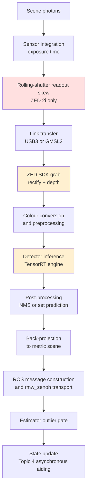

# Topic 5 — Perception pipeline: cameras, detection, and scene interpretation

**Status:** Research baseline. Complete.
**Date:** 2026-09-01
**Decision status:** No ADR. This document records evidence only. It does not select a camera, a detector, or a pipeline topology.

---

## Purpose and evidence policy

This document establishes the evidence base for the visual perception chain, from photons to a scene
estimate consumable by the state estimator defined in the Topic 4 baseline and by the behaviour layer
in later topics.

It is deliberately **not** a design. Topic 4 closed with two deferrals — the exteroceptive aiding
cadence and the ground-contact sensing modality — and both are downstream of facts established here.
Freezing a perception architecture before the camera and the compute profile are chosen would
manufacture exactly the kind of premature commitment the ADR process exists to prevent.

Every claim carries an evidence tag:

| Tag                 | Meaning                                                                                                                                                         |
| ------------------- | --------------------------------------------------------------------------------------------------------------------------------------------------------------- |
| **[Rules]**         | Quoted verbatim from the RoboCup Humanoid League _Laws of the Game 2025_ (14 April 2025). Binding.                                                              |
| **[Upstream]**      | Stated by the maintainer of the software or hardware, in their own documentation or repository.                                                                 |
| **[Primary]**       | Read directly from a licence file, manifest, or source file at a named URL.                                                                                     |
| **[Peer reviewed]** | Published in a refereed venue.                                                                                                                                  |
| **[League]**        | Reported by a competing team about their own system.                                                                                                            |
| **[Derived]**       | Computed here from tagged inputs. The derivation and its assumptions are shown.                                                                                 |
| **[Project]**       | A target or constraint set by this project, not an external fact.                                                                                               |
| **NR**              | **Not reported.** No source states this. `NR` never means "zero" or "negligible" — it means the quantity is unmeasured and is therefore a risk, not an absence. |

**Verification note.** Every `[Primary]`, `[Upstream]`, and `[Rules]` claim in this document was
retrieved directly from the named URL or local document during preparation. An initial attempt to
delegate this survey produced several confident but false statements — including that the Ultralytics
YOLO family is Apache-2.0 licensed (it is AGPL-3.0), that the ZED 2i has a global shutter (it is
rolling), and that the ZED Mini has no IMU (it has one). Those claims were discarded. Where this
document disagrees with common secondary summaries, the primary source is cited so the disagreement
can be checked.

---

## Confirmed project inputs

| Input                             | Value                                                                                                                                                                                                        | Source                         |
| --------------------------------- | ------------------------------------------------------------------------------------------------------------------------------------------------------------------------------------------------------------ | ------------------------------ |
| Camera family                     | Stereolabs ZED. **Model not selected.**                                                                                                                                                                      | [Project]                      |
| Middleware                        | `rmw_zenoh_cpp`, shared memory disabled, loaned messages unavailable                                                                                                                                         | ADR-003                        |
| ROS 2 distribution                | Jazzy Jalisco on Ubuntu 24.04                                                                                                                                                                                | [Project]                      |
| Compute                           | NVIDIA Jetson Orin, profile P0 / P1 / P2 per Topic 4                                                                                                                                                         | [Project]                      |
| Control loop                      | 200 Hz, 5 ms, hard deadline, no perception work inside it                                                                                                                                                    | ADR-001, ADR-002               |
| Aiding cadence into the estimator | Deferred to this topic. Topic 4 assumed a variable, health-gated 30–60 Hz stream that may drop, stall, arrive late, or be rejected by an outlier gate.                                                       | Topic 4 §4.6                   |
| **Size class**                    | **KidSize.** 9 x 6 m field, FIFA size 1 ball, 1.2 m goals.                                                                                                                                                   | [Project] Confirmed 2026-09-01 |
| **Distribution mode**             | **Publicly open-sourced.** Not sold, not used commercially.                                                                                                                                                  | [Project] Confirmed 2026-09-01 |
| **Depth modality**                | **Passive stereo. Decided.** The architecture requires 3D perception. Rule R1 makes passive stereo the only legal depth source. The camera SKU is a downstream selection, not an architectural variable.     | [Project] Confirmed 2026-09-01 |
| **Gaze scheduling ownership**     | **Topic 7** owns intent (where to look, from game state). **Topic 3** owns kinematic execution and neck pan/tilt limits. **Topic 5** consumes the resulting camera pose via the TF tree and owns none of it. | [Project] Confirmed 2026-09-01 |

### Status of external league repositories

Bit-Bots and UTRA soccerbot are cited in this document **only** as evidence for immutable rule
interpretation and for the behaviour of specific software artefacts (licences, model families,
package dependencies). They are **not architectural precedents**. This project is designing a new
robot; hardware, structure, and software are open variables bounded only by the rulebook. Another
team's choice of camera, sensing modality, or pipeline topology carries no weight here, and the
absence of a league precedent is not a risk factor.

---

## 1. Competition-imposed perception envelope

The rulebook constrains the perception system more tightly than any engineering consideration. These
are not preferences; a violation is a disqualification. All quotations are verbatim from _Laws of the
Game 2025_.

### 1.1 Sensing modality

| #   | Rule text                                                                                                                                                                                                      | Consequence                                                                                                                                                                                                                                                                              |
| --- | -------------------------------------------------------------------------------------------------------------------------------------------------------------------------------------------------------------- | ---------------------------------------------------------------------------------------------------------------------------------------------------------------------------------------------------------------------------------------------------------------------------------------- |
| R1  | "Any other **active sensor** (emitting light, sound, or electromagnetic waves into the environment in order to measure reflections) **is not allowed**." [Rules]                                               | LiDAR, time-of-flight, and structured-light depth (e.g. the IR projector on a RealSense D4xx) are **illegal**. **Passive stereo is the only legal source of direct depth.** This is the strongest single argument for a stereo camera and it is a rules argument, not a performance one. |
| R2  | "The number of cameras is limited to a stereo vision setup (i.e., **max. 2 cameras with a large overlap**) only. Monocular vision is also allowed." [Rules]                                                    | A ZED sits exactly at the legal limit. There is **no budget for a third camera** — no wide-angle plus telephoto pair, no dedicated downward ball camera, no rear camera. Every visual task must be served by one stereo pair.                                                            |
| R3  | "External sensors, such as cameras and up to two microphones, may not be placed in the legs or arms or the torso of the robots. They must be placed in the robot's **head and above any neck joint**." [Rules] | The camera rides the most dynamic link in the kinematic chain. Camera extrinsics are a function of every neck joint angle and of the whole-body state. Perception and state estimation are structurally coupled.                                                                         |
| R4  | "Measurements from earth magnetic field sensors **may not be used in the software** and — in case of doubt — the code must be made available to members of the Technical Committee for inspection." [Rules]    | No magnetometer yaw. Absolute yaw must come from vision against field features, or it does not exist. Confirmed in Topic 4; restated because it makes field-feature perception load-bearing rather than optional.                                                                        |
| R5  | "Touch sensors, force sensors, and temperature sensors may be placed at any position on the robot." [Rules]                                                                                                    | Unrestricted. Relevant to the Topic 4 contact-sensing deferral: the rules do not constrain that choice.                                                                                                                                                                                  |

### 1.2 Field of view and head motion

| #   | Rule text                                                                                                                                                                                                                                          | Consequence                                                                                                                                                       |
| --- | -------------------------------------------------------------------------------------------------------------------------------------------------------------------------------------------------------------------------------------------------- | ----------------------------------------------------------------------------------------------------------------------------------------------------------------- |
| R6  | "The field of view of the robots is limited at any time to 180 degrees. This means that the maximum angle between any two points in the **union** of the field of view of all cameras mounted on the robot must be less than 180 degrees." [Rules] | Caps lens choice. Fisheye, catadioptric, and omnidirectional optics are excluded. The union clause means the two stereo eyes cannot be splayed to widen coverage. |
| R7  | "the mechanism to pan the camera is limited to 180 degree pan, which means ±90 degrees from the position looking straight ahead. The mechanism to tilt the camera is limited to ±90 degrees (measured from the horizontal line)." [Rules]          | A pan-tilt neck is permitted and bounded. Active gaze control is legal and is the only way to cover the field with a sub-180° lens.                               |
| R8  | "if positioned at the centre mark the robot may not be able to see more than two goal posts in any tilt angle and in any standing or walking posture of the robot." [Rules]                                                                        | An additional, geometry-dependent cap on instantaneous FOV. Must be demonstrated at inspection for the chosen lens and neck geometry.                             |

**Derived consequence.** R2, R6, and R7 taken together define the perception problem: a single stereo
pair, sub-180° instantaneous FOV, mounted on an actively steerable head that is itself moving. The
system cannot see the whole field at once and must therefore **schedule its gaze**. Gaze scheduling is
a perception-driven control problem that has no home in the current architecture — see Section 8.

### 1.3 Scene appearance

| Element       | Rule text                                                                                                                                                                                                                                       | Consequence                                                                                                                                                                               |
| ------------- | ----------------------------------------------------------------------------------------------------------------------------------------------------------------------------------------------------------------------------------------------- | ----------------------------------------------------------------------------------------------------------------------------------------------------------------------------------------- |
| Field surface | "Matches may be played on artificial surfaces with a height of approximately **30 mm**. The colour of artificial surfaces **must be green**." [Rules]                                                                                           | Green is the only guaranteed colour cue in the scene. The 30 mm pile is a real depth-texture nuisance at close range.                                                                     |
| Lines         | "All lines must be of the same width, which must be approximately **5 cm**." [Rules]                                                                                                                                                            | Line width is the highest-value scale reference in the scene — a known metric dimension observable almost everywhere.                                                                     |
| Goals         | "The goalposts and crossbars must be **white**." Width and depth "not smaller than 8 cm and do not exceed 12 cm". Goal width 2.6 m. Goal height 1.2 m (KidSize) / 1.8 m (AdultSize). Depth 0.6 m. Nets "must not be green or white". [Rules]    | Goalposts are a known-width vertical white primitive — a strong monocular range cue via apparent width.                                                                                   |
| Ball          | "spherical"; "is made of or resembles the weight, form, movement characteristics and appearance of leather or other suitable material"; "**FIFA size 1** for KidSize and **size 5** for AdultSize leagues." [Rules]                             | **The rulebook does not specify ball colour.** Colour-based ball detection is not merely fragile, it is unsupported by the rules. The ball must be found by shape and learned appearance. |
| Robots        | "Robots must be mostly black or of dark grey colour (i.e. **RAL 7011 Iron Grey or darker**) and non reflective." "Any colour used for the field (green, white) or colours similar to the opponent team's team markers must be avoided." [Rules] | Opponents are dark, low-contrast, non-reflective objects against green — the hardest detection class, and the one that matters for obstacle avoidance.                                    |
| Team markers  | "coloured **red** for one team and **blue** for the other"; "one single solid rectangular marker on the front and one on the back"; area at least $0.03 \cdot H_{top}^2$. [Rules]                                                               | Team identity is a red/blue colour classification on a marker of known relative area — separable from robot detection itself.                                                             |

### 1.4 Lighting

> "The lighting resembles that of either artificial or natural light." [Rules]

This is the **entire** lighting specification in the rulebook. There is no illuminance floor, no colour
temperature bound, no uniformity requirement, and no prohibition on direct sunlight through venue
glazing.

**Consequence.** The perception system must tolerate an unbounded photometric range, including
mixed daylight and artificial light within a single frame, moving shadows from spectators, and
specular glare. Any method whose parameters are tuned to a fixed illuminant will fail at competition.
This is the documented historical reason the league abandoned colour-lookup vision — see Section 4.4.

### 1.5 Off-board bandwidth

> "The total bandwidth of each robot belonging to one team may not exceed **1 Mbit/s**." [Rules]
> "the robots must not rely on the quality of the wireless network. They must be able to play if the network is of low quality." [Rules]
> "No external power supply, teleoperation, remote control, or **remote brain of any kind** is allowed." [Rules]

**Derived.** One 1280×720 RGB8 frame is $1280 \times 720 \times 3 = 2.76\ \mathrm{MB}$. At 30 Hz that is
$82.9\ \mathrm{MB/s} = 663\ \mathrm{Mbit/s}$, which exceeds the per-robot budget by a factor of
$\approx 663$. Even a single heavily compressed 720p JPEG of 100 kB transmitted once per second
consumes $0.8\ \mathrm{Mbit/s}$ — approximately the **entire** budget for that robot.

Therefore: **no image stream may leave the robot during a match.** All debug image transport must be
compile-time or run-time disabled in competition configuration, and the design cannot depend on
off-board inference of any kind. This is a hard architectural boundary, not a tuning parameter.

---

## 2. Scene geometry: what the optics must actually resolve

The rules fix the field dimensions and the ball size. The angular size of the ball at maximum useful
range is the single number that dominates lens and resolution choice, so it is derived here explicitly.

### 2.1 Field extents [Rules]

| Dimension                 | KidSize      | AdultSize    |
| ------------------------- | ------------ | ------------ |
| Field length (touch line) | 9 m          | 14 m         |
| Field width (goal line)   | 6 m          | 9 m          |
| Border strip (min.)       | 1 m          | 1 m          |
| Centre circle radius      | 0.75 m       | 1.5 m        |
| Goal width                | 2.6 m        | 2.6 m        |
| Goal height               | 1.2 m        | 1.8 m        |
| Goal depth                | 0.6 m        | 0.6 m        |
| Line width                | approx. 5 cm | approx. 5 cm |

**Derived maximum sight line.** KidSize playing surface diagonal:
$\sqrt{9^2 + 6^2} = \sqrt{117} \approx 10.8\ \mathrm{m}$. Including the 1 m border strip on all sides,
corner to corner: $\sqrt{11^2 + 8^2} = \sqrt{185} \approx 13.6\ \mathrm{m}$. AdultSize playing surface
diagonal: $\sqrt{14^2 + 9^2} \approx 16.6\ \mathrm{m}$. [Derived]

### 2.2 Ball angular size

The rulebook states the FIFA size class but **not a diameter**. FIFA size 1 is conventionally
18–20 inches (0.457–0.508 m) circumference and size 5 is 68–70 cm, giving:

$$d_{\text{size 1}} = \frac{0.457\ \text{to}\ 0.508}{\pi} \approx 0.145\ \text{to}\ 0.162\ \mathrm{m}, \qquad d_{\text{size 5}} = \frac{0.68\ \text{to}\ 0.70}{\pi} \approx 0.216\ \text{to}\ 0.223\ \mathrm{m}$$

Taking $d = 0.15\ \mathrm{m}$ (KidSize) and $d = 0.22\ \mathrm{m}$ (AdultSize). [Derived — the
circumference figures come from the FIFA equipment standard, which the rulebook incorporates by
reference but does not reproduce. This should be confirmed against the ball actually used.]

Angular diameter at range $Z$: $\theta = 2\arctan\!\left(\frac{d}{2Z}\right)$.

Pixel diameter for a horizontal field of view $\mathrm{HFOV}$ and image width $W$ pixels, assuming a
rectilinear lens and uniform angular resolution: $n_{px} = \theta \cdot \frac{W}{\mathrm{HFOV}}$.

**KidSize ball, $d = 0.15\ \mathrm{m}$, HFOV = 110°** (the maximum quoted for ZED optics):

| Range $Z$         | $\theta$ | $n_{px}$ at $W = 1280$ | $n_{px}$ at $W = 1920$ | $n_{px}$ at $W = 2208$ |
| ----------------- | -------- | ---------------------- | ---------------------- | ---------------------- |
| 1 m               | 8.59°    | 100                    | 150                    | 172                    |
| 2 m               | 4.30°    | 50                     | 75                     | 86                     |
| 4 m               | 2.15°    | 25                     | 38                     | 43                     |
| 6 m               | 1.43°    | 17                     | 25                     | 29                     |
| 8 m               | 1.07°    | 12                     | 19                     | 21                     |
| 10.8 m (diagonal) | 0.80°    | 9                      | 14                     | 16                     |

[Derived]

**This table is the core difficulty of the topic.** At the far end of a KidSize field the ball spans
roughly **9–16 pixels** with a 110° lens. The COCO convention classifies anything under $32 \times 32$
pixels as a "small" object, and detector accuracy degrades sharply below that threshold. The ball is
a small object over most of the field, and it is a _sub-16-pixel_ object at the ranges where seeing it
first confers tactical advantage.

Three levers exist, and each has a cost visible elsewhere in this document:

| Lever                                                                       | Effect                                                   | Cost                                                                          |
| --------------------------------------------------------------------------- | -------------------------------------------------------- | ----------------------------------------------------------------------------- |
| Narrower HFOV                                                               | Linear increase in pixels on target                      | Less of the field visible per frame; more gaze scheduling; R8 inspection risk |
| Higher input resolution                                                     | Linear increase in pixels on target                      | Superlinear inference cost (Section 6); higher bandwidth off the sensor       |
| Detection at native resolution rather than a letterboxed 640² network input | Avoids discarding the pixels the sensor already captured | Most off-the-shelf detector configurations downscale aggressively by default  |

The common practice of feeding a $640 \times 640$ letterboxed input to a detector would reduce the
10.8 m ball from 14 px (at 1920 wide) to **under 5 px** — below any plausible detection floor.
[Derived] Whatever pipeline is eventually chosen must be evaluated at the resolution it will actually
run, against balls at the ranges in the table above.

### 2.3 Known-scale references in the scene

Because the rules fix several metric dimensions, monocular range estimation is available independently
of stereo:

| Feature              | Known dimension         | Notes                                                                               |
| -------------------- | ----------------------- | ----------------------------------------------------------------------------------- |
| Line width           | 5 cm                    | Present across the whole field; strongest constraint on the ground-plane homography |
| Goalpost width       | 8–12 cm                 | Range is not tight; usable but with 40 % width ambiguity                            |
| Goal width           | 2.6 m                   | Both size classes; unambiguous when both posts are visible                          |
| Ball diameter        | approx. 0.15 m / 0.22 m | Direct range from apparent diameter                                                 |
| Centre circle radius | 0.75 m / 1.5 m          | Size-class disambiguating                                                           |

This matters because Section 3.4 shows stereo depth is least reliable exactly where this scene is
most textureless.

---

## 3. Camera hardware: the ZED family

### 3.1 Current model lineup [Upstream]

| Family      | Models                                    | Interface              |
| ----------- | ----------------------------------------- | ---------------------- |
| ZED USB 3   | **ZED 2i**, **ZED Mini**                  | USB 3.0, UVC compliant |
| ZED X GMSL2 | **ZED X**, **ZED X Mini**, **ZED X Nano** | GMSL2                  |
| ZED X One   | **ZED X One GS**, **4K**, **S**           | GMSL2, **monocular**   |

Source: `docs.stereolabs.com/docs/products/cameras.md`.

### 3.2 Properties that matter for this application

| Property                                         | Finding                                                                                                                                                           | Source                                   |
| ------------------------------------------------ | ----------------------------------------------------------------------------------------------------------------------------------------------------------------- | ---------------------------------------- |
| **ZED 2i shutter**                               | **Rolling.** "ZED 2i is an IP66-rated **Rolling Shutter** camera"; spec field _Shutter Sync_ = "Electronic Synchronized Rolling Shutter".                         | [Upstream] Stereolabs product page       |
| **ZED X shutter**                                | **Global.** "With its IP67-rated **Global Shutter** and high-performance IMU, it is built to withstand harsh conditions".                                         | [Upstream] `products/cameras/zedx.md`    |
| **IMU presence**                                 | The object detection module "requires a stereo camera equipped with an inertial sensor (IMU), such as the ZED 2/2i, **ZED Mini**, ZED X, ZED X Mini, ZED X Nano." | [Upstream] `modules/object-detection.md` |
| **Models without IMU / stereo**                  | "The original **ZED** (out of production), which has no built-in IMU." "The **ZED X One GS/4K/S** cameras, which are **monocular**."                              | [Upstream] same page                     |
| **GMSL2 requirement**                            | "The ZED X, ZED X Mini, and ZED X Nano cameras use a GMSL2 connection, which is **not compatible with USB**." Requires a ZED Link capture card on the Jetson.     | [Upstream] `products/cameras/zedx.md`    |
| **Ingress rating**                               | "Only ZED X and ZED X Mini are IP67 rated. **ZED X Nano has no IP rating**; it is designed for indoor use."                                                       | [Upstream] same page                     |
| Depth range                                      | "up to 35 m"                                                                                                                                                      | [Upstream] `modules/depth-sensing.md`    |
| Maximum FOV                                      | "up to 110° (H) x 95° (V)"                                                                                                                                        | [Upstream] same page                     |
| Per-model FOV, resolution, baseline, mass, power | **NR** at the documentation URLs surveyed. Must be taken from each model's datasheet before any mass or power budget is closed.                                   | NR                                       |

### 3.3 The rolling shutter finding

**The ZED 2i is a rolling-shutter camera.** For a camera bolted above the neck joint of a walking
biped this is a first-order problem, not a detail:

1. **Geometric distortion under head rotation.** Rows are exposed sequentially. During a head pan or a
   walking-induced torso yaw, each image row corresponds to a _different_ camera pose. The single
   pinhole projection model used to back-project a detection onto the ground plane is invalid for the
   duration of the readout.
2. **Interaction with the Topic 4 timestamp contract.** Topic 4 §4.6 records that "At 1 m/s a 10 ms
   timestamp error is 10 mm". A rolling-shutter frame does not _have_ a single timestamp; it has a
   readout interval. Attributing one timestamp to the whole frame injects exactly the delay
   misattribution error that §4.6 identifies as a failure mode.
3. **Stereo consistency.** Stereolabs describes the shutter as "Electronic **Synchronized** Rolling
   Shutter", which addresses left/right consistency but does not remove intra-frame skew.

The **readout time** (the interval between first and last row exposure) is **NR**. Without it, the
skew magnitude cannot be bounded, and neither can the correction. This is a measurement gate, not a
literature question — see Section 7.

The ZED X family is global shutter and does not have this problem, but requires GMSL2 and therefore a
capture card, changing the carrier board, mass, and power picture.

### 3.4 Stereo depth behaviour on a RoboCup field

Stereolabs states the depth error model directly:

> "Stereo vision uses triangulation to estimate depth from a disparity image, with the following
> formula describing how depth resolution changes over the range of a stereo camera: $D_r = Z^2 \cdot \alpha$
> ... Depth accuracy decreases with distance, following a quadratic relationship. For ZED stereo
> cameras, depth accuracy is typically around **1 % of the measured distance at close range,
> increasing to about 9 % at the maximum range**." [Upstream]

**Derived.** Absolute depth uncertainty grows as $Z^2$, so _relative_ uncertainty grows linearly:
$\sigma_Z / Z = \alpha Z$. Anchoring the vendor's 9 % at the stated 35 m maximum gives
$\alpha \approx 0.00257\ \mathrm{m^{-1}}$:

| Range $Z$ | Relative depth error | Absolute depth error |
| --------- | -------------------- | -------------------- |
| 1 m       | 0.26 %               | 2.6 mm               |
| 2 m       | 0.51 %               | 10 mm                |
| 4 m       | 1.03 %               | 41 mm                |
| 6 m       | 1.54 %               | 93 mm                |
| 8 m       | 2.06 %               | 0.16 m               |
| 10.8 m    | 2.78 %               | 0.30 m               |

[Derived. Assumes the vendor's endpoints describe a single quadratic and that the chosen model has the
baseline the vendor benchmarked. Both must be re-derived for the specific model and baseline selected.]

At 2 m the depth is good enough to place a ball for a kick. At 10 m it is not good enough to tell which
half of the field the ball is in. **Stereo depth is a near-field instrument on this field.**

Compounding this, Stereolabs names the failure surfaces explicitly:

> "Depth accuracy may also be reduced by outlier measurements on homogeneous or textureless surfaces,
> such as **white walls**, **green screens**, or reflective areas. These surfaces often lack visual
> features, leading to temporal instability and less reliable depth measurements." [Upstream]

**This is the RoboCup field.** The playing surface is a uniform green textureless plane by rule; the
goalposts and crossbar are white by rule. The two structures the robot most needs to localise against
are the two examples the vendor gives for where its depth is unreliable. The 30 mm turf pile provides
some high-frequency texture at close range, but its contribution at 5–10 m is **NR** and is unlikely
to survive the sensor's angular resolution.

**Combined consequence, and the handoff to Topic 6.** Stereo depth is well-conditioned near-field on
textured targets (the ball, other robots) and poorly conditioned far-field on the textureless
structures (turf plane, goal). The known metric dimensions catalogued in Section 2.3 are the
complementary information source, and they are strongest exactly where stereo is weakest.

This does **not** argue against stereo. It argues that the depth error is **range-dependent and
surface-dependent**, and must therefore be modelled rather than assumed constant. Two consequences
are binding on Topic 6:

1. **Depth measurements carry a heteroscedastic noise model, not a fixed covariance.** At minimum the
   reported variance must scale as $\sigma_Z^2 \propto Z^4$ (from $\sigma_Z = \alpha Z^2$), and must
   be inflated on low-texture support regions. A single tuned covariance would be optimistic at range
   by roughly two orders of magnitude between 2 m and 10.8 m.
2. **Depth validity is a per-pixel signal, not a per-frame one.** Dropouts on green turf and white
   goalposts are expected behaviour, not faults. The estimator must consume a validity mask and must
   not treat an invalid region as a zero-range or maximum-range measurement.

Section 7 gate 4 produces the measurements that parameterise this model.

### 3.5 SDK platform requirements [Upstream]

| Requirement             | Value                                                                                                                                                                      |
| ----------------------- | -------------------------------------------------------------------------------------------------------------------------------------------------------------------------- |
| Embedded GPU            | "NVIDIA Jetson Orin, Thor" (Thor "support is under development and can have some limitations")                                                                             |
| Compute capability      | ">= 7.5 based on Turing or more recent". Orin is Ampere, `sm_87` — satisfied. [Derived]                                                                                    |
| Embedded RAM            | "4 GB minimum"                                                                                                                                                             |
| Embedded OS             | "Jetson Linux (L4T)"                                                                                                                                                       |
| Connectivity            | "USB 2.0 / USB 3.0 / GMSL2". "With USB 2.0, the maximum supported resolution is VGA at 30 FPS."                                                                            |
| Neural depth build cost | "optimizing the NEURAL and NEURAL_PLUS depth models can take a long time and requires large swap files and memory optimizations to complete" (stated for Jetson Nano 4 GB) |

The last row is an operational trap: the SDK builds an optimised depth engine on first use. On a
competition robot with no internet and a fixed pre-match setup window, this build must be completed
and cached in the deployed image. The engine is tied to the GPU architecture and the TensorRT version,
so it does not port between JetPack releases.

**Published ZED SDK throughput or latency figures on Jetson Orin: NR.** Stereolabs publishes no
frames-per-second or millisecond figures for any Orin variant at any resolution or depth mode. Every
pipeline timing number in Section 6 is therefore unvalidated.

### 3.6 ROS 2 integration status

| Fact                              | Value                                                                                                                                                    | Source                              |
| --------------------------------- | -------------------------------------------------------------------------------------------------------------------------------------------------------- | ----------------------------------- |
| `zed-ros2-wrapper` distro support | "Supported on ROS 2 **Humble, Jazzy**, and Lyrical (LTS) — plus Foxy (backward compatibility) and Rolling (developers)"; "Jazzy Jalisco on Ubuntu 24.04" | [Primary] repository `README.md`    |
| `zed-ros2-wrapper` in rosdistro   | **Not present.** Source build only.                                                                                                                      | [Primary] `jazzy/distribution.yaml` |
| `zed-ros2-interfaces` in Jazzy    | **Present, 5.3.0-1**                                                                                                                                     | [Primary] `jazzy/distribution.yaml` |
| `zed-ros2-description` in Jazzy   | **Present, 0.1.5-1**                                                                                                                                     | [Primary] same                      |
| Message package delivery          | "the dependency `zed_msgs` is no longer installed as a submodule of this package; it is available through `apt` as a binary package"                     | [Primary] wrapper `README.md`       |
| Build dependency                  | CUDA; on Jetson JP6 requires `nvidia-jetpack` and `nvidia-jetpack-dev`, otherwise `FindCUDA.cmake` fails with `Specify CUDA_TOOLKIT_ROOT_DIR`            | [Primary] wrapper `README.md`       |
| Point cloud compression           | `point_cloud_transport` supported but optional; "removed ... as a required dependency ... to avoid forcing its installation"                             | [Primary] wrapper `README.md`       |
| Vendor network guidance           | Stereolabs publishes a "ROS 2 tuning guide" for "DDS and network tuning"                                                                                 | [Primary] wrapper `README.md`       |

This corrects the Topic 4 note that recorded no `ros-jazzy-zed-*` packages. The **interfaces and
description packages are released into Jazzy**; the wrapper itself is not, and must be built from
source and version-pinned like `ros2_control` (ADR-001).

The vendor's DDS tuning guide is written for the default RMW. Under `rmw_zenoh_cpp` (ADR-003) its
advice does not apply and its QoS assumptions must be audited — see Section 5.3.

**ZED SDK licence.** Proprietary and closed-source. Redistribution inside container images is licence-gated.
This is a supply-chain constraint on any published artefact and is unresolved — see Section 8.

---

## 4. Detection and segmentation models

### 4.1 Licensing — the decisive finding

Every licence below was read directly from the `LICENSE` file in the named repository. This section
exists because the widely repeated claim that the Ultralytics YOLO family is Apache-2.0 is **false**.

| Project                       | Repository                                 | Licence (read from `LICENSE`)                         |
| ----------------------------- | ------------------------------------------ | ----------------------------------------------------- |
| Ultralytics (YOLOv8 / YOLO11) | `ultralytics/ultralytics`                  | **AGPL-3.0**                                          |
| YOLOv5                        | `ultralytics/yolov5`                       | **AGPL-3.0**                                          |
| YOLOv10                       | `THU-MIG/yolov10`                          | **AGPL-3.0**                                          |
| YOLOv7                        | `WongKinYiu/yolov7`                        | **GPL-3.0**                                           |
| YOLOv9                        | `WongKinYiu/yolov9`                        | **GPL-3.0**                                           |
| YOEO                          | `bit-bots/YOEO`                            | **GPL-3.0**                                           |
| Darknet                       | `AlexeyAB/darknet`                         | "YOLO LICENSE Version 2, July 29 2016" (non-standard) |
| **RF-DETR**                   | `roboflow/rf-detr` (`develop`)             | **Apache-2.0**                                        |
| RT-DETR                       | `lyuwenyu/RT-DETR`                         | Apache-2.0                                            |
| YOLOX                         | `Megvii-BaseDetection/YOLOX`               | Apache-2.0                                            |
| NanoDet                       | `RangiLyu/nanodet`                         | Apache-2.0                                            |
| D-FINE                        | `Peterande/D-FINE`                         | Apache-2.0                                            |
| MMDetection                   | `open-mmlab/mmdetection`                   | Apache-2.0                                            |
| Detectron2                    | `facebookresearch/detectron2`              | Apache-2.0                                            |
| torchvision                   | `pytorch/vision`                           | BSD-3-Clause                                          |
| **Bit-Bots vision**           | `bit-bots/bitbots_main` (`bitbots_vision`) | **MIT**                                               |

[Primary] All entries retrieved from `raw.githubusercontent.com`.

**Correct interpretation — neither alarmist nor dismissive.** GPL and AGPL obligations attach on
**conveying** the work. AGPL-3.0 adds a network-interaction clause. Running AGPL-licensed software on
a robot you own, and never distributing it, does **not** by itself trigger the source-disclosure
obligation. The risk is real but conditional, and it materialises when the team:

- publishes its stack (which most Humanoid League teams do, and which the league culture encourages);
- distributes container images or a robot to another party;
- reuses the work in anything commercial or in a sponsor deliverable.

Under those conditions AGPL-3.0 reaches the **entire combined work**, not just the model code.
Ultralytics markets an Enterprise Licence precisely for organisations that cannot accept this. The
practical significance is that an AGPL dependency chosen early is very expensive to remove late,
because it constrains every downstream package that links to it.

The permissive column is not a compromise on capability: RF-DETR, RT-DETR, D-FINE, and YOLOX are all
current architectures. **There is no capability argument that requires accepting AGPL here.**

### 4.1.1 Project ruling on licensing

The project has confirmed it will be **publicly open-sourced** and will not be sold or used
commercially. Legal risk appetite is therefore not the governing consideration. Two engineering
consequences survive that ruling and are recorded as binding:

1. **AGPL-3.0 is incompatible with the ZED SDK in a distributable combined work.** The ZED SDK is
   proprietary and closed-source (Section 3.6). GPL-family copyleft extends to the whole combined
   work; distributing AGPL-licensed code linked against a closed-source library is not permitted
   without a licence exception, which Stereolabs does not grant. This is a **technical distribution
   blocker**, not a risk assessment. It applies the moment the stack is published, which is the
   stated intent.
2. **Copyleft removes the project's own licensing freedom.** An AGPL dependency forces the entire
   published stack to AGPL-3.0, preventing the permissive release that both surveyed league teams
   chose (Bit-Bots: MIT; UTRA: BSD-3-Clause) and blocking downstream reuse by permissively licensed
   projects.

Since the permissive alternatives are architecturally current and one of them is already proven in
this exact league (Section 4.2), AGPL and GPL components carry cost and confer no benefit here.
Gate 11 enforces this. The matter is closed and is not revisited in later topics.

### 4.2 What the league actually runs

The most relevant data point is not a benchmark, it is a competitor's production system.

> "The vision is able to detect balls, goal posts, obstacles, and robots, and detects field lines,
> using a **single RF-DETR ONNX model with separate detection and segmentation heads**."
> — `bitbots_vision` README [Primary], package licensed **MIT**

This supersedes the team's earlier YOEO network:

> "YOEO — You Only Encode Once. A CNN for Embedded Object Detection and Semantic Segmentation. This
> project is based upon PyTorch-YOLOv3" — `bit-bots/YOEO` README [Primary], **GPL-3.0**

And that in turn superseded the colour-lookup pipeline documented in Fiedler et al., _An Open Source
Vision Pipeline Approach for RoboCup Humanoid Soccer_, RoboCup 2019, Springer. [Peer reviewed]

**The trajectory is the finding.** A leading Humanoid League team moved: hand-tuned colour lookup →
single-encoder multi-head CNN (YOEO) → single transformer-based multi-head model (RF-DETR), and moved
from GPL to a permissively licensed model in the process. Three properties persisted across all three
generations:

1. **One network, multiple heads.** Detection (ball, goalposts, robots, obstacles) and segmentation
   (field lines, field area) share an encoder. On an embedded budget the encoder is the expensive part;
   running two networks doubles the dominant cost.
2. **Field lines are solved as segmentation, not detection.** Lines are not objects with bounding
   boxes. Their value is as a dense constraint on the ground-plane pose.
3. **ONNX as the deployment interchange.** Not the training framework's native runtime.

A second KidSize team, UTRA soccerbot (University of Toronto), is licensed **BSD-3-Clause** and
declares its perception dependency explicitly:

> `soccer_object_detection/package.xml`: `<license>BSD</license>`, `<depend>rclpy</depend>`,
> `<depend>usb_cam</depend>` [Primary]

`usb_cam` is a plain monocular UVC camera driver. Their stack runs on ROS 2 **Humble** with PyTorch
and torchvision on Jetson. [Primary]

**What this evidence is and is not.** Both teams are monocular. That is a fact about their robots,
not a constraint on this one — see "Status of external league repositories" above. Their sensing
choices are dated to their own hardware eras and budgets, and neither team published a comparison
against stereo. **No conclusion about stereo viability can be drawn from their absence of it.**

What _is_ transferable is the three-item technique list above, because those findings are about
embedded inference economics rather than about hardware selection: a shared encoder is cheaper than
two networks, lines are better expressed as segmentation than as boxes, and ONNX is the practical
deployment interchange. Those hold regardless of whether the input is monocular or stereo.

One further transferable finding: **the permissive licences both teams chose (MIT, BSD-3-Clause)
demonstrate that a competitive league vision stack can be built without copyleft dependencies**,
which corroborates Section 4.1.1.

### 4.3 ZED SDK object detection as an alternative to a custom model

The ZED SDK ships its own object detection module. Its outputs are richer than a bounding box:

| Output                                                         | Type      |
| -------------------------------------------------------------- | --------- |
| ID (stable across frames), Label, Tracking state, Action state | discrete  |
| Position $(x,y,z)$, Velocity $(v_x,v_y,v_z)$, Dimensions       | metric 3D |
| 2D bounding box, 3D bounding box (eight points), Mask          | geometric |

[Upstream] `modules/object-detection.md`

Two structural facts limit its applicability:

1. **No sports-ball class.** The built-in label set is oriented to `Person` and `Vehicle`. Detecting a
   RoboCup ball, a goalpost, or a field line is not in scope for the built-in models. **NR** for any
   class matching league objects.
2. **Custom detector ingestion exists.** "Since ZED SDK 3.6, a custom detector can be used with the
   API. The 2D detection is ingested and the 3D information such as position, 3D bounding box and more
   are computed." [Upstream]

The second point is the architecturally interesting one: the SDK can act as a **2D-to-3D lifting and
tracking service** for detections produced by an external, permissively licensed model. Whether that
lifting is better or worse than back-projection through the ground-plane homography is **NR** and is
a measurement question, given the depth behaviour in Section 3.4.

Object detection and tracking both require the positional tracking module, which requires the IMU —
which is why the module's camera support list is exactly the IMU-equipped models (Section 3.2). This
creates a second, camera-internal source of pose that is not the Topic 4 estimator. Two independent
pose estimates in one system is a consistency hazard, not a redundancy benefit, unless one is
explicitly subordinate. Unresolved — Section 8.

### 4.4 Why colour-based methods are excluded by evidence, not preference

Combining Section 1.3 and Section 1.4:

- Ball colour is **not specified by the rules**.
- Lighting is only required to "resemble ... either artificial or natural light", with no illuminance,
  uniformity, or colour-temperature bound.
- Robots must avoid "any colour used for the field (green, white)" but are otherwise dark.
- The only rule-guaranteed colours are green (surface), white (lines, goals), and red/blue (team markers).

A colour-threshold or colour-lookup classifier therefore has no stable target for the single most
important object in the game, under an unbounded illuminant. The league's own migration away from such
methods (Section 4.2) is the empirical confirmation. Colour remains useful for the two tasks where the
rules do fix a colour: **field-area segmentation** (green) and **team-marker classification**
(red/blue).

---

## 5. ROS 2 Jazzy integration surface

### 5.1 Availability — verified against the Jazzy manifest

Read from `ros/rosdistro` `jazzy/distribution.yaml` (837 repositories) [Primary]:

| Repository                             | Version     | Packages relevant here                                                                                                        |
| -------------------------------------- | ----------- | ----------------------------------------------------------------------------------------------------------------------------- |
| `image_common`                         | 5.1.8-1     | `image_transport`, `camera_info_manager`, `camera_calibration_parsers`                                                        |
| `image_transport_plugins`              | 4.0.7-1     | `compressed_image_transport`, `compressed_depth_image_transport`, `theora_image_transport`, `zstd_image_transport`            |
| `image_pipeline`                       | 5.0.13-1    | `image_proc`, `stereo_image_proc`, `depth_image_proc`, `camera_calibration`, `image_view`, `tracetools_image_pipeline`        |
| `vision_opencv`                        | 4.1.0-1     | `cv_bridge`, `image_geometry`                                                                                                 |
| `vision_msgs`                          | 4.1.1-3     | 2D/3D detection messages                                                                                                      |
| **`soccer_interfaces`**                | **1.0.0-2** | `soccer_vision_2d_msgs`, `soccer_vision_3d_msgs`, `soccer_vision_attribute_msgs`, `soccer_geometry_msgs`, `soccer_model_msgs` |
| `soccer_vision_3d_rviz_markers`        | 1.0.0-2     | visualisation for the above                                                                                                   |
| `game_controller_spl`                  | 4.1.0-1     | referee/game-state interface                                                                                                  |
| `rmw_zenoh`                            | 0.2.10-1    | ADR-003 middleware                                                                                                            |
| `ffmpeg_image_transport`               | 3.0.4-1     | H.264/H.265 image transport plugin                                                                                            |
| `turbojpeg_compressed_image_transport` | 0.2.1-5     | JPEG via libjpeg-turbo                                                                                                        |
| `foxglove_compressed_video_transport`  | 3.0.3-1     | compressed video transport                                                                                                    |
| `tensorrt_cmake_module`                | 0.0.5-1     | TensorRT build integration                                                                                                    |
| `zed-ros2-interfaces`                  | 5.3.0-1     | ZED message definitions                                                                                                       |
| `zed-ros2-description`                 | 0.1.5-1     | ZED URDF                                                                                                                      |

**Not present in the Jazzy manifest:** any `isaac_ros_*` repository, any NITROS package, and
`zed-ros2-wrapper`. [Primary] Isaac ROS is distributed through NVIDIA's own channels, not rosdistro;
its distro support and its `ros2_control` and `rmw_zenoh` compatibility are therefore **NR** from the
ROS side and must be established separately before it can be considered a dependency.

### 5.2 `soccer_interfaces` — a standard the project did not know existed

`soccer_interfaces` (ros-sports) provides `soccer_vision_2d_msgs`, `soccer_vision_3d_msgs`, and
`soccer_vision_attribute_msgs`, released into Jazzy at 1.0.0-2. [Primary]

This is materially different from the Topic 4 situation, where no standard message existed for foot
contact and a project-specific type was unavoidable. Here a released, distro-installed vocabulary for
soccer perception products already exists, with RViz visualisation support alongside it. Whether its
schema matches this project's needs is **NR** — the message definitions have not yet been read — but
adopting an existing released interface rather than inventing one has obvious costs in coupling and
obvious benefits in tooling and interoperability. Section 7 gate 8.

### 5.3 QoS conflicts with ADR-003

ADR-003 prohibits `SYSTEM_DEFAULT`, `UNKNOWN`, and `BEST_AVAILABLE` QoS, and requires raw
cross-process image topics to be best-effort / volatile / keep-last-1.

| Hazard                                                                                   | Status                                                                      | Consequence                                                                                                                                                                                      |
| ---------------------------------------------------------------------------------------- | --------------------------------------------------------------------------- | ------------------------------------------------------------------------------------------------------------------------------------------------------------------------------------------------ |
| `image_transport::Subscriber` does not accept an explicit QoS profile in its constructor | Reported by survey, **verification pending against `image_common` 5.1.8-1** | If confirmed, any subscriber created through the `image_transport` convenience API cannot express the ADR-003 profile. Same class of problem as the `imu_sensor_broadcaster` finding in Topic 4. |
| Isaac ROS common QoS helper accepts `SYSTEM_DEFAULT` as a string parameter               | Reported by survey, **verification pending**                                | Would be a direct ADR-003 violation if Isaac ROS were adopted. Compounded by Isaac ROS being absent from rosdistro (5.1).                                                                        |
| `rmw_zenoh_cpp` returns `RMW_RET_UNSUPPORTED` for all loaned-message APIs                | Reported by survey, consistent with ADR-003                                 | Zero-copy across processes is unavailable. Confirms ADR-003's existing position.                                                                                                                 |
| rclcpp intra-process transport with `TypeAdapter` bypasses the RMW entirely              | Reported by survey, **verification pending**                                | If confirmed, in-process image handoff is unaffected by the loaned-message limitation — a significant difference between in-process and cross-process image paths.                               |
| ZED wrapper follows the vendor's DDS tuning guide, written for the default RMW           | [Primary] wrapper README                                                    | Vendor guidance does not transfer to `rmw_zenoh_cpp`. The wrapper's published QoS defaults must be audited against ADR-003.                                                                      |

**These are qualification gates, not architectural rework** — the same ruling recorded for the Topic 4
hazards. None invalidates ADR-001, ADR-002, or the ADR-003 _decision_; the conflicts are with QoS
_defaults_ and with convenience APIs. They are carried into Section 7.

Four of the five rows above originate from an automated survey whose reliability proved poor elsewhere
in this topic. They are recorded as **leads requiring verification**, not as findings, and are marked
accordingly.

### 5.4 Binding interface contract: camera frustum publication

**Source: Topic 6 decision D4, accepted 2026-09-01. This is a requirement on Topic 5, not a
suggestion, and must be satisfied before Topic 5 is frozen into an ADR.**

Topic 6 §3.4 established that a single steerable camera makes "target not currently observable" the
**normal** state rather than a fault. A world-model tracker that decays track confidence on elapsed
time alone will therefore discard a correctly tracked ball simply because the robot looked at a goal.
The correct predicate is **visibility-aware**: decay only when the target was inside the field of view
and was not detected.

That predicate cannot be evaluated by the tracker alone. It requires perception to state what it could
have seen, not only what it did see.

| Requirement                | Statement                                                                                                                                                                                                                                             |
| -------------------------- | ----------------------------------------------------------------------------------------------------------------------------------------------------------------------------------------------------------------------------------------------------- |
| **What must be published** | The camera view volume for the frame that produced each detection set: camera pose in the TF tree, horizontal and vertical field of view, near and far usable depth range, and the image timestamp the detections were derived from.                  |
| **When**                   | With **every** detection message, including empty ones. An empty detection set with a frustum is informative; an empty detection set without one is not.                                                                                              |
| **Association**            | The frustum and the detection set must share the same frame ID and the same source timestamp, so a consumer can evaluate the visibility test against the exact geometry that produced the result.                                                     |
| **Far range**              | Must reflect the **usable** detection range, not the sensor's nominal maximum. Topic 5 gate 3 produces this number per object class. A frustum claiming 35 m while the detector loses the ball at 6 m would cause the tracker to delete valid tracks. |
| **Occlusion**              | Out of scope. The frustum answers "was it in view?", not "was it visible?". Occlusion by other robots is handled in the Topic 6 tracker, which knows the other robots' positions.                                                                     |
| **Rate and QoS**           | Same rate and same QoS profile as the detection stream it accompanies. It is a small message; publishing it separately at a lower rate breaks the timestamp association and is prohibited.                                                            |

**Schema status: NR.** Whether `soccer_vision_3d_msgs` carries a view-volume type is unknown — the
message definitions have not been read (§5.2, gate 8). If it does not, a project-specific message is
required. Gate 12 covers this.

**Consequence if unmet.** Topic 6 D4 cannot be implemented, and the tracker falls back to timeout-based
decay, which Topic 6 §3.4 rejects. This is the single hardest dependency Topic 6 places on Topic 5.

---

## 6. Latency and compute budget

### 6.1 The photon-to-state chain

### 6.2 Measured values

| Stage                                    | Value  | Source                                                |
| ---------------------------------------- | ------ | ----------------------------------------------------- |
| Sensor integration                       | **NR** | configurable; interacts with Section 1.4 lighting     |
| Rolling-shutter readout skew             | **NR** | Section 3.3                                           |
| USB3 / GMSL2 transfer                    | **NR** | GMSL2 described only qualitatively as "low-latency"   |
| ZED SDK grab, rectification, depth       | **NR** | Stereolabs publishes no Jetson Orin figures           |
| Preprocessing                            | **NR** |                                                       |
| Detector inference                       | **NR** | no trustworthy figure obtained; see verification note |
| Post-processing                          | **NR** |                                                       |
| Back-projection and message construction | **NR** |                                                       |
| `rmw_zenoh_cpp` loopback transport       | **NR** |                                                       |
| Estimator gate and update                | **NR** |                                                       |
| **End-to-end photon-to-state latency**   | **NR** |                                                       |

**Every term in the perception latency chain is unmeasured.** This is the single most important
statement in this document about timing. No published source gives an end-to-end figure for this
class of pipeline on this class of hardware, and the numbers that circulate in secondary summaries did
not survive source checking.

The Topic 4 §4.6 asynchronous aiding contract was specified with a re-propagation window of
$W = 0.5\ \mathrm{s}$ (100 cycles at 200 Hz, approximately 48 kB of stored inputs). That window was
chosen precisely to absorb an unmeasured perception delay. **It remains adequate only while the
true end-to-end latency stays well inside 0.5 s**, which is currently an assumption, not a measurement.
Gate 1 below closes this.

### 6.3 Compute contention with the control loop

ADR-001 and ADR-002 require a genuine 200 Hz / 5 ms cycle with the admission envelope
$C_{read}+C_{estimate}+C_{realize}+C_{safety}+C_{write}+M \le 5\ \mathrm{ms}$ and 40 % measured
CPU-time margin. The perception pipeline shares the Orin with that loop.

| Contention mechanism                                                                                                       | Status                                                                         |
| -------------------------------------------------------------------------------------------------------------------------- | ------------------------------------------------------------------------------ |
| GPU preemption granularity on Orin — whether a long inference kernel can delay a CUDA operation needed by the control path | **NR**                                                                         |
| Memory bandwidth contention (Orin variants share memory between CPU and GPU)                                               | **NR** — per-variant GB/s figures not yet verified from NVIDIA primary sources |
| DLA availability per Orin variant (offloading inference off the GPU)                                                       | **NR** — believed absent on Orin Nano; unverified                              |
| `nvpmodel` power mode effect on sustained inference throughput, including the JetPack 6.2 "Super" uprating                 | **NR**                                                                         |
| TensorRT version per JetPack release, and engine portability across releases                                               | **NR**                                                                         |
| PREEMPT_RT support on Jetson Linux and its documented limitations                                                          | **NR**                                                                         |
| CPU cost of image compression if any debug transport is enabled                                                            | **NR** — Section 1.5 shows it must be disabled in competition regardless       |

Because perception is explicitly **outside** the 5 ms cycle, contention is a _scheduling_ risk rather
than a correctness risk — but ADR-002's fall trigger depends on estimator validity, and the estimator
consumes perception output. A perception stall that starves the aiding gate is a Topic 4 §4.6 failure
mode with an ADR-002 consequence.

### 6.4 Bandwidth on the robot

| Path                        | Requirement                                                                            | Note                                               |
| --------------------------- | -------------------------------------------------------------------------------------- | -------------------------------------------------- |
| Camera to SDK               | Up to 663 Mbit/s for 720p30 RGB8 raw, per Section 1.5 derivation                       | USB3 or GMSL2; within link capacity                |
| In-process image handoff    | Zero-copy possible via rclcpp intra-process + `TypeAdapter` (verification pending)     | Bypasses RMW                                       |
| Cross-process image handoff | **No zero-copy.** `rmw_zenoh_cpp` loaned messages unsupported; SHM disabled by ADR-003 | Every cross-process image is a full serialise/copy |
| Off-robot                   | **1 Mbit/s hard rule limit**                                                           | No image streaming in competition                  |

The cross-process row is the design-relevant one: under ADR-003, **process boundaries in the image
path are expensive by construction.** The cost per boundary is **NR**.

---

## 7. Falsifiable gates

Each gate is a measurement with a pass condition. None can be satisfied by literature.

| #   | Gate                                                                                                                                                                                                                                                       | Pass condition                                                                                                                                                                                                          |
| --- | ---------------------------------------------------------------------------------------------------------------------------------------------------------------------------------------------------------------------------------------------------------- | ----------------------------------------------------------------------------------------------------------------------------------------------------------------------------------------------------------------------- |
| 1   | **End-to-end latency.** Instrument the full chain in Section 6.1 with a hardware-visible event (LED or shutter marker) and recover photon-to-state latency.                                                                                                | Median and 99th percentile measured. 99th percentile must be inside the Topic 4 re-propagation window $W$ with margin, or $W$ is re-derived.                                                                            |
| 2   | **Rolling-shutter readout time.** Measure the ZED 2i inter-row readout interval, and the resulting image skew at the maximum head pan rate.                                                                                                                | Skew bounded in pixels and in equivalent angular error; either corrected or shown negligible against the Section 2.2 pixel budget.                                                                                      |
| 3   | **Ball detection versus range.** Evaluate the chosen detector at deployment resolution against balls at 1, 2, 4, 6, 8, and 10.8 m.                                                                                                                         | Recall and localisation error reported per range bin. The range at which recall falls below the behaviour layer's requirement is stated explicitly.                                                                     |
| 4   | **Stereo depth on turf and goal.** Measure depth validity and error against ground truth on the green surface and on a white goalpost at 2, 5, and 10 m.                                                                                                   | Quantifies the Section 3.4 textureless-surface risk. Determines the range regime in which stereo depth is admissible.                                                                                                   |
| 5   | **Illumination robustness.** Evaluate detection under the widest illuminant range the rules permit, including direct daylight and mixed sources within one frame.                                                                                          | No configuration change permitted between conditions. Degradation quantified.                                                                                                                                           |
| 6   | **Control-loop non-interference.** Run the perception pipeline at full rate while the 200 Hz loop executes, and measure the ADR-001 cycle-time distribution.                                                                                               | Cycle overrun count is zero and the ADR-002 40 % CPU-time margin holds with perception at worst-case load.                                                                                                              |
| 7   | **QoS conformance.** Audit every publisher and subscriber in the perception path, including inside the ZED wrapper, against the ADR-003 contract.                                                                                                          | No `SYSTEM_DEFAULT`, `UNKNOWN`, or `BEST_AVAILABLE`. Every raw cross-process image topic best-effort / volatile / keep-last-1. Resolves the Section 5.3 leads.                                                          |
| 8   | **`soccer_interfaces` schema fit.** Read the released message definitions and compare against the required perception products.                                                                                                                            | Either adopted, or a written justification for a project-specific type.                                                                                                                                                 |
| 9   | **Offline determinism.** Verify the full pipeline runs with no network access, with all model weights and all TensorRT/depth engines pre-built into the deployed image.                                                                                    | Cold boot to first valid detection, with the network interface down, within the pre-match setup window.                                                                                                                 |
| 10  | **Competition bandwidth conformance.** Measure total egress from one robot in competition configuration.                                                                                                                                                   | Below 1 Mbit/s sustained, with all debug image transport verified disabled.                                                                                                                                             |
| 11  | **Licence audit.** Enumerate every model, weight file, and library in the deployed image with its licence.                                                                                                                                                 | No AGPL or GPL component present unless a written decision accepts the obligation for the intended distribution mode. Weights are audited separately from code — a permissive codebase may ship non-permissive weights. |
| 12  | **Camera frustum contract (§5.4, Topic 6 D4).** Verify that every detection message — including empty ones — is accompanied by a view volume sharing its frame ID and source timestamp, with the far range set from gate 3 rather than the sensor nominal. | A Topic 6 tracker can evaluate "was this target inside the field of view?" for any past frame within the track history, using only published data. Missing, mis-timestamped, or nominal-range frusta fail.              |

---

## 8. Open gaps

1. ~~Size class is not established.~~ **Resolved 2026-09-01: KidSize.** The Section 2.2 pixel budget
   is therefore binding at $d = 0.15\ \mathrm{m}$ and a 10.8 m maximum sight line. Ball diameter
   should still be confirmed against the physical ball, since the rulebook cites the FIFA size class
   without reproducing a diameter.

2. **Camera SKU is not selected.** This is a **downstream hardware selection, not an architectural
   variable** — the stereo architecture is fixed. The shutter finding reframes the trade: rolling
   shutter (ZED 2i, USB3, simple integration) versus global shutter (ZED X family, GMSL2, requires a
   ZED Link capture card with consequences for the carrier board, mass, and power), with dual synced
   global-shutter sensors as a third option. Per-model FOV, resolution, baseline, mass, and power are
   **NR** and must come from the datasheets. Gate 2 determines whether rolling shutter is tolerable;
   if it is not, the SKU changes and nothing above the camera driver changes with it.

3. **Lens FOV is unresolved and is constrained from three directions**: rule R6 (union under 180°),
   rule R8 (goalpost visibility from the centre mark), and Section 2.2 (pixels on the ball). These
   pull in opposite directions and no evidence here resolves them.

4. **Camera mounting geometry is undesigned.** Rule R3 forces head mounting above the neck joint.
   Topic 3's Model Gate 0 (joint tree, masses, sole geometry) is still open, so the camera's
   kinematic position, and therefore its extrinsic calibration chain, does not yet exist.

5. **Two competing pose estimators.** The ZED SDK positional tracking module produces camera pose
   independently of the Topic 4 estimator (Section 4.3). Which is authoritative, and whether the SDK
   module is used at all, is unresolved. ADR-002's fall trigger depends on "estimator invalidity" —
   with two estimators, that predicate is ambiguous.

6. ~~Gaze scheduling has no architectural home.~~ **Resolved 2026-09-01.** Ownership is split:
   **Topic 7 (Behaviour)** owns gaze _intent_ — where to look, as a function of game state.
   **Topic 3 (WBC/Locomotion)** owns _kinematic execution_ and the neck pan/tilt limits imposed by
   rules R6–R8. **Topic 5 (Perception)** consumes the resulting camera pose via the TF tree and owns
   no part of the gaze decision. Topic 6 evaluates the information-theoretic versus behaviour-driven
   scheduling question on Topic 7's behalf.

7. **The entire latency chain is unmeasured** (Section 6.2), and the Topic 4 aiding window was sized
   against an assumption rather than a measurement.

8. **Four of five QoS hazards in Section 5.3 are unverified leads**, not findings, and must be checked
   against the released Jazzy sources.

9. **The ZED SDK is proprietary and closed-source, and the project will publish its stack.** A
   published stack that requires a closed-source SDK is not independently reproducible: no third
   party can build or run it without accepting a separate proprietary licence. This also forecloses
   AGPL and GPL components entirely (Section 4.1.1). Unresolved.

10. ~~No Humanoid League team is known to use stereo depth.~~ **Withdrawn 2026-09-01.** This was
    recorded as a risk on the mistaken premise that other teams' architectural choices constrain this
    one. They do not. The stereo decision stands on rule R1 and on the project's 3D perception
    requirement. What remains open is not _whether_ to use stereo but the **depth noise
    characterisation** in Section 3.4, which gate 4 produces and Topic 6 consumes.

11. **Isaac ROS is absent from rosdistro** and its compatibility with Jazzy, `ros2_control`, and
    `rmw_zenoh_cpp` is **NR**. It cannot be treated as an available dependency until established.

**Topic 5 research is accepted as a baseline (2026-09-01).** Three results are recorded as binding on
later topics:

1. **AGPL and GPL components are excluded** (Section 4.1.1), enforced by gate 11.
2. **`soccer_interfaces` 1.0.0-2 is available in Jazzy** (Section 5.2) and is the default candidate
   vocabulary for perception products, subject to gate 8.
3. **Gaze scheduling ownership is split** across Topics 7, 3, and 5 (Section 8, gap 6).

**No ADR is written for Topic 5.** The camera SKU, the lens, and the latency budget remain open, and
nine gaps above are unresolved. Freeze this into an ADR when the SKU and lens are selected and gates
1, 2, 3, 4, and 6 have produced numbers.

---

## References

### Rules

- **[R-1]** RoboCup Soccer Humanoid League, _Laws of the Game 2025_, 14 April 2025. Sections cited: Law 1 (Field of Play), Law 2 (The Ball), Law 4 (The Players' Equipment — Sensors, Colours, Communication and Control).

### Stereolabs (Upstream)

- **[Z-1]** Depth Sensing Overview — `https://docs.stereolabs.com/docs/development/zed-sdk/modules/depth-sensing.md`
- **[Z-2]** 3D Object Detection Overview — `https://docs.stereolabs.com/docs/development/zed-sdk/modules/object-detection.md`
- **[Z-3]** Positional Tracking Overview — `https://docs.stereolabs.com/docs/development/zed-sdk/modules/positional-tracking.md`
- **[Z-4]** Cameras — `https://docs.stereolabs.com/docs/products/cameras.md`
- **[Z-5]** ZED X — GMSL2 — `https://docs.stereolabs.com/docs/products/cameras/zedx.md`
- **[Z-6]** ZED — USB 3 — `https://docs.stereolabs.com/docs/products/cameras/zed.md`
- **[Z-7]** Recommended Specifications for ZED SDK — `https://docs.stereolabs.com/docs/development/zed-sdk/specifications.md`
- **[Z-8]** ZED 2i product page, shutter specification — `https://www.stereolabs.com/en-nl/products/zed-2`
- **[Z-9]** `zed-ros2-wrapper` README — `https://raw.githubusercontent.com/stereolabs/zed-ros2-wrapper/master/README.md`
- **[Z-10]** `zed-sdk` README — `https://raw.githubusercontent.com/stereolabs/zed-sdk/master/README.md`
- **[Z-11]** Documentation index — `https://docs.stereolabs.com/llms.txt`

### ROS 2 distribution (Primary)

- **[D-1]** `ros/rosdistro`, `jazzy/distribution.yaml` — `https://raw.githubusercontent.com/ros/rosdistro/master/jazzy/distribution.yaml`. All package versions in Section 5.1 read from this file.
- **[D-2]** `soccer_interfaces` — `https://github.com/ros-sports/soccer_interfaces`

### Detection and segmentation (Primary — licence files)

- **[M-1]** `https://raw.githubusercontent.com/ultralytics/ultralytics/main/LICENSE` — AGPL-3.0
- **[M-2]** `https://raw.githubusercontent.com/ultralytics/yolov5/master/LICENSE` — AGPL-3.0
- **[M-3]** `https://raw.githubusercontent.com/THU-MIG/yolov10/main/LICENSE` — AGPL-3.0
- **[M-4]** `https://raw.githubusercontent.com/WongKinYiu/yolov7/main/LICENSE.md` — GPL-3.0
- **[M-5]** `https://raw.githubusercontent.com/WongKinYiu/yolov9/main/LICENSE.md` — GPL-3.0
- **[M-6]** `https://raw.githubusercontent.com/roboflow/rf-detr/develop/LICENSE` — Apache-2.0
- **[M-7]** `https://raw.githubusercontent.com/lyuwenyu/RT-DETR/main/LICENSE` — Apache-2.0
- **[M-8]** `https://raw.githubusercontent.com/Megvii-BaseDetection/YOLOX/main/LICENSE` — Apache-2.0
- **[M-9]** `https://raw.githubusercontent.com/RangiLyu/nanodet/main/LICENSE` — Apache-2.0
- **[M-10]** `https://raw.githubusercontent.com/Peterande/D-FINE/master/LICENSE` — Apache-2.0
- **[M-11]** `https://raw.githubusercontent.com/open-mmlab/mmdetection/main/LICENSE` — Apache-2.0
- **[M-12]** `https://raw.githubusercontent.com/facebookresearch/detectron2/main/LICENSE` — Apache-2.0
- **[M-13]** `https://raw.githubusercontent.com/pytorch/vision/main/LICENSE` — BSD-3-Clause
- **[M-14]** `https://raw.githubusercontent.com/AlexeyAB/darknet/master/LICENSE` — "YOLO LICENSE Version 2"

### RoboCup Humanoid League vision

- **[V-1]** `bitbots_vision` README — `https://raw.githubusercontent.com/bit-bots/bitbots_main/main/src/bitbots_vision/README.md`. MIT. RF-DETR ONNX, detection and segmentation heads.
- **[V-2]** `bit-bots/YOEO` README — `https://raw.githubusercontent.com/bit-bots/YOEO/main/README.md`. GPL-3.0.
- **[V-3]** Fiedler, N., Brandt, H., Gutsche, J., Vahl, F., Hagge, J., Bestmann, M. _An Open Source Vision Pipeline Approach for RoboCup Humanoid Soccer_. RoboCup 2019: Robot World Cup XXIII, Springer.
- **[V-4]** UTRA soccerbot (University of Toronto), KidSize. `https://github.com/utra-robosoccer/soccerbot` — BSD-3-Clause. `soccer_perception/soccer_object_detection/package.xml` declares `usb_cam` (monocular UVC), no stereo or depth dependency. Documentation: `https://soccerbot.readthedocs.io/en/latest/`

### Project documents

- **[P-1]** [architecture/ADR-001-real-time-actuation-and-hardware-abstraction.md](architecture/ADR-001-real-time-actuation-and-hardware-abstraction.md)
- **[P-2]** [architecture/ADR-002-safety-and-fault-management.md](architecture/ADR-002-safety-and-fault-management.md)
- **[P-3]** [architecture/ADR-003-zenoh-middleware.md](architecture/ADR-003-zenoh-middleware.md)
- **[P-4]** [research/topic-3-locomotion-survey.md](research/topic-3-locomotion-survey.md)
- **[P-5]** [research/topic-4-sensors-timing-state-estimation.md](research/topic-4-sensors-timing-state-estimation.md) — in particular §4.6 (asynchronous aiding contract) and §5.2 (integration hazards).
