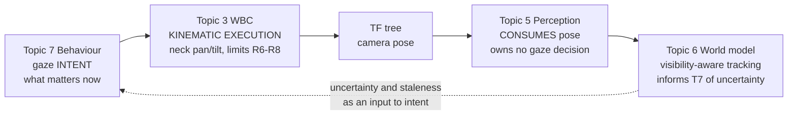

# Topic 6 Research: Localization, World Model, and Gaze

- Status: **Frozen research baseline with architectural intent.** Decisions D1-D8 (§9) are approved and
  binding on later topics. ADR-005 is **deferred by decision**, not by omission: it is not written until
  the cross-topic dependencies close — Topic 4 contact sensing, Topic 3 Model Gate 0, Topic 5 latency
  chain. Later topics may rely on D1-D8; they may not contradict them without revising §9.
- Approved: 2026-09-01
- Evidence last verified: 2026-09-01
- Canonical decisions: [ADR-001](../architecture/ADR-001-real-time-actuation-and-hardware-abstraction.md), [ADR-002](../architecture/ADR-002-safety-and-fault-management.md), [ADR-003](../architecture/ADR-003-zenoh-middleware.md)
- Related research: [Topic 3 locomotion](topic-3-locomotion-survey.md), [Topic 4 sensors and estimation](topic-4-sensors-timing-state-estimation.md), [Topic 5 perception](topic-5-perception-pipeline.md)

## Purpose and evidence policy

Topic 4 delivered drift-bounded local odometry and explicitly assigned absolute heading ownership to
this topic. Topic 5 fixed passive stereo as the depth modality and characterised its error as
range- and surface-dependent. This document establishes what can be localized, what can be tracked,
and what gaze must do, given those inputs.

Evidence tags follow the Topic 4 and Topic 5 convention:

| Tag                 | Meaning                                                                                                   |
| ------------------- | --------------------------------------------------------------------------------------------------------- |
| **[Rules]**         | Quoted verbatim from the RoboCup Humanoid League _Laws of the Game 2025_ (14 April 2025). Binding.        |
| **[Peer reviewed]** | Published in a refereed venue. Cited for the method, not for numeric results unless the number is quoted. |
| **[Primary]**       | Read directly from a licence file, manifest, or source at a named URL.                                    |
| **[Upstream]**      | Stated by the maintainer in their own documentation.                                                      |
| **[Derived]**       | Computed here from tagged inputs. Derivation and assumptions shown.                                       |
| **[Project]**       | A target or constraint set by this project.                                                               |
| **NR**              | **Not reported.** Never means zero.                                                                       |

**Discipline note.** Where a canonical paper is cited for a method, no numeric result is attributed to
it unless that number was verified. Method attribution and result attribution are kept separate
throughout.

## Confirmed project inputs

| Input                    | Value                                                                                                    | Source           |
| ------------------------ | -------------------------------------------------------------------------------------------------------- | ---------------- |
| Size class               | KidSize. 9 x 6 m field, FIFA size 1 ball, 1.2 m goals, **4 v 4**                                         | [Rules], Topic 5 |
| Depth modality           | Passive stereo. **Decided.** Camera SKU is a downstream selection.                                       | Topic 5          |
| Depth error model        | Heteroscedastic. $\sigma_Z = \alpha Z^2$, inflated on low-texture surfaces, per-pixel validity mask.     | Topic 5 §3.4     |
| Base odometry            | Drift-bounded local odometry plus an explicit validity signal, from the Topic 4 split estimator          | Topic 4          |
| Absolute heading         | **Owned by this topic.** Structurally unobservable in Topic 4.                                           | Topic 4          |
| Magnetometer             | **Prohibited by rule.** Not a fallback.                                                                  | [Rules]          |
| Gaze intent              | Owned by **Topic 7** (behaviour)                                                                         | [Project]        |
| Gaze kinematic execution | Owned by **Topic 3** (WBC), bounded by neck limits                                                       | [Project]        |
| Gaze consumption         | **Topic 5** consumes camera pose via TF. This topic evaluates the scheduling policy on Topic 7's behalf. | [Project]        |
| Aiding cadence           | Variable, health-gated 30-60 Hz, may drop, stall, arrive late, or be gate-rejected                       | Topic 4 §4.6     |
| Control loop             | 200 Hz, 5 ms hard deadline, no perception or optimisation inside it                                      | ADR-001, ADR-002 |
| Licensing                | AGPL and GPL excluded                                                                                    | Topic 5 §4.1.1   |

**Status of external league repositories.** As established in Topic 5, other teams' repositories are
consulted only for rule interpretation and for the behaviour of specific software artefacts. Their
architectural choices are not constraints on this design.

---

## 1. The observability problem

### 1.1 What Topic 4 hands over

Topic 4 established that yaw is structurally unobservable from proprioception alone: an IMU without a
magnetometer observes gravity, which fixes roll and pitch, but leaves rotation about the gravity
vector undetermined. Leg kinematics integrate relative motion and therefore accumulate yaw drift
without bound. [Peer reviewed — Bloesch et al. 2012; Hartley et al. 2020]

Absolute pose in the field frame must therefore come from vision. There is no second option, because
the only other absolute heading sensor is prohibited by rule.

### 1.2 The field is exactly symmetric — a verified negative finding

The 2025 rulebook was searched for every category of symmetry-breaking feature. The result:

| Feature searched                 | Occurrences in _Laws of the Game 2025_ |
| -------------------------------- | -------------------------------------- |
| `landmark`                       | **0**                                  |
| `pole`                           | **0**                                  |
| `beacon`                         | **0**                                  |
| `corner post`                    | **0**                                  |
| `coloured goal` / `colored goal` | **0**                                  |
| `symmetr`                        | **0**                                  |

[Rules — verified by exhaustive search of the full extracted rulebook text]

The only occurrence of `flag` is inherited FIFA boilerplate — "A goal consists of two upright posts
equidistant from the **corner flagposts**" — and corner flagposts appear nowhere in the RoboCup
dimension table or field figure. They are not a required field element and must not be relied upon.

Combined with the verified requirement that "The goalposts and crossbars must be **white**"
(both goals, Topic 5 §1.3), the conclusion is exact:

> **The permanent visual features of the KidSize field are invariant under a 180-degree rotation
> about the field centre.**

Formally, for a robot pose $x = (p_x, p_y, \theta)$ the measurement likelihood satisfies

$$p(z \mid x) = p(z \mid \mathcal{R}_\pi x), \qquad \mathcal{R}_\pi x = (-p_x,\, -p_y,\, \theta + \pi)$$

for any observation $z$ of lines, goals, or the centre circle. The posterior is therefore **at best
bimodal**, with two modes of exactly equal weight, and **no amount of field-feature observation can
separate them.** This is not a tuning problem or a sensor-quality problem. It is a property of the
field.

**Consequence.** Any estimator that reports a unimodal pose from field features alone is reporting a
number it cannot justify. The architecture must either carry both modes explicitly or import the
disambiguating information from outside the field-feature measurement model.

### 1.3 Where symmetry-breaking information actually comes from

Each source below is rated by whether the rules guarantee it.

| Source                                                                                                                                       | Rule-guaranteed?                                                                      | Strength                                                                                                            | Failure mode                                                                                                          |
| -------------------------------------------------------------------------------------------------------------------------------------------- | ------------------------------------------------------------------------------------- | ------------------------------------------------------------------------------------------------------------------- | --------------------------------------------------------------------------------------------------------------------- |
| **Known kick-off placement.** Robots are placed in their own half at kick-off, and the defended side is announced.                           | Yes — the side assignment is part of the game plan and GameController state (Topic 8) | Strong, but it is a **prior**, not a measurement. It seeds the correct mode; it does not correct a later mode flip. | Any undetected mode flip is permanent until the next placement event                                                  |
| **Odometry continuity.** Topic 4 odometry propagates the seeded mode.                                                                        | Yes (own sensors)                                                                     | Strong while continuous                                                                                             | Broken by every fall (ADR-002 `POST_FALL`), every manual pickup and replacement, and every estimator invalidity event |
| **Teammate observation.** "The robots of each team must be uniquely identifiable. They must be marked with numbers or names." (new for 2025) | **Yes**                                                                               | A recognised teammate at a known self-reported pose is a genuine absolute measurement                               | Requires the teammate to be localized and visible; requires reading a number at range                                 |
| **Team marker colour.** Red versus blue markers, front and back.                                                                             | Yes                                                                                   | Distinguishes own team from opponent, and gives a coarse facing direction                                           | Colour assignment is per-game: "The color teams play in is randomly assigned and announced in the game plan"          |
| **Goalkeeper identity.** "The goal keeper robot must be marked uniquely."                                                                    | Yes                                                                                   | Own goalkeeper is a near-static beacon at a known end of the field                                                  | Only useful if the goalkeeper itself is correctly localized                                                           |
| **Off-field background** (crowd, walls, banners)                                                                                             | **No**                                                                                | Can be highly discriminative                                                                                        | Venue-dependent, changes between rounds, may move. Not admissible as a primary source                                 |

**The decisive structural finding.** Every rule-guaranteed symmetry-breaking source is either a
**prior** (placement) or **inter-robot** (teammate observation, self-reported teammate state). None is
a self-contained visual measurement. This makes fall recovery the critical case: after a fall the
robot has lost odometry continuity, and its own field-feature observations are provably incapable of
telling it which way it is facing.

### 1.4 Depth is heteroscedastic — inherited from Topic 5

Topic 5 §3.4 requires that depth measurements carry a range-dependent variance and a per-pixel
validity mask, because the vendor documents degraded accuracy on textureless green and white
surfaces, which the rules mandate for the field and goals respectively.

Restated as the measurement model this topic must implement, with $\sigma_Z = \alpha Z^2$:

| Range  | Relative depth error | Absolute $\sigma_Z$ | Variance ratio vs. 2 m |
| ------ | -------------------- | ------------------- | ---------------------- |
| 2 m    | 0.51 %               | 10 mm               | 1                      |
| 4 m    | 1.03 %               | 41 mm               | 17                     |
| 6 m    | 1.54 %               | 93 mm               | 86                     |
| 8 m    | 2.06 %               | 0.16 m              | 270                    |
| 10.8 m | 2.78 %               | 0.30 m              | 900                    |

[Derived from Topic 5 §3.4, anchored on the vendor's stated 9 % at 35 m]

**A single tuned depth covariance would be wrong by a factor of 900 across the field.** Using one is
not a simplification; it is a guarantee of filter inconsistency at range, and inconsistency is exactly
what produces confident wrong answers in a symmetric environment.

### 1.5 The complementary geometry channel

Topic 5 §2.3 catalogued the rule-fixed metric dimensions. Their angular sizes determine how far each
can serve as a range cue. For a 110-degree HFOV at 1280 px width (11.6 px per degree):

| Feature                | Metric size | Angular size at 4 m | Pixels at 4 m | Angular size at 8 m | Pixels at 8 m |
| ---------------------- | ----------- | ------------------- | ------------- | ------------------- | ------------- |
| Line width             | 0.05 m      | 0.72°               | 8.3           | 0.36°               | 4.2           |
| Goalpost width         | 0.08-0.12 m | 1.15-1.72°          | 13-20         | 0.57-0.86°          | 6.6-10        |
| Goal width             | 2.6 m       | 36.1°               | 419           | 18.4°               | 214           |
| Ball diameter          | 0.15 m      | 2.15°               | 25            | 1.07°               | 12            |
| Centre circle diameter | 1.5 m       | 21.2°               | 246           | 10.7°               | 124           |

[Derived]

**Goal width (2.6 m) is by far the strongest single range cue** — two orders of magnitude more pixels
than a line — and it is available precisely at the ranges where stereo depth has degraded. This is the
quantitative statement of the Topic 5 complementarity claim.

---

## 2. Base state and heading estimation

### 2.1 Fusion inputs and their character

| Input                             | Rate                    | Character                                                             | Availability                    |
| --------------------------------- | ----------------------- | --------------------------------------------------------------------- | ------------------------------- |
| IMU (base-mounted, Topic 4)       | High, in-loop           | Continuous, biased, drift-accumulating                                | Always                          |
| Leg kinematics / contact odometry | 200 Hz                  | Continuous, drift-accumulating, depends on unresolved contact sensing | While contacts are valid        |
| Stereo depth of field features    | 30-60 Hz, variable      | Heteroscedastic, gated, may drop                                      | While gaze is on field features |
| Field-line segmentation           | 30-60 Hz                | Dense geometric constraint, **symmetric**                             | While lines are in view         |
| Goal detection                    | 30-60 Hz                | Strong range and bearing, **symmetric**                               | While a goal is in view         |
| ZED VIO (SDK positional tracking) | SDK-internal            | Independent pose estimate, head-frame                                 | Health-gated only (Topic 4)     |
| Teammate self-reports             | Low (bandwidth-limited) | Absolute, symmetry-breaking, correlated                               | While network is up             |
| GameController state              | Low                     | Side assignment, game phase                                           | Topic 8                         |

### 2.2 Filter class candidates

| Class                         | Structure                                            | Handles field symmetry?                                                                 | In-loop admissible?                                                                                               | Notes                                                                                                                     |
| ----------------------------- | ---------------------------------------------------- | --------------------------------------------------------------------------------------- | ----------------------------------------------------------------------------------------------------------------- | ------------------------------------------------------------------------------------------------------------------------- |
| **ESKF**                      | Unimodal Gaussian on the error state                 | **No.** Cannot represent two modes. Will collapse onto one and report false confidence. | Yes — fixed cost                                                                                                  | Topic 4 candidate for the local core                                                                                      |
| **InEKF**                     | Unimodal, group-affine error dynamics                | **No**, same limitation                                                                 | Yes — fixed cost, and Topic 4 §4.6 found its delayed-update covariance propagation cheaper and better conditioned | [Peer reviewed — Barrau and Bonnabel 2017; Hartley et al. 2020]                                                           |
| **Particle filter (MCL)**     | Sample-based, arbitrary multimodal                   | **Yes.** Native representation of the bimodal posterior.                                | **No** — variable cost, resampling, unbounded worst case                                                          | [Peer reviewed — Dellaert, Fox, Burgard, Thrun, ICRA 1999; Thrun, Burgard, Fox, *Probabilistic Robotics*, MIT Press 2005] |
| **Multi-hypothesis Gaussian** | Fixed small bank of Gaussians, one per symmetry mode | **Yes**, and exactly two modes are needed                                               | Yes — cost is 2x a single filter, still fixed                                                                     | Bounded alternative to a particle filter for this specific symmetry                                                       |
| **Factor graph / iSAM2**      | Incremental smoothing over a window                  | Partially — supports multi-hypothesis via max-mixtures, but not natively                | **No** — variable relinearisation cost                                                                            | [Peer reviewed — Kaess et al., iSAM2, IJRR 2012; Forster et al., on-manifold IMU preintegration, T-RO 2017]               |

**The structural observation.** The symmetry established in §1.2 is **exactly two-fold and known in
advance.** This is materially different from the general global-localization problem that motivates
particle filters. A particle filter spends thousands of samples discovering a structure that the
rulebook already tells us: there are two modes, related by a known rigid transform, with exactly equal
likelihood. A fixed bank of two filters, one per mode, represents the same posterior with bounded and
predictable cost.

This does not by itself select the method — a particle filter also handles the kidnapped-robot case
after a fall, which a two-mode bank handles only if it re-initialises correctly — but it does mean the
usual argument for particle filters ("the posterior is multimodal") is weaker here than it first
appears, because the multimodality is structured and enumerable.

### 2.3 The two-estimator hazard

Topic 5 §4.3 and Topic 4 both flagged that the ZED SDK positional tracking module produces a pose
independently of the project estimator. Three concrete problems:

1. **Frame mismatch.** The SDK pose is of the camera, which sits above the neck joint (rule R3). It is
   separated from the base by the neck chain, its encoder error, backlash, and compliance. It is not a
   base pose and converting it requires the very kinematic chain whose calibration is unresolved.
2. **ADR-002 ambiguity.** The fall trigger depends on "estimator invalidity while dynamic motion is
   active". With two estimators that predicate is undefined unless one is explicitly subordinate.
3. **Correlated double-counting.** Feeding SDK VIO into a filter that also consumes the same camera's
   depth measurements double-counts the same photons and produces optimistic covariance.

Topic 4 already ruled that ZED VIO is admissible only as a health-gated input. This topic must state
what "health-gated" means operationally, and must not treat the SDK pose as authoritative.

### 2.4 Split architecture, restated

Topic 4 fixed the split: a bounded fixed-cost core inside the 5 ms cycle, plus a non-real-time
refinement stage. Topic 6 adds absolute correction on top and must respect the same boundary. The
asynchronous aiding contract of Topic 4 §4.6 — buffer inputs, re-propagate, do not store covariance
history, window $W = 0.5$ s at 100 cycles and approximately 48 kB — is the mechanism by which delayed
visual corrections enter. Nothing in this topic may place an optimiser, a resampling step, or a
variable-cost association search inside the control cycle.

---

## 3. World model and tracking

### 3.1 Cardinality and identity, from the rules

| Quantity                  | Value                                                                                               | Source    |
| ------------------------- | --------------------------------------------------------------------------------------------------- | --------- |
| Players per side, KidSize | **4** ("Regular tournament for KidSize (4 vs. 4)")                                                  | [Rules]   |
| Maximum robots on field   | **8**                                                                                               | [Derived] |
| Ball count                | 1                                                                                                   | [Rules]   |
| Team identification       | Red or blue markers, front and back, area at least $0.03 H_{top}^2$                                 | [Rules]   |
| Team colour assignment    | "The color teams play in is randomly assigned and announced in the game plan"                       | [Rules]   |
| Individual identification | "The robots of each team must be uniquely identifiable. They must be marked with numbers or names." | [Rules]   |
| Goalkeeper                | "must be marked uniquely that it can be easily distinguished from the other robots of a team"       | [Rules]   |

**This is a small, bounded tracking problem.** Eight targets maximum, one ball, in a 9 x 6 m arena.
The combinatorial arguments that motivate sophisticated multi-target trackers in radar and autonomous
driving apply weakly at this cardinality. The hard part here is not association combinatorics; it is
**intermittent observability** caused by a single steerable camera (§4).

The 2025 unique-identifiability rule is architecturally significant and appears to be underexploited:
it means teammate identity is in principle a _visual_ observable, not only a network-reported one.
Whether a number or name is legible at competition ranges is **NR** and is a measurement question —
Topic 5 §2.2 shows a 0.15 m ball is 25 px at 4 m, so a painted digit at the same range is a small
number of pixels tall. Gate 5 below tests this.

### 3.2 Ball state and dynamics

The ball state needed by behaviour is at minimum $(p, \dot p)$ in the field frame, and the useful
horizon is a short-term prediction for interception.

Rule-fixed properties: spherical, FIFA size 1, "resembles the weight, form, movement characteristics
and appearance of leather or other suitable material" [Rules]. **The rulebook specifies neither mass
nor colour nor coefficient of restitution.**

| Dynamic parameter                                       | Status                                                                               |
| ------------------------------------------------------- | ------------------------------------------------------------------------------------ |
| Ball mass                                               | **NR** — not in the rulebook; FIFA size 1 mass is not standardised the way size 5 is |
| Rolling resistance coefficient on 30 mm artificial turf | **NR** from any primary source inspected                                             |
| Coefficient of restitution on turf                      | **NR**                                                                               |
| Turf drag anisotropy (pile direction)                   | **NR**                                                                               |
| Deceleration model                                      | **NR** — must be measured                                                            |

The standard model for a ball rolling on a compliant surface is a near-constant deceleration
$\ddot s = -\mu_r g$ with $\mu_r$ the coefficient of rolling resistance. On 30 mm artificial turf
$\mu_r$ is substantially larger than on a hard floor, and the ball may transition between sliding and
rolling after a kick. **None of these parameters is available from a primary source and all must be
measured on the competition surface.** Gate 3 covers this.

Two consequences:

1. A constant-velocity tracker will systematically overshoot, because turf deceleration is not small.
2. The deceleration parameter is a _measurement_, not a literature value, and it interacts with pile
   direction and turf wear.

### 3.3 Ball velocity is not observable by finite differencing — derived

Suppose ball position is obtained from stereo depth at range $Z$ and velocity is estimated by
differencing two consecutive frames separated by $\Delta t$. The depth-direction velocity error is

$$\sigma_{\dot Z} = \frac{\sqrt{2}\,\sigma_Z}{\Delta t}$$

Using the §1.4 depth errors at $\Delta t = 1/30$ s:

| Ball range | $\sigma_Z$ | $\sigma_{\dot Z}$ from two-frame differencing |
| ---------- | ---------- | --------------------------------------------- |
| 2 m        | 10 mm      | **0.44 m/s**                                  |
| 4 m        | 41 mm      | **1.8 m/s**                                   |
| 6 m        | 93 mm      | **3.9 m/s**                                   |
| 8 m        | 0.16 m     | **6.8 m/s**                                   |
| 10.8 m     | 0.30 m     | **12.7 m/s**                                  |

[Derived]

A KidSize ball after a kick travels on the order of a few m/s. **Beyond about 2 m, the two-frame
velocity estimate has an uncertainty larger than the signal.** At 6 m the estimate is pure noise.

**Consequence.** Ball velocity must come from a dynamics-constrained filter that integrates many
observations under a motion model, not from differencing. This is the strongest quantitative argument
in this document for an explicit ball filter with a measured deceleration model rather than a
smoothing heuristic. It also means the bearing channel matters disproportionately: angular position is
far better conditioned than depth, so a bearing-plus-known-size range estimate (§1.5) may beat stereo
depth for the ball at range. Gate 4 tests that comparison directly.

### 3.4 Data association

At 8 targets the association problem is small. The realistic difficulties are:

| Difficulty               | Character                                                                                                                                                                                                            |
| ------------------------ | -------------------------------------------------------------------------------------------------------------------------------------------------------------------------------------------------------------------- |
| **Dynamic occlusion**    | Robots occlude each other and the ball. In a 4 v 4 crowd around the ball this is the normal case, not the exception.                                                                                                 |
| **Gaze-induced dropout** | A target outside the current FOV is not occluded, it is simply unobserved. Track lifetime must be governed by an explicit "could I have seen it?" test using the camera pose from TF, not by a timeout.              |
| **Appearance ambiguity** | Opponents are "mostly black or of dark grey colour (RAL 7011 Iron Grey or darker) and non reflective" [Rules] — low contrast against shadowed turf, and mutually near-identical apart from team markers and numbers. |
| **Own-body occlusion**   | A head-mounted camera looking down at a near ball may see the robot's own arms or torso.                                                                                                                             |

The gaze-induced dropout row is the architecturally important one and is specific to a single
steerable camera. A conventional tracker that decays confidence with elapsed time will forget a
correctly tracked ball simply because the robot looked at a goal. The correct predicate is
**visibility-aware**: decay only when the target was within the field of view and was not detected.
This requires the perception layer to publish the camera frustum alongside detections, which is a
concrete interface requirement on Topic 5.

### 3.5 Teammate state sharing fits easily in the bandwidth budget — derived

Rule limit: 1 Mbit/s total per robot [Rules].

A compact shared world-model message: own pose (3), pose covariance upper triangle (6), ball position
(3), ball covariance (6), ball velocity (3), validity and identity fields (approximately 4), each
4 bytes, gives roughly 100 bytes of payload. With UDP and IP overhead call it 150 bytes.

At 10 Hz: $150 \times 10 = 1.5$ kB/s $= 12$ kbit/s, which is **1.2 % of the per-robot budget.**
Even at 30 Hz it is 3.6 %. [Derived]

**Teammate state sharing is essentially free.** Given §1.3 — that teammate observation is one of the
few rule-guaranteed symmetry-breaking sources — this is a strong result: the information most needed
to resolve the field ambiguity is also the cheapest to obtain. The binding constraint is not bandwidth
but the rule that "the robots must not rely on the quality of the wireless network. They must be able
to play if the network is of low quality" [Rules], so shared state must be an _enhancement_, never a
dependency.

---

## 4. Gaze scheduling

### 4.1 Ownership

Fixed by project decision (see Confirmed project inputs):

Topic 6 does not own gaze. It owns the **uncertainty signals** that make an informed gaze decision
possible, and it evaluates candidate scheduling policies on Topic 7's behalf.

### 4.2 The scheduling problem is real and quantified

One camera. Sub-180-degree instantaneous FOV (rule R6). Pan limited to ±90 degrees, tilt ±90 degrees
(rule R7). Three simultaneous consumers:

| Consumer                       | Wants gaze on               | Cost of not looking                                                                                   |
| ------------------------------ | --------------------------- | ----------------------------------------------------------------------------------------------------- |
| Ball tracking                  | The ball, continuously      | Velocity estimate degrades immediately (§3.3); ball may be kicked away unobserved                     |
| Self-localization              | Lines, goals, centre circle | Pose covariance grows at the odometry drift rate; symmetry mode cannot be re-checked                  |
| Obstacle and opponent tracking | Other robots                | Collision risk; ADR-002 has no perception-based obstacle authority, so this is a behaviour-level risk |

With a 110-degree HFOV and ±90-degree pan, the total coverable azimuth is
$180 + 110 = 290$ degrees, but only 110 degrees at a time. [Derived] Covering the reachable azimuth
therefore requires at least $\lceil 290/110 \rceil = 3$ fixations, and the time cost is
$3 \times (t_{slew} + t_{settle} + t_{expose})$, of which **every term is NR** because neck slew rate
is undesigned (Topic 3 Model Gate 0) and the latency chain is unmeasured (Topic 5 §6.2).

### 4.3 Policy candidates

| Policy                                                                      | Mechanism                                                                                                                         | Strength                                                                                 | Weakness                                                                                                                                                           |
| --------------------------------------------------------------------------- | --------------------------------------------------------------------------------------------------------------------------------- | ---------------------------------------------------------------------------------------- | ------------------------------------------------------------------------------------------------------------------------------------------------------------------ |
| **Fixed scan pattern**                                                      | Predetermined sweep                                                                                                               | Trivially predictable, testable, no estimator coupling                                   | Ignores what is actually uncertain; wastes fixations                                                                                                               |
| **Behaviour-driven / rule-based**                                           | Explicit priority from game state: chasing ball then look at ball; lost then scan for goals                                       | Simple, debuggable, directly expresses game intent, no closed loop through the estimator | Priorities are hand-tuned and interact badly at boundaries; no principled arbitration between two urgent needs                                                     |
| **Information-theoretic**                                                   | Choose the fixation maximising expected information gain, e.g. expected reduction in entropy of the joint pose-and-ball posterior | Principled arbitration; naturally handles "my pose is fine but the ball is stale"        | Requires a trustworthy covariance, which §1.4 shows is hard; the expected-information computation is a variable-cost optimisation; can be myopic without a horizon |
| **Hybrid: behaviour sets the constraint set, information gain breaks ties** | Topic 7 declares which targets are admissible now; the scheduler picks among them by expected information gain                    | Keeps game intent authoritative while removing hand-tuned tie-breaking                   | Two-layer tuning; still needs a calibrated covariance                                                                                                              |

[Peer reviewed for the information-theoretic family — the expected-information-gain formulation for
active sensing is standard in the active perception and belief-space planning literature; specific
numeric results are not attributed here.]

**Structural observation.** An information-theoretic scheduler is only as good as the covariance it
maximises against, and §1.4 establishes that a naive depth covariance is wrong by a factor of 900
across the field. **Calibrated uncertainty is a prerequisite for information-theoretic gaze, not an
optional refinement.** A behaviour-driven policy has no such prerequisite. That ordering — get the
noise model right before attempting information-theoretic gaze — is a scheduling constraint on the
project, not just on the robot.

A second structural point: gaze is a **control output with a kinematic cost**, and Topic 3 owns the
neck. Any scheduler that ignores slew time will thrash. The cost model must include the transition,
which makes this a sequential decision problem rather than a per-frame argmax.

---

## 5. Algorithmic candidates and ROS 2 Jazzy availability

### 5.1 Verified availability

Read from `ros/rosdistro` `jazzy/distribution.yaml` [Primary]:

| Package / repo                  | Jazzy version        | Relevance                                                            | Licence                                                       |
| ------------------------------- | -------------------- | -------------------------------------------------------------------- | ------------------------------------------------------------- |
| **`gtsam`**                     | **4.2.0-4**          | Factor graphs, iSAM2, IMU preintegration                             | **BSD** (simplified) [Primary]                                |
| **`fuse`**                      | **1.1.6-1**          | ROS-native factor-graph sensor fusion framework                      | **BSD** (Locus Robotics) [Primary]                            |
| **`robot_localization`**        | **3.8.3-1**          | EKF/UKF pose fusion                                                  | **BSD** (Charles River Analytics) [Primary]                   |
| **`navigation2`** (`nav2_amcl`) | jazzy                | Particle-filter localization (AMCL)                                  | —                                                             |
| `mola_imu_preintegration`       | 1.17.1-1             | IMU preintegration factors                                           | —                                                             |
| `imu_tools`                     | 2.1.5-1              | Complementary and Madgwick filters                                   | —                                                             |
| `imu_pipeline`                  | 0.5.2-1              | IMU transform utilities                                              | —                                                             |
| `geometry2` (tf2)               | 0.36.22-1            | Transform tree — the gaze/camera-pose interface                      | —                                                             |
| `message_filters`               | 4.11.17-1            | Time synchronisation policies                                        | —                                                             |
| `libg2o`                        | 2020.5.29-6          | Graph optimisation backend                                           | —                                                             |
| `sophus`                        | 1.22.9102-2          | Lie group types                                                      | —                                                             |
| `cartographer` / `slam_toolbox` | 2.0.9004-1 / 2.8.5-1 | 2D lidar SLAM                                                        | **Not applicable** — lidar is prohibited by rule R1           |
| `apriltag_ros`                  | 3.4.0-1              | Fiducial detection                                                   | **Not applicable** — no artificial markers on a RoboCup field |
| `soccer_interfaces`             | 1.0.0-2              | `soccer_vision_3d_msgs`, `soccer_geometry_msgs`, `soccer_model_msgs` | Topic 5 §5.2                                                  |

**All three primary estimator candidates are BSD-licensed and released into Jazzy**, so Section 4.1.1
of Topic 5 imposes no constraint here. That is a clean result.

### 5.2 Fitness assessment

| Candidate                             | Fits the in-loop core?                                                 | Fits the non-RT refinement? | Handles the two-fold symmetry? | Concern                                                                                                                                                                                 |
| ------------------------------------- | ---------------------------------------------------------------------- | --------------------------- | ------------------------------ | --------------------------------------------------------------------------------------------------------------------------------------------------------------------------------------- |
| InEKF (custom)                        | **Yes** — fixed cost, and Topic 4 §4.6 favoured it for delayed updates | Yes                         | No, alone                      | Must be written; no released Jazzy package implements a contact-aided InEKF                                                                                                             |
| ESKF (custom or `robot_localization`) | Yes                                                                    | Yes                         | No, alone                      | `robot_localization` is a general 15-state EKF, not contact-aided legged odometry                                                                                                       |
| `nav2_amcl`                           | **No** — variable cost                                                 | Yes                         | **Yes**                        | Designed for 2D lidar scan matching against an occupancy grid. Its measurement model is not a stereo/vision field-feature model. Reuse would be substantial surgery, not configuration. |
| GTSAM / iSAM2                         | **No** — variable relinearisation                                      | **Yes**, strong fit         | Via max-mixtures, not natively | Heaviest dependency; the incremental smoothing benefit is largest when loop closures exist, which a 9 x 6 m field provides constantly                                                   |
| `fuse`                                | No                                                                     | Yes                         | Not natively                   | ROS-native graph fusion; less mature ecosystem than GTSAM                                                                                                                               |
| Two-mode Gaussian bank (custom)       | **Yes** — 2x fixed cost                                                | Yes                         | **Yes, exactly**               | Must be written; needs an explicit mode-management policy                                                                                                                               |

**The honest summary.** No released package solves this problem. `nav2_amcl` has the right posterior
representation and the wrong measurement model. `robot_localization` has the right ROS integration and
the wrong state model for legged contact odometry. GTSAM and `fuse` are libraries, not solutions. Some
custom estimation code is unavoidable; the question this topic informs is how much, and where the
boundary sits.

---

## 6. Compute and timing budget

| Stage                                        | Placement                                      | Cost                                                      |
| -------------------------------------------- | ---------------------------------------------- | --------------------------------------------------------- |
| IMU propagation                              | In-loop, 200 Hz                                | Fixed, small                                              |
| Contact/leg odometry update                  | In-loop, 200 Hz                                | Fixed; depends on unresolved contact sensing (Topic 4)    |
| Delayed visual correction, re-propagation    | In-loop, amortised over the $W = 0.5$ s window | Bounded by Topic 4 §4.6 (100 cycles, approximately 48 kB) |
| Field-feature association                    | Non-RT                                         | **NR**                                                    |
| Mode management / symmetry resolution        | Non-RT                                         | **NR**                                                    |
| Ball filter                                  | Non-RT                                         | Small — one target                                        |
| Multi-robot tracking                         | Non-RT                                         | Small — at most 8 targets                                 |
| Gaze scheduling                              | Non-RT, Topic 7                                | **NR**, depends on policy class                           |
| Smoothing / factor-graph refinement, if used | Non-RT                                         | **NR**, variable                                          |

Everything outside the in-loop rows is **NR**, and the perception latency chain feeding all of it is
also NR (Topic 5 §6.2). The Topic 4 §4.6 window remains the mechanism that absorbs this, and remains
sized against an assumption.

---

## 7. Falsifiable gates

| #   | Gate                                                                                                                                                   | Pass condition                                                                                                                                                                                                  |
| --- | ------------------------------------------------------------------------------------------------------------------------------------------------------ | --------------------------------------------------------------------------------------------------------------------------------------------------------------------------------------------------------------- |
| 1   | **Symmetry honesty.** Place the robot at a known pose, deprive it of placement prior and teammate data, and let it localize from field features alone. | The estimator reports a **bimodal** posterior with near-equal mode weights, or explicitly reports "ambiguous". A confident unimodal answer is a **failure**, even when the reported mode happens to be correct. |
| 2   | **Post-fall recovery.** Trigger ADR-002 `POST_FALL`, then re-enable localization.                                                                      | Time to re-establish a correct, correctly-disambiguated pose is measured, with the disambiguating source logged. Silent mode flips are counted; the target is zero.                                             |
| 3   | **Ball deceleration on turf.** Roll the match ball on the competition surface at several speeds and pile orientations; fit the deceleration model.     | $\mu_r$, its variance, and any pile-direction anisotropy reported with sample counts. Replaces an NR with a number.                                                                                             |
| 4   | **Ball range: stereo depth versus known-size bearing.** Estimate ball range by both methods at 1, 2, 4, 6, 8, and 10.8 m against ground truth.         | Per-range error reported for both. Determines the crossover range and parameterises the §1.4 heteroscedastic model.                                                                                             |
| 5   | **Teammate identity legibility.** Measure the range at which robot numbers or names are correctly read.                                                | The maximum reliable identification range is stated. Determines whether the 2025 unique-identifiability rule is exploitable as a symmetry-breaking measurement.                                                 |
| 6   | **Visibility-aware track lifetime.** Verify that a tracked ball outside the FOV is retained, while a ball inside the FOV and undetected decays.        | Track confidence responds to the frustum test, not to a timeout. Requires Topic 5 to publish the frustum.                                                                                                       |
| 7   | **Filter consistency.** Run NEES/NIS consistency tests across the full range envelope with the heteroscedastic depth model.                            | Consistency within bounds at all ranges. A filter that is consistent at 2 m and overconfident at 8 m fails.                                                                                                     |
| 8   | **Network-loss degradation.** Remove teammate communication mid-game.                                                                                  | Localization degrades gracefully and the robot continues to play, per the rule that it "must be able to play if the network is of low quality". No crash, no permanent mode flip.                               |
| 9   | **Gaze starvation.** Force a sustained gaze commitment to one consumer.                                                                                | The starved consumers' uncertainty growth is measured and bounded. Establishes the maximum admissible fixation dwell time.                                                                                      |
| 10  | **In-loop cost.** Measure the estimator core's contribution to the 5 ms cycle under worst-case delayed-update re-propagation.                          | ADR-001 cycle budget and the ADR-002 40 % margin hold.                                                                                                                                                          |

---

## 8. Open gaps

1. **Contact sensing is still unresolved** (Topic 4 deferral). Leg odometry quality — the thing that
   determines how long the robot can coast between visual corrections — cannot be characterised until
   it is.
2. **Model Gate 0 remains open** (Topic 3). No kinematic tree, masses, or sole geometry means no leg
   odometry chain, no neck slew model, and therefore no gaze cost model.
3. **Ball dynamic parameters are entirely NR** (§3.2) and must be measured on the competition surface.
4. ~~The symmetry resolution policy is undecided.~~ **Resolved 2026-09-01 (D3).** The estimator
   carries **exactly two modes with weights, permanently, and never collapses to a single pose.**
   Topic 7 is required to hold a policy for an ambiguous heading. Rationale: the rules provide no
   visual means of recovering a wrongly-collapsed heading, so a collapsed estimate can be confidently
   wrong for the remainder of a half. What remains open is the **mode-management policy** — the
   weight update rule, and the conditions under which a mode is re-opened after a fall or pickup.
5. **ZED VIO subordination is unspecified.** "Health-gated" needs an operational definition. **The
   ADR-002 "estimator invalidity" predicate is resolved (D2): it refers to Tier 0 only.** What remains
   is the gating criterion itself.
6. **Teammate identity legibility is NR** (gate 5). If numbers cannot be read at useful range, one of
   the few rule-guaranteed symmetry-breaking sources is unavailable in practice.
7. ~~Estimator implementation boundary is undecided.~~ **Resolved 2026-09-01 (D8).** Custom
   contact-aided InEKF core plus custom two-mode field localizer. GTSAM is deferred until a smoother
   is demonstrated necessary. Rationale: Topic 4 selected an InEKF direction that no released package
   implements; the two-mode bank is a small increment over a single Gaussian filter; and option B
   would import a variable-cost optimiser into the tier feeding the control loop.
8. **Gaze cost model is NR** in every term (§4.2).
9. **The perception latency chain remains unmeasured** (Topic 5 §6.2), and the Topic 4 aiding window
   remains sized against an assumption.

**No ADR is written for Topic 6 yet.** Eight architecture decisions (D1-D8) were confirmed on
2026-09-01 and are recorded below, but six gaps above remain open and three of them (contact sensing,
Model Gate 0, latency chain) are owned by other topics. Freeze into an ADR when gates 1, 2, 3, 4, and
7 have produced numbers.

---

## 9. Confirmed architecture decisions (2026-09-01)

These are accepted directions, recorded here pending an ADR. They must not be contradicted by later
research without an explicit revision of this section.

| ID     | Decision                                                                                                                                                                                                                                     | Grounds                                                                                                                                                                                           |
| ------ | -------------------------------------------------------------------------------------------------------------------------------------------------------------------------------------------------------------------------------------------- | ------------------------------------------------------------------------------------------------------------------------------------------------------------------------------------------------- |
| **D1** | **Frame split per REP-105.** Tier 0 (in-loop InEKF core) owns `odom -> base_link` and is continuous by construction. Tier 1 (field localizer) owns `map -> odom` and is permitted to jump. The WBC and SafetyKernel consume **only** `odom`. | A symmetry mode flip or a delayed visual correction can never inject a pose discontinuity into the 5 ms cycle. Satisfies ADR-001 and ADR-002 without special-casing.                              |
| **D2** | **Single validity authority.** ADR-002's "estimator invalidity while dynamic motion is active" refers to **Tier 0 only**. ZED SDK VIO is a Tier-1 aiding input, health-gated, never authoritative; its failure is not a fall trigger.        | §2.3. Resolves the two-estimator ambiguity carried from Topic 5 §4.3.                                                                                                                             |
| **D3** | **Symmetry is a first-class type.** The pose product is a **two-mode set with weights**, published permanently. No collapse to a single pose. Topic 7 must hold a policy for an ambiguous heading.                                           | §1.2. The posterior is provably bimodal; the rules give no visual means to recover a wrongly-collapsed heading.                                                                                   |
| **D4** | **Visibility-aware tracking.** Perception publishes the camera frustum alongside every detection. Track confidence decays **only** when a target was inside the frustum and undetected. Never on elapsed time alone.                         | §3.4. A single steerable camera makes "unobserved" the normal state, not a fault. Binding interface requirement on Topic 5.                                                                       |
| **D5** | **Dynamics-constrained ball filter** with a deceleration model measured on the competition surface. No finite differencing of ball position anywhere in the stack.                                                                           | §3.3 — two-frame velocity error exceeds the signal beyond about 2 m.                                                                                                                              |
| **D6** | **Gaze scheduling is phased.** Behaviour-driven policy first. Information-theoretic scheduling is gated behind consistency gate 7.                                                                                                           | §4.3. An information-theoretic scheduler maximises against a covariance that §1.4 shows is wrong by a factor of 900 across the field. Calibrated uncertainty is a prerequisite, not a refinement. |
| **D7** | **Teammate state sharing is an enhancement, never a dependency.** Full localization capability standalone.                                                                                                                                   | §3.5 and the rule that robots "must not rely on the quality of the wireless network". Cost is 1.2 % of the bandwidth budget, so the constraint is not cost.                                       |
| **D8** | **Custom contact-aided InEKF core plus custom two-mode field localizer.** GTSAM deferred until a smoother is demonstrated necessary. `nav2_amcl` rejected.                                                                                   | §5.2. No released package fits. `nav2_amcl` pays for general multimodality when the multimodality here is exactly two-fold and known in advance.                                                  |

---

## References

### Rules

- **[R-1]** RoboCup Soccer Humanoid League, _Laws of the Game 2025_, 14 April 2025. Law 1 (Field of Play), Law 2 (The Ball), Law 4 (The Players' Equipment), Section II (Competition Rules, KidSize 4 v 4).

### Estimation and localization

- **[E-1]** Dellaert, F., Fox, D., Burgard, W., Thrun, S. _Monte Carlo Localization for Mobile Robots_. ICRA 1999.
- **[E-2]** Thrun, S., Burgard, W., Fox, D. _Probabilistic Robotics_. MIT Press, 2005.
- **[E-3]** Kaess, M., Johannsson, H., Roberts, R., Ila, V., Leonard, J., Dellaert, F. _iSAM2: Incremental Smoothing and Mapping Using the Bayes Tree_. IJRR, 2012.
- **[E-4]** Forster, C., Carlone, L., Dellaert, F., Scaramuzza, D. _On-Manifold Preintegration for Real-Time Visual-Inertial Odometry_. IEEE T-RO, 2017.
- **[E-5]** Barrau, A., Bonnabel, S. _The Invariant Extended Kalman Filter as a Stable Observer_. IEEE TAC, 2017.
- **[E-6]** Hartley, R., Ghaffari, M., Eustice, R., Grizzle, J. _Contact-Aided Invariant Extended Kalman Filtering for Robot State Estimation_. IJRR, 2020.
- **[E-7]** Bloesch, M., Hutter, M., Hoepflinger, M., Leutenegger, S., Gehring, C., Remy, C.D., Siegwart, R. _State Estimation for Legged Robots — Consistent Fusion of Leg Kinematics and IMU_. RSS 2012.

### Software availability (Primary)

- **[S-1]** `ros/rosdistro`, `jazzy/distribution.yaml` — `https://raw.githubusercontent.com/ros/rosdistro/master/jazzy/distribution.yaml`. All Jazzy versions in §5.1 read from this file.
- **[S-2]** GTSAM licence — `https://raw.githubusercontent.com/borglab/gtsam/develop/LICENSE` — "GTSAM is released under the simplified BSD license".
- **[S-3]** `fuse` licence — `https://raw.githubusercontent.com/locusrobotics/fuse/rolling/LICENSE` — BSD, Locus Robotics.
- **[S-4]** `robot_localization` licence — `https://raw.githubusercontent.com/cra-ros-pkg/robot_localization/jazzy-devel/LICENSE` — BSD, Charles River Analytics.

### Project documents

- **[P-1]** [architecture/ADR-001-real-time-actuation-and-hardware-abstraction.md](../architecture/ADR-001-real-time-actuation-and-hardware-abstraction.md)
- **[P-2]** [architecture/ADR-002-safety-and-fault-management.md](../architecture/ADR-002-safety-and-fault-management.md)
- **[P-3]** [architecture/ADR-003-zenoh-middleware.md](../architecture/ADR-003-zenoh-middleware.md)
- **[P-4]** [research/topic-4-sensors-timing-state-estimation.md](topic-4-sensors-timing-state-estimation.md) — §4.6 asynchronous aiding contract.
- **[P-5]** [research/topic-5-perception-pipeline.md](topic-5-perception-pipeline.md) — §3.4 heteroscedastic depth, §2.3 known-scale references, §5.2 `soccer_interfaces`.
