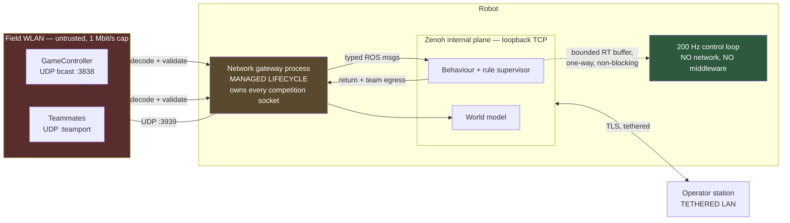

# Topic 8 Research: GameController Integration and Team Networking

- Status: Complete research baseline; update before any Topic 8 architecture revision
- Evidence last verified: 2026-09-01
- Scope: Networking plumbing only. Protocol semantics, rule-state handling, and coordination strategy are in [Topic 7](topic-7-behavior-and-strategy.md).
- Canonical decisions: [ADR-001](../architecture/ADR-001-real-time-actuation-and-hardware-abstraction.md), [ADR-002](../architecture/ADR-002-safety-and-fault-management.md), [ADR-003](../architecture/ADR-003-zenoh-middleware.md), [ADR-005](../architecture/ADR-005-behavior-game-state-and-team-networking.md)

## Purpose and scope boundary

Topic 7 established **what** the GameController transmits, **what** the rules permit, and **how** the
behaviour layer should consume it. This document covers only what was left over: sockets, node
lifecycle, process placement, trust boundaries, and the isolation requirements that keep competition
network traffic away from the real-time actuator path.

Evidence tags follow the Topic 4-7 convention. `NR` means **not reported**; it never means zero.

**Facts carried forward from Topic 7, not repeated here:** the struct layouts, the state and penalty
enumerations, the 500 ms / 200 ms transmission cadence, the return-struct unimodality conflict, the
`messageBudget` question, the anti-coaching law, and the 1 Mbit/s bandwidth ceiling.

## Confirmed project inputs

| Input                 | Value                                                                                 | Source             |
| --------------------- | ------------------------------------------------------------------------------------- | ------------------ |
| GameController data   | UDP broadcast, port **3838**, header `"RGme"`, version **20**, 160 B                  | Topic 7 §4.1, §5.3 |
| GameController return | UDP, port **3939**, header `"RGrt"`, version **4**, 32 B                              | Topic 7 §4.1       |
| Team messages         | UDP, `robocup_extension.proto` + mode-set extension, approx. 550 B on the wire, 10 Hz | Topic 7 D13, §5.3  |
| Bandwidth ceiling     | 1 Mbit/s per robot, total                                                             | [Rules]            |
| Network reliability   | Must play with a degraded or absent network                                           | [Rules]            |
| Middleware            | `rmw_zenoh_cpp`, explicit TCP/TLS topology, no multicast                              | ADR-003            |
| Control loop          | 200 Hz, 5 ms, no middleware and no network I/O inside it                              | ADR-001, ADR-002   |

---

## 1. Three network planes, deliberately separate

The robot carries three distinct kinds of network traffic. They have different trust levels, different
transports, and different failure consequences. Collapsing them is the main architectural hazard in
this topic.

| Plane                                                                    | Transport                                                              | Trust                | Consequence of total loss                                             |
| ------------------------------------------------------------------------ | ---------------------------------------------------------------------- | -------------------- | --------------------------------------------------------------------- |
| **Competition plane** — GameController in, return out, team messages     | Raw UDP, broadcast, unauthenticated, league-defined wire format        | **Untrusted**        | Rule-safe stationary default (Topic 7 D15); play continues solo (D12) |
| **Internal plane** — every ROS 2 topic, service, action, TF, diagnostics | `rmw_zenoh_cpp` over loopback TCP via the supervised local router      | Trusted, single host | Local watchdogs choose a safe state (ADR-003)                         |
| **Operator plane** — telemetry egress, development, recording            | Zenoh over mutually authenticated TLS; **tethered LAN at competition** | Authenticated        | Remote intent expires; no effect on play                              |

**The load-bearing claim.** Competition UDP is never carried by Zenoh, and Zenoh is never used to
reach the field network. The gateway is the only process holding a competition socket, and it converts
untrusted bytes into typed, validated ROS messages before anything else sees them. This gives one
auditable place to enforce the trust boundary — which matters because the rules allow the Technical
Committee to demand that _"the code must be made available... for inspection"_ (Topic 7 §1.1).

### 1.1 Why not carry GameController data over Zenoh from an external bridge

Rejected. ADR-003 already forbids multicast and requires an explicit TCP/TLS topology; the
GameController is UDP broadcast on a league-fixed port and cannot be made to fit. More importantly, the
rules state _"Any kind of transmission from an external computer to the playing robots is
prohibited"_ [Rules, Topic 7 §1.2]. A bridge host that re-broadcast game state to robots would be
exactly that. The receiver must be **on the robot**.

---

## 2. Socket-level requirements

### 2.1 GameController ingress, port 3838

| Requirement    | Value                                                            | Reason                                                                                                                                          |
| -------------- | ---------------------------------------------------------------- | ----------------------------------------------------------------------------------------------------------------------------------------------- |
| Protocol       | UDP, **receive broadcast**                                       | `socket.set_broadcast(true)` in the controller's sender [Primary, Topic 7 §4.2]                                                                 |
| Bind address   | Wildcard (`0.0.0.0` / `INADDR_ANY`)                              | The controller's address is not known in advance and the packet is a broadcast; binding a specific unicast address will not receive it          |
| `SO_REUSEADDR` | **Set**                                                          | Permits a monitor or a replay tool to bind the same port during development, and permits fast restart without `TIME_WAIT`-style rebind failures |
| Receive buffer | Small and bounded, e.g. a few packets                            | At 2 Hz and 160 B, a large buffer only stores stale state. **Newest packet wins**; older queued packets are discarded, not processed            |
| Blocking       | **Never.** Non-blocking or a bounded-timeout poll                | ADR-003's rule against unbounded waits applies to the whole stack, not just the RT path                                                         |
| Read loop      | Drain the socket fully each wake, keep the **last** valid packet | Prevents a burst from being replayed as a sequence of state changes                                                                             |

**Drain-and-keep-last is not an optimisation, it is a correctness requirement.** The controller sends a
fast burst at 200 ms after a state change (Topic 7 §4.2). Processing every queued packet in order after
a scheduling delay would replay the same transition several times.

### 2.2 GameController egress, port 3939

Destination is the observed source address of the incoming control packet, not a configured constant.
The controller's address is discovered, and hard-coding it makes the robot fail on any field where the
controller host differs. Rate is a team choice; nothing in the rules requires a specific one.

### 2.3 Team messages

The port is a team configuration value, not fixed by the rules text examined. Requirements mirror
§2.1, with two additions:

- **Self-filtering.** A broadcast is received by the sender. Discard any message whose `player_id` and
  team match this robot, before it reaches the world model. Failing to do this creates a robot that
  confirms its own hypotheses.
- **Per-sender freshness.** Each teammate's most recent message is kept with its arrival time. There is
  no aggregate "team message" — there are up to three independent, independently ageing slots.

### 2.4 Bandwidth accounting

Egress must be measured, not assumed, because the 1 Mbit/s ceiling is per robot and **shared with
everything else the robot transmits**, including Zenoh telemetry if any of it leaves the host. From
Topic 7 §5.3: GameController return plus team messages at 10 Hz is under 5 % of the budget. The
remaining 95 % is not free capacity — at competition the operator plane is tethered, so the practical
rule is that **the wireless interface carries competition traffic only**. This is a configuration
requirement on Topic 9, not a hope.

---

## 3. Node and lifecycle design

### 3.1 Managed lifecycle, with sockets bound to state

The gateway is a managed (lifecycle) node. Socket ownership is tied to lifecycle state so that
"configured but not listening" is representable:

| Lifecycle state     | Socket state           | Behaviour                                                                                                    |
| ------------------- | ---------------------- | ------------------------------------------------------------------------------------------------------------ |
| `unconfigured`      | None                   | —                                                                                                            |
| `inactive`          | **Bound, not reading** | Configuration and interface selection validated; failure here is a startup failure, not a silent degradation |
| `active`            | Bound and reading      | Publishes decoded game state and teammate state                                                              |
| `finalized` / error | Closed                 | —                                                                                                            |

Binding at `configure` rather than `activate` means a port conflict or a missing interface is detected
before the robot is on the field, and is reported as a failed transition rather than as silence.

### 3.2 Publication contract

Per ADR-003, every endpoint declares explicit QoS. The applicable classes from the ADR-003 catalogue:

| Publication                        | ADR-003 class                              | Reliability | Durability      | History           |
| ---------------------------------- | ------------------------------------------ | ----------- | --------------- | ----------------- |
| Decoded game state                 | Static manifest or current operating state | Reliable    | Transient local | Keep last 1       |
| Game-state **age and link health** | Discrete safety or fault event telemetry   | Reliable    | Transient local | Keep last bounded |
| Per-teammate state                 | High-rate replaceable sensor sample        | Best effort | Volatile        | Keep last 1       |

Game state is transient-local so that a behaviour node restarting mid-game immediately receives the
current state instead of standing still until the next 500 ms broadcast.

**Age is published as data, not inferred by consumers.** Every consumer computing its own staleness
from timestamps will eventually disagree with every other consumer. The gateway owns the single
authoritative answer to "how old is this?", consistent with the Topic 7 D15 threshold.

### 3.3 What the gateway must not do

- It must not make behavioural decisions. It decodes, validates, ages, and publishes. Rule
  interpretation lives in the rule-state supervisor (Topic 7 D9).
- It must not retry, buffer for later delivery, or reorder. UDP is fire-and-forget by design here.
- It must not block, allocate per packet after configuration, or log per packet at competition.
- It must not hold any handle that the real-time process depends on.

---

## 4. Isolation from the real-time path

ADR-001 and ADR-002 already forbid network I/O inside the 5 ms cycle. Topic 8 adds the specific
transitive requirement:

> No competition-network condition — packet flood, malformed packet, socket error, interface loss, or
> gateway process death — may change the timing of the 200 Hz cycle or the behaviour of the
> `SafetyKernel`.

This holds structurally if the gateway is a separate process, communicates only over the Zenoh internal
plane, and reaches the real-time process only through the bounded real-time buffer that ADR-003 already
mandates. The failure mode to test is not correctness but **CPU contention**: an unbounded packet flood
on the field WLAN consumes softirq and scheduler time on cores the control loop may be using. This is
the direct link to Topic 9's core-isolation and IRQ-affinity work, and it is gate 5.

---

## 5. Trust boundary and input validation

**Neither competition protocol has any authentication, integrity check, or replay protection.** The
GameController struct carries a 4-byte magic header and a version byte; the team protocol is plain
protobuf. Any host associated with the field WLAN can transmit well-formed packets of either kind.

The rules prohibit doing so — _"Any kind of transmission from an external computer to the playing
robots is prohibited"_ — but a rule is not a technical control, and accidental cases are realistic: a
neighbouring field's controller, a team's own test tooling left running, or a misconfigured monitor.

### 5.1 Validation ladder

Applied in order; a packet failing any rung is counted and dropped, never partially processed.

| #   | Check                                                                                                                                             | Rejects                                                                              |
| --- | ------------------------------------------------------------------------------------------------------------------------------------------------- | ------------------------------------------------------------------------------------ |
| 1   | Datagram length equals the expected struct size exactly                                                                                           | Truncated and oversized packets, and the buffer over-read they would otherwise cause |
| 2   | Header equals `"RGme"` and version equals **20**                                                                                                  | Other leagues' controllers, other protocol versions, unrelated traffic               |
| 3   | This robot's team number appears in `teams[]`, and this robot's player number is within `playersPerTeam`                                          | Adjacent-field controllers running a different fixture                               |
| 4   | Enumerated fields are in range; `secsRemaining` and `secondaryTime` within plausible bounds                                                       | Corrupt or fuzzed packets                                                            |
| 5   | Source address consistency — after the first accepted packet, a change of source address is logged and requires a settling period before adoption | Naive spoofing from a second host                                                    |
| 6   | Rate plausibility — sustained arrival far above 5 Hz is a fault condition, not a fast game                                                        | Flooding, and burst replay                                                           |

For team messages the ladder is: protobuf parse success, `player_id` within the team, not self, sender
address stable per player, and per-sender rate limit.

### 5.2 The safety argument

Validation reduces exposure; it does not eliminate it. The load-bearing argument is that **a
successfully spoofed packet cannot produce a dangerous physical action**:

| Injected content                   | Worst outcome                              | Why it is bounded                                                                                                                                  |
| ---------------------------------- | ------------------------------------------ | -------------------------------------------------------------------------------------------------------------------------------------------------- |
| False `SET` or `stopped`           | Robot stands still                         | This is the rule-safe and ADR-002-safe default (Topic 7 D15). An attacker can stop the robot but not endanger it.                                  |
| False `PLAYING` during a real stop | Robot moves when it should not             | A refereeing penalty, not a hazard. Bounded by the same locomotion and safety envelope as normal play.                                             |
| False penalty                      | Robot stops and re-seeds its field side    | Degraded play only.                                                                                                                                |
| Poisoned teammate pose             | Corrupted world model, bad role assignment | Bounded by D7: teammate state is an enhancement, never a dependency. Consistency gating between shared and self-observed state limits the damage.  |
| Flood                              | CPU contention                             | Bounded by Topic 9 core isolation and by rate limiting. **This is the one input that can reach the real-time budget**, which is why gate 5 exists. |

Every path degrades toward _less_ motion. That property is worth preserving explicitly: any future
change that makes a network input capable of _increasing_ actuator authority breaks this argument and
must be rejected.

### 5.3 What is deliberately not done

No cryptographic authentication is added to the competition plane. The wire formats are league-defined
and must interoperate with the official controller and with mixed-team opponents in Drop-In games. A
proprietary authenticated variant would be non-conformant. The mitigation is the validation ladder plus
the safety argument above, not confidentiality or integrity that the protocol cannot carry.

---

## 6. Binding requirement on Topic 9: container network placement

**This is a requirement on Topic 9, not a suggestion.**

UDP **broadcast** reception requires the receiving socket to be on a network namespace that actually
receives the field broadcast domain. A container on Docker's default bridge network is behind NAT on a
separate namespace and **does not receive host-subnet broadcasts**.

| Requirement              | Value                                                                                                                                                                                                                                                                                   |
| ------------------------ | --------------------------------------------------------------------------------------------------------------------------------------------------------------------------------------------------------------------------------------------------------------------------------------- |
| Namespace                | The gateway process must run in the **host network namespace**, or in a namespace with a macvlan/ipvlan interface on the field WLAN                                                                                                                                                     |
| Scope                    | This applies to the **gateway process only**. No other container needs field-network access.                                                                                                                                                                                            |
| Consequence if unmet     | The robot receives no game state and stands still for the entire match. The failure is silent — the socket binds successfully and simply never receives anything.                                                                                                                       |
| Interaction with ADR-003 | Zenoh's loopback TCP topology is unaffected: loopback is per namespace, so if the gateway is on the host namespace, the Zenoh router it connects to must be reachable on that namespace. This constrains the Topic 9 process layout and must be resolved there, not worked around here. |
| Test                     | Gate 3 must run against a real broadcast source across the real container boundary, never against a unicast localhost sender.                                                                                                                                                           |

**Verification note.** A unicast test to `127.0.0.1:3838` passes in every container configuration and
therefore proves nothing. This is the single most likely way for this subsystem to pass all tests and
fail on the field.

---

## 7. Falsifiable gates

| #   | Gate                                                                                                                                                               | Pass condition                                                                                                                                              |
| --- | ------------------------------------------------------------------------------------------------------------------------------------------------------------------ | ----------------------------------------------------------------------------------------------------------------------------------------------------------- |
| 1   | **Protocol conformance.** Replay recorded official-controller traffic covering every state, `stopped` toggle, all 7 set plays, all 14 penalties, and `undo`.       | Every field of struct version 20 decoded correctly. Return packets accepted by the official controller. Shared with Topic 7 gate 6.                         |
| 2   | **Burst handling.** Deliver the 200 ms post-transition burst after an artificial 400 ms scheduling stall.                                                          | Exactly one state transition observed downstream, not several. Drain-and-keep-last verified.                                                                |
| 3   | **Broadcast across the container boundary.** Real broadcast source, real container network configuration, no unicast fallback.                                     | Packets received. Explicitly re-run whenever the container network configuration changes.                                                                   |
| 4   | **Malformed and hostile input.** Fuzz both wire formats: truncated, oversized, wrong header, wrong version, out-of-range enums, wrong team, replayed, and flooded. | No crash, no unbounded memory growth, no partial processing. Every rejection counted by rung.                                                               |
| 5   | **Flood non-interference.** Saturate the field interface while the 200 Hz loop runs at worst-case load.                                                            | Zero control-cycle overruns; ADR-002 CPU margin holds. Shared with Topic 7 gate 5 and Topic 9.                                                              |
| 6   | **Egress budget.** Measure sustained transmission on the wireless interface for a full half.                                                                       | Under 1 Mbit/s with stated margin. No non-competition traffic observed on the wireless interface. Shared with Topic 7 gate 8.                               |
| 7   | **Lifecycle and restart.** Kill the gateway mid-game and restart it.                                                                                               | Behaviour receives current game state immediately from transient-local durability, not after the next 500 ms broadcast. Control loop unaffected throughout. |
| 8   | **Interface loss.** Remove the wireless interface during play.                                                                                                     | Gateway reports link failure; behaviour follows the D15 staleness path; no crash, no busy loop, no restart storm.                                           |
| 9   | **Self-message rejection.** Verify own broadcasts are discarded before the world model.                                                                            | Zero self-derived teammate entries.                                                                                                                         |

---

## 8. Open gaps

1. **Team message port and addressing convention are NR.** Not fixed by the rules text examined; must be
   agreed at competition or discovered.
2. **Field WLAN characteristics are NR** — SSID, band, whether broadcast is rate-limited by the access
   point, and whether client isolation is enabled. Access-point client isolation would silently break
   robot-to-robot communication while leaving the GameController working. Worth confirming on site.
3. **Return packet rate is unset.** No rule requires one; the choice interacts with §5.5 of Topic 7's
   unresolved `messageBudget` question.
4. **Mixed-team (Drop-In) interoperability is unscoped**, carried forward from Topic 7 gap 10.
5. **Time base across robots is unaddressed.** The team protobuf carries a `Timestamp`, but no source
   examined establishes a shared time reference. Without one, cross-robot fusion of ball observations
   is limited to the coarse consensus schemes in Topic 7 §5.2. Interacts with Topic 4's timing work.
6. **The Zenoh router's namespace placement is unresolved** and is a Topic 9 decision (§6).

---

## References

- **[R-1]** RoboCup Soccer Humanoid League, _Laws of the Game 2025_, 14 April 2025. Communication and control clauses, quoted in full in Topic 7 §1.
- **[P-1]** `RoboCup-HumanoidSoccerLeague/GameController`, `game_controller_msgs/headers/RoboCupGameControlData.h` and `game_controller_net/src/control_message_sender.rs`, branch `master`. MIT.
- **[P-2]** `RoboCup-Humanoid-TC/RobocupProtocol`, `robocup_extension.proto`.
- **[P-3]** `ros-sports/game_controller_spl` — structural reference for UDP-to-ROS conversion; SPL data versions 14/15/16 only, not HL version 20.
- **[D-1]** [architecture/ADR-003-zenoh-middleware.md](../architecture/ADR-003-zenoh-middleware.md) — QoS catalogue, topology, and the prohibition on middleware in the real-time path.
- **[D-2]** [research/topic-7-behavior-and-strategy.md](topic-7-behavior-and-strategy.md) — protocol semantics, rule state, D9-D16.
